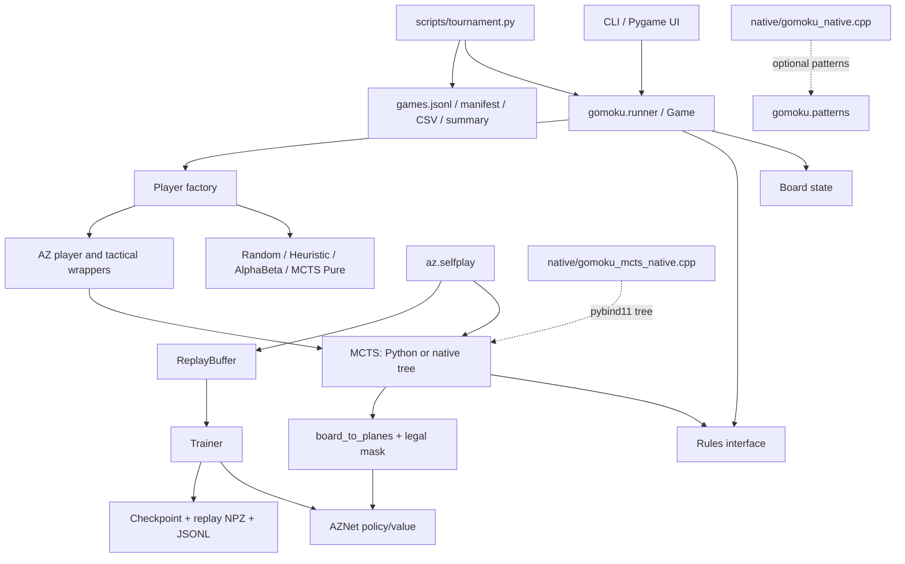

# SPEC: Gomoku AlphaZero 11×11

> **Trạng thái tài liệu:** baseline kỹ thuật và đặc tả mục tiêu nghiên cứu, tổng hợp từ source, tests, configs và báo cáo hiện có. Không thay thế bằng chứng runtime của từng thay đổi mới.
>
> **Nhãn bằng chứng:** **Verified** = hành vi thấy rõ trong source và được test/report có liên quan xác nhận; **Implemented / Unverified** = có implementation nhưng mức kiểm chứng chưa đủ cho kết luận; **Planned** = mục tiêu/thiết kế chưa hiện diện; **Unknown** = chưa đủ dữ liệu để xác định. Các test status dưới đây là kết quả đã ghi trong tài liệu/reports của repo, không phải test chạy trong lần soạn SPEC này.

## Mục lục

1. [Mục tiêu và câu hỏi nghiên cứu](#1-mục-tiêu-và-câu-hỏi-nghiên-cứu)
2. [Phạm vi, yêu cầu và tiêu chí thành công](#2-phạm-vi-yêu-cầu-và-tiêu-chí-thành-công)
3. [Tech stack, cấu trúc và code style](#3-tech-stack-cấu-trúc-và-code-style)
4. [Kiến trúc và execution paths hiện tại](#4-kiến-trúc-và-execution-paths-hiện-tại)
5. [Hợp đồng game engine và luật](#5-hợp-đồng-game-engine-và-luật)
6. [Policy-value network](#6-policy-value-network)
7. [MCTS / PUCT](#7-mcts--puct)
8. [Self-play, replay và training](#8-self-play-replay-và-training)
9. [Python/C++ dual backend](#9-pythonc-dual-backend)
10. [Tournament, Elo và đánh giá sức chơi](#10-tournament-elo-và-đánh-giá-sức-chơi)
11. [Performance và benchmark](#11-performance-và-benchmark)
12. [Reproducibility và persistence](#12-reproducibility-và-persistence)
13. [CLI, UI và commands](#13-cli-ui-và-commands)
14. [Testing strategy và traceability](#14-testing-strategy-và-traceability)
15. [Code style](#15-code-style)
16. [Boundaries](#16-boundaries)
17. [Current state, gaps và roadmap](#17-current-state-gaps-và-roadmap)
18. [Open questions và giới hạn bằng chứng](#18-open-questions-và-giới-hạn-bằng-chứng)

## 1. Mục tiêu và câu hỏi nghiên cứu

### 1.1 Đối tượng và problem

Hệ thống phục vụ AI coding agents, người bảo trì/nghiên cứu và giảng viên. Bài toán là xây dựng agent Gomoku trên bàn 11×11, học policy và value bằng self-play kiểu AlphaZero, rồi đánh giá sức chơi bằng đối kháng có kiểm soát. Đây vừa là phần mềm chơi game, vừa là nền tảng thí nghiệm; một pipeline chạy xong hoặc loss giảm không đồng nghĩa chơi tốt hơn.

### 1.2 Research questions

- **RQ1:** Với cùng luật, checkpoint, ngân sách tìm kiếm, opening và phân bố màu, checkpoint AlphaZero có score/rating cao hơn Heuristic hay không?
- **RQ2:** Các mốc số ván self-play và optimizer steps ảnh hưởng thế nào đến playing strength, không chỉ loss?
- **RQ3:** Native C++ có tăng throughput trên workload đại diện mà vẫn giữ semantics, dữ liệu huấn luyện và playing strength trong sai số định trước không?
- **RQ4:** Normal và Renju tạo ra khác biệt gì khi so sánh trong rating pool và protocol riêng?

### 1.3 Mục tiêu và giới hạn

**Research objective, chưa đạt:** AlphaZero thắng Heuristic với bằng chứng đủ tin cậy trong một rating pool/protocol chung. **Scale objective:** hỗ trợ nghiên cứu 5.000–10.000+ ván. **Optimization objective:** tăng tốc không đánh đổi correctness hoặc data/quality. Số ván và speedup chỉ là operational metrics, không phải chỉ số chất lượng mô hình.

Phạm vi hiện tại là board 11×11, Normal và Renju như code mô tả; không tuyên bố tương đương đầy đủ luật Renju quốc tế. Không có chứng cứ rằng mọi mục tiêu hiệu năng, GPU soak dài hạn, parity thống kê hoặc Elo đã đạt.

## 2. Phạm vi, yêu cầu và tiêu chí thành công

Trạng thái của yêu cầu được đánh dấu theo phần đầu tài liệu. Ưu tiên: P0 correctness/data integrity; P1 reproducible evaluation và backend parity; P2 scale/performance.

| ID | Yêu cầu / nghiệm thu | Hiện trạng |
|---|---|---|
| RQ-GAME-01 | Board 11×11, lượt luân phiên, nước hợp lệ và terminal state thống nhất qua `Rules` API | Verified: `gomoku/board.py`, `gomoku/rules/`; unit tests tồn tại |
| RQ-RULE-02 | Normal: ≥5 liên tiếp theo 4 hướng thắng; bàn đầy không thắng là hòa | Verified trong implementation/tests |
| RQ-RULE-03 | Renju: Black exact-five thắng và được ưu tiên hơn forbidden checks; overline, double-four, double-three bị cấm; White ≥5 thắng | Implemented; tests Renju có, nhưng chuẩn luật quốc tế/edge coverage chưa được chứng minh đầy đủ |
| RQ-AZ-01 | Policy/value input/output shapes, value perspective và checkpoint contract đúng | Verified qua source; tests `test_model.py` |
| RQ-MCTS-01 | Terminal không gọi network; legal masking không expand nước cấm; value backup đổi dấu mỗi ply; win-in-1 test | Verified qua source và `test_mcts.py` |
| RQ-SELFPLAY-01 | Mỗi trạng thái trước nước đi tạo đúng một mẫu; `z` là kết quả cuối ván theo player-to-move; buffer tách luật | Verified qua source và `test_selfplay.py` / `test_replay_buffer.py` |
| RQ-TRAIN-01 | Resume khôi phục model, optimizer, iteration/global step và buffer khi có; log từng iteration | Implemented; report ghi CPU/GPU smoke, nhưng resume schedule phụ thuộc config/horizon |
| RQ-NATIVE-01 | C++ MCTS giữ hành vi Python theo các differential criteria và không fallback âm thầm | Differential tests có; trạng thái experimental, cần mở rộng trajectory/quality gates |
| RQ-EVAL-01 | Tournament cân bằng màu, ghi kết quả/provenance, không ghi đè output cũ; Elo có uncertainty | Tournament hiện có; Elo **Planned**, chưa tìm thấy implementation |
| RQ-QUALITY-01 | Kết luận AZ > Heuristic chỉ khi protocol matched, log đầy đủ và uncertainty loại trừ tie theo tiêu chí đã định trước | Chưa đạt: báo cáo T35 ghi Heuristic thắng 100/100 AZ v0, threat và AZ Renju trong các pool được khảo sát |
| RQ-SCALE-01 | 5k/10k+ games có operational monitoring, quality checkpoints và điều kiện dừng | Config 5k có; 5k training không chứng minh quality hoặc soak safety |
| RQ-REPRO-01 | Có thể dựng lại run từ config/seed/code/checkpoint identity/environment/log; replayable tournament records | Tournament khá đầy đủ; training provenance còn thiếu model init seed/code hash và lịch sử checkpoint nguồn |

**Success criteria của nghiên cứu:** (1) luật và training target correctness qua tests; (2) tournament matched-condition với checkpoint SHA-256; (3) theo Elo v1.0, đạt mục tiêu khi `ΔElo > 0` và lower 95% CI `>0`, mục tiêu mạnh khi `ΔElo ≥ +100` và lower 95% CI `>0`; (4) kết quả lặp lại trên nhiều seed/opening và đổi màu; (5) claims C++ quality/parity tách khỏi throughput. Các ngưỡng và cỡ mẫu 100/400/600/800 là đề xuất protocol, chưa được xác nhận bằng pilot/power analysis; phải chốt/version trước nghiên cứu chính thức, không sửa sau khi thấy kết quả.

## 3. Tech stack, cấu trúc và code style

### 3.1 Stack hiện có

- Python với NumPy, PyTorch, PyYAML; pytest cho tests; pygame cho UI.
- Optional native extensions C++17 qua pybind11, compile bằng compiler được `scripts/build_gomoku_native.py` gọi. Trên Windows còn phụ thuộc Python ABI, linker/compiler và thư viện Python tương thích.
- `../requirements.txt` là requirements dùng chung nhiều lab, không pin phiên bản và ghi Python 3.12; các report Gomoku ghi môi trường thí nghiệm cụ thể Python 3.10.6 / torch 2.14.1+cu126. Đây là khác biệt môi trường cần xử lý khi tái lập, không nên suy ra môi trường chuẩn duy nhất.

### 3.2 Cấu trúc thực tế (file tiêu biểu)

```text
gomoku/       Board, rules, game/runner, features, patterns
az/           Model, MCTS, self-play, replay, trainer, evaluator/logging
players/      Random, human, heuristic, alpha-beta, pure MCTS, AZ wrappers
native/       C++ patterns và C++ MCTS tree
scripts/      train, play, arena, tournament, benchmark, native build
configs/      Normal, Renju, 5k training YAML
tests/        Unit, integration, CLI, backend differential tests
ui/           Pygame interface
docs/         Reports, performance studies, tournament/repro guides
logs/, checkpoints/  Runtime artifacts; ignore khỏi source control theo quy ước
```

Một số README mô tả cấu trúc dự kiến; SPEC ưu tiên file/code thực có trong working tree. Entry points đã xác nhận: `scripts/play.py`, `scripts/train.py`, `scripts/arena.py`, `scripts/tournament.py`, `python -m ui.pygame_app`; native build: `scripts/build_gomoku_native.py`.

## 4. Kiến trúc và execution paths hiện tại



### 4.1 Responsibilities and data flow

1. `Board` owns flat `int8` 121-cell grid, current player, move history; `play/undo/copy` không phụ thuộc luật.
2. `Rules` cung cấp `legal_moves`, `forbidden_moves`, `is_win`, `is_terminal`. Players và UI dùng interface này.
3. `board_to_planes` tạo `(4,11,11)` `uint8`, model trả `(B,121)` policy probabilities và `(B,)` value. MCTS nhận policy/value leaf request, mask policy priors bằng legal moves rồi mở child nodes.
4. AZ player thực hiện MCTS, lấy move theo visit distribution/temperature. Self-play giữ `(planes, pi, player)` trước nước thật và gán `z` sau terminal.
5. ReplayBuffer lưu dữ liệu compact, augmentation theo đối xứng lúc sample; Trainer tối ưu model, checkpoint và buffer; script ghi JSONL.
6. Tournament dùng player factory, chạy paired color-swapped games, ghi từng game và aggregate. Hiện aggregate score/WDL/matrix chứ chưa ước lượng Elo.

**Dependency boundaries:** `gomoku/` không phụ thuộc `torch`; rules không nằm trong players/MCTS; board không ra quyết định luật. Native MCTS chỉ sở hữu tree/search mechanics; Python giữ Board, Rules, RNG, feature generation và model inference. Native Patterns tăng tốc `find_patterns`, được tiêu thụ bởi heuristic/tactical pattern consumers; AZ v0 self-play không gọi patterns.

## 5. Hợp đồng game engine và luật

### 5.1 Board contract

`SIZE=11`, `EMPTY=0`, `BLACK=1`, `WHITE=2`; flat action `a=11r+c`; initial side Black. `play(r,c)` từ chối tọa độ ngoài bàn/ô chiếm, ghi history rồi đổi player; không tự kiểm tra legality theo rules. `undo()` khôi phục ô cuối và current player. Caller phải kiểm tra luật trước `play`.

### 5.2 Luật được xác minh

| Điều kiện | Normal | Renju |
|---|---|---|
| Black line | ≥5 thắng | đúng 5 thắng; overline không thắng và nước tạo overline bị cấm |
| White line | ≥5 thắng | ≥5 thắng |
| Black forbidden | không có | double-three, double-four, overline; exact-five exception |
| Draw | không còn ô trống và không thắng | không còn legal move và không thắng |
| Forbidden mask | rỗng | chỉ xét lượt Black; White trả mask rỗng |

Renju code xét exact-five trước các điều kiện forbidden khác. Candidate scan chỉ xét ô trong phạm vi 4 bước theo bốn hướng từ Black stone; open-three dựa trên extension tạo open-four và đệ quy kiểm tra hợp lệ. Cache dùng board bytes/current player. Đây là semantics code; không chứng minh toàn bộ quy tắc quốc tế về precedence, định nghĩa pattern phức tạp, foul/game adjudication hoặc tình huống bàn đã có trạng thái thắng.

### 5.3 Acceptance / edge cases

- `AC-RULE-01`: thắng horizontal, vertical, hai diagonal, cắt biên, exact 5 và overline theo ruleset.
- `AC-RULE-02`: full board không line thắng => terminal draw; Renju không còn legal move do forbidden cells => terminal.
- `AC-RULE-03`: occupied/out-of-range move bị từ chối; undo rỗng bị từ chối; play/undo round-trip giữ grid/player/history.
- `AC-RULE-04`: Renju Black exact five vẫn legal kể cả đồng thời hình thành forbidden threats; Black overline/3-3/4-4 fixture bị loại; White không bị mask.
- `AC-RULE-05`: mỗi consumer chỉ gọi Rules API; không tạo luật thứ hai ngoài Rules.

Test locations: `tests/test_board.py`, `test_rules_normal.py`, `test_rules_renju.py`, `test_renju_integration.py`, `test_runner.py`. Còn cần differential/reference fixtures hoặc expert review cho biên Renju mà hiện tests không bao phủ.

## 6. Policy-value network

### 6.1 Input/output và kiến trúc

State input `(B,4,11,11)`; channels: own stones, opponent stones, forbidden squares, player color (all ones for Black, zeros for White). Không có last-move/history plane. Cùng bốn channels cho cả hai rulesets. Augmentation dùng 8 dihedral transforms với cùng transform cho feature và policy.

`AZNet(n_blocks=6,n_filters=64)`: stem conv 3×3, BN, ReLU; mỗi residual block hai conv 3×3 + BN + skip + ReLU. Policy head conv 1×1 (2 filters), BN/ReLU, flatten, FC→121 logits. Value head conv 1×1, BN/ReLU, flatten, FC→64→ReLU→1→tanh. `predict` nhận numpy batch, eval/no_grad, trả softmax probabilities float32 và values float32 thuộc `[-1,1]`, giá trị theo current player.

### 6.2 Training objective và defaults

Với logits `l`, policy target `π`, prediction value `v`, terminal target `z`:

$$L_\pi=-\frac1B\sum_i\sum_a\pi_{ia}\log\operatorname{softmax}(l_i)_a,\qquad L_v=\frac1B\sum_i(v_i-z_i)^2,$$
$$L=w_\pi L_\pi+w_vL_v.$$

Code dùng Adam, `learning_rate=1e-3`, `weight_decay=1e-4`, cosine schedule theo global step; `weight_decay` đi qua optimizer, không cộng khoản L2 explicit vào `_total_loss`. Defaults source/config: 6 blocks, 64 channels, `w_policy=w_value=1`, `n_iter=20`, `games_per_iter=50`, `train_steps_per_iter=200`, `batch_size=128`, `buffer_size=50000`, `eval_fixed_batch_size=512`. `configs/normal_5000.yaml` extends normal: 100 iterations × 50 games, 1000 train steps/iteration; đó là config, không phải kết quả.

Checkpoint `.pt` gồm `model_state_dict`, optional `optimizer_state_dict`, metadata `format_version=1`, architecture, rule_set/config/iteration fields. `load_checkpoint` map_location CPU/CUDA theo khả dụng. Backward compatibility có defaults cho thiếu metadata, nhưng không có schema migration versioning rộng.

**Rủi ro metric:** fixed eval batch là batch lấy từ cùng self-play stream, có thể có vị trí cùng ván/training overlap; sampler lấy có hoàn lại; buffer vòng có thể overwrite slot. Đây không phải independent generalization set hay strength metric.

## 7. MCTS / PUCT

### 7.1 Công thức và contract

Node lưu prior `P`, visit count `N`, value sum `W`; `Q=W/N` theo góc nhìn người chơi tại node. Với child `a`:

$$a^*=\arg\max_a\left[-Q(s_a)+c_{puct}P(s,a)\frac{\sqrt{\max(1,N(s))}}{1+N(s_a)}\right].$$

Mặc định `c_puct=1.5`. Ties trong tolerance `1e-9` chọn ngẫu nhiên qua RNG. Root noise chỉ khi bật:

$$P'(s,a)=(1-\epsilon)P(s,a)+\epsilon\eta_a,\quad\eta\sim Dirichlet(\alpha),$$

trên legal moves; defaults training `alpha=0.15`, `epsilon=0.25`. Priors bị mask bằng legal mask rồi normalize; nếu tổng hợp lệ ≤`1e-8`, dùng uniform legal priors. Terminal win ở state sau nước đi nhận `-1` cho player-to-move (đã thua); draw `0`; node terminal không gọi model. Leaf NN value backup đổi dấu mỗi cạnh. Forbidden moves bị xóa khỏi legal mask và không được mở rộng.

### 7.2 Pseudocode tương ứng

```text
reset(root_state)
while simulations_done < budget:
    node = root; path = []
    while node.expanded and not node.terminal:
        child = argmax(-child.Q + c_puct * child.P * sqrt(max(1,node.N))/(1+child.N))
        play(child.move); path.append((node, child)); node = child
    if terminal(node.state):
        backup(result_from_side_to_move(node))  # alternate sign per edge
    else:
        planes = encode(state); legal = rules.legal_moves(state) - forbidden
        policy, value = evaluator(planes)
        prior = normalize(policy masked to legal; uniform legal if zero mass)
        if node is root and root_noise: mix Dirichlet over legal priors
        expand(node, legal, prior); backup(value, alternating_sign)
    undo(path)
return root child visits
```

Implementation uses request/receive API (`az/mcts.py`); self-play interleaves requests from multiple games into inference batch. Root tree resets per actual move; no subtree reuse in `run_games`. Temperature is separate from target temperature: action probability `N^(1/τ)`; `τ=0` chooses max visit (random tie). Self-play uses action temperature 1 for first `temp_moves=15`, thereafter 0; `pi_target_temp=1` independently shapes normalized visit target. Exact default target/action mechanics in `az/selfplay.py`.

### 7.3 Invariants / corner cases / tests

- Pending request must be received before another request; reset before search.
- Every accepted policy/value has valid shape/domain at consumer contract; value finite in `[-1,1]`.
- No legal move => draw/terminal; zero visit counts cannot choose action.
- Terminal branches count a simulation but no NN call; first simulation can expand root without incrementing any child visits, so root child visit sum need not equal budget.
- Root-only noise; no noise for tournament by default.
- For Renju, forbidden move masking must agree with same Rules implementation at every leaf.
- Tests: win-in-1, backup sign, terminal call counts, forbidden mask, root noise scope, temperature zero, exhausted budget in `tests/test_mcts.py`; parity/terminal/RNG/noise coverage in `tests/test_native_mcts.py`.

**Research correctness caveat:** unit fixtures prove these cases, not all board states. Add fuzz/differential states and property invariants before claiming universal parity.

## 8. Self-play, replay và training

### 8.1 Contracts / pipeline

1. `scripts/train.py` loads YAML merged over `DEFAULT_CONFIG`; initializes or resumes Trainer and ReplayBuffer.
2. `run_games` creates game-local Board/MCTS/sample list and interleaves up to `parallel_games`; optionally worker process chunks are generated by `run_games_parallel`, returned samples are stored by parent. `parallel_games` is active game concurrency for batching; `--workers` is process parallelism.
3. For every pre-move state, store features, visit-based `pi`, and player identity. End game: `z=+1/-1/0` from stored player’s final outcome; one sample per actual move; no separate terminal-state sample.
4. ReplayBuffer fixed-capacity ring: features `uint8`, pi `float16`, z `float32`, rule ID; overwrite oldest when full. Enforces one rule_set per buffer. Each sampled item gets one of 8 rotations/reflections applied to planes and policy together; `z` unchanged.
5. Trainer samples mini-batches with replacement, optimizes weighted policy CE + value MSE; logs loss components, distinct sample count, throughput and fixed-batch loss.
6. Save `last.pt`, optional `buffer_last.npz`; per-run `train_*.jsonl`, paired `games_*.jsonl`. `--resume` restores checkpoint and buffer if present; missing buffer warns and resumes empty.

### 8.2 Reproducibility and recovery contract

Training driver seed default 0; current code seeds game/self-play paths, but reports note missing record of network initialization seed and source code hash in historical training logs. Seed deterministic across one path is not equivalent to full bitwise reproducibility across Python/NumPy/PyTorch, CUDA, process scheduling or backend RNGs. Resume must use matching ruleset/model architecture and intentionally fixed config horizon; changing `n_iter` changes cosine schedule horizon. Existing `Trainer.from_pretrained` for Normal→Renju transfers weights and initializes fresh optimizer/training state with fresh Renju buffer.

Required future run record: immutable run ID; git commit + dirty diff/hash; config snapshot after CLI overrides; ruleset; initial/final checkpoint SHA-256 and parent checkpoint; seed scheme for initialization/game/worker/MCTS; Python/OS/hardware, NumPy/PyTorch/CUDA/compiler/native ABI; exact command; counts of games/samples/optimizer steps; worker/backend settings; logs and exit status. Do not treat fixed-batch loss or sample volume as strength.

### 8.3 Failure handling and acceptance

- Interrupted iteration must not silently lose evidence; checkpoint/resume boundaries recorded; artifact writes should be atomic where feasible (current source save behavior needs separate audit before requiring atomicity).
- Assert `samples == moves`, pi finite/nonnegative/sums to 1, pi mass only on legal actions, z ∈ {−1,0,+1}; ensure per-game IDs unique and one ruleset per buffer.
- Verify resume optimizer/global_step/iteration/buffer and schedule values against same config; test missing/corrupt/mismatched artifacts explicitly.
- Quality gate per checkpoint: fixed-protocol mini-arena against frozen baselines; do not promote on loss or game count alone. Existing `arena_win_threshold=0.55` appears in config, but this threshold is not an Elo gate and must not be read as completed quality evidence.

## 9. Python/C++ dual backend

### 9.1 Implemented boundary

**Verified implementation presence:** `native/gomoku_mcts_native.cpp` is a C++17 pybind11 arena-backed search tree (node indices, PUCT selection, expansion, backup, terminal values, visits). Python `NativeMCTS` owns board/rules/RNG/features/network inference and passes legal move/prior/value arrays across binding. `native/gomoku_native.cpp` implements pattern detection `find_patterns`; `gomoku/patterns.py` selects it. `az/backend.py` resolves overall preset `--backend python|cpp` plus independent MCTS/Patterns overrides; unavailable selected extension fails closed, no silent fallback. Python remains default.

`gomoku_native` is not a native game/rules/board engine; no C++ neural network, training or complete self-play engine is evidenced. Native patterns and MCTS are distinct components; standard AZ self-play marks Patterns `not_used`.

### 9.2 Parity levels and acceptance design

Never require bitwise equality across RNG implementations or floating point unless deterministic contract makes it possible. Compare by level:

1. **Exact:** same state → same legal moves, forbidden mask, terminal/win result, game result, moves/sample count when trajectory is intentionally fixed.
2. **Numerical tolerance:** same fixed model output and deterministic tie handling → same request planes/legal mask, visit counts and simulation count; root/value outputs `abs(delta)≤ε` declared by test. Existing parity tests compare masks/requests/visits/root value on fixtures.
3. **Statistical:** across paired seeds/openings, compare move/visit distributions, game outcomes/score and training-target distributions with pre-registered confidence intervals/effect tolerance.
4. **Performance:** identical compiled extension/Python ABI, checkpoint hash, rules, search budget, hardware/load, warm-up and workload; report repeated median/tail and memory.

Add tests for Python-vs-C++ exact legal/terminal/forbidden masks across generated fixtures, fixed evaluator parity, full self-play paired per-sample features/pi/z plus winner/end reason across multiple seeds, resume and worker spawn. Compare policies/values with explicit tolerances; test ties separately. For a backend optimization: correctness first, training-target/data-distribution regression second, controlled arena quality third, speedup last. If stochastic outcome equivalence is not established, keep backend experimental even if faster.

### 9.3 Current evidence and limits

Reports document native differential tests, CPU full suite, multiprocessing self-play, checkpoint/resume and tournament smoke. `docs/performance/12-5000-games-readiness.md` later documents a small GPU train/resume smoke (2 iterations, 30 optimizer steps total) and a four-game paired self-play comparison with exact matching samples for that seed. This is stronger than earlier GPU failure report, but not long-run stability or broad stochastic/quality parity. Reports document C++ MCTS no material speedup in small depth-1 tournament, while an optimized self-play workload records improvement; do not blend those workloads into one speedup claim. No sanitizer or long RSS soak is evidenced. Build output is CPython ABI-specific `.pyd`/`.so`; compiler, headers, OS and ABI must match.

## 10. Tournament, Elo và đánh giá sức chơi

### 10.1 Tournament hiện có

`scripts/tournament.py` schedules round-robin pairs; requires even games ≥2 and alternates colors. Paired games share opening and per-side seeds; optional random opening. Budgets can be `sims:N` or `time:S`; they are not cross-agent equivalent (AlphaBeta depth differs from MCTS simulations; time deadlines are soft). Tournament supports Normal/Renju separately, agents random/heuristic/alphabeta/mcts-pure/AZ variants, checkpoint mapping, workers, resume and shard merge. It preflights agents, hashes checkpoints before/after, writes `config.json`, `games.jsonl`, `matrix.csv`, `pairs.csv`, `summary.json`; output dir must be empty unless valid resume. Logs include selected backend/components, seeds, settings, checkpoint hash, environment, colors, moves and telemetry.

Current primary aggregate is score `(W + 0.5D)/N`, WDL, paired/color splits and Wilson interval on score. Wilson interval with draws-as-half is an approximation, not exact multinomial uncertainty and does not account for dependence/multiple comparisons. Do not interpret interval covering .5 as proof equivalence. Seed-paired tests should be analyzed with paired methods or model-level uncertainty where appropriate.

### 10.2 Elo Evaluation Protocol v1.0 (Planned)

Không có Elo engine/leaderboard trong `scripts/tournament.py`, `az/evaluator.py` hoặc test suite được khảo sát. Quy định dưới đây là protocol nghiên cứu đề xuất, chưa được triển khai/chạy; trước tournament chính thức phải khóa phiên bản protocol, xác nhận script/log đủ trường và kiểm tra tính phù hợp sample-size trên dữ liệu pilot.

**Rating pools và định danh.** Normal và Renju là hai pool độc lập, không so Elo chéo luật. Trong mỗi pool, `Heuristic` là anchor cố định `R=1200`; các model khác cùng protocol ước lượng relative rating trên cùng graph đối thủ. `model_id` bất biến gồm ruleset + checkpoint SHA-256 (hoặc code/config identity với agent không có checkpoint) + agent/search config; backend/compiler/extension version thuộc `execution_id` và được log như factor, không làm một checkpoint thành model khác. Cùng checkpoint AZ Python/C++ mặc định cùng model rating; chỉ tách thành paired backend contrast khi nghiên cứu parity. Nếu model graph không nối được tới anchor thì không báo rating tuyệt đối.

**Ước lượng chính: Bradley–Terry.** Với skill `θ_i` theo log-odds và game i-vs-j, `P(i beats j)=σ(θ_i−θ_j)`; đổi sang Elo bằng `R_i=1200+(400/ln 10)(θ_i−θ_Heuristic)` để heuristic neo 1200. Mô hình chính phải xử lý hòa bằng Davidson extension của Bradley–Terry (tie parameter, draws recorded as draws), và điều chỉnh màu nếu pilot cho thấy hiệu ứng màu; báo cả mô hình/identifiability/fit checks. Không loại hòa hoặc mã hóa thành thắng/thua. Bootstrap 95% CI resample **opening pair cluster** (hai game dùng cùng opening/seed, đổi màu), giữ hai ván đi cùng nhau; dùng cùng bootstrap draws để có CI cho `ΔElo = Elo_AZ − 1200`. Nếu mẫu cluster ít, fit lỗi hoặc CI không ổn định: kết quả `Unknown/inconclusive`, không ép ra rating.

**Leaderboard tham khảo (không phải suy luận chính).** Sequential Elo dùng logistic expected score `E_A=1/(1+10^((R_B-R_A)/400))`, `R'_A=R_A+16(S_A-E_A)`, `S_A=1/0.5/0` cho W/D/L; cập nhật đối thủ theo `S_B=1-S_A`. Heuristic giữ cố định ở 1200 làm anchor; trong trận hai model không-anchor, update cả hai theo kết quả đối xứng. Giữ lịch sử theo trận và thứ tự deterministic. Đây chỉ là leaderboard operational vì phụ thuộc thứ tự trận/K và draws; không thay BT estimate/CI. Tests kiểm tra expected score, K=16, anchor bất biến, side-swap invariance, và zero-sum change khi cả hai rating được cập nhật.

**Protocol thi đấu.** Đánh giá Normal/Renju riêng; fixed checkpoint hash, rule/config snapshot, seed derivation, openings và protocol version. Heuristic baseline version/config đóng băng ở rating 1200. AZ: 200 MCTS simulations/move, action temperature `0` (chọn max visits, tie-break RNG theo seed), Dirichlet/root exploration noise tắt. Không dùng softmax exploration trong evaluation. Tournament đổi màu trên từng opening: 2 games/opening pair; cùng opening và paired seed, chỉ đổi ai cầm Black. Đối thủ có cùng thuật toán nhận đúng budget tương ứng; mọi baseline không cùng đơn vị search phải ghi rõ budget/latency và không diễn giải như compute-equivalent. Freeze environment/backend identity; log seed, opening, ruleset, checkpoint/config SHA-256, MCTS sims, temperature/noise, player colors, result/end reason, move count, latency/search telemetry. Fail-fast nếu manifest thiếu/mismatch hoặc checkpoint đổi trong run.

**Cỡ mẫu và mở rộng định trước.** Screening: 100 games/pair = 50 paired openings, chỉ quyết định có tiếp tục/kiểm tra lỗi dữ liệu, không tuyên bố đạt mục tiêu. Main: 400 games/pair = 200 paired openings. Trước chạy phải đăng ký danh sách opening/seeds, model comparisons và bootstrap seed. Sau 400, nếu CI 95% của ΔElo chứa 0 hoặc precision chưa đạt, thêm tranche cố định 200 games (100 paired openings), tối đa 800 games/pair; phân tích ở mốc định trước, không xem CI liên tục để dừng tùy ý. Nếu đến 800 vẫn chưa phân định thì báo inconclusive. Nếu CI đã tách 0 tại mốc main, không cần mở rộng trừ khi độ chính xác yêu cầu đã đăng ký chưa đạt. Mốc sample-size là protocol đề xuất, chưa có power analysis cho dự án; chạy pilot 100 trước và kiểm tra CI bootstrap/cluster variance, sau đó chốt hoặc version protocol mới trước main study.

**Báo cáo và quyết định.** Mỗi so sánh trình bày BT Elo, `ΔElo`, 95% paired-cluster bootstrap CI, games, W/D/L, score `(W+0.5D)/N`, màu/opening strata, illegal/forfeit/draw breakdown, latency/search and resource counters, model IDs, protocol and log hash. “Đạt mục tiêu”: `ΔElo > 0` và cận dưới CI 95% `>0`. “Mục tiêu mạnh”: `ΔElo ≥ +100` và cận dưới CI 95% `>0`. Đạt một tiêu chí không khẳng định tổng quát ngoài pool/opponents/protocol đã đo. Với heuristic 1200, chiến thắng/thua tuyệt đối ở từng trận vẫn được ghi W/L và ảnh hưởng đúng vào BT/leaderboard; trận illegal move/forfeit là loss cho bên vi phạm, không loại khỏi mẫu; hòa là draw trong likelihood và 0.5 score/Elo. Không hoàn tất/aborted game không là W/D/L; phải resume cùng identity hoặc loại theo rule đã đăng ký và báo số loại.

**Log schema tối thiểu / acceptance.** Mỗi game cần `protocol_id`, `ruleset`, `game_id`, `pair_id/opening_id`, `seed/opening`, `model_a_id/model_b_id`, checkpoint/config SHA-256, backend/compiler/extension version trong `execution_id`, `black_model/white_model`, MCTS budget, temperature/noise, `winner` (Black/White/draw), `end_reason`, illegal/forfeit actor, moves, runtime/search telemetry. Rating artifact phải có BT/Davidson fit version, anchor, parameter/K settings, bootstrap seed/cluster count, CI, exclusions, input-log SHA-256 và sequential leaderboard trail. `AT-ELO-01`: expected-score, K=16 update cho win/draw/loss, anchor cố định 1200 và zero-sum chỉ khi hai non-anchor ratings cùng được cập nhật. `AT-ELO-02`: deterministic replay logs tái tạo W/D/L, score, paired clusters và sequential ratings. `AT-ELO-03`: toy synthetic symmetric pool ước lượng quanh anchor; mạnh hơn/yếu hơn fixtures cho đúng thứ tự; draw-only/one-sided/unconnected pools trả warning/inconclusive, không rating bịa. `AT-ELO-04`: bootstrap resample cặp opening, giữ đổi màu, trả CI hữu hạn và tái lập seed. `AT-ELO-05`: hash/config/ruleset mismatch, duplicate/missing game IDs và illegal outcomes bị phát hiện; Normal/Renju không gộp. `AT-ELO-06`: screening 100, main 400, staged extension 600/800 và stopping rule được test bằng pure scheduling/decision logic, không chạy tournament tốn kém trong unit tests.

Leaderboard dưới đây là schema, không phải kết quả:

| Model | Rules | Elo ± 95% CI | ΔElo vs Heuristic | Games | W/D/L | Score | Mean/p95 ms/move |
|---|---|---:|---:|---:|---:|---:|---:|
| AlphaZero checkpoint | Normal | TBD | TBD | TBD | TBD | TBD | TBD |
| Heuristic (anchor) | Normal | 1200 | 0 | TBD | TBD | TBD | TBD |
| Alpha-Beta | Normal | TBD | TBD | TBD | TBD | TBD | TBD |
| Random | Normal | TBD | TBD | TBD | TBD | TBD | TBD |

Vẽ learning curve với X là số self-play games (cùng definition ở mọi run), Y là BT Elo; show CI/error bars, AZ−Heuristic ΔElo, checkpoint hash và protocol ID. Dựng panel riêng cho Normal/Renju; không nối rating khác protocol như cùng một chuỗi.


### 10.3 Existing strength evidence

`docs/report.md` T35 records 2,400 completed games across separate Normal fixed, Renju fixed, and Normal time-budget groups. In its fixed Normal pool, Heuristic beat AZ v0 and AZ threat each 100–0; Renju Heuristic beat AZ Renju 100–0. The time-budget AZ threat vs AlphaBeta result does not compare against Heuristic and is a different protocol. These are evidence for the sampled runs, not Elo, not proof about every checkpoint/config, and not evidence that AZ met its objective. Historical initial report also records 1,000 Normal self-play games and 500 Renju fine-tune games; run losses do not prove playing strength. 5,000-game config is not a completed 5,000-game training result.

### 10.4 Kế hoạch chẩn đoán khi AlphaZero thua Heuristic (Planned)

Chạy theo thứ tự, giữ nguyên ruleset/checkpoint/protocol và lưu artifacts; mỗi bước phân biệt lỗi thực thi với giới hạn chất lượng:

1. **Tái lập baseline:** replay các match IDs từ raw logs, đối chiếu checkpoint/config/rules hashes, màu, illegal/forfeit và seed. Nếu không khớp hoặc run cũ thiếu provenance, xem T35 là bằng chứng lịch sử chứ không dùng làm baseline định lượng mới.
2. **Search correctness:** trên fixture tactic (win-in-1, block-in-1, fork, forced loss, Renju forbidden), kiểm tra legal mask, prior sau mask, visit counts, root value/sign, terminal handling, temperature=0 choice và repeatability. Cùng fixed evaluator so Python/native; không thay model để debug MCTS.
3. **Policy/value và targets:** audit các trạng thái self-play đã log: `pi` finite, normalized, legal-only; tính entropy/top-k/agreement với selected move; so target visit distribution với model policy; đối chiếu `z` theo player-to-move và outcome. Đánh giá value calibration/Brier/MSE theo game outcome trên held-out games/positions tách theo game/seed, không dùng fixed training batch làm test.
4. **Tactical error taxonomy:** từ loss games phân loại bỏ lỡ thắng ngay, không chặn thắng, bỏ fork/forced defense, Renju legality, endgame/draw. Replay position với legal-move listing; so MCTS candidate ranking/visits, network prior/value và Heuristic response. Tactical override/threat-space là ablation riêng; không gán hiệu quả cho base network.
5. **Search budget:** cùng checkpoint, same positions/openings/seeds và no noise, so 50/100/200/400 simulations; ghi Elo/score, move latency, tactical error rates. Tách “search thêm làm mạnh hơn” khỏi “training checkpoint mạnh hơn”; giữ 200 là official v1 comparison budget.
6. **Checkpoint/training diagnosis:** theo từng checkpoint đo matched Elo, independent outcome/value/policy metrics, replay age/diversity, target entropy, game length/WDL by color, optimizer/global steps/config/hash. Kiểm tra overfit, collapse, data leakage, checkpoint mismatch; loss reduction không phải promotion criterion.

Acceptance `AC-DIAG-01`: mỗi diagnosis có immutable position/game IDs, checkpoint hash, rules/config, hypothesis, metric and pass/fail evidence. `AC-DIAG-02`: search fix chỉ được chấp nhận khi invariant tests qua và paired evaluation không có confirmed quality regression. `AC-DIAG-03`: kết luận nguyên nhân phải có canary/control isolating variable; nếu nhiều nguyên nhân cùng phù hợp dữ liệu thì ghi Unknown, không chọn giải thích hậu nghiệm.

### 10.5 Ablation study plan (Planned)

`scripts/ablation.py` hiện có ablations Alpha-Beta pruning và MCTS Pure rollout budgets; không có AZ Elo ablation framework. AZ studies phải dùng protocol v1.0, cùng frozen evaluation set, heuristic anchor, paired opening/color seeds, fixed checkpoint identity where applicable, no evaluation noise/temperature and same rules/config except biến nghiên cứu. Báo Elo/ΔElo+paired CI, W/D/L/score, compute/search telemetry, training data counts; register comparisons and multiplicity handling before running. Tách screening (pilot) khỏi confirmatory result.

| Factor | Screening levels (đề xuất) | Isolation / fairness rule |
|---|---|---|
| MCTS simulations | 50 / 100 / 200 / 400 | Thí nghiệm ngân sách riêng (`protocol_id` ablation); đo cùng checkpoint trước; sau đó riêng study về simulations lúc self-play generation. Không trộn Elo contrasts này với main v1.0 fixed-200 estimate |
| Network architecture | 3×32, 6×64 baseline, 9×96 | Match training data, optimizer steps, search budget; báo parameter count, peak memory/inference cost; không coi equal steps là equal FLOPs |
| Self-play scale | 1k / 2.5k / 5k / 10k cumulative games | Cùng recipe/seed plan; checkpoints trên learning curve, same Elo protocol; xem games, distinct samples, optimizer steps và compute cùng nhau |
| Backend | Python vs C++ search, same checkpoint; backend self-play retraining separate | First exact/differential parity, then paired multi-seed targets/outcomes, then Elo non-regression; runtime speedup không là quality outcome |

Một run/seed không đủ cho kết luận nghiên cứu. Dùng paired training seeds; số seed cho confirmatory ablation phải được chọn từ variance/power pilot và đăng ký trước. Để giới hạn chi phí, dùng screening nhỏ để loại lỗi/large regressions, chỉ confirm các contrasts có ý nghĩa; không chạy full Cartesian product. Baseline v1 remains 6×64, 200 sims, configured defaults until a reviewed protocol version changes it.


Acceptance `AC-ABL-01`: manifest chứng minh chỉ factor mục tiêu đổi, các control giữ nguyên. `AC-ABL-02`: mỗi point có checkpoint hash và cùng evaluation protocol/model pool. `AC-ABL-03`: statistical comparison giữ paired openings/training seeds và điều chỉnh multiple comparisons hoặc ghi exploratory. `AC-ABL-04`: report Elo quality alongside compute; không chọn cấu hình theo throughput/loss đơn lẻ. `AC-ABL-05`: backend quality gate không kém control ngoài non-inferiority tolerance đăng ký trước; tolerance hiện Unknown, phải chốt sau pilot.

## 11. Performance và benchmark

Collect move latency mean/p50/p95/p99, MCTS sims/sec and NN leaf calls, games/min, training samples/optimizer steps/sec, wall-time decomposition, CPU/GPU utilization, peak RSS/VRAM, worker scaling and failure rate. Tag workload CPU/search-bound, inference/GPU-bound, process/IPC-bound, storage-bound; report both total run throughput and per-component counters. Node count is not comparable to simulations or neural evaluations.

Benchmark protocol: pin hardware/software/extension/checkpoint hash, rules, opening/state corpus, simulation/time budget, batch/workers/threads, warm-up, repetitions, system load and CUDA synchronization; randomize/interleave backend order; use same positions/seeds; report median and spread, not one run. Separate fixed-work search correctness/throughput from wall-clock policy quality. Any optimization changing scheduling, batching, tie-breaking or RNG must compare self-play distributions and controlled arena outcomes.

Historical numbers belong only to cited workload: `docs/benchmarks.md`, `docs/performance/`, `docs/bao-cao-dual-backend.md`. In particular 129.59 games/min estimate and 38.6 minute projected 5k self-play are linear extrapolation from 50-game benchmark, omit training/evaluation/checkpoint overhead, and do not constitute 5k soak. No figures in this section are asserted as current universal performance.

## 12. Reproducibility và persistence

- Config source: `config.py` defaults + `configs/*.yaml` + CLI overrides. Preserve fully resolved config with logs.
- Training persistence: `.pt` checkpoint and `.npz` replay buffer, JSONL per iteration/game; defaults under `checkpoints/`, `logs/`, ignored from Git.
- Tournament persistence: per-run `config.json`, `games.jsonl`, CSV matrices/pairs, `summary.json`; resume validates key protocol/checkpoint fields and retains completed records; shard merge validates expected game identity and does not rewrite source shards.
- Use content hash, not mutable basename `last.pt`, to identify a model. Store immutable source and parent hashes; do not overwrite evidence.
- Version the ruleset, evaluation protocol and backend implementation; archive dependencies and native build command. Capture actual `python --version`, `torch.__version__`, CUDA availability/device, OS, CPU, GPU, compiler and extension ABI.
- Re-run from a clean, documented environment and frozen config. Document stochastic reproducibility limits, CUDA nondeterminism and process RNG scheme; distinguish repeatability of exact game logs from statistical replication.

Proposed experiment manifest (format proposal; no code change in this spec): `schema_version`, `run_id`, `git_commit`, `dirty_tree_hash`, `command`, `resolved_config`, `ruleset/rules_version`, `seed_root/derivation`, `model_id/parent_hash`, `backend/components/extension_hash`, environment/hardware/compiler, worker/thread settings, game/sample/step counts, start/end/exit status, artifact paths+SHA-256, evaluation protocol ID, tournament raw-log hash and limitations.

### 12.1 Reproducibility and quality acceptance gates (Planned)

`RG-01 Run identity`: every training/evaluation run persists resolved config, code/dirty-tree identity, all seed streams/derivations, ruleset, environment, backend/ABI and artifact SHA-256; test by loading manifest and verifying every referenced artifact/hash. Missing identity makes result `Unknown`, not “approximately reproducible”.

`RG-02 Seed discipline`: use explicit independent seeds for model initialization, self-play game, worker, action/tie-breaking, opening and bootstrap; derive child seeds deterministically from `(root_seed, purpose, game/pair_id, color)` and persist mapping. Same code/environment/config/seed must reproduce deterministic setup and records where backend/device support deterministic operations; otherwise document exact nondeterministic fields and verify statistical replication.

`RG-03 Checkpoint integrity`: checkpoints immutable/content-addressed in experiment records; resume must match expected parent hash, ruleset, architecture and resolved config; train logs link each promoted checkpoint to parent and iteration/game count. Test mismatch/corruption rejection and round-trip hashes/metadata.

`RG-04 Python/C++ parity`: same rule state produces identical legal moves, terminal outcome and forbidden mask; same fixed evaluator/RNG/tie policy produces equal visits/simulations/root value within declared numeric tolerance; paired self-play compares features, `pi`, `z`, winner and end reason over pre-registered seeds. Any mismatch blocks native promotion until explained and fixed.

`RG-05 Quality regression`: each candidate checkpoint/backend is evaluated against frozen Heuristic and current champion under Elo v1.0. Promote as strength-improving only when paired 95% CI for ΔElo vs champion has lower bound >0; it meets research objective only when ΔElo vs Heuristic also has lower bound >0. CI crossing zero => inconclusive/retain champion, extend only via v1.0 rule; CI upper bound below 0 vs champion => confirmed regression, reject and investigate. For backend parity where practical non-inferiority margin is not yet known, mark tolerance `Unknown`, obtain pilot, pre-register margin before confirmatory run; speedup alone cannot pass this gate.

`RG-06 Quality-regression tests`: unit/integration gates cover rules, MCTS sign/masking/terminal, sample integrity, checkpoint/resume and tournament fairness; a frozen game/position tactical suite catches consumer-visible weakness; every accepted model change has paired matched-protocol Elo evidence. Store regression fixtures with provenance and do not tune against held-out confirmation positions.

`RG-07 Research reproducibility`: independent rerun from manifest reconstructs matchup schedule and all W/D/L from raw logs; rating/CI output reproduces exactly for the same deterministic analysis seed/version. CI may differ only when bootstrap/model code or inputs/version differ, which must be recorded. Report limitations and excluded games.

## 13. CLI, UI và commands

Commands below are source/README-documented interfaces, not executed during this audit. Run in `AlphaZero_Gomoku`; actual Python executable depends on active environment (README references `..\.venv`; native report used a project `.venv`, which itself is an environment discrepancy to resolve).

| Command | Purpose / relevant inputs | Outputs / constraints |
|---|---|---|
| `python scripts/play.py --mode ai-vs-ai --black-agent random --white-agent heuristic --ruleset normal` | CLI game; supports human-vs-AI/AI-vs-AI, Normal/Renju, seeds, agent depth/rollouts/checkpoints | Render result; agent args validated; soft time budget |
| `python -m ui.pygame_app --mode human-vs-ai --agent mcts-pure` | Pygame UI | Interactive; tests in `tests/test_ui.py`; runtime display not verified here |
| `python scripts/train.py --config configs/normal.yaml --seed 0` | Normal training; `--iterations`, `--games`, `--simulations`, `--workers`, backend, resume/output dirs | `.pt`, `.npz`, train/game JSONL; training driver currently rejects non-Normal rules, Renju fine-tune uses separate driver `az/renju_finetune.py` |
| `python scripts/arena.py --a heuristic --b az_v0 --games 100 --budget sims:200` | Two-player evaluation | WDL/summary game logs; not Elo |
| `python scripts/tournament.py --agents random,heuristic,alphabeta,az_v0 --rules normal --games 100 --budget sims:200 --seed 1` | Round robin; even `--games`; options for checkpoints, workers, random openings, pair/resume, backends and output | Run directory, raw JSONL, manifest/config, matrix/pairs CSV, summary; no Elo calculation |
| `python scripts/build_gomoku_native.py --module mcts --cxx g++` | Build native MCTS; also `--module patterns` | ABI-specific extension; build requires compatible compiler, Python headers and pybind11 headers (possibly sourced from PyTorch include) |
| `python -m pytest -q` | Test suite | Project-wide tests; exact environment required; no execution in this spec-writing audit |

Do not infer undocumented CLI support from README command examples alone; confirm flags in script parser. Native selection is explicit; unavailable extension fails with actionable error, not fallback.

## 14. Testing strategy và traceability

Tests use pytest in `tests/`. Run focused tests after implementation; full suite only at integration/release gate, with CPU/GPU/backend matrix where available. Latest performance/native reports document different snapshots/counts (e.g. 260/3 skipped and later 261/2 skipped); do not combine these into one current pass claim. This audit did not execute tests.

| Concern | Existing tests/evidence | Required extension / acceptance |
|---|---|---|
| Board, Normal, Renju | `test_board.py`, `test_rules_normal.py`, `test_rules_renju.py`, `test_renju_integration.py` | Add edge and differential/reference fixtures; Renju exact-five/overline/3-3/4-4 interactions |
| Feature/model contract | `test_features.py`, `test_model.py` | Tensor dimensions/dtype, symmetry feature-policy alignment, finite value/probability and checkpoint roundtrip |
| MCTS | `test_mcts.py` | win-in-1, sign, forbidden mask, terminal calls, root noise, visit policy, no-legal-moves, tie/temperature |
| Replay/self-play | `test_replay_buffer.py`, `test_selfplay.py` | legal-target support, policy sum, one sample per ply, z perspective, ruleset separation, reproducible worker IDs |
| Trainer/resume | `test_trainer.py`, reports | loss math, optimizer/scheduler restore under unchanged config, corrupt/missing buffer and checkpoint behavior |
| Tournament/fairness | `test_tournament.py`, `test_evaluator.py`, reports | color/opening pairing, seed derivation, immutable output/resume/shards, illegal moves, budgets and config/checkpoint hashes |
| Native parity | `test_native_mcts.py`, `test_native_patterns.py`, `test_backend.py` | generated-state exact masks/terminal, multi-seed output/target parity, explicit numerical tolerance, statistical quality gate |
| Elo v1.0 (planned) | No Elo code/tests found | `AT-ELO-01..06`: K=16 math, BT/Davidson fit, log replay, paired-opening bootstrap, protocol/data validation, staged sample decision |
| CLI/UI/classical | `test_play_cli.py`, `test_ui.py`, `test_alphabeta.py`, `test_mcts_pure.py`, `test_heuristic.py` | smoke actual runtime for changed path; headless UI environment limits documented |
| Performance | scripts/reports, benchmark tests | stable corpus and controlled repeated measurements; no speed acceptance without correctness/quality gates |

**Test invocation:** `python -m pytest -q` (full documented command); focused examples: `python -m pytest -q tests/test_rules_renju.py tests/test_mcts.py`, `python -m pytest -q tests/test_native_mcts.py tests/test_backend.py` after building extension. `CUDA_VISIBLE_DEVICES=-1` can force CPU for native report workflow; use platform-appropriate environment syntax on Windows. No performance gate should run expensive training/tournament without explicit authorization.

## 15. Code style

Follow existing modules: Python 3 type hints, `snake_case` functions/modules, `PascalCase` classes, constants uppercase; narrow responsibilities, NumPy arrays for board/tensors, torch confined to `az/`, rules passed by interface, dataclasses for records. C++ bindings expose narrow contracts and throw Python-visible exceptions on invalid shapes/indices. Tests assert user-visible semantics, not source text. Preserve existing function signatures/contracts unless all callers migrate.

```python
def board_to_planes(board, rules, player: int) -> np.ndarray:
    """Encode the position from the perspective of the player to move."""
    planes = np.zeros((N_PLANES, SIZE, SIZE), dtype=np.uint8)
    planes[0] = (board.grid == player).reshape(SIZE, SIZE)
    planes[1] = (board.grid == opponent).reshape(SIZE, SIZE)
    return planes
```

Style snippet illustrates current compact array-first convention; it omits actual forbidden/color planes for readability and is not replacement code.

## 16. Boundaries

- **Always:** check Graphify before source investigation per repository rules; inspect current worktree and keep user changes; source-over-stale-doc precedence; label verified vs unverified; preserve rule/interface/value-sign/data provenance contracts; use exact model/config/ruleset identities; report commands/tests actually run; keep `gomoku/` free of torch; isolate Normal/Renju replay buffers and evidence.
- **Ask first:** changes beyond this `SPEC.md`; rules interpretation not settled by code/official assignment; changes to training hyperparameters, dependencies, public APIs, checkpoint schema, rating protocol, or benchmark hardware/resource envelope; expensive training, tournament, soak, or artifact migration.
- **Never:** fabricate results or infer strength from loss/game count/speed; claim Python/C++ production parity from a smoke test; silently fallback from requested C++; mix rule sets in one buffer/pool; overwrite/delete checkpoints, logs, shards, or outputs; introduce hardcoded rule logic outside rules interface; commit credentials or generated training artifacts.

This task authorized exactly one document, `SPEC.md`; no source changes, training, tournament, or artifact mutation.

## 17. Current state, gaps và roadmap

### 17.1 Current state (evidence-backed)

- Board, Normal/Renju rules, feature encoding, AZNet, MCTS, replay/trainer/self-play and classical opponents exist in source; tests cover key game/search/training contracts.
- Tournament and raw telemetry/provenance pipeline exists, with color balancing, paired seeds/openings, resume/sharding protections, checkpoint hashing and separate rule selection.
- Optional native C++ MCTS and pattern extensions exist; Python is default; code explicitly fails closed on unsupported requested native backend.
- Reports document Normal training 1,000 games and Renju fine-tuning 500 games. Separate config targets 5,000 but is not proof it ran.
- Reported T35 sample: Heuristic 100/100 against AZ v0 and AZ threat in fixed Normal pairs, and 100/100 against AZ Renju in fixed Renju pair. Therefore primary objective is not met on these runs.
- Elo rating calculation/leaderboard is absent. Existing tables are WDL/score and Wilson intervals.

### 17.2 Gaps and research risks

1. Strength gap is immediate: sampled T35 matches show Heuristic dominance. Training more without diagnosing policy targets, openings, model/checkpoint provenance, MCTS budget and game trajectories may scale weak data rather than improve.
2. Elo is planned only; uncertainty from current score reports is limited and T35 pools/protocols differ. No direct Elo claims.
3. Renju semantics need authoritative rule adjudication for international parity beyond current fixtures.
4. Training metrics lack independent game/position holdout; historical logs omit sufficient environment/code/init-seed/parent-checkpoint provenance for bitwise reproduction.
5. Native parity evidence has advanced from initial reports, but broad multiseed/data/quality parity, sanitizer and long-duration soak remain unproven.
6. GPU short smoke and projected 5k throughput do not prove hours-long stability, 10k scaling, or improved playing strength.
7. Requirements mention Python 3.12 while reports use Python 3.10; shared unpinned requirements and environment locations conflict.

### 17.3 Target state and build order

| Order / module id | Target and acceptance | Dependencies |
|---|---|---|
| 1 `game-rules` | Canonicalize Normal/Renju behavior; edge/reference/differential tests and documented rule scope pass | — |
| 2 `ai-search` | Multi-state MCTS/network/self-play invariants; diagnose Heuristic loss with fixed test positions, tactical coverage and training-target audits | game-rules |
| 3 `native-parity` | Broad deterministic differential + multiseed trajectory/target parity; GPU/CPU integration and soak; only then promote backend | game-rules |
| 4 `selfplay-training` | Reliable recoverable runs, complete manifest, independent quality evaluation milestones at 0/500/1k/2.5k/5k/10k; explicit stop/continue rules | ai-search |
| 5 `evaluation` | Immutable protocol/match logs, Elo/Bradley–Terry estimate + uncertainty, frozen baselines, checkpoint learning curve; establish AZ vs Heuristic objective empirically | selfplay-training |
| 6 `reproducibility` | Clean-environment replay of published training/tournament run from manifest and verified artifacts | selfplay-training, evaluation |

Dependency order follows the approved capability map; `native-parity` and `selfplay-training` can proceed after their shared prerequisites without a dependency between them. Ordering is future work, not current implementation structure. Trustworthy logs remain a prerequisite for conclusions.

**Priority decision:** First diagnose and measure quality regression against Heuristic using exact historical protocols and fixed tactical test positions; do not launch 5k/10k run just because config exists. In parallel tighten Renju rule/test contract and training provenance. Then establish evaluation uncertainty, broaden backend parity, and scale self-play with staged resource/quality checkpoints. Optimization only after identifying bottleneck and passing parity/quality gates.

### 17.4 Training roadmap by quality gates (Planned)

Mốc là cumulative self-play games trong cùng một ruleset/run lineage, không acceptance tự thân. Đánh giá từng immutable checkpoint bằng Elo Protocol v1.0 (screening 100 games/pair khi cần, main 400, extension tối đa 800 theo rule), cùng Heuristic=1200, current champion, opponents/config/openings/seeds và AZ 200 sims, temperature 0, noise off. Historical Normal 1,000-game checkpoint là artifact cần re-identify/re-evaluate; Renju 500-game fine-tune là lineage khác, không gộp.

| Cumulative games | Checkpoint/evaluation gate | Quyết định chất lượng |
|---|---|---|
| 1,000 | Lưu hash/config/parent/seed; run 400-game main against heuristic and champion; inspect tactical/target diagnostics | Baseline, không promote chỉ vì đạt 1k |
| 2,500 | Same protocol and anchor pool; report ΔElo and paired 95% CI vs heuristic and prior champion | Promote only if CI lower >0 vs champion; confirmed regression (CI upper <0) blocks this recipe |
| 5,000 | Repeat full gate; resource/memory/worker health and replay diversity checks | Continue only if integrity holds and no confirmed quality regression; if inconclusive after 800 games/pair, pause for diagnosis |
| 10,000+ | Evaluate each planned checkpoint with same gate and log compute/data/strength curve | Continue past 10k only with evidence of useful Elo improvement or a pre-registered study that resolves an explicit uncertainty; no automatic scale-up |

**Stop/continue rule:** stop a recipe immediately on data/rule/checkpoint integrity failure or confirmed Elo regression against champion; investigate before spending more. Candidate whose CI overlaps zero is inconclusive, not a win or loss: extend evaluation only by pre-registered v1.0 tranche; if still unresolved at 800, pause the training progression and run diagnosis/ablation. Promote best checkpoint only with lower CI >0 vs incumbent; mark research objective achieved only with lower CI >0 vs Heuristic. A new stage may continue as exploratory training if no confirmed regression, provenance and resource gates pass, and the stage was authorized; report no quality gain unless Elo evidence passes. Loss, games completed and predicted throughput never trigger promotion/scale-up.

Acceptance `AC-TRAIN-MILESTONE-01`: every 1k/2.5k/5k/10k checkpoint has unique hash, cumulative game/optimizer counts, parent lineage and v1.0 Elo output or explicit Unknown. `AC-TRAIN-MILESTONE-02`: stop/continue/promote decision reproduces from pre-registered rule and result manifest. `AC-TRAIN-MILESTONE-03`: each published curve distinguishes self-play games, optimizer steps, Elo CI and hardware/compute; missing stage data is a gap, not interpolated result.

## 18. Open questions và giới hạn bằng chứng

1. Which authoritative Renju ruleset (including opening/forfeit nuances) is the acceptance authority? Current implementation is documented, but international legality is not independently validated.
2. Elo v1.0 fixes the proposed anchor, thresholds and sample sizes, but their suitability is not yet validated: choose the frozen Heuristic implementation/config and use the 100-game pilot to assess paired-cluster variance/power before preregistering a main run. A protocol change requires a new version.
3. The proposed BT/Davidson model, color adjustment and 400/600/800 stopping schedule require synthetic-data tests and pilot fit diagnostics; confirm whether draw frequency or pool connectivity requires modifying the model before official study.
4. Which interpreter/environment is canonical: shared Python 3.12 requirements or report-tested Python 3.10 venv? Resolve before published reruns.
5. Historical game log provenance does not fully bind source commit, initialization seed and parent checkpoint; exact reproduction may be impossible for earlier runs.
6. This document audit read source, tests, configs and selected performance/report artifacts; did not run test suite, native build, GUI, training, or tournament. Check-in report claims are cited as report evidence, not independently revalidated in this turn.
