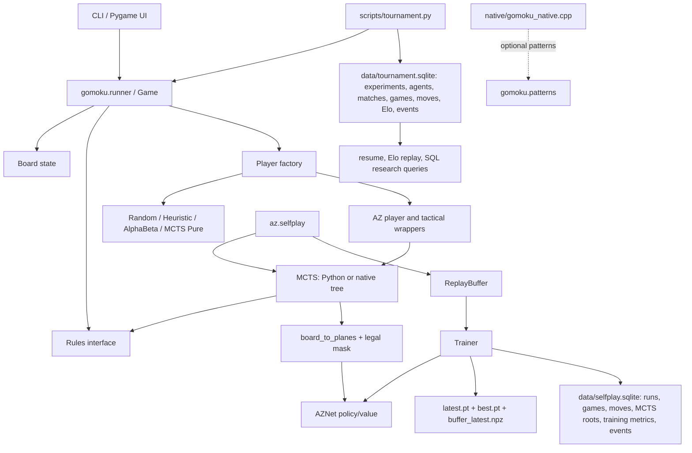

# SPEC: Gomoku AlphaZero 11×11

> **Trạng thái tài liệu:** baseline kỹ thuật và đặc tả mục tiêu nghiên cứu, tổng hợp từ source, tests, configs và báo cáo hiện có. Không thay thế bằng chứng runtime của từng thay đổi mới.
>
> **Nhãn bằng chứng:** **Verified** = hành vi thấy rõ trong source và được test/report có liên quan xác nhận; **Implemented / Unverified** = có implementation nhưng mức kiểm chứng chưa đủ cho kết luận; **Planned** = mục tiêu/thiết kế chưa hiện diện; **Unknown** = chưa đủ dữ liệu để xác định. Các test status dưới đây là kết quả đã ghi trong tài liệu/reports của repo, không phải test chạy trong lần soạn SPEC này.

## Mục lục

1. [Mục tiêu và câu hỏi nghiên cứu](#1-mục-tiêu-và-câu-hỏi-nghiên-cứu)
2. [Phạm vi, yêu cầu và tiêu chí thành công](#2-phạm-vi-yêu-cầu-và-tiêu-chí-thành-công)
3. [Nền tảng công nghệ, cấu trúc và code style](#3-nền-tảng-công-nghệ-cấu-trúc-và-code-style)
4. [Kiến trúc và luồng thực thi hiện tại](#4-kiến-trúc-và-luồng-thực-thi-hiện-tại)
5. [Hợp đồng game engine và luật](#5-hợp-đồng-game-engine-và-luật)
6. [Policy-value network](#6-policy-value-network)
7. [MCTS / PUCT](#7-mcts--puct)
8. [Self-play, replay và huấn luyện](#8-self-play-replay-và-huấn-luyện)
9. [Backend kép Python/C++](#9-backend-kép-pythonc)
10. [Tournament, Elo và đánh giá sức chơi](#10-tournament-elo-và-đánh-giá-sức-chơi)
11. [Hiệu năng và benchmark](#11-hiệu-năng-và-benchmark)
12. [Khả năng tái lập và lưu trữ](#12-khả-năng-tái-lập-và-lưu-trữ)
13. [CLI, UI và lệnh](#13-cli-ui-và-lệnh)
14. [Chiến lược kiểm thử và truy xuất](#14-chiến-lược-kiểm-thử-và-truy-xuất)
15. [Code style](#15-code-style)
16. [Ranh giới](#16-ranh-giới)
17. [Trạng thái hiện tại, khoảng trống và lộ trình](#17-trạng-thái-hiện-tại-khoảng-trống-và-lộ-trình)
18. [Câu hỏi còn mở và giới hạn bằng chứng](#18-câu-hỏi-còn-mở-và-giới-hạn-bằng-chứng)

## 1. Mục tiêu và câu hỏi nghiên cứu

### 1.1 Đối tượng và bài toán

Hệ thống phục vụ AI coding agents, người bảo trì/nghiên cứu và giảng viên. Bài toán là xây dựng agent Gomoku trên bàn 11×11, học policy và value bằng self-play kiểu AlphaZero, rồi đánh giá sức chơi bằng đối kháng có kiểm soát. Đây vừa là phần mềm chơi game, vừa là nền tảng thí nghiệm; một pipeline chạy xong hoặc loss giảm không đồng nghĩa chơi tốt hơn.

### 1.2 Câu hỏi nghiên cứu

- **RQ1:** Với cùng luật, checkpoint, ngân sách tìm kiếm, opening và phân bố màu, checkpoint AlphaZero có score/rating cao hơn Heuristic hay không?
- **RQ2:** Các mốc số ván self-play và optimizer steps ảnh hưởng thế nào đến playing strength, không chỉ loss?
- **RQ3:** Native C++ có tăng throughput trên workload đại diện mà vẫn giữ semantics, dữ liệu huấn luyện và playing strength trong sai số định trước không?
- **RQ4:** Normal và Renju tạo ra khác biệt gì khi so sánh trong rating pool và protocol riêng?

### 1.3 Mục tiêu và giới hạn

**Mục tiêu nghiên cứu, chưa đạt:** AlphaZero thắng Heuristic với bằng chứng đủ tin cậy trong một pool/protocol đánh giá chung. **Mục tiêu quy mô:** hỗ trợ nghiên cứu 5.000–10.000+ ván. **Mục tiêu tối ưu hóa:** tăng tốc mà không đánh đổi tính đúng đắn hoặc chất lượng dữ liệu. Số ván và speedup chỉ là chỉ số vận hành, không phải chỉ số chất lượng mô hình.

Phạm vi hiện tại là bàn 11×11, Normal và Renju theo mô tả trong code; không tuyên bố tương đương đầy đủ với luật Renju quốc tế. Không có bằng chứng cho thấy đã đạt mọi mục tiêu hiệu năng, GPU soak dài hạn, parity thống kê hoặc Elo.

## 2. Phạm vi, yêu cầu và tiêu chí thành công

Trạng thái của yêu cầu được đánh dấu theo phần đầu tài liệu. Ưu tiên: P0 correctness/data integrity; P1 evaluation có thể tái lập và backend parity; P2 quy mô/hiệu năng.

| ID | Yêu cầu / nghiệm thu | Hiện trạng |
|---|---|---|
| RQ-GAME-01 | Board 11×11, lượt luân phiên, nước hợp lệ và terminal state thống nhất qua `Rules` API | Verified: `gomoku/board.py`, `gomoku/rules/`; unit tests tồn tại |
| RQ-RULE-02 | Normal: ≥5 liên tiếp theo 4 hướng thắng; bàn đầy không thắng là hòa | Verified trong implementation/tests |
| RQ-RULE-03 | Renju: Black exact-five thắng và được ưu tiên hơn forbidden checks; overline, double-four, double-three bị cấm; White ≥5 thắng | Implemented; tests Renju có, nhưng chuẩn luật quốc tế/edge coverage chưa được chứng minh đầy đủ |
| RQ-AZ-01 | Policy/value input/output shapes, value perspective và checkpoint contract đúng | Verified qua source; tests `test_model.py` |
| RQ-MCTS-01 | Terminal không gọi network; legal masking không expand nước cấm; value backup đổi dấu mỗi ply; win-in-1 test | Verified qua source và `test_mcts.py` |
| RQ-SELFPLAY-01 | Mỗi trạng thái trước nước đi tạo đúng một mẫu; `z` là kết quả cuối ván theo player-to-move; buffer tách luật | Verified qua source và `test_selfplay.py` / `test_replay_buffer.py` |
| RQ-TRAIN-01 | Resume khôi phục model, optimizer, iteration/global step, RNG và replay; duy trì latest/best | Implemented / Unverified: Normal dùng generation chính thức `checkpoints/normal/latest.json`; quality gate độc lập với việc commit latest |
| RQ-NATIVE-01 | C++ MCTS giữ hành vi Python theo các differential criteria và không fallback âm thầm | Differential tests có; trạng thái experimental, cần mở rộng trajectory/quality gates |
| RQ-EVAL-01 | Tournament cân bằng màu, ghi kết quả/provenance; promotion dùng Elo có uncertainty | Implemented: pairwise Davidson + paired opening-cluster bootstrap cho Normal az_v0; full leaderboard Elo vẫn Planned |
| RQ-QUALITY-01 | Kết luận AZ > Heuristic chỉ khi protocol matched, log đầy đủ và uncertainty loại trừ tie theo tiêu chí đã định trước | Chưa đạt: báo cáo T35 ghi Heuristic thắng 100/100 AZ v0, threat và AZ Renju trong các pool được khảo sát |
| RQ-SCALE-01 | Self-play liên tục có monitoring, quality checkpoints và điều kiện dừng | Pipeline gate có; chưa có bằng chứng strength sau migration hoặc soak safety |
| RQ-REPRO-01 | Có thể dựng lại run từ config/seed/code/checkpoint identity/environment/log; replayable tournament records | Tournament khá đầy đủ; training provenance còn thiếu model init seed/code hash và lịch sử checkpoint nguồn |

**Tiêu chí thành công của nghiên cứu:** (1) correctness của luật và training targets được xác nhận qua tests; (2) tournament trong điều kiện matched với checkpoint SHA-256; (3) theo Elo v1.0, đạt mục tiêu khi `ΔElo > 0` và lower 95% CI `>0`, đạt mục tiêu mạnh khi `ΔElo ≥ +100` và lower 95% CI `>0`; (4) kết quả lặp lại qua nhiều seed/opening và đổi màu; (5) claims về quality/parity C++ được tách khỏi throughput. Các ngưỡng và cỡ mẫu 100/400/600/800 là đề xuất protocol, chưa được xác nhận bằng pilot/power analysis; phải chốt/version trước nghiên cứu chính thức và không sửa sau khi thấy kết quả.

## 3. Nền tảng công nghệ, cấu trúc và code style

### 3.1 Stack hiện có

- Python với NumPy, PyTorch, PyYAML; pytest cho tests; pygame cho UI.
- Optional native extensions C++17 qua pybind11, compile bằng compiler được `scripts/build_gomoku_native.py` gọi. Trên Windows còn phụ thuộc Python ABI, linker/compiler và thư viện Python tương thích.
- `../requirements.txt` là requirements dùng chung nhiều lab, không pin phiên bản và ghi Python 3.12; các report Gomoku ghi môi trường thí nghiệm cụ thể Python 3.10.6 / torch 2.14.1+cu126. Đây là khác biệt môi trường cần xử lý khi tái lập, không nên suy ra môi trường chuẩn duy nhất.

### 3.2 Cấu trúc thực tế (file tiêu biểu)

```text
gomoku/       Board, rules, game/runner, features, patterns
az/           Model, MCTS, self-play, replay, trainer, evaluator/logging
players/      Random, human, heuristic, alpha-beta, pure MCTS, AZ wrappers
native/       C++ patterns và C++ MCTS tree
scripts/      train, play, arena, tournament, benchmark, native build
configs/      Normal, Renju, 5k training YAML
tests/        Unit, integration, CLI, backend differential tests
ui/           Pygame interface
docs/         Reports, performance studies, tournament/repro guides
logs/, data/*.sqlite*, checkpoints/  Runtime artifacts; ignored by Git, local-only
```

Một số README mô tả cấu trúc dự kiến; SPEC ưu tiên file/code thực có trong working tree. Các entry point đã xác nhận gồm `scripts/play.py`, `scripts/train.py`, `scripts/arena.py`, `scripts/tournament.py` và `python -m ui.pygame_app`; lệnh build native là `scripts/build_gomoku_native.py`.

## 4. Kiến trúc và luồng thực thi hiện tại



### 4.1 Trách nhiệm và luồng dữ liệu

1. `Board` sở hữu lưới phẳng `int8` gồm 121 ô, người chơi hiện tại và lịch sử nước đi; `play/undo/copy` không phụ thuộc luật.
2. `Rules` cung cấp `legal_moves`, `forbidden_moves`, `is_win`, `is_terminal`. Players và UI dùng interface này.
3. `board_to_planes` tạo `(4,11,11)` `uint8`; model trả policy probabilities `(B,121)` và value `(B,)`. MCTS nhận yêu cầu policy/value ở leaf, mask policy priors theo legal moves rồi mở child nodes.
4. AZ player chạy MCTS và chọn move theo visit distribution/temperature. Self-play lưu `(planes, pi, player)` trước nước đi thật và gán `z` sau terminal.
5. ReplayBuffer lưu dữ liệu compact, augmentation theo đối xứng lúc sample; Trainer tối ưu model, checkpoint và buffer; `scripts/train.py` ghi run metadata, self-play games/moves, root telemetry và training metrics vào `data/selfplay.sqlite`; checkpoint/replay vẫn giữ định dạng và đường dẫn riêng.
6. Tournament dùng player factory, chạy paired color-swapped games, ghi experiment/game/move records vào `data/tournament.sqlite`; resume dùng DB với `--resume --run-id`, analytics và Elo đọc kết quả từ cùng database, không sinh JSONL/CSV/JSON mặc định.

**Ranh giới phụ thuộc:** `gomoku/` không phụ thuộc `torch`; rules không nằm trong players/MCTS; board không quyết định luật. Native MCTS chỉ sở hữu cơ chế tree/search; Python giữ Board, Rules, RNG, tạo feature và suy luận model. Native Patterns tăng tốc `find_patterns`, được dùng bởi heuristic/tactical pattern consumers; AZ v0 self-play không gọi patterns.
Trong inference Normal và tournament, alias `az` hiện trỏ đến `az_v1_threat` dùng checkpoint AZ Normal chính thức; vẫn có thể chọn `az_v0` tường minh. Thay đổi này chỉ định tuyến ở search layer: không đổi weights checkpoint hoặc luồng self-play huấn luyện, vốn vẫn dùng AZ v0 trừ khi được tích hợp và đánh giá riêng.

## 5. Hợp đồng game engine và luật

### 5.1 Hợp đồng Board
`SIZE=11`, `EMPTY=0`, `BLACK=1`, `WHITE=2`; action phẳng `a=11r+c`; bên đi đầu là Black. `play(r,c)` từ chối tọa độ ngoài bàn hoặc ô đã chiếm, ghi history rồi đổi player; không tự kiểm tra legality theo rules. `undo()` khôi phục ô cuối và current player. Caller phải kiểm tra luật trước khi gọi `play`.

### 5.2 Luật được xác minh

| Điều kiện | Normal | Renju |
|---|---|---|
| Black line | ≥5 thắng | đúng 5 thắng; overline không thắng và nước tạo overline bị cấm |
| White line | ≥5 thắng | ≥5 thắng |
| Black forbidden | không có | double-three, double-four, overline; exact-five exception |
| Draw | không còn ô trống và không thắng | không còn legal move và không thắng |
| Forbidden mask | rỗng | chỉ xét lượt Black; White trả mask rỗng |

Renju code xét exact-five trước các điều kiện forbidden khác. Candidate scan chỉ xét ô trong phạm vi 4 bước theo bốn hướng từ Black stone; open-three dựa trên extension tạo open-four và đệ quy kiểm tra hợp lệ. Cache dùng board bytes/current player. Đây là semantics code; không chứng minh toàn bộ quy tắc quốc tế về precedence, định nghĩa pattern phức tạp, foul/game adjudication hoặc tình huống bàn đã có trạng thái thắng.

### 5.3 Tiêu chí nghiệm thu / trường hợp biên
- `AC-RULE-01`: xác minh thắng theo hàng ngang, hàng dọc, hai đường chéo, trường hợp cắt biên, exact 5 và overline theo ruleset.
- `AC-RULE-02`: bàn đầy nhưng không có line thắng => terminal draw; Renju hết legal moves do forbidden cells => terminal.
- `AC-RULE-03`: từ chối nước đi vào ô đã chiếm/ngoài bàn; từ chối undo khi lịch sử rỗng; play/undo round-trip giữ nguyên grid/player/history.
- `AC-RULE-04`: nước exact five của Black trong Renju vẫn hợp lệ ngay cả khi đồng thời tạo forbidden threats; loại fixture Black tạo overline/3-3/4-4; không mask White.
- `AC-RULE-05`: mỗi consumer chỉ gọi Rules API; không tạo luật thứ hai ngoài Rules.

Vị trí tests: `tests/test_board.py`, `test_rules_normal.py`, `test_rules_renju.py`, `test_renju_integration.py`, `test_runner.py`. Cần thêm differential/reference fixtures hoặc expert review cho các trường hợp biên Renju mà tests hiện tại chưa bao phủ.

## 6. Policy-value network

### 6.1 Đầu vào/đầu ra và kiến trúc

State input `(B,4,11,11)`; channels: own stones, opponent stones, forbidden squares, player color (all ones for Black, zeros for White). Không có last-move/history plane. Cùng bốn channels cho cả hai rulesets. Augmentation dùng 8 dihedral transforms với cùng transform cho feature và policy.

`AZNet(n_blocks=6,n_filters=64)`: stem conv 3×3, BN, ReLU; mỗi residual block hai conv 3×3 + BN + skip + ReLU. Policy head conv 1×1 (2 filters), BN/ReLU, flatten, FC→121 logits. Value head conv 1×1, BN/ReLU, flatten, FC→64→ReLU→1→tanh. `predict` nhận numpy batch, eval/no_grad, trả softmax probabilities float32 và values float32 thuộc `[-1,1]`, giá trị theo current player.

### 6.2 Mục tiêu huấn luyện và giá trị mặc định

Với logits `l`, policy target `π`, prediction value `v`, terminal target `z`:

$$L_\pi=-\frac1B\sum_i\sum_a\pi_{ia}\log\operatorname{softmax}(l_i)_a,\qquad L_v=\frac1B\sum_i(v_i-z_i)^2,$$
$$L=w_\pi L_\pi+w_vL_v.$$

Code dùng Adam, `learning_rate=1e-3`, `weight_decay=1e-4`, cosine schedule theo global step; `weight_decay` đi qua optimizer, không cộng khoản L2 explicit vào `_total_loss`. `DEFAULT_CONFIG` giữ giá trị khởi đầu 20 iterations × 50 games, 200 train steps/iteration; `configs/normal.yaml` đặt mô hình liên tục `az_v0` với 200 × 50 games và 1000 steps/iteration. Kiến trúc 6 blocks × 64 filters, `w_policy=w_value=1`, `batch_size=128`, `buffer_size=50000`, `eval_fixed_batch_size=512`.

Checkpoint training `.pt` gồm `model_state_dict`, optional `optimizer_state_dict`, metadata `format_version=1`, architecture, `rule_set/config`, `n_iter`, `global_step`, `promotion_eval_games` và Trainer RNG state. Inference cũng nhận `.pt` chỉ chứa `state_dict`; loader dùng kiến trúc mặc định AZNet (6 blocks × 64 filters), xem weights-only là Normal và không coi chúng là checkpoint resume. Replay buffer cùng frozen eval batch lưu ở NPZ bên cạnh checkpoint đầy đủ. `load_checkpoint` map_location CPU/CUDA theo khả dụng. Backward compatibility có defaults cho metadata thiếu; không có schema migration versioning rộng.

**Rủi ro metric:** fixed eval batch là batch lấy từ cùng self-play stream, có thể có vị trí cùng ván/training overlap; sampler lấy có hoàn lại; buffer vòng có thể overwrite slot. Đây không phải independent generalization set hay strength metric.

## 7. MCTS / PUCT

### 7.1 Công thức và hợp đồng

Node lưu prior `P`, visit count `N`, value sum `W`; `Q=W/N` theo góc nhìn người chơi tại node. Với child `a`:

$$a^*=\arg\max_a\left[-Q(s_a)+c_{puct}P(s,a)\frac{\sqrt{\max(1,N(s))}}{1+N(s_a)}\right].$$

Mặc định `c_puct=1.5`. Ties trong tolerance `1e-9` chọn ngẫu nhiên qua RNG. Root noise chỉ khi bật:

$$P'(s,a)=(1-\epsilon)P(s,a)+\epsilon\eta_a,\quad\eta\sim Dirichlet(\alpha),$$

trên legal moves; defaults training `alpha=0.15`, `epsilon=0.25`. Priors bị mask bằng legal mask rồi normalize; nếu tổng hợp lệ ≤`1e-8`, dùng uniform legal priors. Terminal win ở state sau nước đi nhận `-1` cho player-to-move (đã thua); draw `0`; node terminal không gọi model. Leaf NN value backup đổi dấu mỗi cạnh. Forbidden moves bị xóa khỏi legal mask và không được mở rộng.

**Ngân sách cố định:** Hợp đồng AZ MCTS cố định `n_simulations=200` cho self-play/training, diagnostics, ablation và evaluation; không điều chỉnh, sweep hoặc ablate số simulations. Mỗi lần MCTS thực sự được gọi dùng ngân sách 200. Tactical/threat override có thể chọn nước trước khi gọi MCTS; ghi rõ override và `simulations_run=0`, không coi đó là một budget khác. Budget rollout của MCTS Pure là cấu hình riêng.

### 7.2 Pseudocode tương ứng

```text
reset(root_state)
while simulations_done < 200:
    node = root; path = []
    while node.expanded and not node.terminal:
        child = argmax(-child.Q + c_puct * child.P * sqrt(max(1,node.N))/(1+child.N))
        play(child.move); path.append((node, child)); node = child
    if terminal(node.state):
        backup(result_from_side_to_move(node))  # alternate sign per edge
    else:
        planes = encode(state); legal = rules.legal_moves(state) - forbidden
        policy, value = evaluator(planes)
        prior = normalize(policy masked to legal; uniform legal if zero mass)
        if node is root and root_noise: mix Dirichlet over legal priors
        expand(node, legal, prior); backup(value, alternating_sign)
    undo(path)
return root child visits
```

Implementation dùng request/receive API (`az/mcts.py`); self-play đan xen requests của nhiều games thành inference batch. Root tree reset sau mỗi nước đi thực tế; `run_games` không tái sử dụng subtree. Temperature dùng để chọn nước khác với target temperature: action probability `N^(1/τ)`; `τ=0` chọn visit count cao nhất (tie ngẫu nhiên). Self-play dùng action temperature 1 trong `temp_moves=15` nước đầu, sau đó 0; `pi_target_temp=1` độc lập định hình visit target đã normalize. Cơ chế target/action mặc định chính xác nằm trong `az/selfplay.py`.

### 7.3 Bất biến / trường hợp biên / tests

- Phải nhận pending request trước khi gửi request khác; reset trước khi search.
- Mỗi policy/value được chấp nhận phải đúng shape/domain theo consumer contract; value hữu hạn trong `[-1,1]`.
- Không có legal move thì draw/terminal; không thể chọn action khi visit counts bằng 0.
- Nhánh terminal được tính là một simulation nhưng không gọi NN; simulation đầu có thể expand root mà không tăng visit của child nào, nên tổng root child visits không nhất thiết bằng budget.
- Chỉ thêm noise ở root; mặc định không thêm noise cho tournament.
- Với Renju, forbidden move masking phải khớp với cùng một implementation Rules tại mọi leaf.
- Tests trong `tests/test_mcts.py` bao phủ win-in-1, backup sign, terminal call counts, forbidden mask, root noise scope, temperature zero và exhausted budget; `tests/test_native_mcts.py` bao phủ parity/terminal/RNG/noise.

**Lưu ý về correctness nghiên cứu:** unit fixtures chứng minh các trường hợp này, không phải mọi trạng thái bàn. Trước khi khẳng định parity tổng quát, hãy thêm fuzz/differential states và property invariants.

## 8. Self-play, replay và huấn luyện

### 8.1 Hợp đồng / pipeline

**Implemented / Unverified — chuyển đổi AZ chuẩn:** Normal có một con trỏ huấn luyện/suy luận chính thức, `checkpoints/normal/latest.json`, được khởi tạo từ generation 60k đã kiểm tra mà không thay đổi weights. Generations, trạng thái recovery, lịch sử rollback và các baseline đánh giá lịch sử vẫn là artifacts riêng, không phải model chính thức bổ sung. Mặc định, training tải generation chính thức đã xác thực cùng replay, optimizer, RNG và counters; nếu trạng thái thiếu hoặc không hợp lệ, tiến trình dừng an toàn. Muốn tạo model mới phải chọn fresh mode tường minh. Training thành công cập nhật con trỏ chính thức theo cách atomic; không thể suy ra kết quả đánh giá chất lượng từ lần cập nhật này. Ghi parent checkpoint SHA-256, generation, run ID, đồng thời phân biệt số game đã tạo, số game thực sự được lấy mẫu để training và số game thuộc lineage; số liệu lịch sử chưa biết phải giữ là chưa biết, không tính run không liên quan `selfplay_20k_cpp_2w`. Migration giữ nguyên các đường dẫn checkpoint lịch sử dùng làm bằng chứng tournament và không thay đổi weights 60k đã kiểm tra.


1. `scripts/train.py` nạp YAML đã gộp với `DEFAULT_CONFIG`; khởi tạo Trainer và ReplayBuffer hoặc resume chúng.
2. `run_games` tạo Board/MCTS/sample list riêng cho từng game và đan xen tối đa `parallel_games`; nếu bật, worker process tạo các chunk qua `run_games_parallel`, rồi parent lưu các samples trả về. `parallel_games` là số game chạy đồng thời để batching; `--workers` là số process song song.
3. Với `selfplay_opening_plies=0`, bắt đầu từ bàn trống. Với giá trị `2` hoặc `4`, đi trước số nước ngẫu nhiên hợp lệ đã seed tương ứng làm opening; lưu các nước này trong game provenance nhưng không dùng làm training targets. Hai quân không thể tạo terminal hoặc đe dọa ngay lập tức thành năm quân theo luật Normal; bốn plies ngẫu nhiên tạo đa dạng opening cho Renju fine-tuning, không khẳng định opening có chất lượng. `selfplay_random_opponent_rate` trong `[0, 1]` khiến tỷ lệ games đó cho một bên đi các nước hợp lệ ngẫu nhiên, uniform và có seed: search vẫn chạy, visit-based `pi` vẫn được lưu, vì vậy vẫn giữ một sample cho mỗi nước MCTS và `samples == moves`, nhưng nước thực đánh là ngẫu nhiên và được đánh dấu bằng `MoveRecord.override_applied`/`override_reason='random_opponent'`. Vị trí của cả hai bên vẫn nằm trong buffer, nhờ đó dữ liệu có cả các ván White thắng và vị trí phòng thủ. Với mỗi nước MCTS tiếp theo, lưu features, visit-based `pi` và player identity. Khi kết thúc game, gán `z=+1/-1/0` theo kết quả cuối cùng của player đã lưu; mỗi nước MCTS có một sample và không tạo sample cho trạng thái terminal. `moves_count` đếm nước MCTS; tổng độ dài game bao gồm opening đã ghi nhận.
4. ReplayBuffer là ring buffer có capacity cố định: features `uint8`, pi `float16`, z `float32`, rule ID; khi đầy thì ghi đè mẫu cũ nhất. Mỗi buffer chỉ nhận một `rule_set`. Khi sample, áp dụng cùng một trong 8 phép xoay/đối xứng cho planes và policy; giữ nguyên `z`.
5. Trainer lấy mini-batches có hoàn lại, tối ưu weighted policy CE + value MSE; ghi loss components, số samples riêng biệt, throughput và fixed-batch loss.
6. Commit `generations/<id>/checkpoint.pt`, `replay.npz` bất biến và hash manifest trước khi thay atomic con trỏ chính thức `checkpoints/normal/latest.json`; `best.json` định danh generation được evaluation chấp thuận, không phải model chính thức riêng. Normal training metadata, game/move records, root telemetry và metrics được lưu trong `data/normal.sqlite`; tournament/Elo lưu riêng. Historical databases và tournament/evaluation records vẫn là evidence; các continuation generations đã xóa được định danh bằng SHA-256 nhưng không thể tái tạo.

### 8.2 Tái lập và hợp đồng recovery

Seed mặc định của training driver là 0; checkpoint lưu trạng thái RNG NumPy của Trainer. `--resume` phân giải và xác thực con trỏ generation đã commit cùng hash của cả hai file; STANDARD resume không có `--generation` yêu cầu run ID ban đầu xuất hiện cả trong metadata checkpoint (hoặc recovery identity trước đó) lẫn trong database self-play, kể cả với checkpoint ban đầu. Generation cũ thiếu cả hai identity cần rollback tường minh với `--generation` và run ID mới; hệ thống không tự gán chủ sở hữu. `--generation` chọn ancestor đã commit để rollback tường minh và, với STANDARD logging, yêu cầu run ID mới. Không thể xác nhận hoặc tự động chuyển đổi artifacts lịch sử thiếu cursor hoặc pairing identity. Resume khôi phục optimizer/global step/iteration, replay và batch đánh giá cố định; đổi `n_iter` làm thay đổi cosine LR horizon. `Trainer.from_pretrained` dùng để chuyển Normal→Renju chỉ chuyển weights, còn optimizer/training state và Renju buffer bắt đầu mới.
Các bootstrap run Normal trong lịch sử giữ nguyên metadata ban đầu và vẫn đọc được; training CLI hiện tại không tạo nhánh bootstrap riêng. `--fresh` tường minh chỉ tạo model mới trong output directory trống. Mặc định, Normal resume giữ nguyên model, replay, optimizer và schedule đã ghi nhận; hệ thống từ chối kéo dài cosine horizon thay vì âm thầm đổi schedule.

Self-play record lưu game ID, seed, SHA-256 checkpoint nguồn và digest tensor thực đo sau worker load; replay lưu game ID theo mẫu để truy vết về record. Digest tensor và SHA file checkpoint là hai loại identity khác nhau. Legacy sample không có game ID không được coi là đã có lineage. Các split độc lập không được suy ra chỉ từ hash hoặc fixed eval batch.

Các thông tin cần ghi cho run trong tương lai gồm: run ID bất biến; git commit và dirty diff/hash; snapshot config sau CLI overrides; ruleset; SHA-256 checkpoint đầu/cuối và parent checkpoint; seed scheme cho initialization/game/worker/MCTS; Python/OS/hardware, NumPy/PyTorch/CUDA/compiler/native ABI; command chính xác; số games/samples/optimizer steps; thiết lập worker/backend; logs và exit status. Không xem fixed-batch loss hoặc số samples là sức chơi.

### 8.3 Xử lý lỗi và tiêu chí nghiệm thu

- Mỗi generation chứa checkpoint, replay bất biến và manifest có SHA-256 của cả hai; thay con trỏ atomic là điểm commit. `previous` xác định parent checkpoint/replay đã tải thực tế. Sau khi rẽ nhánh từ generation cũ hơn, `commit_previous` xác định generation đã commit gần nhất trước đó để rollback vẫn truy cập được nhánh bị bỏ; manifest legacy dùng `previous` cho cả hai. Nếu tiến trình bị ngắt trước khi thay con trỏ, generation đã commit trước đó vẫn truy cập được; rollback tường minh chỉ phân giải lịch sử đã commit. Không tự động xóa generations. Hệ thống thực hiện fsync file; chưa xác minh độ bền của directory entry trên Windows khi mất điện.
- Training STANDARD ghi recovery outbox bền vững, bất biến theo run/iteration/source-checkpoint trước khi commit games: replay targets và payload game/move/root chính xác cùng hashes. Resume dùng lại các bytes đó, xác minh provenance và identity SQLite nghiêm ngặt, đồng thời từ chối games legacy mơ hồ không có outbox. Checkpoint gắn với manifest outbox và training metrics trước khi cập nhật con trỏ; resume hoàn tất idempotently lần ghi metrics còn thiếu. Rollback tường minh bắt đầu bằng run ID mới và ghi generation đã chọn cùng checkpoint SHA; lần retry trước khi commit generation chỉ được dùng lại ID đó cho cùng source. Sau commit, resume không có `--generation`; dùng lại ID với source khác sẽ dừng an toàn. Outbox của nhánh khác không bao giờ được dùng. Thư mục tạm mồ côi và generations chưa commit được giữ lại, không xóa.
- **Implemented / Unverified:** các test crash-injection kiểm tra ranh giới commit, không phải thử nghiệm mất điện. Hash phát hiện thay đổi ngoài ý muốn khi reference còn đáng tin cậy, nhưng không chống được kẻ tấn công có thể sửa cả dữ liệu lẫn manifest không được neo. Độ bền phụ thuộc bảo đảm của filesystem/SQLite; độ bền directory entry trên Windows và khi phần cứng mất điện vẫn chưa được chứng minh. Mỗi run/output directory chỉ hỗ trợ một writer; các writer đồng thời không được điều phối hoặc hỗ trợ. Recovery không tái tạo games bị mất trước khi outbox được commit, cũng không bảo đảm retraining giống từng bit sau khi optimizer step bị gián đoạn.
- Replay NPZ lưu cursor để resume giữ thứ tự ghi đè mẫu cũ nhất. NPZ legacy đầy không có cursor không thể khôi phục thứ tự tuổi: loader cảnh báo và dùng cursor 0 cho mục đích đọc; `Trainer.load` từ chối resume với cursor không rõ. Checkpoint cũ thiếu replay hash không được resume cùng replay mà chưa có quy trình khôi phục được phê duyệt. NPZ legacy chưa đầy khôi phục cursor từ số mẫu.
- Xác nhận `samples == moves`, pi hữu hạn/không âm/có tổng bằng 1, pi chỉ có khối lượng trên legal actions, z ∈ {−1,0,+1}; bảo đảm ID từng game là duy nhất và mỗi buffer chỉ có một ruleset.
- **Implemented / Unverified:** driver fine-tune Renju từ chối tiếp tục tạo games khi kết quả chỉ nghiêng về một bên. Khi run có ít nhất `outcome_guard_min_games` games và một bên thắng ít nhất `outcome_guard_max_side_win_rate` số games đó, driver ghi một event `outcome_guard_stop` rồi thoát với status `3`; có thể resume run này, nhưng lần resume sẽ dừng trước khi chơi game khác. Giá trị trên `1.0` tắt guard; mặc định của cả hai tham số đều giữ guard tắt ngoài `configs/renju.yaml`.
- **Implemented / Unverified:** `value_loss` hoặc fixed-batch loss được lưu trên dataset suy biến không chứng minh value head tổng quát hóa. `scripts/renju_value_probe.py` chấm value head của checkpoint trên các positions lấy từ tournament database đã lưu và báo MSE, sign accuracy, confident fraction cùng prediction trung bình theo bên sắp đi, nhờ đó có thể nhận ra shortcut theo màu/parity. `scripts/renju_gate.py` áp dụng màn kiểm tra đạt mục tiêu cho experiment đã lưu: yêu cầu tối thiểu `--min-games` games được chấm và score, hoặc Wilson 95% lower bound với `--basis wilson_low`, đạt ít nhất `--min-score`; tool thoát với mã `0` khi đạt, `1` khi không đạt, `2` khi input không dùng được. Cả hai tool chỉ đọc database, không chơi hoặc training games.
- Xác minh optimizer/global_step/iteration/buffer và giá trị schedule sau resume so với cùng config; kiểm tra tường minh artifacts thiếu/hỏng/không khớp.
- Quality gate: cận dưới paired Davidson 95% opening-cluster CI giữa candidate và best hiện tại phải >0 mới cập nhật `best.pt`; báo riêng kết quả mục tiêu nghiên cứu so với Heuristic. Chỉ loss, ngưỡng score hoặc số game không bao giờ đủ để promote.

## 9. Backend kép Python/C++

### 9.1 Ranh giới đã triển khai

**Đã xác minh có implementation:** `native/gomoku_mcts_native.cpp` là search tree C++17 dùng arena qua pybind11 (node indices, PUCT selection, expansion, backup, terminal values, visits). Python `NativeMCTS` sở hữu board/rules/RNG/features/network inference và truyền legal move/prior/value arrays qua binding. `native/gomoku_native.cpp` triển khai pattern detection `find_patterns`; `gomoku/patterns.py` chọn implementation này. `az/backend.py` phân giải preset tổng thể `--backend python|cpp` cùng các override MCTS/Patterns độc lập; nếu extension được chọn không khả dụng, thao tác dừng an toàn, không fallback im lặng. Mặc định là Python.

`gomoku_native` không phải native game/rules/board engine; chưa có bằng chứng về C++ neural network, training hoặc self-play engine hoàn chỉnh. Native patterns và MCTS là hai component riêng; AZ self-play tiêu chuẩn đánh dấu Patterns là `not_used`.

### 9.2 Các mức parity và thiết kế nghiệm thu

Không yêu cầu bitwise equality giữa các cách triển khai RNG hoặc phép tính floating point, trừ khi hợp đồng deterministic cho phép. So sánh theo từng mức:

1. **Exact:** cùng state phải cho cùng legal moves, forbidden mask, terminal/win result, game result và moves/sample count khi trajectory được cố định có chủ đích.
2. **Numerical tolerance:** cùng fixed model output và tie handling deterministic phải cho cùng request planes/legal mask, visit counts và simulation count; root/value outputs có `abs(delta)≤ε` theo mức ε do test khai báo. Parity tests hiện có so sánh masks/requests/visits/root value trên fixtures.
3. **Statistical:** với seeds/openings ghép cặp, so sánh move/visit distributions, game outcomes/score và training-target distributions theo confidence intervals/effect tolerance đã đăng ký trước.
4. **Performance:** giữ giống nhau extension đã compile/Python ABI, checkpoint hash, rules, search budget, hardware/load, warm-up và workload; báo median/tail qua nhiều lần chạy và memory.

Thêm tests cho legal/terminal/forbidden masks chính xác giữa Python và C++ trên fixtures được tạo, parity của evaluator cố định, self-play đầy đủ so sánh features/pi/z từng mẫu theo cặp cùng winner/end reason qua nhiều seeds, resume và worker spawn. So sánh policies/values với tolerance tường minh; kiểm tra ties riêng. Với tối ưu backend, kiểm tra tính đúng đắn trước, sau đó regression của training-target/data-distribution, chất lượng arena có kiểm soát, cuối cùng mới đến speedup. Nếu chưa xác lập tương đương về kết quả ngẫu nhiên, giữ backend ở trạng thái experimental dù nhanh hơn.

### 9.3 Bằng chứng và giới hạn hiện tại

Các báo cáo ghi nhận native differential tests, CPU full suite, multiprocessing self-play, checkpoint/resume và tournament smoke. `docs/performance/12-5000-games-readiness.md` ghi nhận về sau một GPU train/resume smoke nhỏ (2 iterations, tổng cộng 30 optimizer steps) và phép so sánh self-play bốn game theo cặp với samples khớp chính xác ở seed đó. Bằng chứng này tốt hơn báo cáo GPU failure trước đó, nhưng không chứng minh ổn định dài hạn hoặc parity ngẫu nhiên/chất lượng trên diện rộng. Báo cáo cho thấy C++ MCTS không tăng tốc đáng kể trong tournament depth-1 nhỏ, trong khi workload self-play đã tối ưu ghi nhận cải thiện; không gộp hai workload này thành một tuyên bố speedup. Chưa có bằng chứng về sanitizer hoặc RSS soak dài hạn. Output build là `.pyd`/`.so` phụ thuộc CPython ABI; compiler, headers, OS và ABI phải tương thích.

## 10. Tournament, Elo và đánh giá sức chơi

### 10.1 Tournament hiện có

`scripts/tournament.py` lên lịch các cặp round-robin; yêu cầu số games chẵn ≥2 và luân phiên màu. Các game theo cặp dùng chung opening và seed cho mỗi bên; có thể chọn opening ngẫu nhiên. Budget có thể là `sims:N` hoặc `time:S`; các budget này không tương đương giữa agents (độ sâu AlphaBeta khác số simulations của MCTS; time deadline chỉ là giới hạn mềm). Tournament hỗ trợ Normal/Renju riêng, các agents random/heuristic/alphabeta/mcts-pure/AZ variants, ánh xạ checkpoint và workers. Trước khi chạy, tournament kiểm tra agents, băm checkpoints và ghi experiment/agent/match/game/move/event records vào `data/tournament.sqlite` local (hoặc `--db`), cũng là nguồn cho resume và analytics. Resume yêu cầu `--resume --run-id RUN_ID` và xác thực cấu hình đã lưu. STANDARD là mặc định; NONE là baseline đo lường không lưu dữ liệu, không phải run nghiên cứu.

Logging V2 dùng `data/selfplay.sqlite` cho self-play/training và `data/tournament.sqlite` cho evaluation/tournament/Elo. SQLite và sidecars chỉ lưu local và được Git bỏ qua. Import lịch sử theo hướng bổ sung/idempotent dựa trên source identity và content hash; dry-run quét `logs/` và `evidence/`, còn import không bao giờ xóa hoặc sửa source files. Experiment exchange bundle được kích hoạt tường minh, chỉ bổ sung dữ liệu và từ chối conflicts; bundle không thay thế target database. Không mặc định các evidence snapshots hiện có là dữ liệu có thể xóa.

Chỉ số tổng hợp chính hiện tại là score `(W + 0.5D)/N`, WDL, phân tách theo cặp/màu và Wilson interval trên score. Wilson interval với draws-as-half là xấp xỉ, không phải độ bất định multinomial chính xác và không tính đến phụ thuộc lẫn nhau hoặc multiple comparisons. Không xem khoảng bao trùm .5 là bằng chứng tương đương. Phân tích các tests ghép cặp theo seed bằng phương pháp paired hoặc độ bất định cấp model khi phù hợp.

### 10.2 Quy trình đánh giá Elo v1.0 (Planned)

`az.elo.recalculate_elo` vẫn là leaderboard tuần tự. `az.elo.paired_davidson_ci` triển khai Davidson ΔElo theo từng cặp với paired opening-cluster bootstrap cho promotion gate Normal `az_v0` tự động; leaderboard Bradley–Terry/Davidson đầy đủ cho nhiều agents và phép tính lại lịch sử production vẫn chưa được triển khai.

**Rating pools và định danh.** Normal và Renju là hai pool độc lập, không so Elo chéo luật. Trong mỗi pool, `Heuristic` là anchor cố định `R=1200`; các model khác cùng protocol ước lượng relative rating trên cùng graph đối thủ. `model_id` bất biến gồm ruleset + checkpoint SHA-256 (hoặc code/config identity với agent không có checkpoint) + agent/search config; backend/compiler/extension version thuộc `execution_id` và được log như factor, không làm một checkpoint thành model khác. Cùng checkpoint AZ Python/C++ mặc định cùng model rating; chỉ tách thành paired backend contrast khi nghiên cứu parity. Nếu model graph không nối được tới anchor thì không báo rating tuyệt đối.

**Ước lượng chính: Bradley–Terry.** Với skill `θ_i` theo log-odds và game i-vs-j, `P(i beats j)=σ(θ_i−θ_j)`; đổi sang Elo bằng `R_i=1200+(400/ln 10)(θ_i−θ_Heuristic)` để heuristic neo 1200. Mô hình chính phải xử lý hòa bằng mở rộng Davidson của Bradley–Terry (tie parameter, ghi draw là draw), và điều chỉnh màu nếu pilot cho thấy hiệu ứng màu; báo cáo model, identifiability và fit checks. Không loại hòa hoặc mã hóa thành thắng/thua. Bootstrap 95% CI lấy mẫu lại **opening pair cluster** (hai game dùng cùng opening/seed và đổi màu), giữ hai game đi cùng nhau; dùng cùng bootstrap draws để có CI cho `ΔElo = Elo_AZ − 1200`. Nếu số cluster ít, fit lỗi hoặc CI không ổn định, kết quả là `Unknown/inconclusive`; không ép ra rating.

**Leaderboard tham khảo (không phải suy luận chính).** Sequential Elo dùng logistic expected score `E_A=1/(1+10^((R_B-R_A)/400))`, `R'_A=R_A+16(S_A-E_A)`, `S_A=1/0.5/0` cho W/D/L; cập nhật đối thủ theo `S_B=1-S_A`. Heuristic giữ cố định ở 1200 làm anchor; trong trận giữa hai model không-anchor, cập nhật cả hai theo kết quả đối xứng. Giữ lịch sử theo trận và thứ tự deterministic. Đây chỉ là leaderboard vận hành vì phụ thuộc thứ tự trận/K và draws; không thay thế BT estimate/CI. Tests kiểm tra expected score, K=16, anchor bất biến, side-swap invariance và zero-sum change khi cập nhật cả hai rating.
**Protocol thi đấu.** Đánh giá Normal/Renju riêng; dùng checkpoint hash, rule/config snapshot, seed derivation, openings và protocol version cố định. Đóng băng version/config của Heuristic baseline tại rating 1200. Với AZ, cấu hình MCTS cố định 200 simulations mỗi lần search; action temperature `0` (chọn max visits, tie-break RNG theo seed), tắt Dirichlet/root exploration noise. Cho phép tactical/threat override bỏ qua MCTS nếu quy tắc search variant quy định; ghi rõ override và 0 simulations. Không dùng softmax exploration trong evaluation. Tournament đổi màu trên từng opening: 2 games/opening pair; giữ nguyên opening và paired seed, chỉ đổi bên cầm Black. Đối thủ cùng thuật toán nhận budget tương ứng; với baseline có đơn vị search khác nhau, ghi rõ budget/latency và không diễn giải chúng là compute-equivalent. Đóng băng environment/backend identity; ghi seed, opening, ruleset, checkpoint/config SHA-256, MCTS sims, temp/noise, màu người chơi, kết quả/end reason, số nước và latency/search telemetry. Dừng ngay nếu manifest thiếu/không khớp hoặc checkpoint đổi trong run.

**Các lựa chọn cố định cho protocol v1.0:** dùng `HeuristicPlayer` làm anchor với code/config identity SHA-256 theo ruleset; không có file config riêng, patterns backend cố định `python`. AZ dùng MCTS backend `python`, `n_simulations=200`, temperature `0`, root noise tắt. Theo mặc định hiện có của tournament, `random_opening_plies=0` (bắt đầu từ bàn trống); dùng `paired-crc32`, đăng ký `--seed` trước mỗi run và dùng lại cùng seed từng tác tử cùng opening trong cặp đổi màu. Không đổi opening/seed scheme giữa các tranche; muốn đổi phải tăng protocol version. Kết luận chỉ áp dụng cho protocol bắt đầu từ bàn trống.

**Cỡ mẫu và mở rộng định trước.** Screening: 100 games/pair = 50 paired openings, chỉ quyết định có tiếp tục/kiểm tra lỗi dữ liệu, không tuyên bố đạt mục tiêu. Main: 400 games/pair = 200 paired openings. Trước khi chạy, đăng ký danh sách opening/seeds, model comparisons và bootstrap seed. Sau 400, nếu CI 95% của ΔElo chứa 0 hoặc precision chưa đạt, thêm tranche cố định 200 games (100 paired openings), tối đa 800 games/pair; phân tích tại các mốc định trước, không theo dõi CI liên tục để dừng tùy ý. Nếu đến 800 vẫn chưa phân định thì báo inconclusive. Nếu CI đã tách 0 tại mốc main, không cần mở rộng trừ khi chưa đạt độ chính xác đã đăng ký. Mốc sample-size là protocol đề xuất, chưa có power analysis cho dự án; chạy pilot 100 trước và kiểm tra CI bootstrap/cluster variance, sau đó chốt hoặc version protocol mới trước main study.

**Báo cáo và quyết định.** Mỗi so sánh trình bày BT Elo, `ΔElo`, 95% paired-cluster bootstrap CI, số games, W/D/L, score `(W+0.5D)/N`, strata theo màu/opening, phân loại illegal/forfeit/draw, latency/search và resource counters, model IDs, protocol và log hash. “Đạt mục tiêu” nghĩa là `ΔElo > 0` và cận dưới CI 95% `>0`. “Mục tiêu mạnh” nghĩa là `ΔElo ≥ +100` và cận dưới CI 95% `>0`. Đạt tiêu chí không khẳng định kết quả tổng quát ngoài pool/opponents/protocol đã đo. Với heuristic 1200, mọi trận thắng/thua vẫn được ghi W/L và ảnh hưởng đúng vào BT/leaderboard; trận illegal move/forfeit là loss cho bên vi phạm, không loại khỏi mẫu; draw được dùng trong likelihood và tính 0.5 score/Elo. Game không hoàn tất/aborted không được tính là W/D/L; phải resume với cùng identity hoặc loại theo rule đã đăng ký và báo số lượng bị loại.
#### Screening gate tự động `az_v0` v1.4 (Implemented / Unverified)

Pipeline Normal chạy kiểm tra mỗi khi tạo thêm 5.000 self-play games, yêu cầu kích thước iteration sao cho gate đạt đúng mốc. Pipeline chơi chính xác 100 games theo cặp đổi màu với Heuristic đã đóng băng, 200 simulations mỗi nước, temperature 0, tắt root noise và dùng bốn opening plies ngẫu nhiên. MCTS/Patterns backends và số worker của tournament theo training command; các thiết lập thực thi được chọn sẽ ghi vào SQLite. Tactical holdout cố định vẫn là một lần evaluation Python riêng. Cluster bootstrap seed và W/D/L được lưu trong SQLite. Nếu chưa có best, cận dưới paired 95% ΔElo CI >0 so với Heuristic cho phép promotion. Nếu đã có best, gate chỉ so với Heuristic không thể chứng minh model mới vượt best đó: giữ best và không promote nếu thiếu phép so sánh riêng với best. Tactical accuracy và screening 100 games không tự chúng chứng minh đạt mục tiêu nghiên cứu. Mức độ tiếp xúc lịch sử với tactical positions trong run 25k vẫn chưa biết.

Các bản ghi v1.2 lịch sử giữ nguyên protocol ban đầu: 100 games đấu với champion hiện tại nếu có, nếu không thì đấu Heuristic, không có tactical screening này.


**Log schema tối thiểu / tiêu chí nghiệm thu.** Mỗi game cần có `protocol_id`, `ruleset`, `game_id`, `pair_id/opening_id`, `seed/opening`, `model_a_id/model_b_id`, checkpoint/config SHA-256, backend/compiler/extension version trong `execution_id`, `black_model/white_model`, MCTS budget, temperature/noise, `winner` (Black/White/draw), `end_reason`, illegal/forfeit actor, moves và runtime/search telemetry. Rating artifact phải có BT/Davidson fit version, anchor, parameter/K settings, bootstrap seed/cluster count, CI, exclusions, input-log SHA-256 và sequential leaderboard trail. `AT-ELO-01`: expected-score, K=16 update cho win/draw/loss, anchor cố định 1200 và zero-sum chỉ khi cùng cập nhật hai non-anchor ratings. `AT-ELO-02`: deterministic replay tái tạo W/D/L, score, paired clusters và sequential ratings từ logs. `AT-ELO-03`: toy synthetic symmetric pool ước lượng quanh anchor; fixtures mạnh hơn/yếu hơn cho đúng thứ tự; draw-only/one-sided/unconnected pools trả warning/inconclusive, không tạo rating giả. `AT-ELO-04`: bootstrap lấy mẫu theo cặp opening, giữ đổi màu, trả CI hữu hạn và tái lập theo seed. `AT-ELO-05`: phát hiện hash/config/ruleset mismatch, duplicate/missing game IDs và illegal outcomes; không gộp Normal/Renju. `AT-ELO-06`: kiểm tra screening 100, main 400, staged extension 600/800 và stopping rule bằng pure scheduling/decision logic, không chạy tournament tốn kém trong unit tests.

Leaderboard dưới đây là schema, không phải kết quả:

| Model | Rules | Elo ± 95% CI | ΔElo vs Heuristic | Games | W/D/L | Score | Mean/p95 ms/move |
|---|---|---:|---:|---:|---:|---:|---:|
| AlphaZero checkpoint | Normal | TBD | TBD | TBD | TBD | TBD | TBD |
| Heuristic (anchor) | Normal | 1200 | 0 | TBD | TBD | TBD | TBD |
| Alpha-Beta | Normal | TBD | TBD | TBD | TBD | TBD | TBD |
| Random | Normal | TBD | TBD | TBD | TBD | TBD | TBD |

Vẽ learning curve với trục X là số self-play games (dùng cùng định nghĩa trong mọi run) và trục Y là BT Elo; hiển thị CI/error bars, AZ−Heuristic ΔElo, checkpoint hash và protocol ID. Dựng panel riêng cho Normal/Renju; không nối ratings từ các protocol khác nhau thành cùng một chuỗi.


### 10.3 Bằng chứng hiện có về sức chơi

`docs/report.md` T35 ghi nhận 2.400 games hoàn tất trong các nhóm riêng biệt gồm Normal fixed, Renju fixed và Normal time-budget. Trong pool Normal fixed, Heuristic thắng AZ v0 và AZ threat đều với tỷ số 100–0; trong pool Renju, Heuristic thắng AZ Renju 100–0. Kết quả AZ threat đấu AlphaBeta với time budget không so sánh với Heuristic và dùng protocol khác. Audit frozen archive xác minh cả 107 giá trị file SHA-256 đã ghi, 24 matchups × 100 games, ID liên tiếp, cân bằng màu và tổng hợp W/D/L so với raw game records. AZ searches trong T35 fixed dùng 200 simulations; 1.133 nước tactical/threat override bỏ qua MCTS và ghi 0 simulations. Seed scheme legacy không dùng lại seed của từng agent giữa các game đổi màu; manifests thiếu Heuristic source hash, backend tường minh, temperature/noise evaluation và metadata opening-plies. Vì vậy, identity chính xác của Heuristic lịch sử và mức tương đương với v1.0 đều Unknown. T35 là bằng chứng lịch sử, không phải Elo, không chứng minh mọi checkpoint/config đều có kết quả tương tự và không chứng minh AZ đạt mục tiêu. Báo cáo ban đầu cũng ghi nhận 1.000 Normal self-play games và 500 Renju fine-tune games; việc mất run không chứng minh sức chơi. Config 5.000 games không phải kết quả training đã hoàn tất 5.000 games.

### 10.4 Kế hoạch chẩn đoán khi AlphaZero thua Heuristic (Planned)

Chạy theo thứ tự, giữ nguyên ruleset/checkpoint/protocol và lưu artifacts; mỗi bước phân biệt lỗi thực thi với giới hạn chất lượng:

1. **Tái lập baseline:** phát lại match IDs từ raw logs, đối chiếu checkpoint/config/rules hashes, màu, illegal/forfeit và seed. Nếu kết quả không khớp hoặc run cũ thiếu provenance, xem T35 là bằng chứng lịch sử, không dùng làm baseline định lượng mới.
2. **Tính đúng đắn của search:** trên tactical fixtures (win-in-1, block-in-1, fork, forced loss, Renju forbidden), kiểm tra legal mask, prior sau khi mask, visit counts, root value/sign, terminal handling, lựa chọn khi temperature=0 và repeatability. So sánh Python/native với cùng fixed evaluator; không đổi model để debug MCTS.
3. **Policy/value và targets:** audit các trạng thái self-play đã ghi: `pi` hữu hạn, đã normalize và chỉ gồm legal moves; tính entropy/top-k/agreement với selected move; so sánh target visit distribution với model policy; đối chiếu `z` theo player-to-move và outcome. Đánh giá value calibration/Brier/MSE theo game outcome trên held-out games/positions được tách theo game/seed; không dùng fixed training batch làm test.
4. **Phân loại lỗi chiến thuật:** phân loại loss games theo các lỗi bỏ lỡ thắng ngay, không chặn nước thắng, bỏ fork/forced defense, Renju legality và endgame/draw. Phát lại position cùng danh sách legal moves; so sánh MCTS candidate ranking/visits, network prior/value và phản ứng của Heuristic. Tactical override/threat-space là ablation riêng; không gán tác dụng cho base network.
5. **Tính đúng đắn của search với budget cố định:** mỗi lần MCTS thực sự chạy phải dùng đúng 200 simulations trên cùng checkpoint, positions/openings/seeds và không noise; ghi Elo/score, move latency và tactical error rates. Không đổi simulation budget để chẩn đoán; tactical override bỏ qua search phải được log riêng và không tính là budget khác.
6. **Chẩn đoán checkpoint/training:** với từng checkpoint, đo matched Elo, metrics outcome/value/policy độc lập, replay age/diversity, target entropy, game length/WDL theo màu, optimizer/global steps/config/hash. Kiểm tra overfit, collapse, data leakage và checkpoint mismatch; loss giảm không phải tiêu chí promotion.

Tiêu chí nghiệm thu `AC-DIAG-01`: mỗi diagnosis có position/game IDs bất biến, checkpoint hash, rules/config, hypothesis, metric và pass/fail evidence. `AC-DIAG-02`: chỉ chấp nhận search fix khi invariant tests đạt và paired evaluation không có quality regression đã xác nhận. `AC-DIAG-03`: kết luận nguyên nhân phải có canary/control cô lập biến; nếu nhiều nguyên nhân cùng phù hợp dữ liệu thì ghi Unknown, không chọn giải thích hậu nghiệm.

### 10.5 Kế hoạch ablation study (Planned)

`scripts/ablation.py` hiện có ablations cho Alpha-Beta pruning và MCTS Pure rollout budgets; chưa có framework AZ Elo ablation. Các nghiên cứu AZ phải dùng protocol v1.0, cùng frozen evaluation set, heuristic anchor, paired opening/color seeds, fixed checkpoint identity khi phù hợp, tắt evaluation noise/temperature và giữ nguyên rules/config ngoại trừ biến nghiên cứu. Báo Elo/ΔElo+paired CI, W/D/L/score, compute/search telemetry và training data counts; đăng ký các comparisons và cách xử lý multiplicity trước khi chạy. Tách screening (pilot) khỏi kết quả confirmatory.

| Yếu tố | Mức screening (đề xuất) | Quy tắc cô lập / công bằng |
|---|---|---|
| MCTS simulations | 200 (fixed) | Không phải factor ablation; giữ nguyên trong mọi run AZ, kể cả self-play generation và evaluation |
| Network architecture | 3×32, 6×64 baseline, 9×96 | Match training data, optimizer steps và search budget; báo parameter count, peak memory/inference cost; không xem equal steps là equal FLOPs |
| Quy mô self-play | 1k / 2.5k / 5k / 10k games tích lũy | Cùng recipe/seed plan; checkpoints trên learning curve, cùng Elo protocol; xem games, distinct samples, optimizer steps và compute cùng nhau |
| Backend | Python so với C++ search, cùng checkpoint; retraining self-play với backend riêng | Trước hết xác minh exact/differential parity, sau đó so targets/outcomes nhiều seeds theo cặp, cuối cùng kiểm tra Elo non-regression; runtime speedup không phải quality outcome |

Một run/seed không đủ để đưa ra kết luận nghiên cứu. Dùng paired training seeds; chọn số seed cho confirmatory ablation dựa trên variance/power pilot và đăng ký trước. Để giới hạn chi phí, dùng screening nhỏ để loại lỗi/regression lớn, chỉ xác nhận các contrasts có ý nghĩa; không chạy full Cartesian product. Baseline v1 vẫn là 6×64 và 200 simulations cho mọi AZ MCTS run; số simulations không phải factor có thể điều chỉnh hoặc thay đổi theo protocol.


Tiêu chí nghiệm thu `AC-ABL-01`: manifest chứng minh chỉ factor mục tiêu thay đổi, các controls giữ nguyên. `AC-ABL-02`: mỗi point có checkpoint hash và cùng evaluation protocol/model pool. `AC-ABL-03`: statistical comparison giữ paired openings/training seeds và điều chỉnh multiple comparisons hoặc ghi exploratory. `AC-ABL-04`: báo chất lượng Elo cùng compute; không chọn cấu hình theo throughput/loss đơn lẻ. `AC-ABL-05`: backend quality gate không kém control ngoài non-inferiority tolerance đã đăng ký; tolerance hiện Unknown và phải chốt sau pilot.

## 11. Hiệu năng và benchmark

Thu thập move latency mean/p50/p95/p99, MCTS sims/sec và NN leaf calls, games/min, training samples/optimizer steps/sec, phân rã wall-time, CPU/GPU utilization, peak RSS/VRAM, worker scaling và failure rate. Gắn nhãn workload là CPU/search-bound, inference/GPU-bound, process/IPC-bound hoặc storage-bound; báo cả throughput toàn run và counters từng component. Không thể so sánh node count với simulations hoặc neural evaluations.
Quy trình benchmark: cố định hardware/software/extension/checkpoint hash, rules, opening/state corpus, simulation/time budget, batch/workers/threads, warm-up, repetitions, system load và CUDA synchronization; xáo trộn/thực hiện xen kẽ thứ tự backend; dùng cùng positions/seeds; báo median và độ phân tán, không chỉ một lần chạy. Tách correctness/throughput của search với lượng công việc cố định khỏi chất lượng policy theo wall-clock. Mọi tối ưu thay đổi scheduling, batching, tie-breaking hoặc RNG phải so sánh self-play distributions và arena outcomes có kiểm soát.

Các số liệu lịch sử chỉ áp dụng cho workload được trích dẫn: `docs/benchmarks.md`, `docs/performance/`, `docs/bao-cao-dual-backend.md`. Cụ thể, ước tính 129.59 games/min và dự phóng 38.6 phút cho 5k self-play là ngoại suy tuyến tính từ benchmark 50 games, bỏ qua overhead training/evaluation/checkpoint và không phải soak 5k. Không khẳng định các con số trong mục này là hiệu năng hiện tại áp dụng chung.

## 12. Khả năng tái lập và lưu trữ

- Nguồn config: giá trị mặc định trong `config.py` + `configs/*.yaml` + CLI overrides. Lưu config đã phân giải đầy đủ cùng logs.
- Lưu trữ training: giữ nguyên checkpoint `.pt` và replay buffer `.npz`. SQLite V2 schema v1 đã có; training CLI ghi run/game/move/training-step records và root search telemetry đã nén ở chế độ STANDARD; NONE bỏ qua việc thu thập telemetry và ghi database. Các root fields được ghi sau mỗi lần search mà không đổi lựa chọn hoặc tiêu thụ RNG.
- Lưu trữ tournament: `scripts/tournament.py` ghi các hàng experiment, agent, match, game và move vào `data/tournament.sqlite`, đồng thời giữ manifests/JSONL/CSV legacy cho resume/readers. `--logging-level none` bỏ qua telemetry và output bền vững cho baseline tạm thời; không thể resume và không dùng cho run nghiên cứu. Replay Elo tuần tự cơ bản đã được triển khai; import lịch sử chưa được triển khai.
- Trao đổi experiment: tournament experiment bundles tường minh giữ metadata, games/moves, event history và Elo rows; import xác thực canonical content hash và thêm rows theo transaction. Self-play run bundles chưa được triển khai.
- Dữ liệu local: `.gitignore` bỏ qua `*.sqlite*` và `*.sqlite3*`; khi kiểm tra không có SQLite database nào được track. Import/export phải được gọi tường minh và không bao giờ ghi đè destination database.
- Hiệu năng logging: các self-play tests dùng synthetic evaluator, chạy ba lần với Python/Normal và native-C++/Normal ở 200 simulations, đo overhead STANDARD lần lượt là 1.49% và 3.24%; runtime deltas của Python/Renju và native-C++/Renju lần lượt là −0.09% và 0.34%. Các tournament tests `az_v0` đấu random ở 200 simulations đo lần lượt 1.20% với Python-MCTS/Normal, −0.06% với C++-MCTS/Python-patterns/Normal, 0.30% với Python-MCTS/Renju và 0.59% với C++-MCTS/Python-patterns/Renju. Renju self-play dùng synthetic evaluator; overhead của workload training production chưa được xác minh.
- Dùng content hash, không dùng basename mutable `last.pt`, để định danh model. Lưu source hash và parent hash bất biến; không ghi đè evidence.
- Version hóa ruleset, evaluation protocol và backend implementation; lưu dependencies và lệnh build native. Ghi lại `python --version`, `torch.__version__`, CUDA availability/device, OS, CPU, GPU, compiler và extension ABI thực tế.
- Chạy lại trong environment sạch, có tài liệu và config cố định. Ghi giới hạn tái lập ngẫu nhiên, CUDA nondeterminism và process RNG scheme; phân biệt khả năng tái lập chính xác game logs với replication thống kê.
Manifest experiment đề xuất (đề xuất định dạng; SPEC này không thay đổi code): `schema_version`, `run_id`, `git_commit`, `dirty_tree_hash`, `command`, `resolved_config`, `ruleset/rules_version`, `seed_root/derivation`, `model_id/parent_hash`, `backend/components/extension_hash`, environment/hardware/compiler, worker/thread settings, số game/sample/step, start/end/exit status, artifact paths+SHA-256, evaluation protocol ID, tournament raw-log hash và các giới hạn.
### 12.1 Cổng nghiệm thu về khả năng tái lập và chất lượng (trạng thái triển khai khác nhau)

`RG-01 Run identity`: mọi training/evaluation run lưu resolved config, code/dirty-tree identity, toàn bộ seed streams/derivations, ruleset, environment, backend/ABI và artifact SHA-256; kiểm tra bằng cách tải manifest và xác minh từng artifact/hash được tham chiếu. Thiếu identity thì kết quả là `Unknown`, không phải “gần như tái lập được”.

`RG-02 Seed discipline`: dùng seed tường minh, độc lập cho model initialization, self-play game, worker, action/tie-breaking, opening và bootstrap; tạo child seeds deterministic từ `(root_seed, purpose, game/pair_id, color)` và lưu mapping. Cùng code/environment/config/seed phải tạo lại setup và records deterministic ở nơi backend/device hỗ trợ phép tính deterministic; nếu không, ghi chính xác các trường nondeterministic và xác minh replication thống kê.

`RG-03 Checkpoint integrity`: checkpoint bất biến, định danh bằng content trong experiment records; resume phải khớp parent hash dự kiến, ruleset, architecture và resolved config; train logs liên kết mỗi checkpoint được promote với parent và iteration/game count. Kiểm tra việc từ chối mismatch/corruption và hash/metadata sau round-trip.

`RG-04 Python/C++ parity`: cùng rule state phải tạo legal moves, terminal outcome và forbidden mask giống nhau; cùng fixed evaluator/RNG/tie policy phải tạo visits/simulations/root value tương đương trong numeric tolerance đã khai báo; self-play theo cặp so sánh features, `pi`, `z`, winner và end reason trên seeds đăng ký trước. Mismatch nào cũng chặn promotion native cho đến khi được giải thích và sửa.

`RG-05 Quality regression`: với Normal `az_v0`, gate v1.2 định kỳ dùng 100 games theo cặp đấu với best, hoặc Heuristic nếu chưa có best. Chỉ promote khi cận dưới paired 95% CI của ΔElo so với opponent được chọn >0. Nếu CI cắt qua 0, giữ best mà không mở rộng; nếu cận trên CI thấp hơn 0 so với best, từ chối candidate và dừng session. Gate chỉ so với best không đánh giá mục tiêu nghiên cứu so với Heuristic. Giới hạn 100 games làm tăng độ bất định và không thay thế protocol nghiên cứu 400 games. Các backends khác và tournament model variants vẫn cần gate matched riêng.

`RG-06 Quality-regression tests`: unit/integration gates kiểm tra rules, MCTS sign/masking/terminal, sample integrity, checkpoint/resume và tournament fairness; tactical suite cố định gồm games/positions phát hiện điểm yếu mà người dùng nhận thấy; mọi thay đổi model được chấp nhận phải có Elo evidence theo matched protocol và paired games. Lưu regression fixtures cùng provenance và không tune theo held-out confirmation positions.

`RG-07 Research reproducibility`: lần chạy độc lập từ manifest dựng lại matchup schedule và toàn bộ W/D/L từ raw logs; rating/CI output phải tái tạo chính xác với cùng deterministic analysis seed/version. CI chỉ được khác khi bootstrap/model code hoặc inputs/version khác, và phải ghi lại khác biệt đó. Báo các giới hạn và games bị loại.

## 13. CLI, UI và lệnh

Các lệnh dưới đây là giao diện được ghi trong source/README, không phải lệnh đã chạy trong lần audit này. Chạy trong `AlphaZero_Gomoku`; Python executable thực tế phụ thuộc environment đang hoạt động (README tham chiếu `..\\.venv`; báo cáo native dùng `.venv` trong project, đây là khác biệt environment cần giải quyết).

| Lệnh | Mục đích / input liên quan | Output / giới hạn |
|---|---|---|
| `python scripts/play.py --mode ai-vs-ai --black-agent random --white-agent heuristic --ruleset normal` | Chơi game qua CLI; hỗ trợ human-vs-AI/AI-vs-AI, Normal/Renju, seeds, agent depth/rollouts/checkpoints | Hiển thị kết quả; xác thực agent args; time budget mềm |
| `python -m ui.pygame_app --mode human-vs-ai --agent mcts-pure` | Pygame UI | Tương tác; có tests trong `tests/test_ui.py`; chưa xác minh display lúc chạy |
| `python scripts/train.py --iterations 701` | Resume generation Normal chính thức đến iteration tuyệt đối 701; checkpoint thiếu thì dừng an toàn; `--fresh` yêu cầu output directory trống | Generation và recovery artifacts trong `checkpoints/normal/`, Normal records trong `data/normal.sqlite`; ví dụ này không hàm ý đã chạy training |
| `python scripts/arena.py --a heuristic --b az_v0 --games 100 --budget sims:200` | Evaluation hai người chơi | WDL/summary game logs; không phải Elo |
| `python scripts/tournament.py --agents random,heuristic,alphabeta,az_v0 --rules normal --games 100 --budget sims:200 --seed 1 --db data/tournament.sqlite` | Round robin; `--games` phải chẵn; hỗ trợ checkpoints, workers, random openings, pair/resume, backends và output | Run directory và các experiment/game/move rows được chọn trong SQLite; vẫn giữ JSONL/manifest/CSV/summary legacy; không tính Elo |
| `python scripts/build_gomoku_native.py --module mcts --cxx g++` | Build native MCTS; cũng hỗ trợ `--module patterns` | Extension phụ thuộc ABI; build cần compiler tương thích, Python headers và pybind11 headers (có thể lấy từ PyTorch include) |
| `python -m pytest -q` | Chạy test suite | Tests toàn project; cần environment chính xác; không chạy full suite cho thay đổi Logging V2 (xem implementation report). |

Không suy ra CLI hỗ trợ flags chưa được tài liệu hóa chỉ từ ví dụ command trong README; xác nhận flags trong script parser. Phải chọn native tường minh; nếu extension không có, báo lỗi có hướng xử lý thay vì fallback.

## 14. Chiến lược kiểm thử và truy xuất

Tests dùng pytest trong `tests/`. Sau khi triển khai, chạy tests tập trung; chỉ chạy full suite ở integration/release gate, với ma trận CPU/GPU/backend nếu có. Các báo cáo performance/native mới nhất ghi nhận snapshots/counts khác nhau (ví dụ 260/3 skipped và sau đó 261/2 skipped); không gộp thành một tuyên bố pass hiện tại. Lần audit này không chạy tests.

| Mối quan tâm | Tests/bằng chứng hiện có | Phần cần bổ sung / tiêu chí nghiệm thu |
|---|---|---|
| Board, Normal, Renju | `test_board.py`, `test_rules_normal.py`, `test_rules_renju.py`, `test_renju_integration.py` | Thêm edge và differential/reference fixtures; kiểm tra tương tác Renju exact-five/overline/3-3/4-4 |
| Hợp đồng feature/model | `test_features.py`, `test_model.py` | Tensor dimensions/dtype, feature-policy alignment theo symmetry, value/probability hữu hạn và checkpoint roundtrip |
| MCTS | `test_mcts.py` | win-in-1, sign, forbidden mask, terminal calls, root noise, visit policy, no-legal-moves, tie/temperature |
| Replay/self-play | `test_replay_buffer.py`, `test_selfplay.py` | legal-target support, tổng policy, một sample mỗi ply, z perspective, tách ruleset, worker IDs có thể tái lập |
| Trainer/resume | `test_trainer.py`, reports | loss math, khôi phục optimizer/scheduler với config không đổi, xử lý buffer/checkpoint thiếu hoặc hỏng |
| Tournament/fairness | `test_tournament.py`, `test_evaluator.py`, reports | ghép cặp màu/opening, seed derivation, output/resume/shards bất biến, illegal moves, budgets và config/checkpoint hashes |
| Native parity | `test_native_mcts.py`, `test_native_patterns.py`, `test_backend.py` | masks/terminal chính xác trên states được tạo, parity output/target nhiều seeds, numeric tolerance tường minh, quality gate thống kê |
| Elo v1.0 (planned) | Có tests tính/replay sequential Elo cơ bản trong `az/elo.py` / `tests/test_elo.py`; chưa có bằng chứng về protocol nâng cao | `AT-ELO-01..06`: phép tính K=16 của protocol nghiên cứu, BT/Davidson fit, paired-opening bootstrap, xác thực protocol/data, quyết định sample theo giai đoạn |
| CLI/UI/classical | `test_play_cli.py`, `test_ui.py`, `test_alphabeta.py`, `test_mcts_pure.py`, `test_heuristic.py` | Chạy smoke test thực tế cho đường đi đã đổi; ghi nhận giới hạn môi trường UI headless |
| Performance | scripts/reports, benchmark tests | corpus ổn định và phép đo lặp có kiểm soát; không chấp nhận speed nếu chưa qua correctness/quality gates |

**Lệnh chạy tests:** `python -m pytest -q` (lệnh đầy đủ được tài liệu hóa); ví dụ tests tập trung: `python -m pytest -q tests/test_rules_renju.py tests/test_mcts.py`, `python -m pytest -q tests/test_native_mcts.py tests/test_backend.py` sau khi build extension. Có thể dùng `CUDA_VISIBLE_DEVICES=-1` để buộc CPU trong quy trình native report; trên Windows, dùng cú pháp environment phù hợp với nền tảng. Không chạy performance gate cần training/tournament tốn kém nếu chưa được cho phép tường minh.

## 15. Code style

Tuân theo các module hiện có: type hints Python 3, function/module dùng `snake_case`, class dùng `PascalCase`, constants viết hoa; trách nhiệm hẹp, NumPy arrays cho board/tensors, chỉ dùng torch trong `az/`, truyền rules qua interface, dùng dataclasses cho records. C++ bindings cung cấp contracts hẹp và ném exceptions mà Python nhận được khi shape/index không hợp lệ. Tests kiểm tra semantics người dùng nhìn thấy, không kiểm tra văn bản source. Giữ nguyên function signatures/contracts trừ khi đã chuyển đổi mọi caller.

```python
def board_to_planes(board, rules, player: int) -> np.ndarray:
    """Mã hóa vị trí theo góc nhìn của người chơi sắp đi."""
    planes = np.zeros((N_PLANES, SIZE, SIZE), dtype=np.uint8)
    planes[0] = (board.grid == player).reshape(SIZE, SIZE)
    planes[1] = (board.grid == opponent).reshape(SIZE, SIZE)
    return planes
```

Đoạn code style minh họa convention hiện tại, ưu tiên array gọn; để dễ đọc, ví dụ bỏ qua các planes forbidden/color thực tế và không dùng thay cho code triển khai.

## 16. Ranh giới

- **Luôn:** kiểm tra Graphify trước khi khảo sát source theo quy tắc repository; xem worktree hiện tại và giữ nguyên thay đổi của người dùng; ưu tiên source hơn tài liệu cũ; gắn nhãn verified/unverified; giữ contracts về rule/interface/value-sign/data provenance; dùng đúng identities của model/config/ruleset; chỉ báo commands/tests thực sự đã chạy; giữ `gomoku/` không phụ thuộc torch; tách replay buffers và evidence của Normal/Renju.
- **Hỏi trước:** thay đổi ngoài `SPEC.md` này; cách hiểu rules mà code/ủy quyền chính thức chưa phân định; thay đổi training hyperparameters, dependencies, public APIs, checkpoint schema, rating protocol hoặc giới hạn hardware/resource cho benchmark; chạy training, tournament, soak tốn kém hoặc migration artifacts.
- **Không bao giờ:** bịa kết quả hoặc suy sức chơi từ loss/game count/speed; khẳng định parity Python/C++ production dựa trên smoke test; âm thầm fallback khi đã yêu cầu C++; gộp rule sets trong một buffer/pool; ghi đè/xóa checkpoints, logs, shards hoặc outputs; thêm logic luật hardcode ngoài rules interface; commit credentials hoặc training artifacts được tạo ra.

Tác vụ này cho phép triển khai logging trong phạm vi đã định và cập nhật SPEC/report này. Không migration, đổi tên hoặc xóa dữ liệu evidence/log/checkpoint/replay lịch sử; chưa chạy benchmark hoặc training/tournament tốn kém. Không yêu cầu hoặc tạo commit.

## 17. Trạng thái hiện tại, khoảng trống và lộ trình

### 17.1 Trạng thái hiện tại (có bằng chứng)

- Source có Board, luật Normal/Renju, feature encoding, AZNet, MCTS, replay/trainer/self-play và classical opponents; tests bao phủ các contracts chính về game/search/training.
- Có pipeline tournament và raw telemetry/provenance, với cân bằng màu, paired seeds/openings, bảo vệ resume/sharding, checkpoint hashing và chọn rules riêng.
- Có native C++ MCTS và pattern extensions tùy chọn; Python là mặc định; code dừng an toàn nếu native backend được yêu cầu nhưng không hỗ trợ.
- Reports ghi nhận 1.000 Normal training games và 500 Renju fine-tuning games. Config riêng đặt mục tiêu 5.000 nhưng không chứng minh đã chạy.
- T35 sample được báo cáo: Heuristic thắng AZ v0 và AZ threat 100/100 trong các cặp Normal fixed, và thắng AZ Renju 100/100 trong cặp Renju fixed. Vì vậy các run này chưa đạt mục tiêu chính.
- Đã có tính lại sequential Elo cơ bản và lưu event; leaderboard, uncertainty model và tiêu chí protocol nghiên cứu chưa được triển khai.

### 17.2 Khoảng trống và rủi ro nghiên cứu

1. Khoảng cách sức chơi là rõ ràng: các trận T35 được lấy mẫu cho thấy Heuristic áp đảo. Training thêm mà chưa chẩn đoán policy targets, openings, model/checkpoint provenance, MCTS budget và game trajectories có thể làm dữ liệu yếu tăng lên thay vì cải thiện.
2. Elo cơ bản chưa đáp ứng protocol rating/uncertainty đã dự kiến; chưa tính lại kết quả lịch sử production.
3. Cần thẩm định luật Renju có thẩm quyền để xác nhận semantics quốc tế ngoài các fixtures hiện có.
4. Training metrics thiếu game/position holdout độc lập; logs lịch sử thiếu provenance môi trường/code/init-seed/parent-checkpoint cần thiết để tái tạo từng bit.
5. Bằng chứng native parity đã tiến triển so với các báo cáo ban đầu, nhưng parity đa seed/dữ liệu/chất lượng trên diện rộng, sanitizer và soak dài hạn vẫn chưa được chứng minh.
6. GPU smoke ngắn và throughput 5k dự phóng không chứng minh độ ổn định nhiều giờ, khả năng scale tới 10k hoặc sức chơi được cải thiện.
7. Requirements đề cập Python 3.12 trong khi reports dùng Python 3.10; requirements dùng chung không pin phiên bản và vị trí environment đang mâu thuẫn.

### 17.3 Trạng thái mục tiêu và thứ tự xây dựng

| Thứ tự / module id | Mục tiêu và tiêu chí nghiệm thu | Phụ thuộc |
|---|---|---|
| 1 `game-rules` | Chuẩn hóa hành vi Normal/Renju; edge/reference/differential tests và phạm vi rules được tài liệu hóa đều đạt | — |
| 2 `ai-search` | Bất biến MCTS/network/self-play trên nhiều states; chẩn đoán việc thua Heuristic bằng test positions cố định, tactical coverage và audit training-targets | game-rules |
| 3 `native-parity` | Differential tests deterministic trên diện rộng cùng parity trajectory/target nhiều seeds; tích hợp GPU/CPU và soak; chỉ sau đó mới promote backend | game-rules |
| 4 `selfplay-training` | Runs đáng tin cậy, có thể phục hồi, manifest đầy đủ, các mốc đánh giá chất lượng độc lập tại 0/500/1k/2.5k/5k/10k; quy tắc stop/continue tường minh | ai-search |
| 5 `evaluation` | Protocol/match logs bất biến, ước lượng Elo/Bradley–Terry cùng uncertainty, baselines đóng băng, checkpoint learning curve; kiểm tra thực nghiệm mục tiêu AZ so với Heuristic | selfplay-training |
| 6 `reproducibility` | Chạy lại trong environment sạch một training/tournament run đã công bố từ manifest và artifacts đã xác minh | selfplay-training, evaluation |

Thứ tự phụ thuộc theo capability map đã duyệt; `native-parity` và `selfplay-training` có thể tiếp tục sau khi đáp ứng các prerequisite chung mà không phụ thuộc lẫn nhau. Đây là thứ tự công việc tương lai, không phải cấu trúc implementation hiện tại. Logs đáng tin cậy vẫn là điều kiện để đưa ra kết luận.

**Quyết định ưu tiên:** Trước tiên chẩn đoán và đo regression chất lượng so với Heuristic theo đúng historical protocols và tactical test positions cố định; không khởi chạy 5k/10k chỉ vì config tồn tại. Đồng thời củng cố hợp đồng luật/test Renju và training provenance. Sau đó thiết lập uncertainty của evaluation, mở rộng backend parity và tăng self-play theo các mốc tài nguyên/chất lượng. Chỉ tối ưu sau khi xác định bottleneck và đạt parity/quality gates.

### 17.4 Lộ trình training theo quality gates (Planned)

Các milestone là iteration tích lũy trong cùng lineage Normal `az_v0`, không phải phiên bản model hoặc baseline riêng. Migration dùng trạng thái checkpoint hợp lệ mới nhất ở iteration 200, global step 184,000, luật Normal, optimizer state, 50.000 replay samples và 512 frozen eval samples. SQLite giữ lại các runs lịch sử nhưng không khẳng định chứa mọi game lịch sử. Checkpoint 1.000-game trước đây không được dùng làm baseline. Cứ mỗi 5.000 games mới được tạo, chạy gate v1.2 chính xác 100 games đấu với best, hoặc Heuristic nếu chưa có best, dùng 200 AZ simulations, bốn opening plies và Python evaluation backend.

| Số self-play games tích lũy | Checkpoint/evaluation gate | Quyết định |
|---|---|---|
| Mỗi +5.000 | Lưu latest/replay; ghi hash, iteration và optimizer steps; đánh giá với best hoặc Heuristic nếu chưa có best | Chỉ promote nếu cận dưới 95% ΔElo CI so với opponent được chọn >0 |

**Quy tắc dừng/tiếp tục:** lỗi toàn vẹn data/rule/checkpoint thì dừng ngay. Regression đã xác nhận (CI upper <0 so với best) từ chối candidate và dừng training session; kết quả inconclusive giữ best và không tạo thêm games. Self-play chỉ tiếp tục từ latest sau khi qua kiểm tra toàn vẹn; loss và số games hoàn tất không bao giờ là căn cứ promote. Giữ nguyên lịch sử SQLite run IDs và outcomes.

Tiêu chí nghiệm thu `AC-TRAIN-MILESTONE-01`: mỗi evaluation checkpoint có hash, iteration/game count, optimizer steps và Elo output có version hoặc trạng thái Unknown tường minh. `AC-TRAIN-MILESTONE-02`: quyết định promotion tái tạo được từ W/D/L đã lưu, bootstrap seed và checkpoint hashes. `AC-TRAIN-MILESTONE-03`: reports phân biệt self-play games, optimizer steps, Elo CI và hardware/compute; thiếu dữ liệu ở giai đoạn nào thì ghi là khoảng trống, không nội suy kết quả.

## 18. Câu hỏi còn mở và giới hạn bằng chứng

1. Cơ quan nào có thẩm quyền xác định ruleset Renju (bao gồm các chi tiết opening/forfeit) dùng làm tiêu chuẩn nghiệm thu? Implementation hiện được tài liệu hóa, nhưng tính hợp lệ theo luật quốc tế chưa được xác minh độc lập.
2. Elo v1.0 đề xuất anchor, thresholds và sample sizes nhưng chưa xác nhận tính phù hợp: chọn implementation/config Heuristic được đóng băng và dùng pilot 100 games để đánh giá paired-cluster variance/power trước khi đăng ký main run. Thay đổi protocol cần version mới.
3. Cần synthetic-data tests và pilot fit diagnostics cho BT/Davidson model, color adjustment và stopping schedule 400/600/800; xác nhận draw frequency hoặc pool connectivity có đòi hỏi điều chỉnh model trước nghiên cứu chính thức không.
4. Interpreter/environment nào là chuẩn: shared Python 3.12 requirements hay venv Python 3.10 đã được báo cáo kiểm thử? Phải giải quyết trước khi công bố reruns.
5. Provenance game logs lịch sử chưa gắn đầy đủ source commit, initialization seed và parent checkpoint; có thể không tái tạo chính xác các run trước đây.
6. Lần audit tài liệu này đã đọc source, tests, configs và một số artifacts performance/report; không chạy test suite, native build, GUI, training hoặc tournament. Các claims trong check-in reports được trích dẫn như bằng chứng từ report, không được xác minh lại độc lập trong lượt này.
