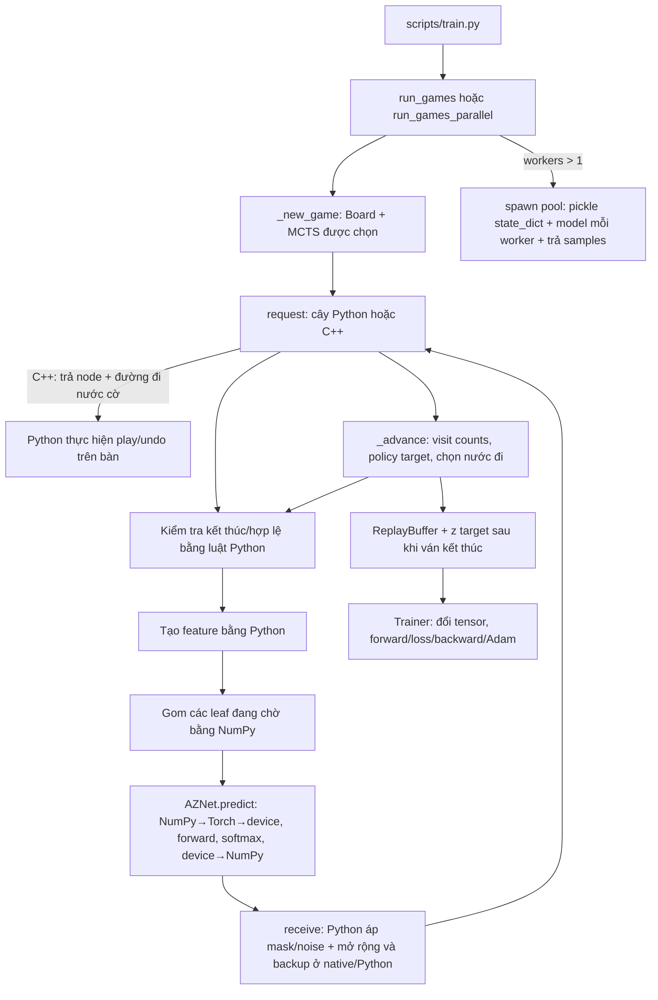

# Kiểm tra kiến trúc: Gomoku hai backend

## Phạm vi và hiện trạng quan sát được

Đã kiểm tra `az/mcts.py`, `az/selfplay.py`, `az/model.py`, `az/trainer.py`, `scripts/train.py`, mã nguồn extension native, các bài kiểm thử backend và những báo cáo hiện có: `docs/bao-cao-dual-backend.md`, `docs/bao-cao-native-mcts.md`, `docs/bao-cao-native-patterns.md`, `docs/bao-cao-profiling-cpp.md` và `docs/benchmarks.md`. Báo cáo tích hợp trước đây ghi nhận 260 test đạt, 3 test bỏ qua; đây không phải kết quả chạy test trong lần kiểm tra này. Working tree đã có nhiều thay đổi chưa commit; không ghi đè các thay đổi đó.

## Luồng gọi self-play

Ở mỗi leaf, `C++ Tree.request()` gọi callback RNG của Python để xử lý các nước hòa điểm PUCT. Python áp các nước được chọn lên `Board` chính thức, kiểm tra luật, tạo legal mask/features rồi undo đường đi. `receive()` chuẩn hóa policy và thêm root noise bằng Python trước khi gửi legal moves/priors trở lại qua pybind11. Do đó backend C++ không chuyển luật, thao tác bàn cờ, tạo feature hay inference sang native. Self-play gom inference của các leaf đang chờ từ nhiều ván; backend native không tự tạo batch lớn hơn trong từng lượt tìm kiếm.

## Luồng gọi tournament

`tournament.py` phân tích agent và công việc, tạo agent qua `players/factory.py`, rồi điều phối `play_game_task`; `AZPlayer.select_move()` quản lý bàn cờ/luật và MCTS đã chọn, đánh giá các leaf bằng `AZNet.predict()` rồi áp nước đi. Tournament cũng có thể chạy heuristic/AlphaBeta, vốn dùng nhận diện mẫu; AZ self-play không gọi `find_patterns()` (báo cáo dual-backend hiện có đánh dấu đúng `not_used` ở luồng này). Vì vậy lợi ích của Patterns backend trong tournament không chứng minh tốc độ self-play hay MCTS tăng.

## Quyền sở hữu và ranh giới

| Thành phần | Nơi xử lý hiện tại | Ảnh hưởng từ MCTS C++ |
|---|---|---|
| Bàn cờ/lịch sử và thao tác trạng thái | Python `Board` | Đường đi nước cờ được chuyển về Python để play/undo |
| Tính hợp lệ Normal/Renju và kiểm tra kết thúc | Python `rules` | Gọi Python trên mỗi leaf được đánh giá |
| Features / legal mask | Python / NumPy | Tạo lại cho mỗi leaf được đánh giá |
| Node cây, duyệt PUCT, backup lượt thăm | Python hoặc arena C++ | Đây là phần chính duy nhất do native sở hữu |
| RNG / xử lý hòa điểm và Dirichlet ở root | NumPy/Python | C++ gọi ngược Python khi có hòa điểm |
| Mô hình neural / inference | PyTorch trong Python | MCTS native không tăng tốc phần này |
| Replay targets và lưu trữ | Python / NumPy | Không đổi |
| Optimizer | PyTorch | Giai đoạn training riêng |
| Truyền dữ liệu nhiều worker | `ProcessPoolExecutor` với spawn | Mỗi worker có model; weights và samples được serialize |

## Các điểm nóng tiềm năng

1. Inference mô hình và truyền NumPy↔Torch/device từng được đo là chiếm ưu thế trong một số profile nhỏ với batch 1; không suy rộng kết quả đó sang cấu hình gom nhiều ván thông thường nếu chưa có số liệu mới.
2. Callback Python xử lý luật/bàn cờ/features ở mỗi leaf, vẫn tồn tại trên đường chạy MCTS native.
3. Chuyển đường đi và legal moves/priors Python↔C++, cùng callback RNG khi xử lý hòa điểm. Đây là chi phí ranh giới có thể có, nhưng chưa được đo riêng trong lần kiểm tra này.
4. Khởi động worker/nhân bản model và serialize replay samples khi chạy multiprocessing. Các báo cáo hiện có chưa xác định số worker tối ưu cho self-play hiện tại.
5. Quét mẫu trong tournament, cụ thể ở các đối thủ sử dụng pattern, là luồng riêng.

Chỉ dựa trên kiểm tra kiến trúc thì chưa có căn cứ để chuyển board/rules sang native hay thay đổi semantics.