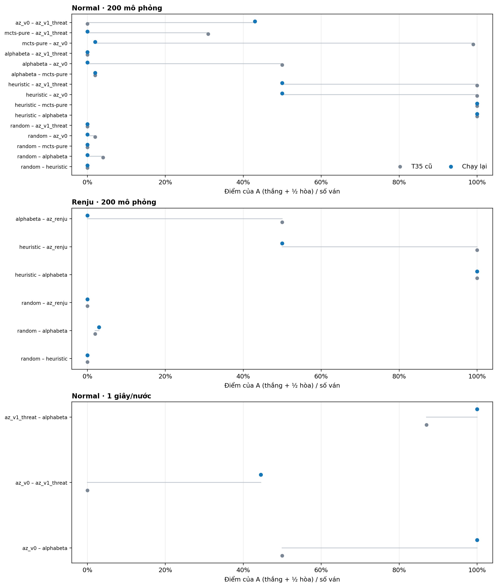
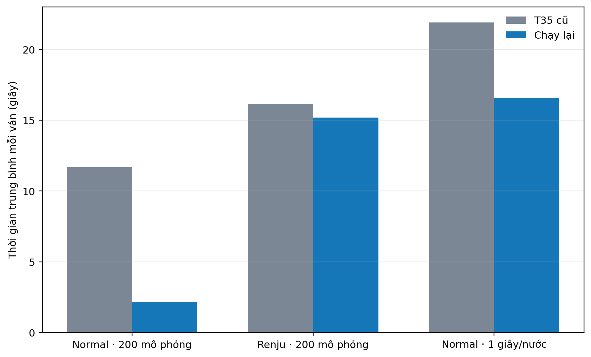

# T35 chạy lại — kết quả cuối (2026-11-24)

> Phạm vi: chạy lại đúng 24 cặp T35, 100 ván/cặp, 50 màu Đen và 50 màu Trắng; không huấn luyện và không thay đổi luật. Dữ liệu gốc T35 được giữ nguyên.

## Thiết lập và định danh

| Nhóm | Run ID SQLite mới | Cặp × ván | Backend / tiến trình | Thời gian từ bắt đầu đến hoàn tất (giây) |
|---|---|---:|---|---:|
| normal_fixed | `t35-rerun-20261124-normal-fixed` | 15 × 100 | cpp / 4→2 (resume) × 1 thread | 2713.2 |
| renju_fixed | `t35-rerun-20261124-renju-fixed` | 6 × 100 | cpp / 2 × 1 thread | 4579.2 |
| normal_time | `t35-rerun-20261124-normal-time` | 3 × 100 | python / 3 × 1 thread | 1671.8 |

T35 cũ gồm Normal cố định (15 cặp), Renju cố định (6 cặp) và Normal 1 giây/nước (3 cặp). Chạy lại giữ nguyên tập tác tử, luật, ngân sách, độ sâu Alpha-Beta cố định 1, seed gốc `20261113`, seed scheme lịch sử `legacy-v1`, bàn trống và đổi màu theo từng cặp. Mỗi nhóm được ghi vào `data/tournament.sqlite` bằng run ID riêng; không ghi đè dữ liệu cũ.

Checkpoint Normal dùng con trỏ best hiện hành `checkpoints/normal/best.json`, generation `7c43f06544a045be8ef1292486a06c15`, SHA-256 `af6337abf4fe733e9bc0dc202f2048f7f2575411bc03d5b102268782771a223e` (Normal, 6×64). Renju dùng checkpoint 1.500 ván được đánh giá tốt nhất trong các tạo tác hiện còn, `checkpoints/renju_finetune_1500/latest.json`, SHA-256 `5e2e45d5a952bdf88c8cce783b882d65d6d5ebd7128549984cd8be21c24af9b5` (Renju, 6×64). Renju không có con trỏ `best.json`; đây là checkpoint được thử nghiệm tốt nhất còn truy xuất được, không phải mô hình đạt ngưỡng sức chơi.

Các nhóm ngân sách mô phỏng dùng MCTS và nhận diện mẫu C++ (`gomoku_native` 0.1.0), 1 luồng Torch mỗi tiến trình; AZ tự chọn CUDA khi khả dụng. Normal cố định bắt đầu với 4 tiến trình, sau đó tiếp tục với 2 tiến trình sau lỗi cấp phát bộ nhớ native; Renju sẽ dùng 2 tiến trình để giảm áp lực bộ nhớ. Nhóm ngân sách thời gian dùng Python và 3 tiến trình, giữ giới hạn 1 giây/nước; Alpha-Beta dùng iterative deepening. Bộ chạy hiện không hỗ trợ batching suy luận liên ván. 55 kiểm thử Python/C++ tập trung đã qua; tính tương đương kết quả trên quỹ đạo ngẫu nhiên chưa được xác lập.

So sánh với T35 cũ giữ nguyên cặp, màu, luật, ngân sách và seed; checkpoint được cập nhật theo yêu cầu. Backend và một phần môi trường T35 cũ khác/không đồng nhất, vì vậy chênh lệch là mô tả giữa hai snapshot, không quy kết nhân quả cho checkpoint hoặc backend.

## Kết quả tổng hợp

| Nhóm | Ván | T35 cũ: tác tử đứng đầu (score) | Chạy lại: tác tử đứng đầu (score) | Hòa | Illegal |
|---|---:|---|---|---:|---:|
| normal_fixed | 1500 | heuristic (100.0%) | az_v1_threat (81.4%) | 0 | 0 |
| renju_fixed | 600 | heuristic (100.0%) | heuristic (83.3%) | 0 | 0 |
| normal_time | 300 | az_v1_threat (93.5%) | az_v1_threat (77.8%) | 3 | 0 |

## Kết quả theo cặp

Tỷ lệ thắng = W / N; điểm = (W + 0,5D) / N. Khoảng điểm là Wilson 95% (hòa tính nửa điểm). Elo là chênh lệch pairwise Davidson so với đối thủ, với bootstrap 2.000 lần theo cụm hai ván đổi màu; đây không phải leaderboard Elo tuyệt đối.

### Normal — 200 mô phỏng

| A | B | T35 cũ W/D/L | Chạy lại W/D/L | A thắng Đen/Trắng | Tỷ lệ thắng | Điểm [Wilson 95%] | ΔElo A−B, cũ → mới [CI 95%] | Giây/ván (cũ → mới) |
|---|---|---:|---:|---:|---:|---|---|---:|
| random | heuristic | 0/0/100 | 0/0/100 | 0/0 | 0.0% | 0.0% [0.000; 0.037] | -921.3 [-921.3; -921.3] → -921.3 [-921.3; -921.3] | 0.04 → 0.01 |
| random | alphabeta | 4/0/96 | 0/0/100 | 0/0 | 0.0% | 0.0% [0.000; 0.037] | -532.5 [-728.7; -414.7] → -921.3 [-921.3; -921.3] | 37.11 → 1.65 |
| random | mcts-pure | 0/0/100 | 0/0/100 | 0/0 | 0.0% | 0.0% [0.000; 0.037] | -921.3 [-921.3; -921.3] → -921.3 [-921.3; -921.3] | 1.07 → 0.71 |
| random | az_v0 | 2/0/98 | 0/0/100 | 0/0 | 0.0% | 0.0% [0.000; 0.037] | -638.2 [-921.3; -495.9] → -921.3 [-921.3; -921.3] | 7.36 → 1.29 |
| random | az_v1_threat | 0/0/100 | 0/0/100 | 0/0 | 0.0% | 0.0% [0.000; 0.037] | -921.3 [-921.3; -921.3] → -921.3 [-921.3; -921.3] | 4.88 → 0.94 |
| heuristic | alphabeta | 100/0/0 | 100/0/0 | 50/50 | 100.0% | 100.0% [0.963; 1.000] | +921.3 [+921.3; +921.3] → +921.3 [+921.3; +921.3] | 8.55 → 0.34 |
| heuristic | mcts-pure | 100/0/0 | 100/0/0 | 50/50 | 100.0% | 100.0% [0.963; 1.000] | +921.3 [+921.3; +921.3] → +921.3 [+921.3; +921.3] | 0.69 → 0.32 |
| heuristic | az_v0 | 100/0/0 | 50/0/50 | 50/0 | 50.0% | 50.0% [0.404; 0.596] | +921.3 [+921.3; +921.3] → +0.0 [+0.0; +0.0] | 2.20 → 5.40 |
| heuristic | az_v1_threat | 100/0/0 | 50/0/50 | 50/0 | 50.0% | 50.0% [0.404; 0.596] | +921.3 [+921.3; +921.3] → +0.0 [+0.0; +0.0] | 2.28 → 5.03 |
| alphabeta | mcts-pure | 2/0/98 | 2/0/98 | 0/2 | 2.0% | 2.0% [0.006; 0.070] | -638.2 [-921.3; -495.9] → -638.2 [-921.3; -495.9] | 20.92 → 1.52 |
| alphabeta | az_v0 | 50/0/50 | 0/0/100 | 0/0 | 0.0% | 0.0% [0.000; 0.037] | +0.0 [+0.0; +0.0] → -921.3 [-921.3; -921.3] | 40.12 → 1.66 |
| alphabeta | az_v1_threat | 0/0/100 | 0/0/100 | 0/0 | 0.0% | 0.0% [0.000; 0.037] | -921.3 [-921.3; -921.3] → -921.3 [-921.3; -921.3] | 29.20 → 1.52 |
| mcts-pure | az_v0 | 99/0/1 | 2/0/98 | 2/0 | 2.0% | 2.0% [0.006; 0.070] | +728.7 [+578.0; +921.3] → -638.2 [-921.3; -495.9] | 5.61 → 1.53 |
| mcts-pure | az_v1_threat | 31/0/69 | 0/0/100 | 0/0 | 0.0% | 0.0% [0.000; 0.037] | -137.5 [-217.1; -62.6] → -921.3 [-921.3; -921.3] | 8.11 → 1.25 |
| az_v0 | az_v1_threat | 0/0/100 | 43/0/57 | 19/24 | 43.0% | 43.0% [0.337; 0.528] | -921.3 [-921.3; -921.3] → -48.5 [-114.0; +20.7] | 7.41 → 9.20 |
### Renju — 200 mô phỏng

| A | B | T35 cũ W/D/L | Chạy lại W/D/L | A thắng Đen/Trắng | Tỷ lệ thắng | Điểm [Wilson 95%] | ΔElo A−B, cũ → mới [CI 95%] | Giây/ván (cũ → mới) |
|---|---|---:|---:|---:|---:|---|---|---:|
| random | heuristic | 0/0/100 | 0/0/100 | 0/0 | 0.0% | 0.0% [0.000; 0.037] | -921.3 [-921.3; -921.3] → -921.3 [-921.3; -921.3] | 0.11 → 0.08 |
| random | alphabeta | 2/0/98 | 3/0/97 | 1/2 | 3.0% | 3.0% [0.010; 0.085] | -638.2 [-921.3; -495.9] → -578.0 [-921.3; -438.3] | 14.62 → 1.69 |
| random | az_renju | 0/0/100 | 0/0/100 | 0/0 | 0.0% | 0.0% [0.000; 0.037] | -921.3 [-921.3; -921.3] → -921.3 [-921.3; -921.3] | 26.96 → 7.70 |
| heuristic | alphabeta | 100/0/0 | 100/0/0 | 50/50 | 100.0% | 100.0% [0.963; 1.000] | +921.3 [+921.3; +921.3] → +921.3 [+921.3; +921.3] | 6.92 → 0.40 |
| heuristic | az_renju | 100/0/0 | 50/0/50 | 0/50 | 50.0% | 50.0% [0.404; 0.596] | +921.3 [+921.3; +921.3] → +0.0 [+0.0; +0.0] | 14.13 → 71.04 |
| alphabeta | az_renju | 50/0/50 | 0/0/100 | 0/0 | 0.0% | 0.0% [0.000; 0.037] | +0.0 [+0.0; +0.0] → -921.3 [-921.3; -921.3] | 34.36 → 10.27 |
### Normal — 1 giây/nước

| A | B | T35 cũ W/D/L | Chạy lại W/D/L | A thắng Đen/Trắng | Tỷ lệ thắng | Điểm [Wilson 95%] | ΔElo A−B, cũ → mới [CI 95%] | Giây/ván (cũ → mới) |
|---|---|---:|---:|---:|---:|---|---|---:|
| az_v0 | alphabeta | 50/0/50 | 100/0/0 | 50/50 | 100.0% | 100.0% [0.963; 1.000] | +0.0 [-77.1; +84.2] → +921.3 [+921.3; +921.3] | 23.59 → 10.50 |
| az_v0 | az_v1_threat | 0/0/100 | 43/3/54 | 29/14 | 43.0% | 44.5% [0.351; 0.543] | -921.3 [-921.3; -921.3] → -39.2 [-101.0; +21.5] | 18.58 → 30.20 |
| az_v1_threat | alphabeta | 87/0/13 | 100/0/0 | 50/50 | 100.0% | 100.0% [0.963; 1.000] | +324.7 [+227.2; +465.0] → +921.3 [+921.3; +921.3] | 23.57 → 9.00 |

## Biểu đồ

## Diễn giải và giới hạn

- T35 cũ ghi 2.400 ván; lần chạy lại phải có đủ 1.500 Normal cố định, 600 Renju cố định và 300 Normal thời gian. Các kết quả được giữ tách theo luật/ngân sách.
- Bàn trống và các tác tử tất định có thể tạo lại cùng quỹ đạo dù có 50 cặp seed. Do đó khoảng Wilson/cluster-bootstrap là mô tả danh nghĩa; số quỹ đạo độc lập thấp hơn số ván và không hỗ trợ suy rộng ngoài pool này.
- Thời gian cũ ghép từ nhiều môi trường trong nhóm fixed; thời gian mới đo trên Windows, RTX 4060 Laptop, PyTorch 2.14.1+cu126, 16 CPU logic. So sánh wall-clock không cô lập tác động của checkpoint/backend. Thời lượng mới là chênh lệch giữa thời điểm bắt đầu experiment và `finished_at` trong SQLite, gồm cả khoảng gián đoạn khi resume.
- Dữ liệu T35 cũ được giữ nguyên, không có experiment ID tương ứng trong SQLite hiện tại. Bộ tạo báo cáo đã đối chiếu W/D/L của đủ 2.400 ván JSONL với bảng tổng hợp và xác nhận 50 cặp ván đổi màu cho mỗi trận đấu.
- Khi khôi phục run sau lỗi, cấu hình SQLite giữ số tiến trình khởi tạo; số tiến trình thực tế trong lần tiếp tục được ghi tại `logs/tournament/t35-rerun-20261124-normal-fixed-resume.json`.

## Tái lập và nguồn

- Cơ sở dữ liệu: `data/tournament.sqlite`; run IDs: `t35-rerun-20261124-normal-fixed, t35-rerun-20261124-renju-fixed, t35-rerun-20261124-normal-time`.
- Baseline: `evidence/colab_return_20261114T085015Z/t35_analysis.json` và các `games.jsonl`/`manifest.json` được trỏ trực tiếp từ tệp phân tích.
- Phân tích/biểu đồ: `report/build_t35_rerun.py`; W/D/L, điểm và thời gian đọc từ SQLite; Elo là ước lượng Davidson theo cụm cặp màu, cùng công thức trong `az/elo.py` và bootstrap 2.000 mẫu.
- T35 lịch sử: `docs/report.md`, mục 10; giao thức: `docs/benchmarks.md`, mục T35; mô tả luật/benchmark: `SPEC.md`, mục 10–11.
