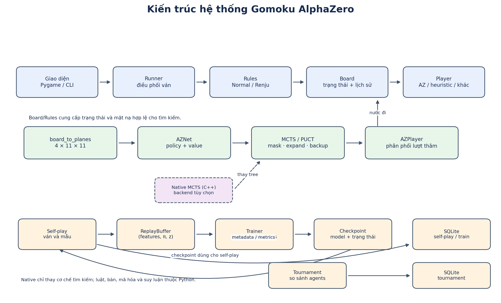
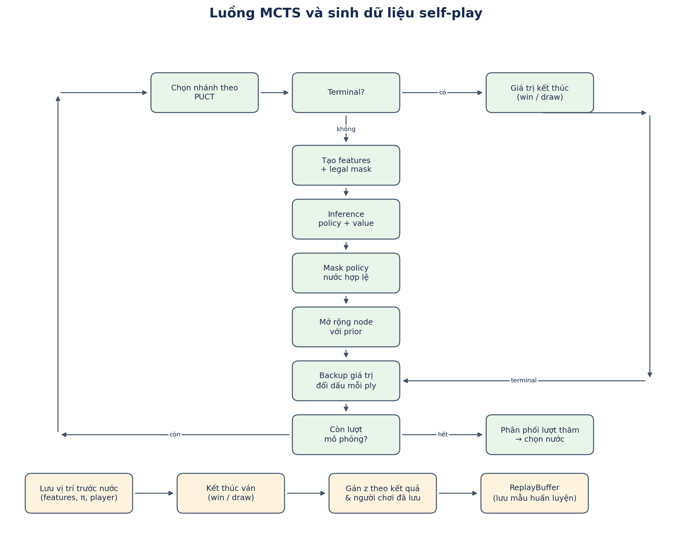

# Chương 1. Giới thiệu

## 1.1. Bối cảnh

Gomoku là trò chơi đối kháng hai người trên bàn cờ, trong đó hai bên luân phiên đặt quân vào các giao điểm còn trống. Trong biến thể Normal của đồ án, người chơi thắng khi tạo được ít nhất năm quân liên tiếp theo hàng, cột hoặc một trong hai đường chéo. Dù luật ngắn gọn, số trạng thái có thể xuất hiện tăng rất nhanh theo số nước đã đi: lựa chọn ở mỗi lượt phụ thuộc vào toàn bộ thế cờ, còn một sai lầm chiến thuật có thể quyết định kết quả ngay lập tức. Vì vậy, một chương trình chơi Gomoku cần đồng thời biểu diễn trạng thái, kiểm tra luật, ước lượng vị trí và lựa chọn hành động.

Đồ án xây dựng một hệ thống nghiên cứu agent Gomoku 11×11 theo hướng AlphaZero: mạng nơ-ron dự đoán chính sách nước đi và giá trị trạng thái; tìm kiếm Monte Carlo Tree Search (MCTS) sử dụng các dự đoán đó để phân bổ lượt mô phỏng; dữ liệu từ các ván tự chơi được đưa trở lại quá trình huấn luyện. Đây là vòng lặp kết hợp học tăng cường và lập kế hoạch tìm kiếm, thay vì chỉ dùng mạng nơ-ron suy luận một nước hoặc chỉ duyệt cây bằng luật heuristic. Đặc tả dự án xác định mục tiêu nghiên cứu là xây dựng agent, hỗ trợ Normal/Renju và so sánh sức chơi trong các điều kiện được kiểm soát; mục tiêu “AlphaZero mạnh hơn Heuristic” là câu hỏi nghiên cứu, không phải tiền đề đã được chứng minh (`SPEC.md`, mục 1–2, dòng 28–66).

## 1.2. Bài toán và biểu diễn hình thức

Xét một trò chơi có trạng thái `s`, tập hành động hợp lệ tại trạng thái đó `A(s)`, hàm chuyển trạng thái `T(s,a)` và kết quả cuối ván. Agent ở lượt của mình cần chọn `a ∈ A(s)`. Trong Gomoku, trạng thái bao gồm bố trí quân trên bàn và bên sắp đi; tập hành động chủ yếu là các ô trống, sau đó bị giới hạn thêm bởi luật của ruleset. Trò chơi là đối kháng, hai phía có mục tiêu trái dấu. Vì thế, giá trị của cùng một vị trí phải gắn với góc nhìn của một người chơi xác định, chứ không phải chỉ là điểm vô hướng không có quy ước dấu.

Trong phần cài đặt, bàn có kích thước 11×11, hai màu được mã hóa bằng BLACK/WHITE, ô trống là EMPTY và hành động được làm phẳng thành `a = 11r + c`. `Board` sở hữu lưới, người chơi hiện tại và lịch sử nước đi; việc một nước có hợp lệ theo luật hay không được hỏi qua `Rules`, không được suy ra chỉ từ thao tác sửa bàn (`SPEC.md`, mục 5.1, dòng 131–147; `gomoku/board.py`, định nghĩa `Board` và thao tác `play/undo`). Cách tách này giúp mô hình hóa trò chơi thống nhất giữa giao diện, self-play và tìm kiếm.

## 1.3. Mục tiêu, câu hỏi nghiên cứu và phạm vi

Trọng tâm kỹ thuật của báo cáo là giải thích đầy đủ cơ sở lý thuyết và kiến trúc đã được hiện thực: AlphaZero, MCTS/PUCT, ResNet, reinforcement learning, self-play và transfer learning; tiếp đó mô tả engine, luật Normal/Renju và đường đi tensor–MCTS–replay–training. Các câu hỏi nghiên cứu được SPEC nêu gồm so sánh AlphaZero với Heuristic trong cùng điều kiện, quan sát ảnh hưởng của mốc dữ liệu self-play và optimizer steps lên playing strength, đánh giá native backend về throughput lẫn tính đúng đắn, và so sánh Normal với Renju trong rating pool riêng (`SPEC.md`, mục 1.2, dòng 34–45).

Các chương đầu phân biệt cấu hình với kết quả thực nghiệm được phân tích ở các chương sau. Những giá trị như số block, batch size, số mô phỏng, số vòng và số ván trong cấu hình không tự chứng minh một lần chạy đã sử dụng các giá trị đó, cũng không phải kết quả thực nghiệm. SPEC đánh dấu mục tiêu AlphaZero thắng Heuristic với bằng chứng đủ tin cậy là chưa đạt tại thời điểm tài liệu được rà soát và yêu cầu không suy luận sức chơi từ việc loss giảm hay pipeline chạy hoàn tất (`SPEC.md`, mục 1.3 và bảng yêu cầu, dòng 41–66).

Phạm vi trò chơi được giữ ở bàn 11×11 và hai luật mà mã dự án hiện thực. Đặc biệt, Renju trong báo cáo được mô tả là hành vi của implementation; không khẳng định nó bao phủ mọi quy tắc, tiền lệ và tình huống phân xử của chuẩn Renju quốc tế (`SPEC.md`, mục 1.3 và 5.2, dòng 41–46, 137–157).

## 1.4. Ý nghĩa và bố cục

Ý nghĩa của hệ thống nằm ở sự liên kết giữa ba lớp: (i) luật và biểu diễn trạng thái cung cấp đầu vào nhất quán, (ii) mạng policy-value và MCTS tạo hành vi lựa chọn có tìm kiếm, (iii) tự chơi, replay và tối ưu tham số khép kín vòng học. Sai sót ở một lớp có thể lan sang lớp khác: ví dụ mask nước cấm sai làm cây tìm kiếm mở rộng hành động không hợp lệ; value dùng sai quy ước người chơi làm backup đảo kết quả; dữ liệu gán nhãn sai khiến loss vẫn tính được nhưng không còn mục tiêu học đúng.

Chương 2 trình bày nền tảng học thuật; Chương 3 mô tả hệ thống, engine và hai ruleset; Chương 4 tập trung vào kiến trúc mạng và pipeline AlphaZero. Các chương tiếp theo trình bày quá trình thực nghiệm, kết quả, kiểm thử và kết luận, kèm giới hạn bằng chứng.

# Chương 2. Cơ sở lý thuyết

## 2.1. Học tăng cường trong trò chơi đối kháng

Học tăng cường (Reinforcement Learning, RL) nghiên cứu cách một tác tử tương tác với môi trường, nhận trạng thái và phần thưởng rồi cải thiện chính sách lựa chọn hành động. Một quá trình quyết định Markov thường được ký hiệu bằng trạng thái `s`, hành động `a`, xác suất chuyển `P(s′|s,a)` và phần thưởng `r`. Trong trò chơi bàn cờ xác định, chuyển trạng thái được quyết định bởi nước đi và luật; phần thưởng thường tập trung ở cuối ván. Mục tiêu là tìm chính sách `π(a|s)` tối đa hóa tổng phần thưởng kỳ vọng.

Trong thiết lập hai người chơi có tổng bằng không, giá trị của vị trí có thể viết theo góc nhìn người đang đi: `v(s) = E[z | s, player-to-move]`, với kết quả cuối `z ∈ {−1, 0, +1}` tương ứng thua, hòa và thắng cho người chơi được quy ước. Sau khi một ply (một nước của một bên) được đi, góc nhìn đối kháng đổi bên, nên dấu giá trị đảo. Quy ước này là thiết yếu cho backpropagation trong MCTS và cho nhãn value trong dữ liệu tự chơi.

Trong AlphaZero, RL không dựa vào dữ liệu gắn nhãn do con người cung cấp. Agent tự sinh các ván, dùng tìm kiếm để tạo chính sách mục tiêu giàu thông tin hơn một lần dự đoán đơn lẻ, rồi cập nhật mạng dựa trên kết quả ván. Bài báo AlphaZero trình bày phương pháp học game từ self-play kết hợp policy/value network với MCTS, và báo cáo áp dụng trên cờ vây, cờ vua và shogi (Silver và cộng sự, 2018, https://www.science.org/doi/10.1126/science.aar6404). Đây là nền tảng phương pháp; bài báo không phải bằng chứng về sức chơi của implementation Gomoku trong đồ án.

## 2.2. AlphaZero: policy, value và tìm kiếm

Mạng policy-value học hai phép dự đoán trên một biểu diễn trạng thái:

- `p(a|s)`: prior xác suất cho hành động `a`, cho biết mạng ưu tiên khám phá nhánh nào.
- `v(s)`: giá trị kỳ vọng từ trạng thái, theo góc nhìn người chơi quy ước.

Policy tạo thứ tự ưu tiên khi mở rộng cây; value giúp ước lượng các lá chưa đi đến kết thúc. MCTS làm giàu dự đoán policy ban đầu thông qua nhiều lần duyệt cây. Sau tìm kiếm, số lần thăm các nước gốc được chuyển thành phân phối mục tiêu `π`; hành động thực tế có thể được lấy mẫu từ phân phối đó hoặc chọn nước có số lượt thăm cao nhất. Kết quả cuối ván tạo nhãn `z`. Mục tiêu tổng hợp thường có dạng:

`L(θ) = (z − vθ(s))² − πᵀ log pθ(s) + c||θ||²`.

Ở đây, hạng value hồi quy kết quả; hạng policy khớp phân phối thăm của tìm kiếm; regularization kiểm soát độ lớn tham số trong mô tả lý thuyết. Trong implementation của đồ án, objective được chia rõ thành policy cross-entropy và value MSE; weight decay được cấu hình ở Adam thay vì cộng thêm một lần vào loss (`az/trainer.py`, dòng 99–124). Vì vậy, công thức lý thuyết không được hiểu nhầm là mã đang cộng hạng L2 tường minh.

## 2.3. Monte Carlo Tree Search và UCT

MCTS xây dựng cây tìm kiếm từng phần bằng cách lặp bốn ý tưởng: lựa chọn một đường đi từ gốc theo thống kê hiện có; mở rộng nút mới; đánh giá lá (bằng mô phỏng hoặc hàm đánh giá); rồi backup kết quả về các nút trên đường đi. Khác với duyệt toàn bộ cây, MCTS tăng ngân sách tại các nhánh được xem là có tiềm năng, nhờ đó tập trung tính toán vào các lựa chọn hữu ích.

UCT (Upper Confidence bounds applied to Trees) cân bằng khai thác và khám phá bằng cách cộng điểm giá trị trung bình vào một hạng thưởng cho nhánh ít được thăm. Một dạng thường dùng là:

`UCT(s,a) = Q(s,a) + c √(ln N(s) / N(s,a))`.

Trong đó `Q` là kết quả trung bình ước lượng, `N(s)` là số lần thăm nút cha, `N(s,a)` là số lần thăm nhánh và `c` điều chỉnh mức khám phá. Kocsis và Szepesvári phát triển UCT như phương pháp áp dụng confidence bounds vào cây tìm kiếm (2006, https://link.springer.com/chapter/10.1007/11871842_29). UCT cung cấp nền tảng cho ý tưởng chọn nhánh theo thống kê và exploration bonus; AlphaZero thay cấu trúc thưởng bằng prior policy trong PUCT.

Trong cờ đối kháng, `Q` phải có hướng nhìn nhất quán. Nếu node con lưu giá trị từ góc nhìn người chơi tới lượt ở chính node con, thì parent đánh giá nhánh đó với dấu âm: một vị trí tốt cho đối thủ là không tốt cho người đang chọn ở parent. Không làm rõ quy ước này là nguồn lỗi phổ biến vì mọi số vẫn có thể hữu hạn và cây vẫn chạy, nhưng hành vi chọn nước bị đảo.

## 2.4. PUCT trong AlphaZero

PUCT kết hợp giá trị ước lượng với prior từ policy network. Dạng điểm chọn child được sử dụng trong dự án là:

`score(s,a) = −Q(s_a) + c_puct · P(s,a) · √(max(1,N(s))) / (1 + N(s_a))`.

Ở đây, `P(s,a)` là prior; `N(s)` là visit count của node cha; `N(s_a)` là visit count child; `Q(s_a)` là giá trị trung bình của node con theo góc nhìn người tới lượt ở con; dấu âm đưa nó về góc nhìn node cha. `c_puct` điều chỉnh độ ảnh hưởng của prior/khám phá. Ban đầu nhánh có prior cao được ưu tiên; khi nhánh được thăm nhiều, mẫu số tăng và phần thưởng giảm, cho phép nhánh khác được khảo sát. Công thức và mặc định `c_puct=1.5` được mô tả trong SPEC (`SPEC.md`, mục 7.1, dòng 180–194); các trường node và quy ước `q_value` nằm trong `az/mcts.py`, dòng 18–37.

Khi mở rộng lá, network trả về policy softmax; MCTS nhân policy đó với legal mask sau softmax, tính tổng khối lượng còn lại rồi chuẩn hóa lại trên các nước hợp lệ. Nếu tổng nhỏ hơn hoặc bằng ngưỡng `1e−8`, phần mềm dùng phân phối đều trên các hành động legal; nước cấm nhận prior bằng 0. Về mặt toán học, mask logits trước softmax tương đương khi chuẩn hóa chính xác trên cùng tập hợp hợp lệ; tuy nhiên sai số số học và ngưỡng fallback có thể tạo khác biệt trong cài đặt. Mã mask sau softmax tại `az/mcts.py`, dòng 158–174; `AZNet.predict` tạo policy probability tại `az/model.py`, dòng 86–105.

Trong huấn luyện, Dirichlet noise có thể được trộn vào prior tại root để khuyến khích khám phá: `P′ = (1−ε)P + εη`, trong đó `η` lấy từ Dirichlet chỉ trên legal moves. Đây là cơ chế self-play/training; đánh giá tournament mặc định tắt root noise theo protocol được mô tả trong SPEC (`SPEC.md`, mục 7.1 và 10.2). Do đó không nên nói root noise luôn bật trong mọi lần MCTS.

## 2.5. Mạng ResNet và mạng policy-value

Mạng tích chập phù hợp với bàn cờ vì mỗi ô nằm trong quan hệ không gian cục bộ với các ô lân cận; các bộ lọc có thể phát hiện mẫu theo vị trí mà không cần một tham số riêng cho từng tọa độ ở mọi lớp. ResNet bổ sung kết nối tắt (skip connection) để một block học phần dư thay vì phải tái tạo trực tiếp ánh xạ đầy đủ. Với đầu vào `x`, block có dạng `y = ReLU(F(x) + x)` (có chuẩn hóa batch trong các lớp tích chập). Kết nối tắt hỗ trợ truyền tín hiệu qua nhiều lớp và là nền tảng cho mạng sâu hơn. He và cộng sự giới thiệu residual learning cho recognition thị giác quy mô lớn (2015, https://arxiv.org/abs/1512.03385).

AZNet trong dự án dùng một stem convolution, tiếp đó là các residual blocks và hai head. Policy head chuyển đặc trưng không gian thành 121 logits, một cho mỗi ô của bàn 11×11. Value head tổng hợp đặc trưng thành một scalar qua `tanh`, nên dự đoán bị chặn trong `[-1,1]`. Cấu trúc có thể biểu diễn khái quát là `x → trunk ResNet → {policy logits, value}`. Theo mặc định của constructor và cấu hình, model có 6 residual blocks và 64 filters; đây là giá trị cấu hình, không phải kích thước bắt buộc của lý thuyết AlphaZero (`az/model.py`, dòng 14–40, 68–84; `config.py`, dòng 28–30; `SPEC.md`, mục 6, dòng 159–178).

Hai head phục vụ hai nhiệm vụ liên quan nhưng không đồng nhất. Policy head xếp hạng hành động; value head ước lượng kết quả kỳ vọng từ vị trí. Việc dùng chung trunk cho phép các đặc trưng hữu ích cho cả đánh giá vị trí và chọn nước được học chung, trong khi mỗi head có lớp đầu ra riêng. Không nên diễn giải policy probability là xác suất thắng; đó là phân phối trên hành động, còn value là dự đoán kết quả.

## 2.6. Self-play và dữ liệu mục tiêu

Self-play là quá trình một policy tạo ra các ván huấn luyện bằng cách điều khiển cả hai bên hoặc vận hành hai lượt agent trong cùng một game. Mỗi trạng thái trước nước đi có thể tạo mẫu `(s, π, player)`, trong đó `π` là phân phối visits sau MCTS. Khi ván kết thúc, kết quả `z` được quy đổi theo bên đã lưu ở trạng thái đó. Như vậy mỗi mẫu chứa thông tin cục bộ từ tìm kiếm và tín hiệu kết quả cuối ván.

Self-play vừa tạo dữ liệu vừa xác định phân phối trạng thái mà model gặp: thay đổi policy sẽ làm thay đổi ván, các trạng thái được thăm và target policy tiếp theo. Điều này tạo vòng phản hồi giữa dữ liệu và model. Nó cũng có rủi ro phân phối: nhiều mẫu có thể tương tự nhau hoặc thiếu các tình huống hiếm; số lượng mẫu lớn không đồng nghĩa với độ đa dạng hay playing strength cao. Để bảo toàn ngữ nghĩa, `z` phải gắn với người chơi ở trạng thái đã lưu, `π` chỉ có xác suất trên nước hợp lệ, và số mẫu nên khớp số trạng thái đã được tìm kiếm. SPEC liệt kê các bất biến tương ứng cho pipeline (`SPEC.md`, mục 8.3, dòng 255–265).

## 2.7. Transfer learning và fine-tuning

Transfer learning khai thác tri thức đã học trên một tác vụ hoặc phân phối nguồn để khởi tạo mô hình cho tác vụ đích liên quan. Trong fine-tuning, một phần hoặc toàn bộ tham số của model đã huấn luyện được tiếp tục tối ưu trên dữ liệu/tác vụ mới. Tổng quan của Pan và Yang phân loại phương pháp transfer learning theo quan hệ giữa miền nguồn, miền đích và nhiệm vụ (2010, https://ieeexplore.ieee.org/abstract/document/5288526).

Trong bối cảnh Gomoku, ý tưởng có thể là khởi tạo từ checkpoint đã học trên Normal rồi tiếp tục tối ưu khi luật đích là Renju. Có thể có đặc trưng dùng chung như hình thành chuỗi quân hoặc chiến lược chiếm trung tâm, nhưng ruleset thay đổi tập hành động hợp lệ, khái niệm kết thúc và phân phối kết quả. Do đó chuyển trọng số không đồng nghĩa với chuyển nguyên vẹn policy đúng cho luật mới. Training examples, legal mask, nhãn kết quả, buffer và checkpoint phải nhất quán với ruleset đích; dữ liệu Normal không nên bị âm thầm trộn trong buffer Renju nếu pipeline đặt ràng buộc một luật mỗi buffer.

Trong repo có cấu hình và driver fine-tuning Renju, nhưng sự hiện diện của chúng chỉ chứng minh có đường chạy được thiết kế/cài đặt; nó không chứng minh fine-tuning làm tăng strength. Cần thí nghiệm matched trước–sau với checkpoint nguồn, luật, ngân sách tìm kiếm, protocol, màu và seeds được kiểm soát để kết luận tác động nhân quả. SPEC cũng tách pool Normal/Renju và cảnh báo không thể suy diễn từ một loss hoặc số ván (`SPEC.md`, mục 1.2, 10.2; `az/renju_finetune.py`; `configs/renju.yaml`).

# Chương 3. Kiến trúc hệ thống và luật chơi

## 3.1. Tổng quan hệ thống

Hệ thống được chia thành các thành phần có trách nhiệm khác nhau. Lớp giao diện dòng lệnh hoặc Pygame khởi tạo game và player; `gomoku/` giữ board, rules, game/runner và feature encoding; `players/` cung cấp các loại tác tử; `az/` triển khai model, MCTS, self-play, replay, trainer và đánh giá; `native/` chứa các extension C++ tùy chọn. Kết quả training và tournament được ghi ở các kho dữ liệu khác nhau; checkpoint và replay được lưu riêng theo hợp đồng huấn luyện (`SPEC.md`, mục 3–4, dòng 68–128).

Trong luồng inference thông thường, player gọi MCTS; MCTS truy vấn Rules để xác định nước legal và trạng thái terminal, tạo tensor đặc trưng cho lá, rồi yêu cầu mạng policy-value đánh giá. Sau một ngân sách tìm kiếm, thống kê root được chuyển thành lựa chọn nước đi. Ở self-play, cùng luồng được thực hiện cho từng game; feature và visit policy được giữ lại, kết quả cuối được gán làm value target rồi mẫu được đưa vào replay. Trainer lấy batch từ replay, cập nhật tham số mạng, lưu checkpoint và metadata.

Cấu trúc dữ liệu và ranh giới thành phần giúp phân biệt hai hoạt động: self-play/training sinh dữ liệu, còn tournament/evaluation đánh giá checkpoint bằng giao thức riêng. Log self-play/training và database tournament không phải một kho thay thế nhau; số game đã tạo không tự là phép đo chất lượng (`SPEC.md`, mục 4.1, dòng 119–128).

## 3.2. Board, Rules và hợp đồng game

Board 11×11 được lưu dưới dạng 121 ô tuyến tính; `a=11r+c` chuyển giữa chỉ số hành động và tọa độ hàng-cột. `Board.play` bảo đảm tọa độ nằm trong bàn và ô chưa bị chiếm, ghi lịch sử rồi đổi lượt; nó không quyết định tính hợp lệ theo Normal hay Renju. Caller cần kiểm tra nước đi với `Rules` trước khi cập nhật. `undo` phục hồi nước cuối và bên đi (`SPEC.md`, mục 5.1, dòng 131–135).

Interface `Rules` tách các câu hỏi luật khỏi biểu diễn bàn: danh sách nước hợp lệ, danh sách nước cấm, trạng thái thắng và kết thúc. Cả player, MCTS và UI cần dùng chung interface để tránh tự triển khai các biến thể luật không đồng nhất. MCTS không tự hiểu “ô cấm” theo một heuristic riêng; nó nhận legal mask được tạo từ Rules (`SPEC.md`, mục 4 và 5.3, dòng 119–128, 149–157).

Normal cho phép đặt lên mọi ô trống. Năm quân trở lên liên tiếp theo một trong bốn hướng (ngang, dọc, chéo chính, chéo phụ) là thắng cho cả hai màu; bàn đầy mà chưa có thắng là hòa. Implementation kiểm tra chuỗi qua hai chiều quanh nước cuối và dùng `>=5` (`gomoku/rules/normal.py`, dòng 8–17, 19–48; `SPEC.md`, mục 5.2, dòng 137–147).

## 3.3. Luật Renju theo implementation

Renju trong đồ án áp dụng bất đối xứng theo màu. Với Black, exact-five thắng; overline, double-four và double-three là các dạng nước bị cấm theo semantics hiện tại. Với White, năm quân trở lên thắng và không có forbidden mask. Đặc biệt, code xét exact-five trước các forbidden checks khác, nên một nước Black tạo đúng năm được coi là thắng ngay cả khi đồng thời tạo mẫu khác. Các hành động bị cấm được loại khỏi danh sách legal chứ không chỉ bị phạt trong policy (`SPEC.md`, mục 5.2, dòng 137–147; `gomoku/rules/renju.py`, dòng 13–16, 22–57, 59–73).

Để tìm candidate cấm, implementation giới hạn vùng xét ở các ô trong phạm vi tối đa bốn bước theo các hướng đường thẳng từ quân Black hiện có. Với từng candidate, mã tạm đặt quân Black, kiểm tra overline, nhóm four và nhóm open-three, sau đó khôi phục ô. Kiểm tra open-three dựa vào extension tạo open-four; các extension còn được kiểm tra điều kiện hợp lệ theo quy tắc nội bộ. Đây là mô tả thuật toán mã nguồn, không phải khẳng định rằng mọi biến thể hình thế hoặc tiền lệ luật Renju quốc tế đã được bao phủ (`gomoku/rules/renju.py`, dòng 32–57, 75–90, 129–229; `SPEC.md`, mục 5.2–5.3, dòng 147–157).

Luật Renju có ảnh hưởng xuyên suốt pipeline. Legal mask tại mỗi lá MCTS phải cùng kết quả với Rules; feature input có một plane forbidden; replay phải mang nhãn ruleset; buffer chỉ chứa một ruleset; và thí nghiệm strength phải được phân tích trong pool riêng. Nếu từng lớp dùng một định nghĩa luật khác nhau thì có thể phát sinh `π` gán khối lượng lên hành động bất hợp lệ hoặc target được sinh từ trạng thái kết thúc không tương thích.

## 3.4. Python và native backend

Kiến trúc cho phép dùng Python hoặc extension C++ tùy chọn cho một số phần tìm kiếm hoặc phát hiện pattern. Ranh giới được mô tả trong SPEC là: C++ MCTS quản lý mechanics của cây; Python tiếp tục sở hữu Board, Rules, RNG, feature generation và neural inference. Native pattern detector là một thành phần riêng, không đồng nghĩa với native game engine. Do đó, “có native backend” không có nghĩa toàn bộ ván, luật, model hoặc huấn luyện đã được viết lại bằng C++ (`SPEC.md`, mục 9.1, dòng 267–284).

Hai backend cần được xem xét ở nhiều mức: hành vi luật và trạng thái, tính nhất quán ở fixture, phân phối mục tiêu qua nhiều seeds, chất lượng trận đấu, rồi mới đến throughput. Một phép đo thời gian đơn lẻ không chứng minh parity; một test fixture không chứng minh equivalence trên toàn bộ không gian trạng thái. Báo cáo này chỉ mô tả ranh giới kiến trúc, không đưa ra kết luận benchmark hay chất lượng.

# Chương 4. Kiến trúc AlphaZero: tensor, MCTS, buffer và huấn luyện

## 4.1. Mã hóa trạng thái thành tensor

Hàm `board_to_planes(board, rules, player)` mã hóa vị trí thành tensor `uint8` có shape `(4,11,11)`. Bốn plane lần lượt biểu diễn: quân của người đang đi, quân đối thủ, ô bị cấm theo Rules, và màu người đi (plane hằng 1 khi Black, 0 khi White). Đây là biểu diễn tương đối theo player-to-move, giúp dùng cùng mạng cho hai màu. Không có plane riêng cho last move hoặc toàn bộ lịch sử ván (`gomoku/features.py`, dòng 7–35; `SPEC.md`, mục 6.1, dòng 159–165).

Tính bất biến theo hình học được khai thác bằng tám phép đối xứng của hình vuông: các phép quay và phản chiếu. Biến đổi áp dụng giống nhau lên tensor bàn và policy vector đã làm phẳng; policy 121 phần tử được định hình lại thành 11×11, biến đổi không gian, rồi làm phẳng trở lại. `ReplayBuffer.sample` chọn một phép biến đổi ngẫu nhiên cho từng mẫu và áp dụng đồng bộ lên feature với policy; nhãn kết quả `z` không đổi (`gomoku/features.py`, dòng 11–20, 38–57; `az/replay_buffer.py`, dòng 80–118).

## 4.2. AZNet: trunk ResNet và hai head

`AZNet` nhận batch tensor dạng `(B,4,11,11)`. Stem sử dụng convolution 3×3, batch normalization và ReLU. Mỗi residual block gồm hai convolution 3×3 cùng batch normalization, cộng skip connection và kích hoạt. Mặc định constructor là 6 blocks × 64 filters (`az/model.py`, dòng 14–40, 68–84; `config.py`, dòng 28–30).

Policy head dùng convolution 1×1, batch normalization/ReLU, flatten và lớp fully-connected để tạo 121 logits. Value head cũng dùng convolution 1×1, batch normalization/ReLU, rồi các lớp fully-connected, ReLU và đầu ra `tanh` scalar. Forward pass trả logits và values; `predict` chuyển policy logits thành softmax probabilities và trả mảng NumPy cho phía MCTS (`az/model.py`, dòng 37–105; `SPEC.md`, mục 6.1, dòng 161–166).

Policy head không nhận legal mask bên trong mạng. Mạng dự đoán trên toàn bộ 121 ô; legal filtering thuộc bước sử dụng policy trong MCTS. Vì thế, cần phân biệt hai phép toán: softmax chuyển logits thành phân phối trước; MCTS nhân phân phối với legal mask sau đó và chuẩn hóa lại trên nước hợp lệ. Cách này giữ model output dùng chung, còn tính hợp lệ phụ thuộc vào Rules của trạng thái (`az/model.py`, dòng 86–105; `az/mcts.py`, dòng 158–174).

## 4.3. Một simulation MCTS và giao tiếp model

Mỗi node MCTS lưu parent, nước đi, prior, visit count `N`, value sum `W`, child nodes và trạng thái terminal/expanded. Giá trị trung bình là `Q=W/N`, bằng 0 khi chưa được thăm. MCTS khởi động lại root tại trạng thái mới cho mỗi quyết định nước, rồi thực hiện tối đa ngân sách simulation (`az/mcts.py`, dòng 18–37, 41–79; `SPEC.md`, mục 7.2, dòng 196–217).

Một simulation bắt đầu từ root và đi xuống các child đã mở rộng theo điểm PUCT. Mỗi nước được áp lên bàn tạm trong traversal. Khi gặp node terminal, giá trị thắng/thua/hòa được backup mà không gọi mạng. Với một lá không terminal, MCTS tạo plane tensor và legal mask từ Rules; nếu không có legal move thì lá được đánh dấu hòa. Nếu cần network inference, MCTS tạo `LeafRequest`, lưu đường đi đang chờ và hoàn tác các nước tạm trên bàn. Khi nhận policy/value, `receive` mask-normalize policy, mở rộng các nước hợp lệ rồi backup giá trị (`az/mcts.py`, dòng 88–156, 158–183; `SPEC.md`, mục 7.2, dòng 196–217).

Trong cờ đối kháng, mỗi cạnh làm đổi bên đi; vì vậy dấu của value được đổi qua từng ply khi backup. Một trạng thái terminal sau nước đi được biểu diễn từ góc nhìn người tới lượt ở trạng thái terminal, tức bên vừa đến lượt là bên thua (`−1`) trong trường hợp đối thủ vừa thắng. Hợp đồng dấu này tương ứng với điểm child PUCT có `−Q(child)` khi đánh giá từ parent. Việc hiểu đúng góc nhìn ở cả hai nơi ngăn lỗi đảo dấu (`az/mcts.py`, dòng 32–37, 115–134; `SPEC.md`, mục 7.1, dòng 184–194).

API request/receive cho phép self-play xen kẽ các game: mỗi game yêu cầu đánh giá lá, các yêu cầu đang chờ được gom thành batch inference, kết quả policy/value được trả lại từng MCTS. `run_games` ghi rõ mỗi tick tiến các game chưa kết thúc và dùng một lần `model.predict` cho các leaves đang chờ (`az/selfplay.py`, dòng 69–88). Số game chạy đồng thời phục vụ batching; nó không đồng nghĩa với số simulation cho mỗi quyết định.

## 4.4. Từ thống kê root tới nước đi và target policy

Khi MCTS hoàn thành search, visit counts của các hành động ở root tạo phân phối tìm kiếm. Có thể biểu diễn target policy bằng `π(a|s) ∝ N(s,a)^(1/τ)`, sau đó chuẩn hóa tổng xác suất bằng 1. `τ` điều khiển mức phân tán: ở nhiệt độ dương, các nhánh có lượt thăm thấp vẫn có cơ hội được lấy mẫu; khi `τ=0`, chọn hành động có visit cao nhất (xử lý tie theo RNG). Hành động chơi thực tế và nhiệt độ tạo target có thể là hai cấu hình độc lập (`SPEC.md`, mục 7.2, dòng 217).

Mặc định self-play được nêu trong SPEC: hành động dùng temperature 1 trong 15 plies đầu rồi temperature 0; target policy dùng `pi_target_temp` độc lập. Root Dirichlet noise, nếu bật, chỉ tác động vào prior tại root. Vì vậy, không nên nhập nhằng temperature của nước đi với temperature của `π`, hoặc kết luận mọi search đều dùng exploration noise (`config.py`, dòng 13–17, 43; `SPEC.md`, mục 7.1–7.2, dòng 188–217).

Ngân sách MCTS trong hợp đồng AlphaZero là cố định 200 simulations cho mỗi lần MCTS thực sự được gọi. Một override chiến thuật có thể chọn nước mà không gọi MCTS; trường hợp đó cần được hiểu là bỏ qua search ở quyết định ấy, không phải một MCTS với budget khác. Thông tin 200 là default/contract cấu hình, không phải bằng chứng về số ván chạy trong một thí nghiệm (`config.py`, dòng 8–17; `SPEC.md`, mục 7.1, dòng 192–195, 10.2).

## 4.5. Mẫu self-play và gán nhãn kết quả

Self-play duy trì trạng thái riêng cho từng game, MCTS và danh sách vị trí. Tại mỗi quyết định, mẫu lưu feature của trạng thái trước nước đi, phân phối target từ visit statistics và phía đang đi. Khi game kết thúc, outcome được đổi sang góc nhìn của từng mẫu để tạo `z`; do đó cùng một ván thắng sẽ cho target value trái dấu giữa các bên. `run_games` mô tả vị trí được gom thành mẫu sau khi kết quả đã biết (`az/selfplay.py`, dòng 24–40, 69–88; `SPEC.md`, mục 8.1, dòng 231–243).

Khai báo “một mẫu mỗi nước” không có nghĩa mọi nước mở màn ngẫu nhiên đều là sample tìm kiếm. SPEC mô tả tùy chọn random opening plies: các nước mở đầu chỉ tạo vị trí xuất phát đa dạng và không được dùng làm training targets. Khi random-opponent rate được cấu hình, nước được chơi có thể là random legal move, trong khi search và visit target vẫn được ghi theo quy ước; vì thế provenance cần phân biệt nước override và nước do search chọn (`SPEC.md`, mục 8.1, dòng 238–243).

## 4.6. Replay buffer và tăng cường dữ liệu

`ReplayBuffer` là bộ đệm vòng có capacity cố định, lưu features `uint8`, policy `float16`, value `float32`, ID ruleset và game ID. Khi đầy, ghi mẫu mới ghi đè vị trí cũ nhất. Buffer kiểm tra shape feature `(4,11,11)`, policy `(121,)`, ruleset hợp lệ và không cho trộn nhiều ruleset trong cùng một buffer (`az/replay_buffer.py`, dòng 25–78).

Sampling lấy batch với hoàn lại; do đó cùng một slot có thể được lấy nhiều lần trong batch hoặc ở các bước khác nhau. Với mỗi sample, một phép đối xứng ngẫu nhiên được áp dụng đồng bộ lên feature và `π`. `z` giữ nguyên vì phép biến đổi chỉ làm thay đổi hình học bàn chứ không đổi kết quả game. Kích thước mặc định 50.000 là cấu hình khởi đầu, không đảm bảo mọi lần chạy buffer đầy hoặc chứa 50.000 vị trí phân biệt (`az/replay_buffer.py`, dòng 80–118; `config.py`, dòng 19–21, 45).

## 4.7. Hàm mất mát và cập nhật tham số

Với batch kích thước `B`, logits `lᵢ`, policy target `πᵢ`, dự đoán value `vᵢ` và outcome target `zᵢ`, policy loss là cross-entropy mềm:

`L_policy = −(1/B) Σᵢ Σₐ πᵢₐ log softmax(lᵢ)ₐ`.

Value loss là sai số bình phương trung bình:

`L_value = (1/B) Σᵢ (vᵢ − zᵢ)²`.

Loss tối ưu:

`L = w_policy L_policy + w_value L_value`.

Trong code, policy loss sử dụng `log_softmax` trực tiếp trên logits; value loss dùng MSE sau khi làm phẳng giá trị và target. Mặc định hai hệ số loss là 1.0. Adam dùng `learning_rate=1e−3` và `weight_decay=1e−4`; lịch learning rate cosine theo global step. Weight decay thuộc optimizer, không được cộng lần thứ hai vào `_total_loss` (`az/trainer.py`, dòng 91–136; `config.py`, dòng 18–30; `SPEC.md`, mục 6.2, dòng 167–178).

Mỗi bước tối ưu lấy batch từ buffer, chuyển tensor sang device, forward model, tính loss, xóa gradient, backpropagation và cập nhật Adam. Batch sampling có hoàn lại, nên `batch_size × train_steps` không đồng nghĩa số sample duy nhất; trainer thống kê distinct slots được dùng (`az/trainer.py`, dòng 138–190). Mặc định `batch_size=128` và 200 optimizer steps/iteration trong `DEFAULT_CONFIG`; cấu hình YAML có thể ghi đè. Chẳng hạn SPEC ghi `configs/normal.yaml` dùng 1000 steps/iteration trong một cấu hình Normal, khác default 200; đây là hai tầng cấu hình, không phải kết quả chạy (`config.py`, dòng 8–27; `SPEC.md`, mục 6.2, dòng 174).

## 4.8. Fixed evaluation batch và giới hạn diễn giải

Trainer có thể cố định một batch để theo dõi loss qua thời gian và lưu các index để tránh lấy trực tiếp các slot đó vào bước train. Tuy nhiên, batch này được lấy từ replay/self-play stream, không phải tập test độc lập được thu thập ngoài quá trình huấn luyện; buffer thay đổi và có thể có quan hệ dữ liệu gần với các mẫu training. Vì vậy, fixed-batch loss chỉ mô tả loss trên batch cố định đó, không đo trực tiếp playing strength, khả năng tổng quát hóa hay superiority trước đối thủ (`az/trainer.py`, dòng 192–225; `az/replay_buffer.py`, dòng 45–47; `SPEC.md`, mục 6.2, dòng 178).

Đánh giá sức chơi cần dựa trên tournament có checkpoint identity, luật, ngân sách, màu, opening và protocol được xác định; loss giảm không thay thế phép đo đó. Các phép đo và giới hạn tương ứng được phân tích ở các chương thực nghiệm.

## 4.9. Tóm tắt luồng end-to-end

Từ một trạng thái game, Rules sinh legal mask và feature encoder tạo bốn plane. AZNet tạo policy/value; MCTS dùng PUCT để mở rộng các hành động hợp lệ, backup giá trị theo góc nhìn người chơi và tích lũy visits. Visits trở thành `π`, hành động được chọn theo nhiệt độ tương ứng, và trạng thái cùng target được lưu. Khi ván kết thúc, outcome tạo `z`; replay cung cấp các batch đã augmentation; trainer tối ưu policy-value loss và cập nhật tham số. Chu kỳ tiếp tục với model mới, nhưng chất lượng của chu kỳ chỉ có thể được kết luận qua đánh giá phù hợp, không thể suy ra từ kiến trúc hay cấu hình.

