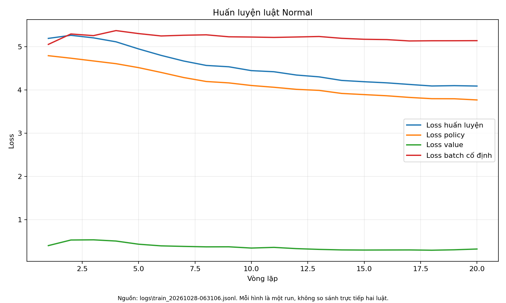
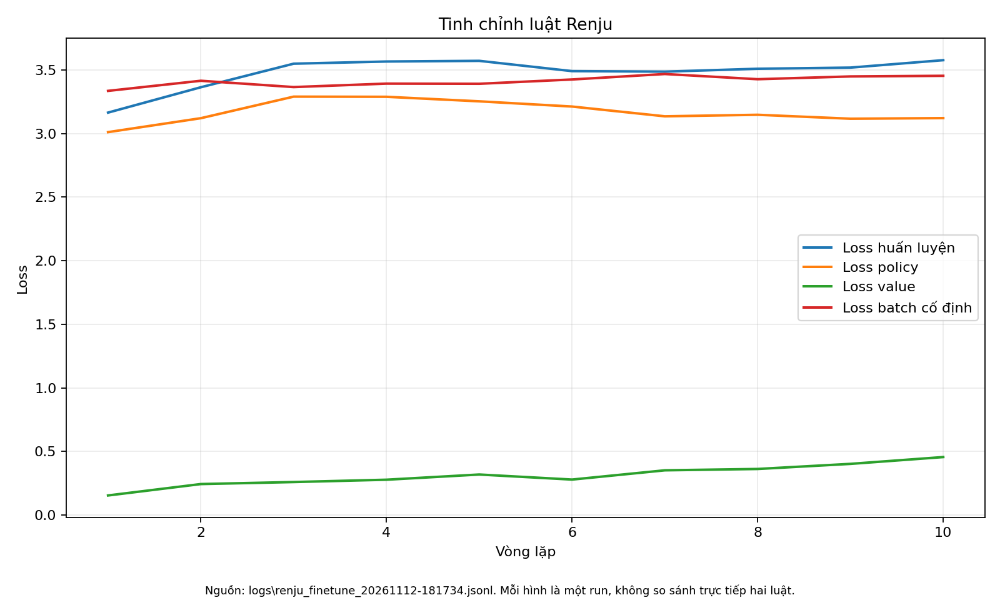

# Chương 6. Kết quả thực nghiệm

## 6.1. Phạm vi và quy ước đọc kết quả

Chương này tổng hợp các kết quả đã được ghi nhận trong báo cáo, log, cơ sở dữ liệu và audit của dự án. Đây là báo cáo lịch sử: trong quá trình biên soạn không chạy lại huấn luyện, self-play, giải đấu hay kiểm thử. Số ván self-play, optimizer step và training loss mô tả quá trình tạo artifact; chúng không phải phép đo độc lập về sức chơi. Các phép đối kháng chỉ được diễn giải trong đúng luật, checkpoint, backend, ngân sách tìm kiếm, opening, lịch đổi màu và cách lấy mẫu đã ghi cho từng run. Vì các protocol và mốc checkpoint khác nhau, các số liệu dưới đây không được ghép thành một chuỗi tiến bộ hoặc dùng để quy kết tác động nhân quả của huấn luyện.

Trong các bảng, W/D/L là thắng/hòa/thua từ góc nhìn tác tử A; score được tính là `(W + 0,5D)/N`. Khoảng Wilson 95% trong T35 là xấp xỉ cho score với hòa tính nửa điểm; nó không phải khoảng chính xác cho mô hình đa thức W/D/L, không hiệu chỉnh sự phụ thuộc giữa các ván đổi màu hoặc nhiều so sánh. Khoảng bootstrap ở các báo cáo mới lấy mẫu theo cặp opening, nhưng cũng chỉ biểu diễn biến thiên theo những cụm và protocol được dùng. Không diễn giải khoảng tin cậy chứa 0,5 là chứng minh tương đương. (`docs/report.md:203-209`; `SPEC.md:298`)

## 6.2. Đối kháng lịch sử T35

T35 hoàn tất ngày 14/11/2026 gồm 2.400 ván: Normal fixed 1.500, Renju fixed 600, Normal time-budget 300. Mỗi cặp gồm 100 ván, mỗi tác tử cầm Đen 50 ván; seed gốc `20261113`; không có ván hòa trong tập được chọn. Khi AlphaBeta tham gia, baseline fixed được đổi từ depth 2 sang depth 1 và tám cặp liên quan được chạy lại; các cặp không phụ thuộc AlphaBeta giữ nguyên. Ở nhóm fixed, AZ và MCTS Pure dùng 200 simulations; AlphaBeta dùng depth 1. Nhóm Normal một giây/nước dùng iterative deepening, không phải depth 1 cố định. Do đó Normal fixed, Renju fixed và Normal time là các pool tách biệt. (`docs/report.md:225-233`)

### W/D/L T35, ngân sách cố định

| Luật / tác tử A | Đối thủ B | W/D/L của A | A thắng khi Đen /50 | A thắng khi Trắng /50 | Score A | Wilson 95% |
|---|---|---:|---:|---:|---:|---:|
| Normal / Random | Heuristic | 0/0/100 | 0 | 0 | 0,00% | [0,000; 0,037] |
| Normal / Random | AlphaBeta | 4/0/96 | 2 | 2 | 4,00% | [0,016; 0,098] |
| Normal / Random | MCTS Pure | 0/0/100 | 0 | 0 | 0,00% | [0,000; 0,037] |
| Normal / Random | AZ v0 | 2/0/98 | 2 | 0 | 2,00% | [0,006; 0,070] |
| Normal / Heuristic | AlphaBeta | 100/0/0 | 50 | 50 | 100,00% | [0,963; 1,000] |
| Normal / Heuristic | MCTS Pure | 100/0/0 | 50 | 50 | 100,00% | [0,963; 1,000] |
| Normal / Heuristic | AZ v0 | 100/0/0 | 50 | 50 | 100,00% | [0,963; 1,000] |
| Normal / Heuristic | AZ v1 threat | 100/0/0 | 50 | 50 | 100,00% | [0,963; 1,000] |
| Normal / AlphaBeta | MCTS Pure | 2/0/98 | 1 | 1 | 2,00% | [0,006; 0,070] |
| Normal / AlphaBeta | AZ v0 | 50/0/50 | 50 | 0 | 50,00% | [0,404; 0,596] |
| Normal / AlphaBeta | AZ v1 threat | 0/0/100 | 0 | 0 | 0,00% | [0,000; 0,037] |
| Normal / MCTS Pure | AZ v0 | 99/0/1 | 50 | 49 | 99,00% | [0,946; 0,998] |
| Normal / MCTS Pure | AZ v1 threat | 31/0/69 | 12 | 19 | 31,00% | [0,228; 0,406] |
| Normal / AZ v0 | AZ v1 threat | 0/0/100 | 0 | 0 | 0,00% | [0,000; 0,037] |
| Renju / Random | Heuristic | 0/0/100 | 0 | 0 | 0,00% | [0,000; 0,037] |
| Renju / Random | AlphaBeta | 2/0/98 | 0 | 2 | 2,00% | [0,006; 0,070] |
| Renju / Random | AZ Renju | 0/0/100 | 0 | 0 | 0,00% | [0,000; 0,037] |
| Renju / Heuristic | AlphaBeta | 100/0/0 | 50 | 50 | 100,00% | [0,963; 1,000] |
| Renju / Heuristic | AZ Renju | 100/0/0 | 50 | 50 | 100,00% | [0,963; 1,000] |
| Renju / AlphaBeta | AZ Renju | 50/0/50 | 50 | 0 | 50,00% | [0,404; 0,596] |
Ghi chú: Các dòng Normal một giây/nước không đưa vào bảng fixed vì khác protocol: AZ v0–AlphaBeta 50/0/50, AZ v0–AZ v1 threat 0/0/100, AZ v1 threat–AlphaBeta 87/0/13. (`docs/report.md:237-279`)

Bảng cho thấy trong pool T35 được khảo sát, Heuristic thắng 100/100 trước AZ v0 ở Normal fixed và 100/100 trước AZ Renju ở Renju fixed; AZ v0 và AlphaBeta chia đều 50/50, trong đó AZ v0 thắng 50 ván khi cầm Trắng và 0 khi cầm Đen. Đây là mô tả kết quả của các cặp được đánh giá, không chứng minh thứ hạng tổng quát ngoài pool đó. Điểm số agent gộp ở các đội hình không thể so trực tiếp vì số đối thủ, luật và ngân sách khác nhau. (`docs/report.md:241-298`)

## 6.3. Đánh giá pilot ứng viên trên parent Normal 50k

### 6.3.1. Thiết kế và tiêu chí

Đợt này có hai nhóm artifact cần tách rõ. `parent` là checkpoint Normal 50k SHA-256 `28ea9001fd83c1c7b4d62117a4d7e4a1726c95eb02b8a37f39298614ea35c5cd`, model được đánh giá trong `docs/analysis/50k-quality-validation.md` và dùng làm parent của pilot. `candidate` là checkpoint khác từ pilot ba seed, trong đó seed 314159 áp dụng can thiệp value-weighting; candidate không được promote. Candidate tournaments 400 game trước 40k và Heuristic được chạy riêng; không có tournament candidate-vs-parent trực tiếp. (`docs/analysis/50k-final-submission.md:5, 11, 21-25`; `docs/analysis/50k-quality-validation.md:5-19`)
Candidate được đánh giá trong hai tournament độc lập, mỗi tournament 400 ván gồm 200 cặp đổi màu; Normal, Python backend, 200 AZ simulations/move, opening bốn nước, không root noise, temperature 0. Telemetry không ghi override hoặc nước bất hợp lệ; database có `PRAGMA quick_check=ok`. Khác biệt score candidate−parent được bootstrap 10.000 lần theo opening-pair clusters, seed 508051. Hai giải không dùng cùng một tập opening được ghép chéo, nên CI là so sánh giữa các tournament riêng chứ không phải paired candidate-vs-parent game outcomes. (`docs/analysis/50k-final-submission.md:17, 23, 29-33`)

| So sánh candidate với đối thủ | Số ván candidate | W/D/L candidate trong tournament đó | Score candidate | Khác biệt score candidate−parent 50k | CI 95% | Gate |
|---|---:|---:|---:|---:|---:|---|
| Candidate seed 314159 vs checkpoint 40k | 400 | 262/3/135 | 65,875% | −0,04250 | [−0,10125; +0,01750] | Cận dưới > −0,10; **không đạt** |
| Candidate seed 314159 vs Heuristic | 400 | 193/4/203 | 48,750% | −0,04875 | [−0,11500; +0,01875] | Cận dưới > 0; **không đạt** |

W/D/L candidate trong bảng là outcome của candidate trước từng đối thủ, không phải candidate-vs-parent. Parent 50k trước 40k (278/5/117) và trước Heuristic (213/3/184) là hai tournament độc lập đã lưu ở `docs/analysis/50k-quality-validation.md:21-41`, seed 508001; đó là các W/D/L của parent trong riêng các tournament ấy. CI candidate−parent trong bảng là khác biệt score được bootstrap theo opening-pair clusters với seed 508051 trên các kết quả tournament riêng, không phải W/D/L hay tournament ghép trực tiếp giữa candidate và parent. CI này cũng không phải ΔElo từ quality-validation với seed 508001. Theo gate preregistered, cả hai cận dưới đều không đạt; kết luận là giữ parent 50k, không promote candidate. Chênh lệch không xác định nguyên nhân của kết quả, cũng không cho phép kết luận nhân quả chung về value-weighting. (`docs/analysis/50k-final-submission.md:23-25`; `docs/analysis/50k-quality-validation.md:14-19, 21-41`)

### 6.3.2. Giới hạn độc lập và diễn giải
Tập holdout value dùng 99 game ID, 25 state sâu từ 21 opening seeds; các game có cùng opening có thể tương quan. Báo cáo ghi nhận thiết kế holdout có hạn chế về thời điểm biết counts và chưa loại được hoàn toàn near-duplicate/historical exposure. Vì vậy bootstrap theo cặp không khắc phục mọi phụ thuộc hay leakage tiềm năng. Gate value thất bại; gate tactical inconclusive do thiếu mẫu theo category/màu. Đây là giới hạn của đánh giá value/tactical, không phải một phép holdout strength tournament. (`docs/analysis/50k-final-submission.md:13-21, 25-33`)

## 6.4. Mốc 60k: screening riêng, không ghép với 50k

Báo cáo screening có 100 ván Normal (50 cặp opening bốn ply, đổi màu) giữa Heuristic và checkpoint được mô tả là 35k continuation / mốc 60k. AZ ghi nhận 55 thắng, 1 hòa, 44 thua (score 55,5%), với +38,4 Elo và 95% CI [−27,6; +106,4]. Khoảng chứa 0, do đó đây là kết quả sàng lọc không xác nhận ưu thế. Báo cáo xác định AZ v0, Python MCTS 200 simulations, seed `20261120`; device thực tế và Git/engine identity còn thiếu. (`docs/analysis/60k-vs-heuristic-100-games-20261120.md:1-15, 19-39`)

Mốc 60k là danh nghĩa lịch sử, không phải tổng cộng chắc chắn của mọi run: report migration xác nhận file checkpoint byte-identical với artifact 60k được kiểm toán, đồng thời nêu không cộng một nhánh 20k khác vào lineage. Không nên xem “60k” là protocol, cũng không dùng nó làm mắt xích để diễn giải chênh lệch với checkpoint 50k hay run 1500. (`docs/az-normal-migration-report.md:1-5`; `SPEC.md:231-244`)

## 6.5. Normal self-play và loss

`data/normal.sqlite` có 75.000 game records Normal và 1.500 hàng training metrics, phủ iteration 1–1500 / global step 100–150.000. Các khoảng run trong DB là 1–500, 501–720, 721–1200 và 1201–1500; chúng phản ánh các đoạn lịch sử ghi trong DB, không nên ghép thành một lineage/checkpoint liên tục nếu chưa đối chiếu nguồn gốc. Truy vấn WDL `SELECT rule_set,winner,COUNT(*) FROM games GROUP BY rule_set,winner` cho Normal: 60.786 thắng Đen, 14.208 thắng Trắng, 6 hòa; mất cân bằng màu là dấu hiệu cần báo cáo khi xem phân phối dữ liệu, không tự xác định nguyên nhân. Metadata training ghi Normal 11×11, backend C++, seed 314159, LR 0,0001, batch 32, MCTS 200, parallel games 2; `git_commit` và `engine_version` rỗng. (SQLite: `data/normal.sqlite`, bảng `games`, `training_steps`, `runs`; provenance: `SPEC.md:251-253`)

Loss tổng theo các run nằm trong khoảng iteration **2,27776–2,72192**, value loss **0,04916–0,25759**; đây là min/max của `training_steps`, không phải held-out metrics. Loss không giảm đơn điệu. Điểm cuối iteration 1500: total 2,49113, policy 2,39330, value 0,09783; iteration 1200: total 2,45467, policy 2,33182, value 0,12285. Không dùng loss để suy ra sức chơi hoặc chất lượng tổng quát. (SQLite: `data/normal.sqlite`, bảng `training_steps`; metrics JSON keys `loss`, `policy_loss`, `value_loss`)

Dữ liệu cho biểu đồ lấy từ log Normal `logs/train_20261028-063106.jsonl` (20 iterations, tổng 1.000 games). Đây là run lịch sử riêng, không phải đường loss của 75.000 game trong `data/normal.sqlite`, cũng không phải held-out metric hay phép đo playing strength.

## 6.6. Fine-tuning Renju: dữ liệu, loss và sàng lọc đối kháng

`data/renju_finetune_1500.sqlite` chứa 1.500 game records, cả 1.500 đều thắng Đen, không có hòa; có 30 hàng training metrics đến global step 6.000. Đây là phân phối outcome một phía rõ rệt. Training loss khoảng 2,38503–2,44821; value loss khoảng 0,000001–0,000094. Audit báo replay có 14.308 mẫu: 7.904 mẫu Black-to-move với `z=+1`, 6.404 mẫu White-to-move với `z=−1`; điều này khớp winner labels của game đã ghi nhưng không khắc phục phân phối outcome một phía. Loss nhỏ không chứng minh value head tổng quát hóa hoặc cải thiện Renju. (`.audit/renju_diagnostic_20261123.md:5-13`; `data/renju_finetune_1500.sqlite`)

Dữ liệu cho biểu đồ lấy từ log Renju `logs/renju_finetune_20261112-181734.jsonl` (10 iterations, 500 games). Đây là run lịch sử riêng, không phải đường loss của DB 1.500 game; loss không được diễn giải thành generalization.

Audit so sánh checkpoint Renju 500-game với 1.500-game; checkpoint 10.000-game được yêu cầu và match logs tương ứng không có trong worktree được khảo sát. Hai checkpoint sẵn có được screen trong 100 ván mỗi checkpoint, cùng 50 cặp opening ngẫu nhiên bốn ply, đổi màu, theo luật Renju, trước Heuristic, C++ MCTS 200 simulations, không tactical override. Cùng seeds/opening actions được dùng cho hai screens; 500-game thua 100/100, 1.500-game đạt 32 thắng, 0 hòa, 68 thua (score 32%), với 13 thắng khi cầm Đen và 19 khi cầm Trắng. Đây là một screen cho mỗi artifact, không phải các tournament độc lập lặp lại; không kết luận sức chơi tổng quát. (`.audit/renju_diagnostic_20261123.md:3-5, 17, 27-32`)

Mặc dù hai checkpoint được thử trên cùng 50 opening seeds, kết quả không phải phép thử nhân quả sạch về tác động fine-tuning: lineage nguồn checkpoint 500-game không được ghi, và một lịch opening không loại được phụ thuộc giữa ván. Audit ghi checkpoint 1.500-game được bootstrap từ Normal generation có SHA `17ab…`; manifest Renju lưu parent SHA trực tiếp `232d…`. Đây là các cấp lineage khác nhau; cần đối chiếu chuỗi generation trước khi khẳng định quan hệ giữa chúng. Vì vậy chỉ mô tả kết quả của hai artifact đã screen, không quy thay đổi từ 100% thua sang 32% score cho fine-tuning. (`.audit/renju_diagnostic_20261123.md:5`; `checkpoints/renju_finetune_1500/generations/fd545362fa8b457faca3c08536e29621/manifest.json`)

Cùng audit ghi nhận tactical diagnostic trên mười vị trí forced-block cố định: checkpoint 500-game bỏ lỡ cả 10 nước chặn đơn, còn checkpoint 1.500-game chọn đúng cả 10. Đó là kết quả trên tập vị trí cố định được rút từ trajectory, không phải chứng cứ cải thiện sức chơi toàn ván; chính audit nói các tiếp diễn sau khi ép chặn vẫn thua cả mười. Không ngoại suy tactical sample này thành tỷ lệ thắng chung hoặc quan hệ nhân quả. (`.audit/renju_diagnostic_20261123.md:17-25`)

## 6.7. Screening Normal 1500 và giới hạn trajectory

Audit checkpoint iteration 1500 ghi tournament Normal 400 ván trước Heuristic: 295 thắng, 0 hòa, 105 thua; score 73,75%, Wilson 95% CI [0,6923; 0,7782], paired Davidson ΔElo 178,92 [148,84; 211,70]. Cấu hình: Normal, C++ MCTS/Patterns, 200 simulations, ba workers, zero opening plies, đổi màu theo 200 cặp; checkpoint SHA-256 bắt đầu `17ab2889…`. Đây là thống kê pipeline trên tournament 400 game; CI không được tính lại theo số trajectory độc lập sau khi phát hiện diversity thấp. (`.audit/az-checkpoint-strength-20261123.tsv:4-7`)

Audit diversity xác định chỉ **ba trajectories đầy đủ khác nhau** trong run: một với AZ cầm Đen và hai với Heuristic cầm Đen. Do đó CI/ΔElo nêu trên phải xem là thống kê có điều kiện trên tournament và quy trình tính đã lưu, không phải CI hiệu dụng đã điều chỉnh theo ba trajectories. Không trình bày 400 ván như 400 trajectories độc lập. Đây là screening lịch sử, không phải kiểm chứng ưu thế tổng quát. So sánh iteration 1400 bị chặn do checkpoint thiếu; phép 100 game cũ có bốn opening ply không thay thế được so sánh 400 game theo opening trống. (`.audit/az-checkpoint-strength-20261123.tsv:3, 8, 10-11`)

## 6.8. Tóm tắt giới hạn so sánh

| Bằng chứng | Luật và protocol | Có thể kết luận | Không thể kết luận |
|---|---|---|---|
| T35 | Normal/Renju; fixed và time-budget tách riêng; 100 game/cặp | W/D/L trong các cặp đã chọn | Thứ hạng chung hoặc so trực tiếp giữa pool |
| 35k/60k screen | Normal, 100 game, bốn ply, Python MCTS, 50 opening pairs | Screen 55/1/44, CI Elo chứa 0 | Ưu thế chắc chắn; tác động nhân quả của 10k game |
| Candidate value-weighting seed 314159 | Normal, 400 game mỗi đối thủ, bốn ply, Python, 200 sims; CI theo opening pair | Hai gate preregistered không đạt; giữ parent 50k | Tác động nhân quả của weighting hoặc training nói chung |
| Normal checkpoint 1500 | Normal, 400 game, C++, opening trống, 200 sims; ba trajectories | Artifact ghi score 73,75% trong screen này | Generalization qua 400 trajectories độc lập; so với opening khác |
| Renju 500/1500 | Renju, 100 game mỗi checkpoint, 50 opening pairs, C++, 200 sims | 500-game thua 100/100, 1500-game đạt 32/100 ở screen này | Causal gain từ fine-tuning hoặc sức chơi tổng quát |

Không có bằng chứng matched-protocol với đủ số trajectory độc lập để đạt mục tiêu nghiên cứu “AZ thắng Heuristic với độ tin cậy phù hợp”. Đây là mục tiêu chưa đạt, không phải mục tiêu đã hoàn tất. (`SPEC.md:41-66`)

# Chương 7. Kiểm thử và đánh giá hệ thống

## 7.1. Phạm vi kiểm thử được báo cáo

Các kiểm thử dưới đây được dẫn lại từ báo cáo lịch sử; không kiểm thử nào được chạy mới khi soạn chương này. Báo cáo quy trình kiểm chứng ghi các nhóm đã hoàn thành: điều kiện tiên quyết 85 passed; evaluation/arena/tournament 28 passed; hồi quy tích hợp 1 passed; hồi quy AZ 23 passed; Alpha-Beta/MCTS Pure/CLI/UI 14 passed; hai gate `RUN_SLOW` đạt. Hai gate chậm chạy trên snapshot module fixed-simulation cũ, nên không gộp thành tuyên bố toàn bộ mã cuối đã qua mọi gate chậm. (`docs/report.md:180-195`)

Cũng theo báo cáo, smoke run thật của các biến thể AZ dùng cùng checkpoint và 200 simulations, sáu ván cân bằng đổi màu, ghi nhận override theo từng ván. Tác giả báo cáo xác định rõ sáu ván chỉ là kiểm tra đường chạy và logging, không đủ đánh giá sức mạnh hoặc lợi ích tactical/threat-space. Một lệnh CLI khác hoàn tất một ván AZ tactical–threat, và AlphaBeta–MCTS Pure hoàn tất một ván; các ván này chỉ kiểm tra khả năng thực thi, không phải tournament. (`docs/report.md:197-223`)

Audit Renju ghi 102 focused tests đã pass trên rules, Python/native MCTS, self-play, replay, trainer và integration; hai lifecycle tests bổ sung đã pass cho bounded-run/resume path. Đây là trạng thái lịch sử, không chạy lại trong báo cáo này. Audit cũng ghi một diagnostic control riêng hoàn tất 50 games, 488 moves và một training step; 1.081,395 giây là thời gian từ đầu run đến training-step record, gồm self-play, train và checkpointing, không phải throughput thuần. Kết quả control không phải tournament hay bằng chứng sức chơi. (`.audit/renju_diagnostic_20261123.md:11, 36-40`)

SPEC liệt kê kiểm thử cho board/rules, model, features, MCTS, self-play, replay, trainer, native backend, UI và tournament. Tồn tại của fixture không chứng minh correctness trên mọi trạng thái; riêng Renju còn cần đối chiếu reference fixtures/expert review ở biên luật. Kiểm thử differential C++/Python bao phủ các fixture đã chọn, không tương đương parity trên mọi trajectory hay sức chơi. (`SPEC.md:137-157, 219-229, 267-284`)

## 7.2. Đánh giá dữ liệu, tính tái lập và lưu trữ

Recovery và test lịch sử cũng không tương đương kiểm tra mất điện hoặc bảo đảm khôi phục tuyệt đối. SPEC ghi nhận process-crash tests không phải power-loss tests; durability directory entry trên Windows và hardware power loss chưa được chứng minh. Những giới hạn vận hành này không làm mất giá trị của log đã lưu, nhưng cần tránh tuyên bố độ bền chưa được kiểm chứng. (`SPEC.md:255-265`)
Các DB lịch sử cho biết rõ số records và một số cấu hình, song provenance không đồng đều: một số training run thiếu Git commit/engine version, Renju fine-tune thiếu source checkpoint hash ở log cũ. Audit nêu một Normal bootstrap SHA và một Renju manifest parent SHA thuộc cấp lineage khác nhau; cần đối chiếu chuỗi generation thay vì coi chúng là mâu thuẫn. Tournament 50k có database SHA-256 cùng checkpoint hashes trong báo cáo; tournament 1500 Normal có checkpoint SHA, nhưng các trajectories chỉ đa dạng ba ván. Số liệu DB được xác định bằng truy vấn đọc-only: `data/normal.sqlite` (bảng `games`, `training_steps`, `runs`), `data/renju_finetune_1500.sqlite` (các bảng tương ứng). (`data/normal.sqlite`; `data/renju_finetune_1500.sqlite`; `.audit/renju_diagnostic_20261123.md:5`; `docs/analysis/50k-final-submission.md:5-9, 23`; `.audit/az-checkpoint-strength-20261123.tsv:7, 10`)
## 7.3. Tiêu chí đánh giá phù hợp cho nghiên cứu tiếp theo

Kết quả tương lai cần dùng cùng bộ luật, định danh checkpoint SHA-256, backend, ngân sách search và quy tắc mở đầu; cân bằng màu; lưu từng ván, seed, opening pair, số simulations/override và trạng thái kết thúc. Phân tích uncertainty theo opening pair hoặc cụm trajectory độc lập, không coi hai ván đổi màu hay nhiều state trong cùng game là các quan sát độc lập. Cần đăng ký trước cỡ mẫu và ngưỡng thành công, báo W/D/L theo màu, score cùng CI, và giữ fixed-simulation tách khỏi fixed-time. SPEC mô tả các tiêu chí này là protocol nghiên cứu/acceptance, không phải kết quả đã đạt. (`SPEC.md:61-66, 290-298`)

# Chương 8. Kết luận và hướng nghiên cứu

## 8.1. Kết luận

Đồ án hiện thực được một pipeline AlphaZero Gomoku có self-play, policy-value network, MCTS, replay/trainer, hai ruleset Normal/Renju, các agent baseline và công cụ giải đấu. Báo cáo kiến trúc mô tả phân tách Board/Rules, MCTS Python/native và lưu trữ dữ liệu; SPEC ghi rõ phần nào verified từ source/test/report và phần nào mới implemented/unverified. Các số liệu thực nghiệm cho thấy hệ thống đã tạo lượng dữ liệu đáng kể và đã thực hiện nhiều phép screen, nhưng số lượng ván hoặc loss không đủ thay thế phép đánh giá strength có protocol và độc lập phù hợp. (`SPEC.md:28-45, 119-129, 267-289`)

Các kết quả đối kháng không đồng nhất: trong T35, Heuristic thắng AZ v0 và AZ Renju 100/100 ở các pool cố định đã chọn; một screen Normal ở snapshot được gọi 60k ghi AZ 55,5% nhưng CI Elo bao gồm 0; candidate value-weighting seed 314159 không qua hai gate so với 40k và Heuristic, trong khi parent 50k là artifact riêng được validation trước đó; checkpoint Normal iteration 1500 ghi score cao trong một tournament nhưng chỉ có ba trajectories khác nhau; checkpoint Renju 1500-game đạt 32/100 trong screen riêng với Heuristic. Các khác biệt về checkpoint, luật, backend, opening, seed, ngân sách và độ độc lập ngăn việc xếp các con số này thành một đường tiến bộ duy nhất. Chúng cũng không xác định vì sao kết quả khác nhau. (`docs/report.md:241-279`; `docs/analysis/60k-vs-heuristic-100-games-20261120.md:19-27`; `docs/analysis/50k-final-submission.md:23-25`; `docs/analysis/50k-quality-validation.md:21-41`; `.audit/az-checkpoint-strength-20261123.tsv:7, 10`; `.audit/renju_diagnostic_20261123.md:27-32`)

Dữ liệu Normal 75.000 game và Renju 1.500 game cho thấy mất cân bằng outcome theo màu, đặc biệt toàn bộ records Renju ghi Black thắng. Training loss dao động và value loss Renju nhỏ trên dữ liệu một phía; đây không phải bằng chứng generalization. Cần thận trọng với lineage của checkpoint và danh tính code/config, do một số metadata thiếu hoặc không khớp. (`data/normal.sqlite`, bảng `games`/`training_steps`/`runs`; `data/renju_finetune_1500.sqlite`, bảng tương ứng; `.audit/renju_diagnostic_20261123.md:5-13`)

Vì vậy kết luận tổng thể là mục tiêu nghiên cứu chưa đạt: hiện chưa có matched protocol với số lượng trajectory thực sự độc lập đủ để chứng minh AZ thắng Heuristic với uncertainty được kiểm soát. Theo quyết định ngày 24/11/2026, phạm vi phát triển cho đợt này được đóng băng; không chạy thêm thí nghiệm trong quá trình hoàn thiện báo cáo. Những con số đang có được giữ lại như bằng chứng lịch sử theo từng phép đo, không bị phủ nhận nhưng cũng không mở rộng quá phạm vi nguồn. (`SPEC.md:41-66, 290-298`)
## 8.2. Hướng nghiên cứu đề xuất

Các hướng sau chỉ là đề xuất nghiên cứu cho công việc tương lai; đây không phải kế hoạch đã được phép thực thi trong đợt báo cáo:

1. **Chốt protocol đối kháng trước khi chạy.** Dùng checkpoint được định danh bằng hash, cùng luật và backend, search budget cố định, cặp opening đổi màu, seed scheme được ghi; chọn trước cỡ mẫu bằng power analysis. Báo W/D/L, score, CI theo cluster độc lập và kết quả từng màu. Không thay đổi tiêu chí sau khi xem kết quả. (`SPEC.md:61-66, 290-298`)
2. **Tăng độc lập thực sự của mẫu.** Sinh nhiều opening/seed và trajectories đa dạng; kiểm tra trùng trajectory, opening family và near-duplicate. Đơn vị bootstrap phải phản ánh đơn vị độc lập thực tế; 400 game records không được xem là 400 mẫu độc lập nếu chúng chỉ tạo từ một vài trajectories. (`.audit/az-checkpoint-strength-20261123.tsv:10-11`)
3. **Đánh giá tác động training bằng thiết kế matched.** Đối chiếu parent/candidate cùng điểm khởi đầu, luật, dữ liệu, ngân sách, seeds, protocol; có nhiều seed huấn luyện độc lập và control phù hợp. Tách tác động training từ chênh lệch protocol hoặc checkpoint lineage; không suy causal từ loss hay so sánh hai screens đơn lẻ.
4. **Cân bằng và kiểm toán dữ liệu Renju.** Theo dõi outcome theo màu/side-to-move, cài tiêu chí dừng và chất lượng replay, dùng tập đánh giá độc lập theo opening family. Kiểm tra rule edge cases và lineage trước khi diễn giải loss/value. Đặc biệt không xem value loss thấp trên toàn Black-win là xác nhận calibration. (`.audit/renju_diagnostic_20261123.md:5-13`; `SPEC.md:255-265`)
5. **Củng cố provenance và tái lập.** Ghi code commit và dirty diff hash, config hiệu lực, runtime/hardware, initialization/game/worker seeds, source checkpoint/replay SHA và run IDs; lưu artifact immutable để truy vết. Gắn rõ test log với snapshot code và tách process-crash recovery khỏi power-loss claims. (`SPEC.md:245-260`)
6. **Tách correctness, throughput và strength.** C++ parity, self-play target distribution, throughput và tournament quality là các câu hỏi riêng; chỉ so workload cùng checkpoint/hardware/search budget. Mọi tối ưu cần giữ correctness/data distribution trước khi xem speedup là thành công nghiên cứu. (`SPEC.md:267-289`)

## 8.3. Tài liệu tham khảo

### Tài liệu học thuật

[1] Silver, D. et al. (2017). “Mastering the game of Go without human knowledge.” *Nature*, 550, 354–359. https://doi.org/10.1038/nature24270. Nền tảng self-play, policy/value network và tree search; trích dẫn phương pháp chung, không phải bằng chứng cho kết quả Gomoku của đồ án.

[2] He, K., Zhang, X., Ren, S., & Sun, J. (2016). “Deep Residual Learning for Image Recognition.” *Proceedings of the IEEE Conference on Computer Vision and Pattern Recognition (CVPR)*, 770–778. https://doi.org/10.1109/CVPR.2016.90. Tham chiếu kiến trúc residual; không khẳng định mạng trong đồ án tương đương bài báo gốc.

[3] Kocsis, L. & Szepesvári, C. (2006). “Bandit Based Monte-Carlo Planning.” *European Conference on Machine Learning (ECML 2006)*, 282–293. https://doi.org/10.1007/11871842_29. Tham chiếu nền tảng UCT/MCTS; triển khai dự án dùng PUCT theo mô tả tại SPEC §7.

[4] Wang, H., Emmerich, M., Preuss, M., & Plaat, A. (2019). “Policy or Value? Loss Function and Playing Strength in AlphaZero-like Self-play.” *IEEE Conference on Games*. https://liacs.leidenuniv.nl/~plaata1/papers/CoG2019.pdf. Nguồn liên quan đến việc không đồng nhất loss với playing strength.

[5] Liang, W., Yu, C., Whiteaker, B., Huh, I., Shao, H., & Liang, Y. (2023). “AlphaZero Gomoku.” arXiv:2309.01294. https://arxiv.org/abs/2309.01294. Tham khảo ứng dụng AlphaZero vào Gomoku; khác biệt cấu hình/quy tắc không cho phép dùng kết quả paper như baseline trực tiếp.

[6] Pan, S. J. & Yang, Q. (2010). “A Survey on Transfer Learning.” *IEEE Transactions on Knowledge and Data Engineering*, 22(10), 1345–1359. https://ieeexplore.ieee.org/abstract/document/5288526. Bối cảnh khái niệm transfer learning cho việc chuyển checkpoint giữa luật/miền; không phải bằng chứng rằng fine-tuning Renju trong đồ án đã cải thiện sức chơi.

[7] Sutton, R. S. & Barto, A. G. (2018). *Reinforcement Learning: An Introduction* (2nd ed.). MIT Press. https://mitpress.mit.edu/9780262039246/reinforcement-learning/. Tài liệu nền tảng về học tăng cường; không được dùng thay cho kết quả thực nghiệm của dự án.

### Nguồn dự án và điều kiện truy cập

[8] `SPEC.md`, §§1–2, 4–10, 14. Đặc tả kiến trúc, trạng thái bằng chứng, tiêu chí đánh giá và các giới hạn. Tệp trong repository; cần quyền truy cập bản checkout dự án.

[9] `docs/report.md`, §§9–10; `docs/analysis/50k-final-submission.md`; `docs/analysis/60k-vs-heuristic-100-games-20261120.md`. Báo cáo test lịch sử, T35, gate 50k và screening 60k. Các tài liệu repository có thể đọc trong checkout; link tương đối trong báo cáo dẫn tới artifact cục bộ.

[10] `.audit/az-checkpoint-strength-20261123.tsv`; `.audit/renju_diagnostic_20261123.md`; `docs/az-80k-checkpoint-forensics.md`. Audit trajectory, Renju và lineage. `.audit/` là thư mục ẩn/local trong checkout, không phải URL công khai; truy cập cần bản repository chứa các audit này.

[11] `data/normal.sqlite`; `data/renju_finetune_1500.sqlite`; `data/tournament.sqlite`; các DB tournament candidate lưu dưới `data/` và `final_50k_pilot/`. Đây là SQLite runtime artifacts local-only, bị loại khỏi Git/không có URL công khai mặc định; cần truy cập checkout hoặc bản sao dữ liệu tương ứng để truy vấn. Các đường dẫn biểu thị nguồn đã được báo cáo, không bảo đảm DB vẫn còn nguyên trạng.

[12] `az/model.py`, `az/mcts.py`, `az/selfplay.py`, `az/replay_buffer.py`, `az/trainer.py`, `gomoku/rules/`, `scripts/tournament.py`, `tests/`. Source và test trong repository; chỉ có thể truy cập qua checkout tương ứng. Chương này không khẳng định đã chạy lại chúng.

[13] Silver et al. (2018). “A general reinforcement learning algorithm that masters chess, shogi, and Go through self-play.” *Science*, 362(6419), 1140–1144. https://doi.org/10.1126/science.aar6404. Tham chiếu nền tảng thuật toán AlphaZero.

**Lưu ý về nguồn:** các kết quả thực nghiệm và trạng thái test được trích từ tài liệu/DB nội bộ nêu trên, không phải kết quả chạy mới. Nguồn học thuật giải thích phương pháp và bối cảnh; không thay thế bằng chứng thực nghiệm của repository. URL học thuật có thể truy cập công khai; dữ liệu SQLite, audit ẩn và báo cáo nội bộ phụ thuộc quyền truy cập checkout/artifact của dự án.