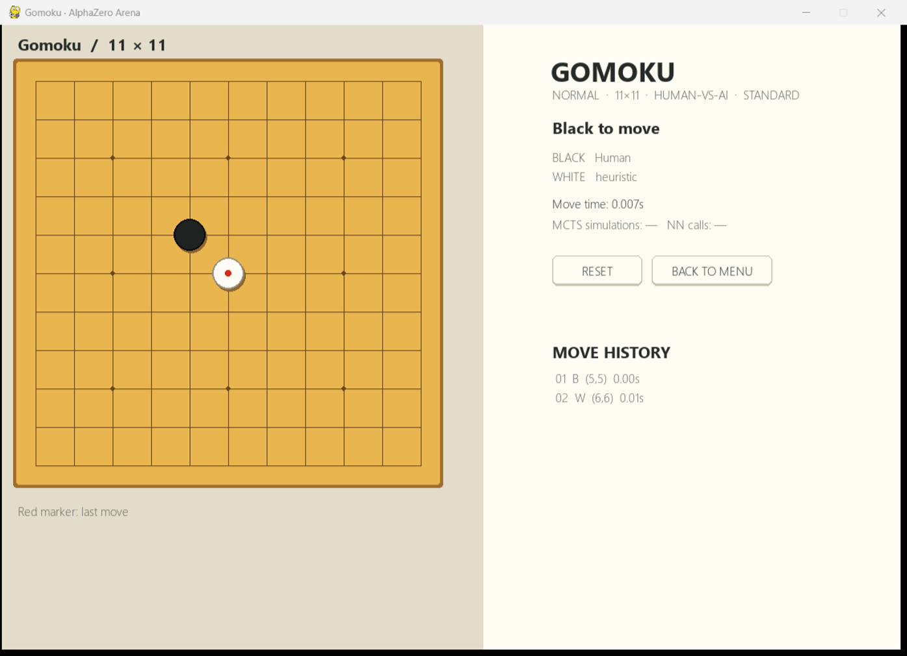
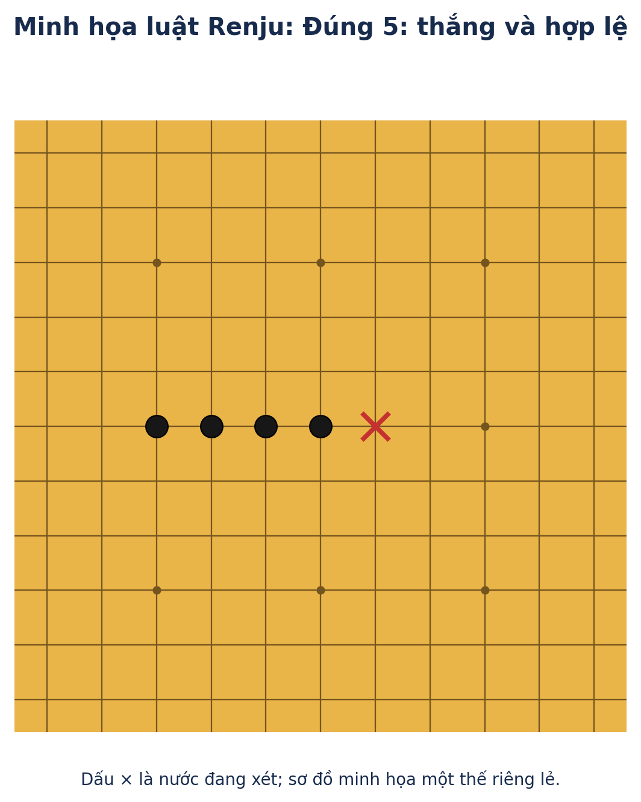
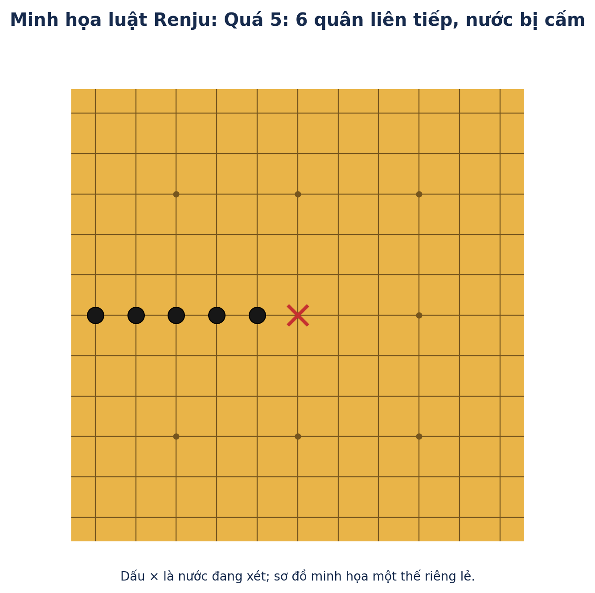
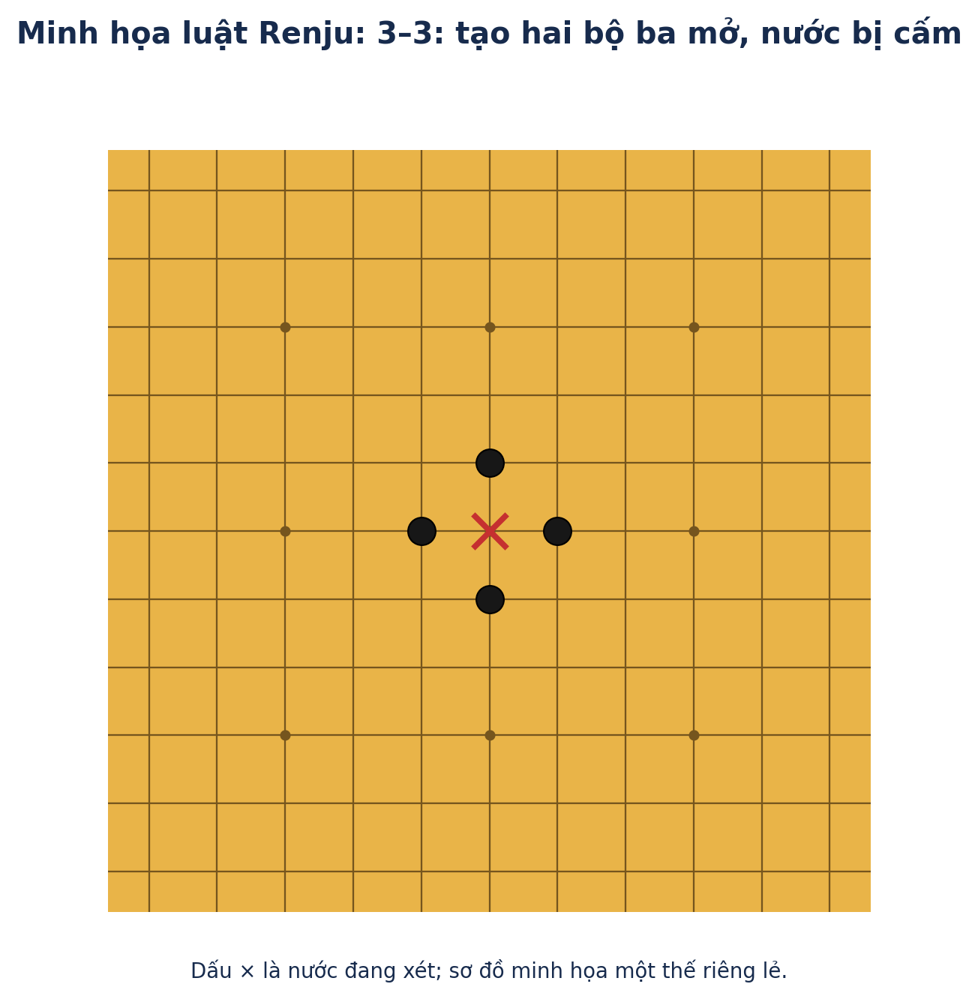
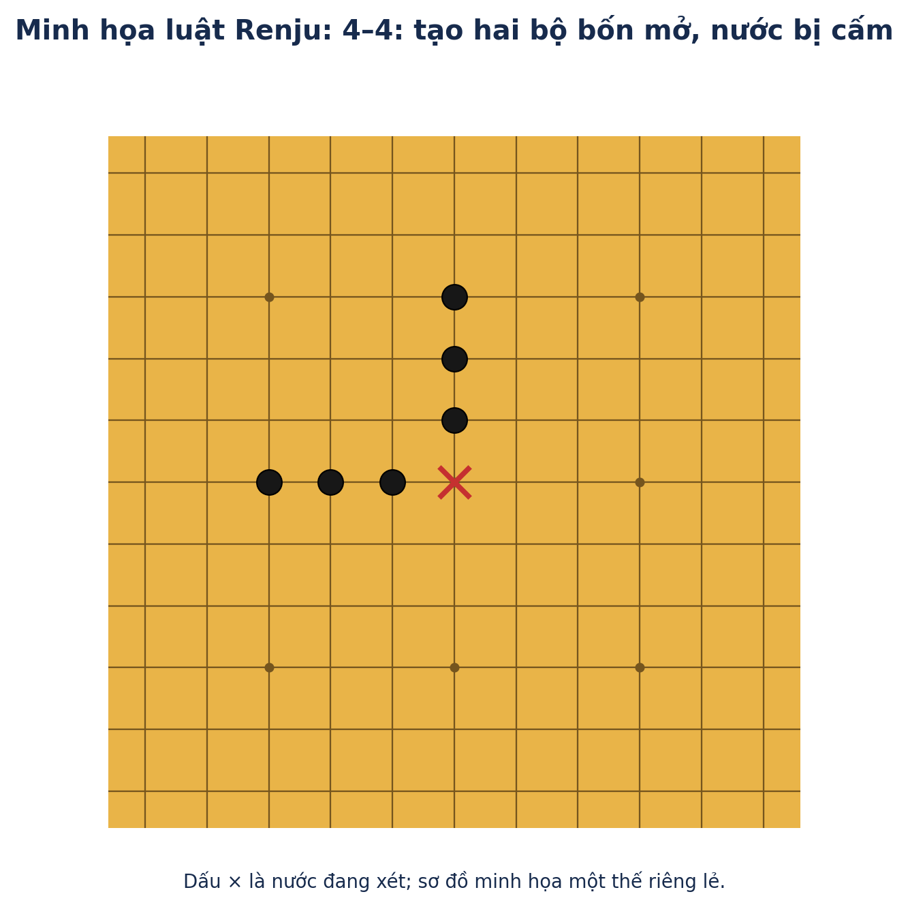
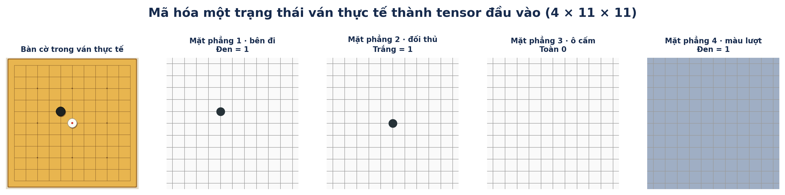
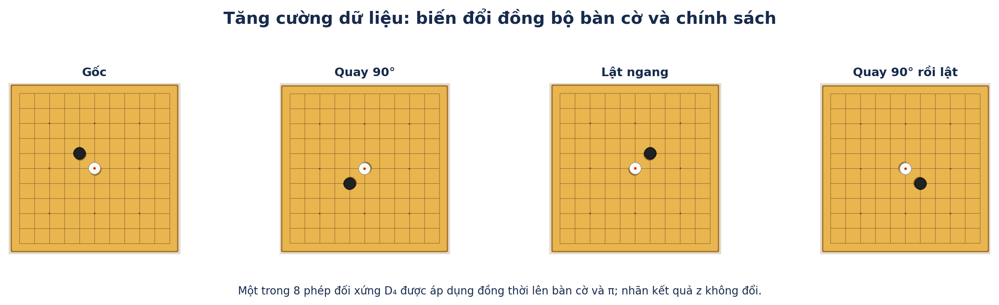
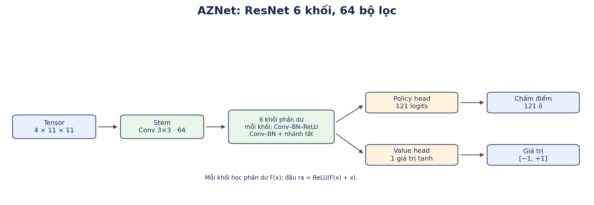
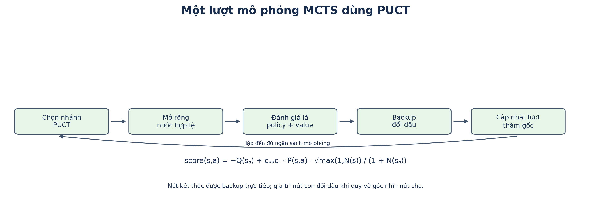
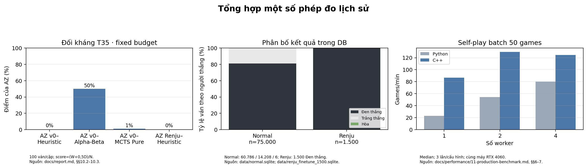

# Tóm tắt

Đồ án xây dựng và đánh giá hệ thống Gomoku 11×11 theo phương pháp AlphaZero, kết hợp mạng nơ-ron chính sách–giá trị, tìm kiếm cây Monte Carlo, tự chơi và cập nhật mô hình từ kết quả ván. Hệ thống tách luật Normal và Renju, hỗ trợ các tác tử đối chứng Random, Heuristic, Alpha-Beta, MCTS thuần, bộ máy tìm kiếm Python/C++ và giao diện Pygame. Báo cáo tổng hợp kiến trúc, cơ sở thuật toán và thực nghiệm từ log, cơ sở dữ liệu cùng tài liệu dự án. Bằng chứng ghi nhận pipeline huấn luyện và đánh giá trên cả hai bộ luật; một số ứng viên đạt kết quả tốt hơn trong các đối chiếu hoặc thế cờ cố định, còn C++ tăng thông lượng ở workload đã đo. Kết quả được diễn giải theo đúng luật và giao thức; số liệu hiện có chưa xác nhận ưu thế tổng quát của AlphaZero trước Heuristic. Đóng góp chính là hệ thống tích hợp và quy trình đối chiếu thực nghiệm có thể kiểm toán.

## Từ khóa

Gomoku; AlphaZero; học tăng cường; tìm kiếm cây Monte Carlo; tự chơi; Renju; đánh giá thực nghiệm.
## Abstract

This project implements and evaluates an 11×11 Gomoku system based on AlphaZero, combining a policy–value neural network, Monte Carlo tree search, self-play, and outcome-based optimization. The system separates Normal and Renju rules, provides Random, Heuristic, Alpha-Beta, and pure MCTS opponents, and includes Python/C++ search backends and a Pygame interface. This report describes the architecture and analyzes historical experiments using saved logs, databases, and project records. The evidence confirms that the training and evaluation pipelines operated under both rule sets. Some candidates performed better in specific checkpoint comparisons or fixed tactical positions, while C++ increased throughput in measured workloads. These results are limited to their recorded protocols and do not establish a general playing-strength advantage over the Heuristic agent. The principal contribution is an integrated system and an auditable experimental record.

## Keywords

Gomoku; AlphaZero; reinforcement learning; Monte Carlo tree search; self-play; Renju; empirical evaluation.

## Danh mục từ viết tắt

| Viết tắt | Nghĩa |
|---|---|
| AZ | AlphaZero |
| CNN | Mạng nơ-ron tích chập |
| CPU / GPU | Bộ xử lý trung tâm / bộ xử lý đồ họa |
| CI | Khoảng tin cậy |
| MCTS | Tìm kiếm cây Monte Carlo |
| PUCT | UCT kết hợp prior của chính sách |
| RL | Học tăng cường |
| ResNet | Mạng nơ-ron phần dư |
| W/D/L | Thắng / hòa / thua |
| UCT | Cận tin cậy trên cây tìm kiếm |

Trong báo cáo, thuật ngữ tiếng Việt được ưu tiên; tên Normal, Renju, tên tác tử và ký hiệu trong mã được giữ nguyên khi cần đối chiếu với implementation.

# Chương 1. Giới thiệu

## 1.1. Bối cảnh

Gomoku là trò chơi đối kháng hai người trên bàn cờ, trong đó hai bên luân phiên đặt quân vào các giao điểm còn trống. Trong biến thể Normal của đồ án, người chơi thắng khi tạo được ít nhất năm quân liên tiếp theo hàng, cột hoặc một trong hai đường chéo. Dù luật ngắn gọn, số trạng thái có thể xuất hiện tăng rất nhanh theo số nước đã đi: lựa chọn ở mỗi lượt phụ thuộc vào toàn bộ thế cờ, còn một sai lầm chiến thuật có thể quyết định kết quả ngay lập tức. Vì vậy, một chương trình chơi Gomoku cần đồng thời biểu diễn trạng thái, kiểm tra luật, ước lượng vị trí và lựa chọn hành động.

Đồ án xây dựng một hệ thống Gomoku 11×11 theo phương pháp AlphaZero: mạng nơ-ron dự đoán chính sách nước đi và giá trị trạng thái; tìm kiếm cây Monte Carlo (MCTS) sử dụng hai dự đoán này để phân bổ lượt mô phỏng; dữ liệu tự chơi được đưa trở lại quá trình huấn luyện. Hướng tiếp cận kế thừa nghiên cứu AlphaZero cho trò chơi bàn cờ và một triển khai AlphaZero dành riêng cho Gomoku [1], [8]. Đặc tả dự án đặt mục tiêu hỗ trợ Normal/Renju và so sánh sức chơi trong điều kiện được kiểm soát; giả thuyết “AlphaZero mạnh hơn Heuristic” là câu hỏi nghiên cứu, không phải kết quả đã biết (`SPEC.md`, mục 1–2, dòng 28–66).

## 1.2. Bài toán và biểu diễn hình thức

Xét một trò chơi có trạng thái `s`, tập hành động hợp lệ tại trạng thái đó `A(s)`, hàm chuyển trạng thái `T(s,a)` và kết quả cuối ván. Agent ở lượt của mình cần chọn `a ∈ A(s)`. Trong Gomoku, trạng thái bao gồm bố trí quân trên bàn và bên sắp đi; tập hành động chủ yếu là các ô trống, sau đó bị giới hạn thêm bởi luật của ruleset. Trò chơi là đối kháng, hai phía có mục tiêu trái dấu. Vì thế, giá trị của cùng một vị trí phải gắn với góc nhìn của một người chơi xác định, chứ không phải chỉ là điểm vô hướng không có quy ước dấu.

Trong phần cài đặt, bàn có kích thước 11×11, hai màu được mã hóa bằng BLACK/WHITE, ô trống là EMPTY và hành động được làm phẳng thành `a = 11r + c`. `Board` sở hữu lưới, người chơi hiện tại và lịch sử nước đi; việc một nước có hợp lệ theo luật hay không được hỏi qua `Rules`, không được suy ra chỉ từ thao tác sửa bàn (`SPEC.md`, mục 5.1, dòng 131–147; `gomoku/board.py`, định nghĩa `Board` và thao tác `play/undo`). Cách tách này giúp mô hình hóa trò chơi thống nhất giữa giao diện, self-play và tìm kiếm.

## 1.3. Mục tiêu, câu hỏi nghiên cứu và phạm vi

Trọng tâm kỹ thuật là cơ sở của AlphaZero, MCTS/PUCT, ResNet, học tăng cường, tự chơi và chuyển giao tri thức; tiếp đó là kiến trúc engine, luật Normal/Renju và luồng dữ liệu tensor–MCTS–replay–huấn luyện. Câu hỏi nghiên cứu gồm so sánh AlphaZero với Heuristic trong cùng điều kiện, quan sát ảnh hưởng của dữ liệu tự chơi và số bước tối ưu lên sức chơi, đánh giá tính đúng đắn và thông lượng của bộ máy C++, và so sánh Normal với Renju trong các nhóm đánh giá riêng (`SPEC.md`, mục 1.2, dòng 34–45).

Các chương đầu phân biệt cấu hình với kết quả thực nghiệm được phân tích ở các chương sau. Những giá trị như số block, batch size, số mô phỏng, số vòng và số ván trong cấu hình không tự chứng minh một lần chạy đã sử dụng các giá trị đó, cũng không phải kết quả thực nghiệm. SPEC đánh dấu mục tiêu AlphaZero thắng Heuristic với bằng chứng đủ tin cậy là chưa đạt tại thời điểm tài liệu được rà soát và yêu cầu không suy luận sức chơi từ việc loss giảm hay pipeline chạy hoàn tất (`SPEC.md`, mục 1.3 và bảng yêu cầu, dòng 41–66).

Phạm vi trò chơi được giữ ở bàn 11×11 và hai luật mà mã dự án hiện thực. Đặc biệt, Renju trong báo cáo được mô tả là hành vi của implementation; không khẳng định nó bao phủ mọi quy tắc, tiền lệ và tình huống phân xử của chuẩn Renju quốc tế (`SPEC.md`, mục 1.3 và 5.2, dòng 41–46, 137–157).

## 1.4. Ý nghĩa và bố cục

Ý nghĩa của hệ thống nằm ở sự liên kết giữa ba lớp: (i) luật và biểu diễn trạng thái cung cấp đầu vào nhất quán, (ii) mạng policy-value và MCTS tạo hành vi lựa chọn có tìm kiếm, (iii) tự chơi, replay và tối ưu tham số khép kín vòng học. Sai sót ở một lớp có thể lan sang lớp khác: ví dụ mask nước cấm sai làm cây tìm kiếm mở rộng hành động không hợp lệ; value dùng sai quy ước người chơi làm backup đảo kết quả; dữ liệu gán nhãn sai khiến loss vẫn tính được nhưng không còn mục tiêu học đúng.

Chương 2 trình bày nền tảng học thuật; Chương 3 mô tả hệ thống, engine và hai ruleset; Chương 4 tập trung vào kiến trúc mạng và pipeline AlphaZero. Các chương tiếp theo trình bày quá trình thực nghiệm, kết quả, kiểm thử và kết luận, kèm giới hạn bằng chứng.

# Chương 2. Cơ sở lý thuyết

## 2.1. Học tăng cường trong trò chơi đối kháng

Học tăng cường nghiên cứu cách một tác tử tương tác với môi trường, nhận trạng thái và phần thưởng rồi cải thiện chính sách lựa chọn hành động [9]. Một quá trình quyết định Markov thường được ký hiệu bằng trạng thái `s`, hành động `a`, xác suất chuyển `P(s′|s,a)` và phần thưởng `r`. Trong trò chơi bàn cờ xác định, chuyển trạng thái do nước đi và luật quyết định; phần thưởng thường tập trung ở cuối ván. Mục tiêu là tìm chính sách `π(a|s)` tối đa hóa tổng phần thưởng kỳ vọng.

Trong thiết lập hai người chơi có tổng bằng không, giá trị của vị trí có thể viết theo góc nhìn người đang đi: `v(s) = E[z | s, player-to-move]`, với kết quả cuối `z ∈ {−1, 0, +1}` tương ứng thua, hòa và thắng cho người chơi được quy ước. Sau khi một ply (một nước của một bên) được đi, góc nhìn đối kháng đổi bên, nên dấu giá trị đảo. Quy ước này là thiết yếu cho backpropagation trong MCTS và cho nhãn value trong dữ liệu tự chơi.

Trong AlphaZero, học tăng cường không dựa vào dữ liệu gắn nhãn do con người cung cấp. Tác tử tự sinh các ván, dùng tìm kiếm để tạo chính sách mục tiêu giàu thông tin hơn một lần dự đoán đơn lẻ, rồi cập nhật mạng dựa trên kết quả ván. Các công trình AlphaGo Zero và AlphaZero trình bày hướng tiếp cận kết hợp mạng chính sách–giá trị, tự chơi và MCTS trên cờ vây, cờ vua và shogi [10], [1]. Đây là nền tảng phương pháp, không phải bằng chứng về sức chơi của implementation Gomoku trong đồ án.

## 2.2. AlphaZero: policy, value và tìm kiếm

Mạng policy-value học hai phép dự đoán trên một biểu diễn trạng thái:

`p(a|s)` là xác suất ưu tiên cho hành động `a`; `v(s)` là giá trị kỳ vọng từ góc nhìn người chơi được quy ước.

Chính sách sắp thứ tự ưu tiên khi mở rộng cây; giá trị ước lượng các nút chưa đến trạng thái kết thúc. MCTS dùng nhiều lượt duyệt cây để cải thiện phân phối chính sách ban đầu. Lượt thăm ở nút gốc tạo phân phối mục tiêu `π`; hành động thực tế được lấy mẫu hoặc chọn theo số lượt thăm cao nhất. Kết quả cuối ván tạo nhãn `z`. Một dạng hàm mục tiêu lý thuyết là:

$$L(θ) = (z − v_θ(s))² − ∑ₐ π(a|s) log p_θ(a|s) + c‖θ‖²$$

Số hạng giá trị hồi quy kết quả; số hạng chính sách khớp phân phối lượt thăm của tìm kiếm; số hạng chính quy hóa giới hạn độ lớn tham số. Nghiên cứu [7] khảo sát mối liên hệ giữa lựa chọn hàm mất mát và sức chơi trong tự chơi kiểu AlphaZero. Trong implementation của đồ án, loss gồm cross-entropy cho chính sách và MSE cho giá trị; weight decay thuộc Adam, không được cộng thêm vào loss (`az/trainer.py`, dòng 99–124).

## 2.3. Monte Carlo Tree Search và UCT

MCTS xây dựng một phần cây bằng bốn bước lặp: chọn đường đi theo thống kê hiện có, mở rộng nút, đánh giá lá (bằng rollout hoặc hàm giá trị), rồi truyền kết quả ngược về các nút trên đường đi. Thay vì duyệt toàn bộ cây, thuật toán tập trung ngân sách vào các nhánh có tiềm năng.

UCT (Upper Confidence bounds applied to Trees) cân bằng khai thác và khám phá bằng cách cộng điểm giá trị trung bình vào một hạng thưởng cho nhánh ít được thăm. Một dạng thường dùng là:

$$UCT(s,a) = Q(s,a) + c · √(ln N(s) / N(s,a))$$

Trong đó `Q` là giá trị trung bình ước lượng, `N(s)` là số lượt thăm nút cha, `N(s,a)` là số lượt thăm nhánh; `c` điều chỉnh mức khám phá. UCT áp dụng cận tin cậy vào cây tìm kiếm [2]. AlphaZero giữ nguyên nguyên tắc cân bằng khai thác–khám phá nhưng dùng xác suất ưu tiên từ mạng trong PUCT.

Trong trò chơi đối kháng, giá trị cần có quy ước góc nhìn nhất quán. Nếu nút con lưu giá trị theo người chơi tới lượt tại nút con, cha phải đảo dấu khi đánh giá nhánh đó: vị trí tốt cho đối thủ là bất lợi cho người đang chọn ở nút cha.

## 2.4. PUCT trong AlphaZero

PUCT kết hợp giá trị ước lượng với xác suất ưu tiên từ mạng chính sách. Điểm lựa chọn trong implementation là:

$$score(s,a) = −Q(sₐ) + c_{puct} · P(s,a) · √(max(1,N(s))) / (1 + N(sₐ))$$

Ở đây, `P(s,a)` là xác suất ưu tiên, `N(s)` và `N(sₐ)` là số lượt thăm của nút cha và nút con; `Q(sₐ)` là giá trị trung bình theo góc nhìn người chơi tới lượt ở nút con. Dấu âm đưa giá trị về góc nhìn nút cha. `c_puct` điều chỉnh ảnh hưởng của xác suất ưu tiên. Công thức và mặc định `c_puct=1.5` nằm trong SPEC; cấu trúc nút và quy ước `q_value` ở `az/mcts.py` (`SPEC.md`, mục 7.1, dòng 180–194; `az/mcts.py`, dòng 18–37).

Khi mở rộng lá, mạng trả về phân phối softmax; MCTS nhân phân phối này với mặt nạ hợp lệ rồi chuẩn hóa trên các nước còn lại. Nếu tổng xác suất không vượt ngưỡng `1e−8`, chương trình dùng phân phối đều trên nước hợp lệ; nước cấm có xác suất ưu tiên bằng 0. Mã thực hiện bước lọc sau softmax (`az/mcts.py`, dòng 158–174; `az/model.py`, dòng 86–105).

Trong huấn luyện, nhiễu Dirichlet có thể được trộn vào prior tại nút gốc để khuyến khích khám phá:
$$P′(s,a) = (1−ε)P(s,a) + εη(a),  η ∼ Dirichlet(α)$$
Nhiễu chỉ được lấy trên nước hợp lệ; đây là cơ chế dành cho tự chơi/huấn luyện, còn đánh giá giải đấu mặc định tắt nhiễu tại nút gốc (`SPEC.md`, mục 7.1 và 10.2).

## 2.5. Mạng ResNet và mạng policy-value

Mạng tích chập khai thác quan hệ không gian cục bộ giữa các ô. ResNet bổ sung nhánh tắt để mỗi khối học phần dư thay vì phải tái tạo toàn bộ phép biến đổi. Với đầu vào `x`, đầu ra của khối là:
$$y = ReLU(F(x) + x)$$
Trong đó `F` gồm các lớp tích chập và chuẩn hóa; nhánh tắt hỗ trợ truyền tín hiệu qua mạng sâu [3].

AZNet dùng một lớp tích chập đầu vào, tiếp đó là các khối phần dư và hai đầu ra. Đầu chính sách tạo 121 logit tương ứng 121 giao điểm; đầu giá trị tổng hợp đặc trưng thành một số vô hướng qua `tanh`, thuộc `[-1,1]`. Theo cấu hình mặc định, mạng có 6 khối phần dư, mỗi khối 64 bộ lọc (`az/model.py`, dòng 14–40, 68–84; `config.py`, dòng 28–30; `SPEC.md`, mục 6, dòng 159–178).

Hai head phục vụ hai nhiệm vụ liên quan nhưng không đồng nhất. Policy head xếp hạng hành động; value head ước lượng kết quả kỳ vọng từ vị trí. Việc dùng chung trunk cho phép các đặc trưng hữu ích cho cả đánh giá vị trí và chọn nước được học chung, trong khi mỗi head có lớp đầu ra riêng. Không nên diễn giải policy probability là xác suất thắng; đó là phân phối trên hành động, còn value là dự đoán kết quả.

## 2.6. Self-play và dữ liệu mục tiêu

Tự chơi là quá trình một chính sách tạo các ván huấn luyện bằng cách điều khiển cả hai bên. Mỗi trạng thái trước nước đi có thể tạo mẫu `(s, π, player)`, trong đó `π` là phân phối lượt thăm sau MCTS. Khi ván kết thúc, kết quả `z` được quy đổi theo phía đã lưu ở trạng thái đó; vì vậy dữ liệu chứa cả thông tin tìm kiếm cục bộ và kết quả cuối ván.

Tự chơi đồng thời tạo dữ liệu và xác định phân phối trạng thái mà mô hình gặp: thay đổi chính sách làm thay đổi thế cờ, lượt thăm và mục tiêu huấn luyện tiếp theo. Số lượng mẫu lớn không bảo đảm độ đa dạng. Để giữ đúng ngữ nghĩa, `z` gắn với người chơi ở trạng thái đã lưu, `π` chỉ phân bổ trên nước hợp lệ, và số mẫu tương ứng với số trạng thái được tìm kiếm (`SPEC.md`, mục 8.3, dòng 255–265).

## 2.7. Chuyển giao tri thức và tinh chỉnh

Chuyển giao tri thức sử dụng tham số đã học trên tác vụ hoặc miền nguồn để khởi tạo mô hình cho tác vụ đích có liên quan. Tinh chỉnh tiếp tục cập nhật một phần hoặc toàn bộ tham số trên dữ liệu/tác vụ mới; hiệu quả phụ thuộc mức tương đồng giữa miền nguồn, miền đích và mục tiêu [4].

Trong Gomoku, một hướng nghiên cứu là khởi tạo từ checkpoint Normal rồi tiếp tục tối ưu cho Renju. Một số đặc trưng có thể dùng chung, nhưng luật đích thay đổi hành động hợp lệ, điều kiện kết thúc và phân phối kết quả. Vì vậy, chuyển trọng số không đồng nghĩa với chuyển nguyên vẹn một chính sách đúng cho luật mới. Mẫu huấn luyện, mặt nạ nước hợp lệ, nhãn kết quả, bộ đệm và checkpoint cần nhất quán với ruleset đích; hai luật không được trộn trong cùng replay buffer.

Repo có cấu hình và trình điều khiển tinh chỉnh Renju; sự hiện diện của chúng chỉ chứng minh đường chạy đã được thiết kế/cài đặt, không chứng minh sức chơi tăng. Kết luận nhân quả cần so sánh trước–sau với checkpoint nguồn, luật, ngân sách tìm kiếm, giao thức, màu và seed được kiểm soát (`SPEC.md`, mục 1.2, 10.2; `az/renju_finetune.py`; `configs/renju.yaml`).

## 2.8. Tác tử đối chứng và thuật toán tìm kiếm cổ điển

Các tác tử đối chứng biểu diễn những mức độ khác nhau của lập kế hoạch. Random chọn đều trong tập nước hợp lệ, tạo mốc tối thiểu để kiểm tra luật và điều phối ván; nó không đánh giá chiến thuật. Heuristic dự án ưu tiên thắng ngay, chặn thắng ngay, tạo hoặc chặn các mẫu bốn và ba quân, sau đó dùng vị trí gần trung tâm để phá hòa. Đây là quy tắc chiến thuật xác định, không phải mô hình học từ dữ liệu.

Minimax mô hình hóa trò chơi tổng bằng không bằng đệ quy trên các nước hợp lệ:
$$V_d(s) = max_{a∈A(s)}[−V_{d−1}(T(s,a))]$$
Hàm đánh giá heuristic ước lượng trạng thái ở độ sâu giới hạn. Thuật toán chọn nước tối đa hóa kết quả với giả định đối thủ đáp trả tối ưu; chất lượng phụ thuộc độ sâu, số nhánh và hàm đánh giá. Alpha-Beta duy trì hai cận `α` và `β`, loại bỏ nhánh không thể cải thiện lựa chọn hiện tại mà vẫn giữ kết quả minimax. Thứ tự duyệt tốt có thể tăng số nhánh bị cắt [5], [6].

MCTS thuần dùng UCT để chọn nhánh và rollout ngẫu nhiên để ước lượng kết quả, không dùng prior chính sách hay mạng giá trị. AlphaZero thay bằng prior policy trong PUCT và giá trị mạng khi đánh giá lá [2], [1]. Hai cách đều tìm kiếm trên cây; cùng số mô phỏng không bảo đảm cùng chi phí hoặc chất lượng.
**Bảng: So sánh tín hiệu lựa chọn nước của các tác tử đối chứng**
| Tác tử | Tín hiệu lựa chọn | Đặc trưng |
|---|---|---|
| Random | Chọn đều nước hợp lệ | Mốc ngẫu nhiên |
| Heuristic | Mẫu chiến thuật và vị trí | Quy tắc xác định, không học |
| Alpha-Beta | Minimax và hàm đánh giá mẫu | Độ sâu hoặc giới hạn thời gian |
| MCTS thuần | UCT và rollout ngẫu nhiên | Không dùng mạng nơ-ron |
| AlphaZero | PUCT và mạng chính sách–giá trị | 200 mô phỏng trong T35 cố định |
Trong T35, AlphaZero và MCTS thuần dùng 200 mô phỏng; Alpha-Beta cố định ở độ sâu 1 sau khi điều chỉnh giao thức. Đây không phải so sánh cùng ngân sách tính toán.

# Chương 3. Kiến trúc hệ thống và luật chơi

## 3.1. Tổng quan hệ thống

Hệ thống gồm bốn nhóm thành phần: giao diện dòng lệnh/Pygame; engine trò chơi trong `gomoku/` (bàn cờ, luật, điều phối và mã hóa đặc trưng); tác tử trong `players/`; và mô hình, MCTS, tự chơi, replay, huấn luyện cùng đánh giá trong `az/`. Thư mục `native/` cung cấp một số phần mở rộng C++ tùy chọn. Dữ liệu huấn luyện/đánh giá, checkpoint và replay được lưu theo các mục đích riêng (`SPEC.md`, mục 3–4, dòng 68–128).

Ảnh giao diện ghi nhận một ván Normal 11×11 đang chơi: người dùng cầm Đen, Heuristic cầm Trắng; hai nước đầu đã được đặt. Đây là ảnh minh họa sản phẩm, không phải phép đo sức chơi hay nghiên cứu khả dụng.

Trong một lượt chơi, tác tử gọi MCTS; MCTS hỏi Rules về nước hợp lệ và trạng thái kết thúc, mã hóa trạng thái thành tensor rồi yêu cầu mạng dự đoán chính sách–giá trị. Sau ngân sách tìm kiếm, lượt thăm ở nút gốc quyết định nước đi. Khi tự chơi, hệ thống lưu đặc trưng, phân phối mục tiêu và người chơi tại mỗi trạng thái; kết quả cuối ván tạo nhãn giá trị trước khi mẫu được đưa vào bộ đệm. Trainer lấy lô mẫu, cập nhật mạng và lưu checkpoint cùng siêu dữ liệu.

Tự chơi/huấn luyện tạo dữ liệu; giải đấu đánh giá checkpoint theo giao thức riêng. Nhật ký huấn luyện và cơ sở dữ liệu giải đấu phục vụ hai mục đích khác nhau; số ván đã tạo không tự đo chất lượng (`SPEC.md`, mục 4.1, dòng 119–128).

## 3.2. Bàn cờ, luật và hợp đồng ván chơi

Bàn 11×11 được lưu thành 121 ô tuyến tính; `a=11r+c` ánh xạ chỉ số hành động sang tọa độ hàng–cột. `Board.play` kiểm tra tọa độ trong bàn và ô còn trống, ghi lịch sử rồi đổi lượt; việc tuân thủ Normal/Renju do Rules quyết định. `undo` phục hồi nước cuối cùng và bên đi (`SPEC.md`, mục 5.1, dòng 131–135).

Giao diện `Rules` cung cấp danh sách nước hợp lệ/bị cấm cùng trạng thái thắng/kết thúc. Tác tử, MCTS và giao diện dùng chung giao diện này; MCTS nhận mặt nạ hợp lệ do Rules sinh ra thay vì tự cài luật (`SPEC.md`, mục 4 và 5.3, dòng 119–128, 149–157).

Normal cho phép đặt lên mọi ô trống; từ năm quân liên tiếp trở lên theo hàng, cột hoặc hai đường chéo là thắng cho cả hai màu. Bàn đầy mà chưa có thắng thì hòa. Mã kiểm tra chuỗi quanh nước cuối và dùng điều kiện `>=5` (`gomoku/rules/normal.py`, dòng 8–17, 19–48; `SPEC.md`, mục 5.2, dòng 137–147).

## 3.3. Luật Renju theo mã hiện thực

Luật Renju trong đồ án bất đối xứng theo màu. Với Đen, tạo đúng năm quân liên tiếp là thắng; nếu không tạo đúng năm, nước làm quá năm, đồng thời tạo hai bộ bốn (4–4) hoặc hai bộ ba mở (3–3) bị cấm theo logic hiện tại. Với Trắng, năm quân trở lên là thắng và không có mặt nạ nước cấm. Mã xét đúng năm trước các điều kiện cấm khác; nước bị cấm bị loại khỏi tập hợp hợp lệ (`SPEC.md`, mục 5.2, dòng 137–147; `gomoku/rules/renju.py`, dòng 13–16, 22–57, 59–73).

Để tìm nước cấm, mã xét các giao điểm cách quân Đen hiện có tối đa bốn bước theo các hướng thẳng. Với mỗi ứng viên, nó tạm đặt quân, kiểm tra quá năm, nhóm bộ bốn và bộ ba mở, rồi phục hồi bàn. Bộ ba mở được xác định qua nước nối thành bộ bốn mở; các nước nối cũng được kiểm tra tính hợp lệ theo quy tắc nội bộ. Đây là mô tả implementation, không khẳng định đã bao phủ mọi diễn giải Renju quốc tế (`gomoku/rules/renju.py`, dòng 32–57, 75–90, 129–229; `SPEC.md`, mục 5.2–5.3, dòng 147–157).

Luật Renju chi phối mặt nạ hợp lệ tại mỗi lá MCTS, plane nước cấm trong tensor, nhãn ruleset của replay và việc tách riêng nhóm đánh giá. Các lớp phải cùng dùng một định nghĩa luật để chính sách không phân bổ xác suất lên nước cấm và dữ liệu không mâu thuẫn với trạng thái kết thúc.

## 3.4. Bộ máy Python và C++

Một số phần tìm kiếm hoặc phát hiện mẫu có thể dùng Python hoặc phần mở rộng C++ tùy chọn. C++ MCTS quản lý cây; Python vẫn quản lý bàn cờ, luật, bộ sinh số ngẫu nhiên, mã hóa đặc trưng và suy luận mạng. Bộ phát hiện mẫu native là thành phần riêng, không phải toàn bộ engine trò chơi. Vì vậy, C++ không thay thế toàn bộ ván chơi, luật, mạng hay huấn luyện (`SPEC.md`, mục 9.1, dòng 267–284).

Đánh giá hai bộ máy cần tách tính đúng đắn trên luật/trạng thái, đối chiếu trên fixture, phân phối mục tiêu, chất lượng trận đấu và cuối cùng là thông lượng. Phần này mô tả ranh giới kiến trúc; các kết quả benchmark được trình bày ở Chương 5.
# Chương 4. Kiến trúc AlphaZero: tensor, MCTS, buffer và huấn luyện

## 4.1. Mã hóa trạng thái thành tensor

Hàm `board_to_planes(board, rules, player)` tạo tensor `uint8` kích thước `(4,11,11)`. Bốn plane biểu diễn quân của bên sắp đi, quân đối phương, ô bị cấm theo Rules và màu bên đi (1 nếu Đen, 0 nếu Trắng). Biểu diễn tương đối này dùng chung mạng cho hai màu; không có plane riêng cho nước cuối hoặc toàn bộ lịch sử ván (`gomoku/features.py`, dòng 7–35; `SPEC.md`, mục 6.1, dòng 159–165).

Tám phép đối xứng của hình vuông (quay và phản chiếu) được áp dụng đồng bộ lên tensor bàn và chính sách 121 phần tử. `ReplayBuffer.sample` chọn ngẫu nhiên một phép cho mỗi mẫu; nhãn kết quả `z` không đổi vì phép biến đổi chỉ thay đổi hướng nhìn bàn (`gomoku/features.py`, dòng 11–20, 38–57; `az/replay_buffer.py`, dòng 80–118).

## 4.2. AZNet: thân ResNet và hai đầu ra

`AZNet` nhận tensor `(B,4,11,11)`. Lớp đầu dùng tích chập 3×3, chuẩn hóa batch và ReLU. Mỗi khối phần dư gồm hai lớp tích chập 3×3, chuẩn hóa batch và nhánh tắt; cấu hình mặc định có 6 khối × 64 bộ lọc (`az/model.py`, dòng 14–40, 68–84; `config.py`, dòng 28–30).

Đầu chính sách dùng tích chập 1×1 và lớp kết nối đầy đủ để tạo 121 logit. Đầu giá trị dùng tích chập 1×1, các lớp kết nối đầy đủ và `tanh` để tạo một giá trị trong `[-1,1]`. Hàm `predict` chuyển logit chính sách thành phân phối softmax cho MCTS (`az/model.py`, dòng 37–105; `SPEC.md`, mục 6.1, dòng 161–166).

Mạng dự đoán trên cả 121 ô; MCTS mới áp dụng mặt nạ nước hợp lệ và chuẩn hóa lại trên các ô còn được phép. Nhờ đó, đầu ra mạng không phụ thuộc riêng một trạng thái luật cụ thể (`az/model.py`, dòng 86–105; `az/mcts.py`, dòng 158–174).

## 4.3. Một lượt mô phỏng MCTS và suy luận mạng

Mỗi nút MCTS lưu nút cha, nước đi, xác suất ưu tiên, lượt thăm `N`, tổng giá trị `W`, các nút con và trạng thái kết thúc/đã mở rộng. Giá trị trung bình là `Q=W/N`, bằng 0 trước lượt thăm đầu tiên. Với mỗi nước đi, MCTS khởi tạo nút gốc theo trạng thái hiện tại rồi thực hiện ngân sách mô phỏng đã định (`az/mcts.py`, dòng 18–37, 41–79; `SPEC.md`, mục 7.2, dòng 196–217).

Mỗi mô phỏng đi từ gốc xuống theo điểm PUCT. Khi gặp nút kết thúc, kết quả được truyền ngược mà không gọi mạng. Với lá chưa kết thúc, MCTS lấy tensor và mặt nạ hợp lệ từ Rules; yêu cầu suy luận được gom lại, các nước tạm được hoàn tác, rồi kết quả chính sách/giá trị được dùng để mở rộng nút và truyền giá trị ngược (`az/mcts.py`, dòng 88–183; `SPEC.md`, mục 7.2, dòng 196–217).

Trong trò chơi đối kháng, mỗi cạnh đổi bên đi nên giá trị được đảo dấu qua từng nước khi truyền ngược. Ở nút kết thúc sau một nước thắng, người tới lượt kế tiếp có giá trị `−1`. Quy ước này tương ứng với `−Q(child)` khi nút cha đánh giá nút con (`az/mcts.py`, dòng 32–37, 115–134; `SPEC.md`, mục 7.1, dòng 184–194).

API `request/receive` cho phép xen kẽ nhiều ván: các yêu cầu đánh giá lá đang chờ được gom thành một lô suy luận rồi trả về từng bộ tìm kiếm. `run_games` tiến các ván chưa kết thúc và gọi `model.predict` cho các lá đang chờ (`az/selfplay.py`, dòng 69–88). Số ván đồng thời phục vụ gom lô, không làm thay đổi ngân sách mô phỏng mỗi nước.

## 4.4. Từ thống kê root tới nước đi và target policy

Phân phối mục tiêu được suy ra từ lượt thăm các hành động ở nút gốc:
$$π(a|s) ∝ N(s,a)^{1/τ}$$

Mặc định trong SPEC: nước đi dùng nhiệt độ 1 trong 15 nước đầu rồi chuyển về 0; nhiệt độ tạo chính sách mục tiêu được cấu hình riêng bằng `pi_target_temp`. Nhiễu Dirichlet, nếu bật, chỉ tác động lên prior ở nút gốc (`config.py`, dòng 13–17, 43; `SPEC.md`, mục 7.1–7.2, dòng 188–217).

Ngân sách mặc định là 200 lượt mô phỏng cho mỗi lần MCTS được gọi. Can thiệp chiến thuật có thể chọn nước trực tiếp, không chạy tìm kiếm ở quyết định đó; giá trị 200 là cấu hình, không phải bằng chứng mọi thí nghiệm đều dùng cùng ngân sách (`config.py`, dòng 8–17; `SPEC.md`, mục 7.1, dòng 192–195, 10.2).

## 4.5. Mẫu tự chơi và gán nhãn kết quả

Mỗi ván lưu trạng thái trước nước đi, tensor đặc trưng, phân phối mục tiêu và phía đang đi. Khi ván kết thúc, kết quả được đổi theo góc nhìn của từng mẫu để tạo `z`; cùng một ván thắng tạo nhãn trái dấu cho hai phía (`az/selfplay.py`, dòng 24–40, 69–88; `SPEC.md`, mục 8.1, dòng 231–243).

Các nước mở đầu ngẫu nhiên chỉ tạo đa dạng vị trí xuất phát, không phải mục tiêu huấn luyện. Nếu một nước được chọn ngẫu nhiên thay cho quyết định tìm kiếm, nguồn gốc đó được ghi riêng với phân phối lượt thăm (`SPEC.md`, mục 8.1, dòng 238–243).

## 4.6. Bộ đệm replay và tăng cường dữ liệu

`ReplayBuffer` là bộ đệm vòng lưu đặc trưng `uint8`, chính sách `float16`, giá trị `float32`, mã ruleset và mã ván. Khi đầy, mẫu mới ghi đè mẫu cũ nhất. Buffer kiểm tra kích thước `(4,11,11)` và `(121,)`, đồng thời không cho trộn nhiều ruleset (`az/replay_buffer.py`, dòng 25–78).

Lấy mẫu được thực hiện có hoàn lại; một vị trí có thể xuất hiện nhiều lần. Với mỗi mẫu, một phép đối xứng ngẫu nhiên được áp dụng đồng bộ cho đặc trưng và `π`; `z` giữ nguyên. Dung lượng mặc định 50.000 là giới hạn cấu hình, không khẳng định mọi lần chạy đều lấp đầy buffer (`az/replay_buffer.py`, dòng 80–118; `config.py`, dòng 19–21, 45).

## 4.7. Hàm mất mát và cập nhật tham số

Với lô kích thước `B`, logit `lᵢ`, chính sách mục tiêu `πᵢ`, giá trị dự đoán `vᵢ` và kết quả `zᵢ`, loss chính sách là `L_policy = −(1/B) ∑ᵢ ∑ₐ πᵢₐ log softmax(lᵢ)ₐ`, loss giá trị là `L_value = (1/B) ∑ᵢ (vᵢ − zᵢ)²`, và tổng loss là `L = w_policy L_policy + w_value L_value`.

Mã tính cross-entropy trên logit và MSE trên giá trị đã làm phẳng. Hai hệ số mặc định là 1.0; Adam dùng `learning_rate=1e−3`, `weight_decay=1e−4` và lịch learning rate cosine. Weight decay thuộc optimizer, không được cộng lần thứ hai vào `_total_loss` (`az/trainer.py`, dòng 91–136; `config.py`, dòng 18–30; `SPEC.md`, mục 6.2, dòng 167–178).

Mỗi bước tối ưu lấy một lô từ buffer, tính loss, lan truyền gradient và cập nhật Adam. Lấy mẫu có hoàn lại nên `batch_size × train_steps` không phải số mẫu duy nhất. Mặc định là batch 128 và 200 bước mỗi vòng; YAML có thể ghi đè, chẳng hạn cấu hình Normal trong SPEC nêu 1.000 bước (`az/trainer.py`, dòng 138–190; `config.py`, dòng 8–27; `SPEC.md`, mục 6.2, dòng 174).

## 4.8. Lô theo dõi loss và phạm vi diễn giải

Trainer có thể theo dõi một lô cố định lấy từ replay và tránh dùng trực tiếp các vị trí đó trong bước tối ưu. Vì lô này vẫn xuất phát từ dữ liệu tự chơi, nó không phải tập kiểm tra độc lập và không đo sức chơi (`az/trainer.py`, dòng 192–225; `az/replay_buffer.py`, dòng 45–47; `SPEC.md`, mục 6.2, dòng 178).

## 4.9. Tóm tắt luồng end-to-end

Từ trạng thái bàn, Rules tạo mặt nạ hợp lệ và bộ mã hóa tạo bốn plane. AZNet dự đoán chính sách–giá trị; MCTS dùng PUCT để tìm kiếm và tích lũy lượt thăm. Lượt thăm tạo chính sách mục tiêu, kết quả ván tạo nhãn `z`, replay cung cấp mẫu đã biến đổi đối xứng và trainer cập nhật mạng. Vòng lặp được dùng cho thế hệ tự chơi tiếp theo.

# Chương 5. Quá trình thực nghiệm và cải tiến hệ thống

Chương này sắp xếp các phép thử theo bằng chứng còn lưu trong báo cáo, nhật ký, cơ sở dữ liệu SQLite và lịch sử mã nguồn. Mỗi mốc nêu động lực, thiết kế, kết quả và quyết định kế tiếp. Ngày trong bảng là ngày chạy hoặc ngày được tài liệu ghi nhận, không mặc nhiên là ngày commit. Checkpoint, mã băm SHA-256, generation, cơ sở dữ liệu và Git commit là các định danh khác nhau; không có căn cứ để gán một commit cụ thể cho mọi thí nghiệm.

Phân tích phân biệt ba loại kết quả: quá trình huấn luyện, sức chơi và tốc độ thực thi. Các kết luận bên dưới chỉ áp dụng cho luật, checkpoint, khai cuộc, bộ máy, ngân sách tìm kiếm và tải công việc đã ghi nhận. Những khác biệt về dữ liệu và khả năng khái quát hóa được tổng hợp tại mục Hạn chế nghiên cứu.

## 5.1. Cách đọc timeline và phép đo

Normal dùng bàn 11×11, ResNet chính sách–giá trị 6 khối × 64 bộ lọc và MCTS mặc định 200 mô phỏng mỗi lần tìm kiếm. Tự chơi tạo mục tiêu chính sách từ lượt thăm và mục tiêu giá trị từ kết quả ván; replay tách riêng theo luật. Tệp cấu hình mô tả thiết lập dự kiến, còn nhật ký và SQLite là bằng chứng về phần đã thực thi (`SPEC.md`, mục 6–8; `docs/report.md`, mục 4–8).

Một số mốc mang nhãn “25k”, “40k”, “50k”, “60k” là tên gọi của checkpoint hoặc lịch sử continuation được đối chiếu. Chúng không phải lúc nào cũng là tổng số ván có thể xác minh độc lập. Chẳng hạn, kiểm toán 60k mô tả mốc danh nghĩa gồm parent lịch sử 25k và 35k ván continuation; riêng lịch sử 25k không được đếm độc lập đầy đủ. Run 20k riêng có checkpoint khởi đầu khác hẳn checkpoint 60k, nên không thể cộng nó thành “80k liên tục” (`docs/az-80k-checkpoint-forensics.md`, §§1–2). DB `data/normal.sqlite` ghi 75.000 game records và 1.500 metric rows qua nhiều run; DB `data/az_25k_continuation_v1.sqlite` ghi 35.000 game records. Đây là hai snapshot không được cộng/gộp nếu chưa chứng minh identity và lineage; trường `git_commit` và `engine_version` trong metadata liên quan để trống (`report/bang_doi_chieu.md`, E19; `data/normal.sqlite`; `data/az_25k_continuation_v1.sqlite`; `docs/az-80k-checkpoint-forensics.md`, §§2–3).

**Bảng: Các mốc thực nghiệm chính đã được xác nhận**
| Mốc | Mục tiêu / cấu hình ghi nhận | Kết quả và ý nghĩa |
|---|---|---|
| 28-10-2026 · Normal 1.000 ván | 20×50 ván; 200 mô phỏng/nước; mạng 6×64; lô 128; 200 bước tối ưu/vòng | Ghi nhận ván, chỉ số và checkpoint; loss huấn luyện giảm nhưng loss trên lô cố định không giảm tương ứng |
| 14-11-2026 · T35 | 2.400 ván; 100 ván mỗi cặp, đổi màu; Normal/Renju và ngân sách cố định/theo thời gian tách riêng | Heuristic thắng AZ v0 và AZ Renju trong các cặp ngân sách cố định |
| 20-11-2026 · Sàng lọc 60k | 100 ván Normal, 50 cặp đổi màu, 4 nước khai cuộc | AZ đạt 55,5% điểm; khoảng Elo chứa 0, chưa xác nhận ưu thế |
| 21-11-2026 · Đo hiệu năng | RTX 4060; 200 mô phỏng; Python/C++ và số tiến trình đo riêng | C++ đạt 2,54× trên tải 8 ván; với lô 50, hai tiến trình đạt trung vị 129,59 ván/phút |
| 23-11-2026 · Kiểm toán checkpoint | Đối chiếu Normal 1.500 và Renju 500/1.500 | Renju có 1.500/1.500 ván do Đen thắng; sức chơi và chiến thuật phụ thuộc tập đánh giá |

Các mục tiếp theo giải thích từng động lực, phương pháp, kết quả và quyết định. Ngày ghi trên tài liệu được giữ nguyên khi không có nhật ký xác nhận ngày chạy.

**Bảng: Cấu hình được ghi nhận trong đợt Normal 1.000 ván ngày 28/10/2026**
| Tham số | Giá trị |
|---|---|
| Bàn và luật | 11×11, Normal |
| Huấn luyện | 20 vòng × 50 ván; hoàn tất 20/20 vòng |
| Tìm kiếm | 200 mô phỏng mỗi lượt tìm kiếm |
| Mạng | ResNet 6 khối × 64 bộ lọc |
| Tối ưu mỗi vòng | Lô 128; 200 bước; 16 ván đồng thời |
| Thiết bị | NVIDIA GeForce RTX 4060 Laptop GPU |
| Tốc độ học, suy giảm trọng số, nhiễu Dirichlet | Không ghi nhận trong nhật ký đợt chạy này |
**Bảng: Cấu hình lưu cho đợt tinh chỉnh Renju 1.500 ván**
| Tham số | Giá trị |
|---|---|
| Bàn và luật | 11×11, Renju |
| Huấn luyện | Cấu hình đặt mục tiêu 100 vòng; nhật ký ghi nhận 30 vòng × 50 ván = 1.500 |
| Tìm kiếm | 200 mô phỏng; `c_puct=1,5` |
| Mạng | ResNet 6 khối × 64 bộ lọc |
| Tối ưu mỗi vòng | Lô 128; 200 bước; tốc độ học `1e−4`; suy giảm trọng số `1e−4`; lịch cosine |
| Tự chơi | 16 ván đồng thời; 0 nước khai cuộc; seed 0 |
| Khám phá ở nút gốc | Dirichlet `α=0,15`, `ε=0,25` |
| Bộ máy | `auto` trong cấu hình lưu tại SQLite |

## 5.2. Mốc khởi đầu: Normal 1.000 ván

### Bối cảnh và giả thuyết

Thử nghiệm Normal đầu tiên kiểm tra khả năng vận hành trọn chu trình AlphaZero: tự chơi, lưu mẫu, tối ưu chính sách–giá trị và ghi checkpoint cùng nhật ký. Giả thuyết vận hành là dữ liệu sẽ được tạo và loss huấn luyện thay đổi sau tối ưu. Đây không phải giả thuyết định lượng về ưu thế trước Heuristic.

### Thiết kế

Nhật ký ngày 28/10/2026 ghi 20 vòng × 50 ván = 1.000 ván. Mỗi lượt dùng 200 mô phỏng; 16 ván chạy đồng thời để gom suy luận; mạng 6×64; lô 128 và 200 bước tối ưu mỗi vòng. Thiết bị là NVIDIA GeForce RTX 4060 Laptop GPU. Đến vòng 20, global step đạt 4.000. Các giá trị này lấy từ nhật ký huấn luyện và từng ván, không suy ra từ YAML (`docs/report.md`, mục 8.1, 8.3, dòng 129–148).

### Kết quả, nhận xét và quyết định

**Bảng: Chỉ số huấn luyện Normal ở vòng đầu và vòng cuối**
| Chỉ số | Vòng 1 | Vòng 20 |
|---|---:|---:|
| Mẫu trong replay | 2.005 | 30.452 |
| Global step | 200 | 4.000 |
| Loss huấn luyện | 5,19370 | 4,09124 |
| Loss chính sách | 4,79342 | 3,76979 |
| Loss giá trị | 0,40028 | 0,32145 |
| Loss trên lô cố định | 5,05494 | 5,14099 |
| Số nước trung bình mỗi ván | 40,10 | 23,10 |
| Số lần đánh giá lá mạng trung bình mỗi ván | 7.877,7 | 4.408,2 |

Loss huấn luyện giảm từ 5,19370 xuống 4,09124; loss trên lô cố định tăng từ 5,05494 lên 5,14099. Số nước mỗi ván cũng giảm, nhưng không tách riêng ảnh hưởng của khai cuộc, màu và điều kiện kết thúc. Lô cố định lấy từ dòng dữ liệu tự chơi, không phải tập kiểm tra độc lập (`docs/report.md`, mục 6, 8.1, dòng 105–115, 133–147; `SPEC.md`, mục 6.2).

Mốc 1.000 ván xác nhận chu trình có thể tạo checkpoint và ghi nhật ký, đồng thời loss huấn luyện biến đổi theo tối ưu. Nó không xác lập hội tụ hoặc ưu thế trước đối thủ. Nhật ký ngày 1/11 chỉ ghi một vòng, hai ván và 95 mẫu; cấu hình lịch sử đặt mục tiêu 5.000 ván cũng không chứng minh đã chạy đủ ngân sách (`docs/report.md`, mục 8.1, dòng 148–149).

## 5.3. T35: đánh giá đối kháng theo giao thức xác định

### Bối cảnh và thiết kế

Sau các lần chạy thử chu trình, T35 chuyển trọng tâm sang đánh giá các tác tử trước đối thủ tham chiếu. Đợt này hoàn tất ngày 14/11/2026, gồm 2.400 ván: 1.500 Normal và 600 Renju theo ngân sách tìm kiếm cố định, cùng 300 ván Normal theo giới hạn thời gian. Mỗi cặp gồm 100 ván, mỗi tác tử cầm Đen 50 ván; seed gốc `20261113`. Sau khi Alpha-Beta ở chế độ cố định được đổi từ độ sâu 2 sang 1, tám cặp có Alpha-Beta được chạy lại đủ 800 ván; 13 cặp không có Alpha-Beta giữ nguyên 1.300 ván. Nhật ký độ sâu 2, chạy thăm dò và đợt gián đoạn được giữ riêng (`docs/report.md`, mục 10.1–10.2, dòng 225–239).

Ở nhóm ngân sách cố định, AZ và MCTS thuần dùng 200 mô phỏng, còn Alpha-Beta dùng độ sâu 1; chi phí tính toán không tương đương. Nhóm giới hạn thời gian dùng một giây mỗi nước và Alpha-Beta tăng dần độ sâu. Normal và Renju được phân tích riêng. Các cặp cân bằng màu; khoảng Wilson có tính hòa nửa điểm chỉ là xấp xỉ, không chứng minh hai tác tử tương đương (`docs/report.md`, mục 9.3, 10.1–10.4, dòng 203–209, 229–233; `SPEC.md`, mục 10.1).

### Kết quả và quyết định

Ở Normal với ngân sách cố định, Heuristic thắng `az_v0` 100–0 và `az_v1_threat` 100–0. Trong đội hình này, `az_v0` đạt 149/500 = 29,8% điểm; `az_v1_threat` đạt 369/500 = 73,8%. Đây là biến thể có tìm kiếm đe dọa, nên không thể quy kết quả cho riêng trọng số mạng. Ở Renju, Heuristic thắng `az_renju` 100–0; AZ Renju hòa 50–50 với Alpha-Beta độ sâu 1, nhưng Alpha-Beta thắng toàn bộ ván khi cầm Đen. Ở Normal với giới hạn một giây, `az_v1_threat` đạt 87/100 trước Alpha-Beta. Hai giao thức được giữ tách biệt (`docs/report.md`, mục 10.2–10.3, dòng 241–298).

Trong các cặp đã đo, AZ v0 thua Heuristic; biến thể có tìm kiếm đe dọa đạt kết quả tốt hơn ở một số cặp Normal. Kết quả không thiết lập thứ hạng tổng quát: ngân sách khác nhau, tập khai cuộc cụ thể và biến thể không cô lập riêng trọng số mạng. T35 dẫn tới việc khảo sát lỗi chiến thuật và dữ liệu; kết quả các đợt sàng lọc sau không được gộp thành một đợt đấu duy nhất.

## 5.4. Chẩn đoán mốc 25k: dữ liệu tự chơi và tìm kiếm chiến thuật

### Vì sao điều tra mốc 25k

Báo cáo phiên 25k nêu kết quả lịch sử 46/400 trước Heuristic (11,5%) và mất cân bằng màu trong dữ liệu tự chơi: trong 15.000 bản ghi được kiểm tra, Đen thắng 14.931 ván; ở một đoạn 5.000 ván, Đen thắng 4.976 và 4.982 ván bắt đầu ở tâm. Đây là phân bố quan sát; dữ liệu không tách được lợi thế đi trước trong Normal khỏi thiên lệch mô hình/tìm kiếm, cũng không chứng minh mất cân bằng màu là nguyên nhân duy nhất khiến tác tử yếu (`docs/analysis/25k-session-summary.md`, mục 1, 5).

Một giả thuyết hẹp hơn là MCTS bỏ lỡ nước thắng ngay vì PUCT phân phối lượt thăm theo xác suất tiên nghiệm (prior) và giá trị (value), dù kiểm tra luật và trạng thái kết thúc đúng. Trên sáu thế bốn hở đã biết, bộ kiểm tra tối ưu xác nhận ô 60 thắng ngay nhưng mô hình gốc bỏ lỡ cả sáu; ở nút gốc, nước thắng nhận 0/199 lượt thăm con. Python và C++ chọn cùng nước trong phép đối chiếu. Bằng chứng chỉ áp dụng cho sáu thế này, không xác nhận lỗi đổi dấu hay lỗi phổ quát của MCTS (`docs/analysis/25k-session-summary.md`, mục 1; `docs/analysis/25k-continuation-pilot.md`, mục 1–2).

### Thăm dò tăng khám phá: ε=0,25 và ε=0,50

Giả thuyết: tăng epsilon Dirichlet từ 0,25 lên 0,50 có thể tăng đa dạng dữ liệu tự chơi và cải thiện chiến thuật. Mỗi nhánh dùng ba seed (111, 222, 333), cùng checkpoint cha 25k, Normal, Adam được khởi tạo lại, 200 mô phỏng MCTS, MCTS C++, một tiến trình, `parallel_games=4` và lô 32. Mỗi seed/nhánh chỉ chạy 8 ván và 16 lần cập nhật, tổng 24 ván/nhánh; thiết bị RTX 4060 Laptop GPU. Đây là thăm dò nhỏ; hai nhánh không có cùng quỹ đạo hay số lượt suy luận (`docs/analysis/25k-continuation-pilot.md`, mục 3–4, dòng 15–28).

Đen thắng 24/24 ván ở cả hai nhánh. ε=0,50 tạo 282 vị trí, so với 238 của ε=0,25; số vị trí nhiều hơn không đồng nghĩa dữ liệu hữu ích hoặc cân bằng màu. Trên 24 thế chiến thuật cố định, checkpoint cha đạt 16/24. Sau 16 lần cập nhật, ε=0,25 đạt 22/24, 19/24, 15/24 theo từng seed; ε=0,50 đạt 15/24, 14/24, 15/24. Kết quả ε=0,25 không lặp lại ở cả ba seed; ε=0,50 không giải quyết các ca thắng ngay, còn khả năng phòng thủ không tăng rõ. Đánh giá đối kháng chỉ có 12 ván/nhánh: checkpoint cha đạt 2/12, hai nhánh sau cập nhật đều 0/12 trước Heuristic. Khoảng bootstrap trên ba seed không đủ ổn định để kết luận cải thiện hay suy giảm (`docs/analysis/25k-continuation-pilot.md`, mục 4–7, dòng 30–59).

Quyết định: giữ ε=0,25 làm cấu hình tham chiếu; không chọn ε=0,50 làm cấu hình tiếp tục, không tính Elo từ thăm dò và không mở rộng chỉ dựa vào loss hoặc số vị trí. Báo cáo readiness cũng chưa xác định nên khởi tạo lại hay khôi phục trạng thái optimizer cho một đợt tiếp tục dài (`docs/analysis/25k-continuation-readiness.md`, mục 1–2).

### Can thiệp chọn nước thắng ngay sau MCTS

Giả thuyết: một lượt quét đáp án tối ưu sau MCTS có thể chọn nước thắng ngay mà không đổi luật, ResNet hay thuật toán tìm kiếm chính. Phép đối chiếu cùng điều kiện dùng chung checkpoint, seed, khai cuộc, bộ máy và ngân sách 200 mô phỏng; biến thể chỉ thêm lượt quét nước thắng ngay. Trên sáu thế kiểm tra cũ, mô hình gốc đạt 0/6, biến thể đạt 6/6. Trên 12 thế mới, cả hai đạt 11/12 trước và sau tám lần cập nhật. Trong sàng lọc trước Heuristic chỉ có bốn ván cho mỗi biến thể/checkpoint; cả hai đạt 0/4 và lượt quét không được kích hoạt (`docs/analysis/25k-recovery-and-tactics.md`, mục 2–4, dòng 53–78).

Bằng chứng xác nhận hành vi hẹp trên các thế kiểm tra đã biết, không cho thấy cải thiện trên thế mới hay sức chơi cả ván. Biến thể không được tích hợp vào sản phẩm. Khả năng chặn nước bắt buộc vẫn là vấn đề; bốn ván không ước lượng được chênh lệch sức chơi. Lượt quét làm phát sinh chi phí phụ, chưa có phép đo cho thấy thời gian hoặc FLOPs bằng mô hình gốc (`docs/analysis/25k-recovery-and-tactics.md`, mục 3–5).

### Phục hồi sau gián đoạn và tính nhất quán dữ liệu

Một lỗi được tái hiện khi ván đã ghi vào SQLite trước khi thế hệ checkpoint hoàn tất: tiếp tục chạy tạo lại ván cùng ID nhưng khác thời gian và thời lượng, dẫn tới xung đột. Cách sửa lưu bản ghi chờ bất biến trước khi xác nhận ván, để lần tiếp tục dùng lại dữ liệu và replay target thay vì tạo lại. Trong thử nghiệm tiến trình thoát thực trên checkpoint cha 25k (seed 712, ε=0,25, 200 mô phỏng), bốn ván đã ghi và hàng chờ có 36 vị trí; hai lần tiếp tục giữ nguyên dữ liệu/replay và chỉ ghi một bản ghi metric. Đây là bằng chứng sau khi tiến trình kết thúc, không phải mô phỏng mất điện (`docs/analysis/25k-recovery-and-tactics.md`, mục 1–2; `SPEC.md`, mục 8.3).

Thử nghiệm cho thấy đường phục hồi giữ được tính nhất quán trong kịch bản này, không đánh giá chất lượng mô hình. Giới hạn độ bền thư mục Windows khi mất điện, dữ liệu cũ thiếu nguồn gốc và khả năng tương quan của tập kiểm tra được tổng hợp ở mục Hạn chế nghiên cứu (`SPEC.md`, mục 8.2–8.3; `docs/analysis/25k-final-readiness.md`, mục 1).

## 5.5. Huấn luyện tiếp tục Normal: 40k, 50k và mốc danh nghĩa 60k

### 40k/50k: so sánh hai checkpoint

Kiểm định chất lượng sau khi huấn luyện thêm không sinh thêm training hay self-play; nó dùng các checkpoint candidate tại gate 40k và 50k. Mốc 40k là parent 25k cộng 15.000 ván mới; mốc 50k là parent cộng 25.000 ván mới. Checkpoint 40k có SHA-256 `89fddabc…3f909`; checkpoint 50k có SHA-256 `28ea9001…35c5cd`. Manifest, replay và event SQLite được xác thực theo báo cáo. Hai so sánh độc lập dùng Normal, Python MCTS 200 simulations, không root noise, temperature 0, bốn nước opening ngẫu nhiên, seed 508001; mỗi so sánh 400 ván/200 opening pairs đổi màu, CI bootstrap 10.000 lần theo opening pair (`docs/analysis/50k-quality-validation.md`, §§1–2, lines 3–19).

**Bảng: Kết quả đối chiếu các checkpoint Normal trên cùng giao thức**
| So sánh | Thắng–hòa–thua của 50k | Tỷ lệ điểm | Ước lượng và khoảng tin cậy | Kết luận |
|---|---:|---:|---:|---|
| 50k so với 40k | 278–5–117 | 70,125% | ΔElo +149,91; 95% CI [+114,88; +188,51] | 50k trội hơn 40k trong giao thức này |
| 50k so với Heuristic | 213–3–184 | 53,625% | ΔElo +25,36; 95% CI [−7,86; +58,00] | Chưa chứng minh vượt Heuristic |

Phân bố theo màu chênh lệch: trước Heuristic, 50k thắng 126/200 ván khi cầm Đen và 87/200 khi cầm Trắng. Kết luận được hỗ trợ là checkpoint 50k tốt hơn 40k trong giao thức đã đo; kết quả chưa chứng minh AZ vượt Heuristic (`docs/analysis/50k-quality-validation.md`, mục 2, 4, dòng 21–41, 98–104; `SPEC.md`, mục 1–2).
 

### Kiểm tra phòng thủ và thí nghiệm trọng số value thất bại

Sau kết quả 50k, kiểm toán 1.000 ván tự chơi tìm thấy 161 lượt Trắng không chặn và cũng không thắng ngay trong 281 cơ hội mà Đen chỉ có một ô thắng. Đây là cơ hội được lọc theo bộ kiểm tra, không phải tỷ lệ lỗi trên mọi nước. Ở mốc 50k, bốn biến thể gần nhau của thế chỉ có một nước chặn đều chọn ô 63 thay vì ô 60; prior của nước sai cao hơn nước chặn. Quan sát này không chứng minh prior hay value riêng lẻ là nguyên nhân (`docs/analysis/50k-quality-validation.md`, mục 3–4, dòng 43–77).

Giả thuyết tiếp theo là tăng trọng số value loss ở state sâu có thể cải thiện dự báo value/phòng thủ mà không làm giảm policy. Protocol preregistered dùng parent/replay đúng generation, seed 314159/314160/314161, 100 updates mỗi nhánh, batch 32, Adam reset, LR cố định `1e-4`, weight decay `1e-4`; tổng 600 updates. Candidate đổi trọng số value MSE theo số quân, chuẩn hóa mean weight trong minibatch; control giữ loss gốc. Ba seed được giữ riêng, và seed 314159 được chọn trước để làm candidate strength evaluation. Tập holdout cuối gồm 99 games và 25 state sâu, SHA-256 được khóa trước pilot; do review phát hiện thiếu loại trừ artifact tactical cũ, bản tạm bị loại và builder chạy lại. Tuy vậy, counts đã thấy trước khi bản cuối tạo, nên đây không phải holdout khóa trước khi xem counts (`docs/analysis/50k-final-submission.md`, §§1–2, lines 3–20).

Thí nghiệm không đạt tiêu chí trọng số value: MSE trên thế sâu của parent là 0,35155; mức cải thiện MSE giữa candidate và control lần lượt −0,00879, −0,00158, +0,01596 theo ba seed, trung bình +0,00186, thấp hơn ngưỡng đăng ký trước +0,01; chỉ một seed cải thiện. Đánh giá chiến thuật chưa đủ mẫu: chỉ có một trạng thái Trắng trước phân nhánh và parent lẫn candidate đều bỏ lỡ đáp án tối ưu. Hai đợt đấu candidate, 400 ván mỗi đối thủ, cũng không đạt tiêu chí sức chơi. Quyết định là **B: giữ parent 50k, không chọn candidate** (`docs/analysis/50k-final-submission.md`, mục 2–4, dòng 11–33).

### Mốc 60k và các nhánh huấn luyện riêng biệt

Báo cáo checkpoint forensic ngày 2026-11-21 xác nhận checkpoint continuation AZ 60k có generation, optimizer 70.000 steps và một chuỗi lịch sử được đặt tên 25k continuation; trong đó DB snapshot `az_25k_continuation_v1.sqlite` ghi 35.000 games/700 iterations. Báo cáo nói rõ 60k là mốc danh nghĩa: lịch sử parent 25k không được đếm độc lập đầy đủ. Vì vậy chương chỉ dùng “60k” như nhãn checkpoint lineage theo kiểm toán, không tuyên bố 60.000 game records đã được tái đếm hoặc độc lập xác minh (`docs/az-80k-checkpoint-forensics.md`, §§1–3; `report/bang_doi_chieu.md`, E12, E19).

Một đợt chạy khác, `selfplay_20k_cpp_2w`, có 20.000 bản ghi ván, 40 vòng × 500 ván và 40.000 bước tối ưu. Tuy nhiên, checkpoint khởi đầu khác 96/96 tensor so với checkpoint AZ 60k và checkpoint cuối 20k; optimizer ban đầu rỗng, bước toàn cục bằng 0, metadata thiếu thông tin bootstrap/parent. Báo cáo kiểm toán không xác nhận đợt 20k bắt đầu từ AZ 60k; bằng chứng đối chiếu trực tiếp cho thấy nó không bắt đầu từ checkpoint 60k đã định danh. Vì vậy **không cộng 20k vào 60k thành AZ 80k**, cũng không suy diễn mô hình khởi tạo ngẫu nhiên khi chưa biết nguồn bên ngoài (`docs/az-80k-checkpoint-forensics.md`, mục 1–2, dòng 5–28).

Quyết định là giữ từng nhánh dữ liệu như một chuỗi riêng, không cộng tổng số ván từ nhiều nhánh thành thời lượng huấn luyện của một mô hình. Tài liệu đề xuất dùng dữ liệu 20k ngoại tuyến trong một thí nghiệm mới, nhưng chưa xác minh bộ nhập dữ liệu; đây không phải huấn luyện tiếp tục theo chính sách hiện hành từ AZ 60k (`docs/az-80k-checkpoint-forensics.md`, mục 4–5).

## 5.6. Renju: 500 và 1.500 ván tinh chỉnh

### Bối cảnh, thiết kế và nguồn checkpoint

Mục tiêu tinh chỉnh Renju là chuyển trọng số Normal sang bộ luật có nước cấm, đồng thời giữ riêng bộ đệm theo luật. Nhật ký ngày 12/11/2026 ghi đợt 500 ván (10×50) với bộ đệm mới: loss huấn luyện tăng từ 3,16399 lên 3,57626, loss giá trị từ 0,15362 lên 0,45555 và loss trên lô cố định từ 3,33481 lên 3,45334. Nhật ký chỉ lưu đường dẫn `checkpoints/last.pt`, không có mã băm nguồn để xác định chính xác checkpoint Normal đã dùng (`docs/report.md`, mục 8.2–8.3, dòng 150–176).

Kiểm toán ngày 23/11/2026 đối chiếu checkpoint 500 ván, SHA `42bdd1c9…55870`, với checkpoint 1.500 ván, SHA `5e2e45d5…af9b5`. Nguồn được ghi cho checkpoint 1.500 ván là Normal generation `379bac…`, SHA `17ab2889…`; checkpoint 500 ván thiếu định danh nguồn. Chuỗi manifest giữa các thế hệ chưa được đối chiếu đầy đủ nên không kết luận SHA nào là parent trực tiếp hay nguồn khởi tạo ban đầu. Không thấy checkpoint 10.000 ván trong worktree đã khảo sát (`.audit/renju_diagnostic_20261123.md`, mục 1).

### Dữ liệu và đánh giá

SQLite của đợt 1.500 ván ghi Đen thắng cả 1.500 ván, không có hòa. Replay có 14.308 mẫu: 7.904 mẫu ở lượt Đen có `z=+1`, 6.404 mẫu ở lượt Trắng có `z=−1`. Đây là phân phối kết quả một phía. Loss nhỏ không cho biết khả năng dự đoán ngoài phân phối này (`.audit/renju_diagnostic_20261123.md`, mục 2; `SPEC.md`, mục 8.3, 17).

Sàng lọc đối kháng gồm 100 ván mỗi checkpoint, bốn nước khai cuộc ngẫu nhiên, 50 cặp đổi màu, 200 mô phỏng MCTS C++ và không bật can thiệp chiến thuật. Checkpoint 500 ván thua Heuristic 100/100; trong mười thế có đúng một nước chặn hợp lệ, nó bỏ lỡ cả mười. Checkpoint 1.500 ván chọn đúng nước chặn ở 10/10 thế cố định. Trong 100 ván đối kháng, checkpoint 1.500 ván đạt 32 thắng, 68 thua, không hòa (32% điểm); kết quả theo màu là 13–37 khi cầm Đen và 19–31 khi cầm Trắng. Mục tiêu 70% không đạt (`.audit/renju_diagnostic_20261123.md`, mục 2–3, dòng 13–32).

Không có đối chứng trước–sau được ghép cùng checkpoint nguồn, seed, khai cuộc và giao thức. T35 cũng ghi Heuristic thắng AZ Renju 100/100. Vì vậy, không quy chênh lệch giữa hai checkpoint cho riêng tác động tinh chỉnh. Kiểm toán ghi quyết định dừng mở rộng đợt chẩn đoán; cơ chế bảo vệ kết quả một phía nhằm ngăn tiếp tục chạy không kiểm soát (`.audit/renju_diagnostic_20261123.md`, mục 3–4; `docs/report.md`, mục 10.2; `SPEC.md`, mục 8.3).

## 5.7. Hiệu năng: CPU/GPU, gom lô suy luận và số tiến trình

### Cấu hình nền và giả thuyết

Vấn đề hiệu năng được đặt ra vì suy luận mạng không phải chi phí duy nhất: MCTS Python và chi phí xử lý mỗi lượt có thể giới hạn thông lượng. Cần đo toàn chu trình với cùng checkpoint, luật, số mô phỏng và tải công việc, thay vì suy luận từ phép đo một nước. Mã cho phép dùng MCTS Python hoặc C++ và gom suy luận từ nhiều ván; GPU chạy mạng, CPU quản lý bàn cờ, luật và tìm kiếm. Phần mở rộng C++ không thay toàn bộ hệ thống: Python vẫn quản lý Board, Rules, đặc trưng, bộ sinh số ngẫu nhiên và suy luận (`SPEC.md`, mục 4, 9.1; `docs/report.md`, mục 4).

### Đo Python/C++: tải cụ thể của mức tăng 2,54×

Đợt đo ngày 21/11/2026 dùng Windows, RTX 4060 Laptop GPU, Python 3.10.6, PyTorch 2.14.1+cu126, NumPy 2.2.6, cùng `checkpoints/latest.pt`, Normal, 200 mô phỏng, `parallel_games=16`, nhiệt độ 0 và 8 ván/đợt; ba seed, hai lượt lặp mỗi seed. Trung vị Python là 0,255 ván/giây (31,408 giây); C++ là 0,648 ván/giây (12,353 giây), tăng thông lượng **2,54×**. Hai bộ máy ghi cùng 39.495 lượt suy luận và kích thước lô trung bình 7,63; đây là chỉ số tổng hợp, không chứng minh mọi yêu cầu và phân phối lô giống nhau. C++ giảm thời gian ngoài suy luận từ trung vị 14,378 xuống 2,502 giây, thời gian suy luận từ 16,829 xuống 9,851 giây. Mức giảm thuộc toàn bộ luồng thực thi, không riêng tìm kiếm cây. GPU sử dụng 11–45% trong tải ngắn (`docs/cpp-real-world-benchmark.md`, mục 1–4, 7–10, dòng 1–75, 98–129).

Phép đo phân rã thời gian ở một ván, lô 1, ghi nhận suy luận chiếm 92–95% thời gian thực; con số này khác tỷ lệ 53,3% (Python) và 79,7% (C++) trong tải nhiều ván vì gom lô làm thay đổi tỷ trọng chi phí. Phép đo chỉ riêng tìm kiếm cây cho 464,23 ms ở Python và 274,34 ms ở C++ (1,69×), với phạm vi khác. Mức 2,54× chỉ mô tả tự chơi Normal ngắn trên một máy và cấu hình cụ thể, không đại diện cho mọi tải, sức chơi, thời gian huấn luyện toàn vòng hay phép đo dài hạn (`docs/cpp-real-world-benchmark.md`, mục 4–8, 10).

### Đo vận hành: gom lô và số tiến trình

Đợt đo vận hành dùng `checkpoints/last.pt` SHA `6e29a4e3…ffbc`, RTX 4060, 200 mô phỏng, bước làm nóng và ba lần đo mỗi cấu hình; các lần đo chạy tuần tự, luân phiên bộ máy. Sau tối ưu C++, ở ma trận số ván hoạt động, thông lượng đạt 27,13 ván/phút với `parallel_games=4` và 60,31 với `parallel_games=16`; Python lần lượt đạt 16,72 và 22,60. C++ ở cấu hình 16 ván có kích thước lô trung bình 8,60, RSS đỉnh 1,08 GB và VRAM 1.131 MiB. Đây là đợt đo khác với mức 2,54×, dùng checkpoint và quy trình khác (`docs/performance/11-production-benchmark.md`, mục 1–2, 9–10, dòng 3–24).

Thông lượng không tăng tuyến tính theo số tiến trình. Với tổng 16 ván cố định, C++ một/hai/bốn tiến trình đạt 60,34/73,27/53,02 ván/phút; RSS đỉnh tương ứng 1,15/3,25/5,23 GB. Hai tiến trình nhanh nhất trong tải này, không có nghĩa luôn tối ưu. Khi chạy bão hòa 16 ván mỗi tiến trình (tổng 16/32/64), C++ đạt 66,03/100,68/156,73 ván/phút; bốn tiến trình dùng RSS đỉnh 5,60 GB. Mỗi cấu hình bão hòa chỉ đo một lần (`docs/performance/11-production-benchmark.md`, mục 3–5, dòng 35–61).

Phép đo gần một vòng huấn luyện nhất dùng 50 ván, 200 mô phỏng và ba lần mỗi cấu hình. `run_games_parallel()` chia 25 ván/tiến trình khi dùng hai tiến trình, tối đa 13 ván/tiến trình khi dùng bốn; một tiến trình dùng `parallel_games=16`. Trung vị C++ lần lượt là 86,51, 129,59 và 124,66 ván/phút với một/hai/bốn tiến trình. Python cùng cấu hình đạt 22,91/54,08/80,05 ván/phút. Hai tiến trình nhanh nhất ở lô 50 và dùng RSS 3,36 GB; bốn tiến trình dùng 5,42 GB. Thời gian làm nóng/khởi động hai tiến trình là 5,31 giây; pool được dùng lại qua các vòng (`docs/performance/11-production-benchmark.md`, mục 6–7, dòng 63–78).

Kết quả hỗ trợ khuyến nghị tạm thời hai tiến trình cho lô 50 trên máy đo, không phải cấu hình tối ưu phổ quát. Ván/phút phụ thuộc độ dài ván; mức sử dụng CPU/GPU chỉ được lấy mẫu, không phải hồ sơ toàn diện. Báo cáo không ghi nhận vòng giải đấu thứ hai, arena sức chơi có kiểm soát hay phép đo bộ nhớ kéo dài; 38,6 phút cho 5.000 ván không phải thời gian đã được xác nhận (`docs/performance/11-production-benchmark.md`, mục 8; `SPEC.md`, mục 11).

### Kết luận về hiệu năng và phạm vi đo

Các phép đo ủng hộ giữ MCTS C++ và gom lô nhiều ván cho các tải đã thử. Tuy nhiên, C++ không thay toàn bộ phần chơi/luật/mạng; suy luận PyTorch vẫn chiếm phần lớn thời gian thực, nhất là khi chạy C++. Không giảm ngân sách 200 mô phỏng chỉ để tăng tốc vì đó là biến ảnh hưởng chất lượng, cần giao thức nghiên cứu riêng (`SPEC.md`, mục 7.1, 9.1–9.3; `docs/cpp-real-world-benchmark.md`, mục 7–10).

Báo cáo readiness ghi một cặp tự chơi bốn ván cho cùng mẫu ở một seed cụ thể và một smoke test nhỏ cho huấn luyện/tiếp tục trên GPU. Đây là kiểm tra đường thực thi, không chứng minh tương đương ngẫu nhiên dài hạn. Tính tương đương Python/C++ trên nhiều seed, chất lượng sau huấn luyện kéo dài, mức sử dụng GPU ổn định, bộ nhớ qua nhiều giờ, sức chơi trong arena ghép cặp và hiệu năng trên phần cứng khác chưa được xác nhận (`SPEC.md`, mục 9.2–9.3; `docs/performance/12-5000-games-readiness.md`).

## 5.8. Tổng hợp quyết định và giới hạn bằng chứng

**Bảng: Giả thuyết, kết quả và quyết định theo từng giai đoạn thực nghiệm**
| Giai đoạn | Giả thuyết/động lực | Quan sát quan trọng | Quyết định có thể bảo vệ |
|---|---|---|---|
| Normal 1.000 | Kiểm tra toàn chu trình và thay đổi loss | Loss huấn luyện giảm; loss trên lô cố định tăng | Xác nhận vận hành, không kết luận về sức chơi |
| T35 | Đo tác tử trước các đối thủ tham chiếu | Heuristic thắng AZ v0 và AZ Renju 100/100 trong từng nhóm luật | Giữ riêng luật và giao thức |
| Thăm dò ε tại 25k | Tăng khám phá có thể cải thiện dữ liệu/chiến thuật | Kết quả biến động theo seed; đối kháng chỉ 12 ván/nhánh | Giữ ε=0,25; không chọn ε=0,50 |
| Quét nước thắng ngay | Can thiệp hẹp có thể xử lý lỗi MCTS | 6/6 thế cũ; 11/12 ở thế mới cho cả hai; 0/4 ván đối kháng | Không tích hợp do chưa có bằng chứng cải thiện sức chơi |
| 40k–50k | Huấn luyện tiếp tục có thể tăng sức chơi | 50k hơn 40k trong giao thức đã đo; chưa chứng minh vượt Heuristic | Giới hạn kết luận theo phép đo |
| Thí nghiệm trọng số value 50k | Tăng trọng số value có thể cải thiện dự báo/phòng thủ | Không đạt tiêu chí MSE; đánh giá chiến thuật chưa đủ mẫu; hai đợt đấu không đạt ngưỡng | Giữ checkpoint 50k, không chọn ứng viên |
| Renju 500/1.500 | Tinh chỉnh Normal sang Renju có thể chuyển giao hữu ích | Checkpoint 1.500 ván chặn đúng 10/10 thế cố định; sàng lọc đạt 32/100; Đen thắng toàn bộ ván tự chơi | Không kết luận tăng sức chơi |
| C++ và hiệu năng | C++/gom lô/nhiều tiến trình có thể tăng thông lượng | 2,54× ở tải 8 ván; 129,59 ván/phút ở lô 50 với hai tiến trình | Chỉ áp dụng cho tải và máy đã đo |

Timeline cho thấy nhóm chuyển từ xác nhận chu trình huấn luyện sang chẩn đoán dữ liệu và tìm kiếm, rồi kiểm tra các cải tiến bằng ngưỡng định trước. Kết quả tích cực gồm ưu thế của checkpoint 50k trước 40k trong giao thức cụ thể, khả năng chặn đúng trên tập Renju cố định và mức tăng thông lượng của C++ ở tải đã đo. Phân tích thống kê và giới hạn phạm vi của từng kết quả được trình bày ở Chương 6–7.

# Chương 6. Kết quả thực nghiệm

## 6.1. Phạm vi và quy ước đọc kết quả

Chương này tổng hợp số liệu đã lưu trong báo cáo, nhật ký, SQLite và hồ sơ kiểm toán; không chạy lại huấn luyện, tự chơi, giải đấu hay kiểm thử. Số ván tự chơi, bước tối ưu và loss mô tả quá trình tạo checkpoint, không phải phép đo độc lập về sức chơi. Mỗi kết quả đối kháng được diễn giải theo đúng luật, checkpoint, bộ máy, ngân sách tìm kiếm, khai cuộc, màu và cách lấy mẫu đã ghi; các mốc khác nhau không được ghép thành một chuỗi tiến bộ hay dùng để suy ra quan hệ nhân quả.

Trong bảng, W/D/L là số ván thắng/hòa/thua của tác tử A; tỷ lệ điểm là `(W + 0,5D)/N`. Khoảng Wilson 95% của T35 xấp xỉ tỷ lệ điểm khi hòa tính nửa điểm; nó không phải khoảng chính xác cho phân phối ba kết quả, cũng không hiệu chỉnh sự phụ thuộc giữa các ván đổi màu hoặc nhiều phép so sánh. Bootstrap ở các báo cáo sau lấy mẫu theo cặp khai cuộc; khoảng này chỉ phản ánh biến thiên trong các cụm và giao thức đã dùng. Khoảng chứa 0,5 không chứng minh hai tác tử tương đương (`docs/report.md`, dòng 203–209; `SPEC.md`, dòng 298).

## 6.2. Đánh giá đối kháng lịch sử T35

T35 hoàn tất ngày 14/11/2026 với 2.400 ván: 1.500 Normal và 600 Renju theo ngân sách cố định, cùng 300 Normal theo giới hạn thời gian. Mỗi cặp có 100 ván, mỗi tác tử cầm Đen 50 ván; seed gốc `20261113`; không có ván hòa trong tập được chọn. Alpha-Beta cố định được đổi từ độ sâu 2 sang độ sâu 1 và tám cặp liên quan được chạy lại; các cặp còn lại giữ nguyên. AZ và MCTS thuần dùng 200 mô phỏng; Alpha-Beta dùng độ sâu 1. Nhóm Normal một giây mỗi nước dùng tìm kiếm tăng dần độ sâu. Ba nhóm luật/ngân sách được giữ riêng (`docs/report.md`, dòng 225–233).

### W/D/L T35 với ngân sách cố định

**Bảng: Kết quả T35 theo bộ luật và cặp tác tử, với ngân sách cố định**
| Luật | Tác tử A so với B | Thắng/hòa/thua; điểm A | A thắng khi cầm Đen/Trắng | Wilson 95% |
|---|---|---:|---:|---:|
| Normal | Random vs Heuristic | 0/0/100; 0,00% | 0 / 0 | [0,000; 0,037] |
| Normal | Random vs AlphaBeta | 4/0/96; 4,00% | 2 / 2 | [0,016; 0,098] |
| Normal | Random vs MCTS Pure | 0/0/100; 0,00% | 0 / 0 | [0,000; 0,037] |
| Normal | Random vs AZ v0 | 2/0/98; 2,00% | 2 / 0 | [0,006; 0,070] |
| Normal | Heuristic vs AlphaBeta | 100/0/0; 100,00% | 50 / 50 | [0,963; 1,000] |
| Normal | Heuristic vs MCTS Pure | 100/0/0; 100,00% | 50 / 50 | [0,963; 1,000] |
| Normal | Heuristic vs AZ v0 | 100/0/0; 100,00% | 50 / 50 | [0,963; 1,000] |
| Normal | Heuristic vs AZ v1 threat | 100/0/0; 100,00% | 50 / 50 | [0,963; 1,000] |
| Normal | AlphaBeta vs MCTS Pure | 2/0/98; 2,00% | 1 / 1 | [0,006; 0,070] |
| Normal | AlphaBeta vs AZ v0 | 50/0/50; 50,00% | 50 / 0 | [0,404; 0,596] |
| Normal | AlphaBeta vs AZ v1 threat | 0/0/100; 0,00% | 0 / 0 | [0,000; 0,037] |
| Normal | MCTS Pure vs AZ v0 | 99/0/1; 99,00% | 50 / 49 | [0,946; 0,998] |
| Normal | MCTS Pure vs AZ v1 threat | 31/0/69; 31,00% | 12 / 19 | [0,228; 0,406] |
| Normal | AZ v0 vs AZ v1 threat | 0/0/100; 0,00% | 0 / 0 | [0,000; 0,037] |
| Renju | Random vs Heuristic | 0/0/100; 0,00% | 0 / 0 | [0,000; 0,037] |
| Renju | Random vs AlphaBeta | 2/0/98; 2,00% | 0 / 2 | [0,006; 0,070] |
| Renju | Random vs AZ Renju | 0/0/100; 0,00% | 0 / 0 | [0,000; 0,037] |
| Renju | Heuristic vs AlphaBeta | 100/0/0; 100,00% | 50 / 50 | [0,963; 1,000] |
| Renju | Heuristic vs AZ Renju | 100/0/0; 100,00% | 50 / 50 | [0,963; 1,000] |
| Renju | AlphaBeta vs AZ Renju | 50/0/50; 50,00% | 50 / 0 | [0,404; 0,596] |
Ghi chú: Các cặp Normal một giây mỗi nước được tách khỏi bảng vì dùng giao thức khác: AZ v0–Alpha-Beta 50/0/50, AZ v0–AZ v1 threat 0/0/100, AZ v1 threat–Alpha-Beta 87/0/13 (`docs/report.md`, dòng 237–279).

Bảng cho thấy trong pool T35 được khảo sát, Heuristic thắng 100/100 trước AZ v0 ở Normal fixed và 100/100 trước AZ Renju ở Renju fixed; AZ v0 và AlphaBeta chia đều 50/50, trong đó AZ v0 thắng 50 ván khi cầm Trắng và 0 khi cầm Đen. Đây là mô tả kết quả của các cặp được đánh giá, không chứng minh thứ hạng tổng quát ngoài pool đó. Điểm số agent gộp ở các đội hình không thể so trực tiếp vì số đối thủ, luật và ngân sách khác nhau. (`docs/report.md:241-298`)

## 6.3. Thử nghiệm ứng viên trên checkpoint Normal 50k

### 6.3.1. Thiết kế và tiêu chí

Đợt này gồm checkpoint gốc (`parent`) và checkpoint ứng viên (`candidate`). Parent là Normal 50k, SHA-256 `28ea9001fd83c1c7b4d62117a4d7e4a1726c95eb02b8a37f39298614ea35c5cd`, được đánh giá trong `docs/analysis/50k-quality-validation.md` và dùng làm điểm khởi đầu của thí nghiệm. Candidate là checkpoint riêng từ ba seed; seed 314159 dùng phương pháp tăng trọng số loss giá trị. Candidate không được chọn làm checkpoint chính. Hai phép đấu 400 ván trước 40k và Heuristic được chạy riêng; không có phép đấu trực tiếp giữa candidate và parent (`docs/analysis/50k-final-submission.md`, dòng 5, 11, 21–25; `docs/analysis/50k-quality-validation.md`, dòng 5–19).

Mỗi phép đấu candidate gồm 400 ván và 200 cặp đổi màu; Normal, Python, 200 mô phỏng AZ mỗi nước, bốn nước khai cuộc, không nhiễu root và nhiệt độ 0. Nhật ký không ghi can thiệp hay nước bất hợp lệ; SQLite đạt `PRAGMA quick_check=ok`. Chênh lệch điểm candidate−parent được bootstrap 10.000 lần theo cụm cặp khai cuộc, seed 508051. Hai phép đấu dùng các tập khai cuộc khác nhau, nên đây không phải kết quả từng cặp ván candidate-vs-parent (`docs/analysis/50k-final-submission.md`, dòng 17, 23, 29–33).

**Bảng: Kết quả ứng viên tăng trọng số loss giá trị theo tiêu chí đăng ký trước**
| So sánh | Số ván | Thắng/hòa/thua của ứng viên (điểm) | Δ điểm ứng viên−parent (CI 95%) | Tiêu chí |
|---|---:|---:|---:|---|
| Ứng viên seed 314159 so với checkpoint 40k | 400 | 262/3/135 (65,875%) | −0,04250 [−0,10125; +0,01750] | Cận dưới > −0,10; **không đạt** |
| Ứng viên seed 314159 so với Heuristic | 400 | 193/4/203 (48,750%) | −0,04875 [−0,11500; +0,01875] | Cận dưới > 0; **không đạt** |

Trong bảng, W/D/L của ứng viên là kết quả trước từng đối thủ, không phải đối đầu trực tiếp với parent. Parent 50k trước 40k (278/5/117) và Heuristic (213/3/184) là hai phép đấu riêng, seed 508001. Khoảng tin cậy ứng viên−parent được bootstrap theo cụm cặp khai cuộc từ hai phép đấu độc lập, seed 508051; đây không phải W/D/L ghép cặp và cũng không phải ΔElo. Cả hai tiêu chí đều không đạt; giữ parent 50k, không chọn candidate (`docs/analysis/50k-final-submission.md`, dòng 23–25; `docs/analysis/50k-quality-validation.md`, dòng 14–19, 21–41).

### 6.3.2. Giới hạn độc lập và diễn giải
Tập đánh giá giá trị gồm 99 mã ván và 25 trạng thái sâu từ 21 seed khai cuộc; các ván chung khai cuộc có thể tương quan. Thời điểm xem số lượng mẫu và nguy cơ mẫu gần trùng/historical exposure làm giảm tính độc lập; bootstrap theo cặp không loại bỏ các phụ thuộc này. Tiêu chí giá trị không đạt; đánh giá chiến thuật chưa đủ mẫu theo loại thế và màu (`docs/analysis/50k-final-submission.md`, dòng 13–21, 25–33).

## 6.4. Sàng lọc checkpoint mốc 60k, tách khỏi 50k

Báo cáo sàng lọc ghi 100 ván Normal (50 cặp khai cuộc bốn nước, đổi màu) giữa Heuristic và checkpoint mang nhãn continuation 35k/mốc 60k. AZ đạt 55 thắng, 1 hòa, 44 thua (55,5% điểm), +38,4 Elo, khoảng tin cậy 95% [−27,6; +106,4]. Khoảng chứa 0 nên chưa xác nhận ưu thế. Nhật ký ghi AZ v0, Python MCTS 200 mô phỏng, seed `20261120`; thiết bị và định danh Git/engine không được lưu (`docs/analysis/60k-vs-heuristic-100-games-20261120.md`, dòng 1–15, 19–39).

“60k” là nhãn lịch sử, không phải tổng số ván đã được kiểm đếm lại. Báo cáo di trú xác nhận checkpoint trùng byte với artifact 60k đã kiểm toán và không gộp nhánh 20k khác vào cùng nguồn gốc. Không dùng nhãn này để so trực tiếp với checkpoint 50k hoặc Renju 1.500 (`docs/az-normal-migration-report.md`, dòng 1–5; `SPEC.md`, dòng 231–244).

## 6.5. Dữ liệu tự chơi và loss Normal

`data/normal.sqlite` ghi 75.000 ván Normal và 1.500 hàng chỉ số huấn luyện, từ vòng 1–1500 / bước toàn cục 100–150.000. Các đoạn run là 1–500, 501–720, 721–1200 và 1201–1500; chưa đủ căn cứ ghép thành một chuỗi checkpoint liên tục. Truy vấn winner cho Normal ghi 60.786 ván Đen thắng, 14.208 Trắng thắng và 6 hòa. Metadata huấn luyện nêu Normal 11×11, C++, seed 314159, tốc độ học 0,0001, lô 32, MCTS 200 và hai ván song song; trường `git_commit`/`engine_version` để trống (SQLite: `data/normal.sqlite`, các bảng `games`, `training_steps`, `runs`; `SPEC.md`, dòng 251–253).

Loss tổng qua các đoạn nằm trong **2,27776–2,72192**; loss giá trị trong **0,04916–0,25759**. Đây là min/max của `training_steps`, không phải tập kiểm tra độc lập; loss không giảm đơn điệu. Ở vòng 1500, tổng/chính sách/giá trị lần lượt là 2,49113/2,39330/0,09783; ở vòng 1200 là 2,45467/2,33182/0,12285 (SQLite: `data/normal.sqlite`, bảng `training_steps`).

Biểu đồ dựa trên nhật ký Normal `logs/train_20261028-063106.jsonl` (20 vòng, 1.000 ván), không phải đường loss của 75.000 ván trong SQLite.

## 6.6. Dữ liệu, loss và đánh giá Renju

`data/renju_finetune_1500.sqlite` ghi 1.500 ván, tất cả Đen thắng, cùng 30 hàng chỉ số huấn luyện đến bước toàn cục 6.000. Loss huấn luyện nằm trong 2,38503–2,44821; loss giá trị 0,000001–0,000094. Replay có 14.308 mẫu: 7.904 mẫu ở lượt Đen với `z=+1`, 6.404 mẫu ở lượt Trắng với `z=−1`; phân phối kết quả vẫn chỉ gồm thắng của Đen (`.audit/renju_diagnostic_20261123.md`, dòng 5–13; SQLite).

Biểu đồ dựa trên nhật ký Renju `logs/renju_finetune_20261112-181734.jsonl` (10 vòng, 500 ván), không phải loss của cơ sở dữ liệu 1.500 ván.

Kiểm toán sàng lọc hai checkpoint Renju (500 và 1.500 ván) bằng 100 ván mỗi checkpoint, 50 cặp khai cuộc ngẫu nhiên bốn nước, đổi màu, MCTS C++ 200 mô phỏng, trước Heuristic và không bật can thiệp chiến thuật. Cùng seed/khai cuộc được dùng cho hai lần sàng lọc. Checkpoint 500 ván thua 100/100; checkpoint 1.500 ván đạt 32 thắng, 68 thua, không hòa (32% điểm), gồm 13–37 khi cầm Đen và 19–31 khi cầm Trắng. Hồ sơ không có checkpoint 10.000 ván (`.audit/renju_diagnostic_20261123.md`, dòng 3–5, 17, 27–32).

Hai checkpoint được thử trên cùng 50 seed khai cuộc, nhưng nguồn checkpoint 500 ván không được ghi đầy đủ; bootstrap Normal của checkpoint 1.500 ván và SHA parent trực tiếp trong manifest Renju thuộc hai cấp nguồn gốc khác nhau. Chỉ báo cáo kết quả của từng checkpoint, không quy chênh lệch từ 100% thua xuống 32% điểm cho riêng tác động tinh chỉnh (`.audit/renju_diagnostic_20261123.md`, dòng 5; manifest tại `checkpoints/renju_finetune_1500/generations/fd545362fa8b457faca3c08536e29621/`).

Trên mười thế chặn đơn cố định, checkpoint 500 ván bỏ lỡ cả 10 nước; checkpoint 1.500 ván chọn đúng cả 10. Các tiếp diễn sau khi chặn vẫn thua cả mười; kết quả này chỉ mô tả tập thế cố định, không phải tỷ lệ thắng toàn ván (`.audit/renju_diagnostic_20261123.md`, dòng 17–25).

## 6.7. Đánh giá Normal 1.500 và độ đa dạng ván

Kiểm toán checkpoint vòng 1500 ghi 400 ván Normal trước Heuristic: 295 thắng, 0 hòa, 105 thua; tỷ lệ điểm 73,75%; Wilson 95% CI [0,6923; 0,7782]; Davidson ΔElo ghép cặp 178,92 [148,84; 211,70]. Cấu hình gồm Normal, MCTS/mẫu hình C++, 200 mô phỏng, ba tiến trình, không có nước khai cuộc ngẫu nhiên và 200 cặp đổi màu; SHA checkpoint bắt đầu `17ab2889…` (`.audit/az-checkpoint-strength-20261123.tsv`, dòng 4–7).

Kiểm toán độ đa dạng chỉ tìm thấy **ba quỹ đạo ván đầy đủ khác nhau**: một khi AZ cầm Đen và hai khi Heuristic cầm Đen. Vì vậy, khoảng tin cậy/Elo lưu trong báo cáo là thống kê theo giao thức đó, chưa hiệu chỉnh theo ba quỹ đạo và không thể xem 400 bản ghi ván là 400 mẫu độc lập. So sánh vòng 1400 không thực hiện do thiếu checkpoint; phép đo cũ 100 ván với bốn nước khai cuộc không thay thế cho phép đo 400 ván không khai cuộc (`.audit/az-checkpoint-strength-20261123.tsv`, dòng 3, 8, 10–11).

Biểu đồ tổng hợp chỉ gồm các cặp T35, tách Normal khỏi Renju. Phân bố kết quả lấy từ hai cơ sở dữ liệu; thông lượng là phép đo tải 50 ván trên một máy, không phải sức chơi.

# Chương 7. Kiểm thử và đánh giá hệ thống

## 7.1. Phạm vi kiểm thử được báo cáo

Các số liệu kiểm thử được trích từ hồ sơ lịch sử. Báo cáo quy trình kiểm chứng ghi nhận: 85 kiểm thử điều kiện tiên quyết; 28 kiểm thử đánh giá/arena/tournament; 1 kiểm thử hồi quy tích hợp; 23 hồi quy AZ; 14 kiểm thử Alpha-Beta/MCTS thuần/CLI/UI; và hai nhóm `RUN_SLOW` đạt. Hai nhóm chạy chậm dùng snapshot mô-đun tìm kiếm cố định cũ (`docs/report.md`, dòng 180–195).

Smoke test các biến thể AZ dùng chung checkpoint, 200 mô phỏng và sáu ván cân bằng màu, có ghi can thiệp theo ván. Báo cáo xem đây là kiểm tra đường chạy và ghi nhật ký, không phải đánh giá sức mạnh. Một lệnh CLI hoàn tất một ván AZ chiến thuật–đe dọa; Alpha-Beta và MCTS thuần cũng hoàn tất một ván (`docs/report.md`, dòng 197–223).

Kiểm toán Renju ghi nhận 102 kiểm thử tập trung trên luật, MCTS Python/native, tự chơi, replay, trainer và tích hợp; hai kiểm thử vòng đời bổ sung bao phủ đường chạy giới hạn và tiếp tục. Một lượt chạy chẩn đoán riêng hoàn tất 50 ván, 488 nước và một bước huấn luyện; 1.081,395 giây là thời gian toàn đợt đến khi ghi bước huấn luyện, gồm tự chơi, tối ưu và lưu checkpoint (`.audit/renju_diagnostic_20261123.md`, dòng 11, 36–40).

SPEC liệt kê kiểm thử bàn cờ/luật, mô hình, đặc trưng, MCTS, tự chơi, replay, trainer, bộ máy native, giao diện và giải đấu. Bộ ca kiểm thử hữu hạn không bao phủ mọi trạng thái; các phép đối chiếu C++/Python xác nhận các fixture đã chọn, không phải mọi quỹ đạo hay sức chơi (`SPEC.md`, dòng 137–157, 219–229, 267–284).

**Bảng: Phạm vi kiểm thử lịch sử theo từng tầng hệ thống**
| Tầng | Nội dung được kiểm tra | Bằng chứng đã lưu | Giới hạn |
|---|---|---|---|
| Luật và trạng thái | Nước hợp lệ, thắng/hòa Normal; nước cấm và ngoại lệ đúng năm Renju | Unit tests và 102 kiểm thử tập trung trong kiểm toán Renju | Tập ca hữu hạn; chưa thay thế đối chiếu chuẩn Renju đầy đủ |
| Tác tử cổ điển | Chọn nước hợp lệ, cắt tỉa Alpha-Beta, MCTS thuần và CLI | Kiểm thử đơn vị/tích hợp; ván smoke | Ván smoke không đo sức chơi |
| MCTS / bộ máy | Terminal, backup đổi dấu, mặt nạ chính sách và fixture Python/C++ | Kiểm thử MCTS/native và đối chiếu vi sai | Không xác nhận tương đương trên mọi vị trí hoặc quỹ đạo |
| Tự chơi / replay | Nhãn theo bên đi, replay theo luật, augmentation và resume | Kiểm thử self-play/replay; phục hồi sau process-crash với 4 ván, 36 vị trí | Seed đơn không chứng minh tương đương dài hạn |
| Huấn luyện | Loss, optimizer/checkpoint và tiếp tục chạy | Kiểm thử trainer và smoke GPU một bước | Không kiểm tra mọi điểm gián đoạn |
| Giao diện Pygame | Bố trí nước, luật, trạng thái ván và tác tử | `tests/test_ui.py`; ảnh chụp ván Normal đang diễn ra | Ảnh minh họa, không phải nghiên cứu khả dụng |

## 7.2. Đánh giá dữ liệu, tính tái lập và lưu trữ

Thử nghiệm phục hồi lịch sử không tương đương kiểm tra mất điện. SPEC ghi nhận kiểm thử tiến trình bị dừng không mô phỏng mất điện; độ bền bản ghi thư mục trên Windows trong sự cố nguồn chưa được xác minh (`SPEC.md`, dòng 255–265).

Nguồn gốc dữ liệu không đồng đều: một số lần huấn luyện thiếu Git commit/engine version; nhật ký Renju cũ thiếu hash checkpoint nguồn. SHA bootstrap Normal và SHA parent trong manifest Renju thuộc các cấp chuỗi khác nhau; cần đối chiếu thế hệ trước khi kết luận. Báo cáo 50k lưu SHA cơ sở dữ liệu/checkpoint; đánh giá Normal 1.500 lưu SHA checkpoint nhưng chỉ có ba quỹ đạo ván khác nhau. SQLite được truy vấn chỉ đọc (`data/normal.sqlite`; `data/renju_finetune_1500.sqlite`; `.audit/renju_diagnostic_20261123.md`; `docs/analysis/50k-final-submission.md`; `.audit/az-checkpoint-strength-20261123.tsv`).

Đối chiếu nhật ký V2 ghi nhận 1.133/1.136 nguồn đã nhập; ba nguồn xung đột hoặc trộn lẫn được cách ly. Có 19.274 hàng được đánh dấu là ứng viên trùng nhưng chưa gộp/xóa khi chưa đủ bằng chứng nhận dạng. Một số tiêu chí sau cutover, kiểm tra crash production và dạng logging chưa được xác nhận đầy đủ (`docs/logging-v2-implementation-report.md`).

Cleanup đã loại bỏ một số cây checkpoint continuation 25k và run 20k `_2w`; nhật ký, cơ sở dữ liệu và báo cáo kiểm toán vẫn còn. Do đó kết quả lưu trữ còn phân tích được, nhưng không phải checkpoint nào cũng sẵn có để nạp lại và tái lập (`docs/az-final-cleanup-report.md`; `docs/az-normal-migration-report.md`; `docs/az-80k-checkpoint-forensics.md`).

Ảnh giao diện ở Hình 2 ghi lại ván Normal với hai nước đã đặt; `tests/test_ui.py` kiểm tra một số tương tác ở chế độ headless. Tài liệu intent mô tả yêu cầu thiết kế, không phải biên bản nghiệm thu (`docs/intent/gomoku-ui.md`; `tests/test_ui.py`; `report/bang_doi_chieu.md`, E23).
Bảng sau tóm tắt khả năng truy vết theo loại bằng chứng.

**Bảng: Khả năng truy vết và tái lập theo loại bằng chứng**
| Thành phần | Có thể đối chiếu | Thiếu hụt hoặc giới hạn |
|---|---|---|
| Mã nguồn và cấu hình | Một số run lưu cấu hình trong DB; báo cáo ghi hash checkpoint | Một số bản ghi thiếu commit/engine; nhật ký Renju cũ thiếu hash nguồn |
| Checkpoint và dữ liệu | DB Normal/Renju, SHA ở một số phép đấu, manifest và log còn lại | Một số checkpoint continuation đã bị dọn; log không khôi phục được trọng số |
| Seed và mẫu ván | Lưu W/D/L, màu, một số khai cuộc/seed và metadata theo ván | Normal 1.500 chỉ có ba quỹ đạo; chưa đủ cho suy luận tổng quát |
| Môi trường và hiệu năng | Benchmark ghi GPU, bộ máy, số tiến trình và tải công việc | Chỉ so sánh trực tiếp các phép đo cùng tải |
| Độ bền | Đường phục hồi sau process-crash được kiểm tra ở một số kịch bản | Chưa xác minh mất điện, mọi điểm gián đoạn hoặc độ bền phần cứng |

## 7.3. Tiêu chí đánh giá phù hợp cho nghiên cứu tiếp theo

Nghiên cứu tiếp theo cần cố định luật, hash checkpoint, bộ máy, ngân sách tìm kiếm và quy tắc khai cuộc; cân bằng màu; lưu từng ván, seed, cặp khai cuộc, số mô phỏng, can thiệp và trạng thái kết thúc. Phân tích bất định theo cặp khai cuộc hoặc cụm quỹ đạo độc lập, không xem hai ván đổi màu hay nhiều trạng thái cùng ván là quan sát độc lập. Cần đăng ký trước cỡ mẫu/ngưỡng thành công, báo W/D/L theo màu, tỷ lệ điểm và CI; tách phép thử số mô phỏng cố định khỏi giới hạn thời gian. Đây là giao thức được đề xuất trong SPEC, không phải kết quả đã đạt (`SPEC.md`, dòng 61–66, 290–298).

## 7.4. Hạn chế nghiên cứu

Các giới hạn dưới đây chi phối phạm vi kết luận của toàn bộ đồ án; chi tiết của từng giao thức vẫn được giữ tại chương thực nghiệm.

**Bảng: Các giới hạn nghiên cứu ảnh hưởng đến phạm vi kết luận**
| Nhóm | Giới hạn được ghi nhận |
|---|---|
| Sức chơi | Các phép đấu khác luật, checkpoint, ngân sách và khai cuộc; một số tập có ít quỹ đạo độc lập. Chưa đủ căn cứ xác nhận ưu thế tổng quát của AlphaZero trước Heuristic. |
| Renju | Cả 1.500 ván tinh chỉnh đều do Đen thắng; 10/10 nước chặn đúng trên tập cố định không đồng nghĩa sức chơi toàn ván. |
| Tái lập | Một số log thiếu commit hoặc hash checkpoint nguồn; một số checkpoint continuation đã bị dọn khỏi worktree, nhưng log và cơ sở dữ liệu còn lại. |
| Hệ thống | Phục hồi sau dừng tiến trình không chứng minh an toàn khi mất điện; tương đương backend và benchmark chỉ được kiểm tra trên fixture/tải cụ thể. |
| Giao diện | Ảnh minh họa một trạng thái chơi; chưa có đánh giá khả dụng hoặc khả năng tiếp cận. |

# Chương 8. Kết luận và hướng nghiên cứu

## 8.1. Kết luận

Đồ án xây dựng hệ thống Gomoku 11×11 với luật Normal/Renju tách biệt, các tác tử đối chứng, ResNet chính sách–giá trị 6×64, MCTS/PUCT, tự chơi, replay, huấn luyện, đánh giá, MCTS C++ tùy chọn và giao diện Pygame. Đóng góp kỹ thuật là tích hợp các mô-đun thành chu trình có ghi nhận dữ liệu; đồng thời lưu vết checkpoint, kết quả đối kháng, kiểm thử và hiệu năng để phân biệt cấu hình dự kiến với bằng chứng đã có.

Các DB hiện có ghi 75.000 ván Normal và 1.500 ván Renju. Thực nghiệm xác nhận checkpoint 50k tốt hơn 40k trong một giao thức đã kiểm soát; MCTS C++ tăng thông lượng ở tải đo; checkpoint Renju 1.500 ván chọn đúng nước chặn trong 10/10 thế cố định. Đây là các đóng góp kỹ thuật có giá trị vì được gắn với dữ liệu và điều kiện đo cụ thể.

Đóng góp nghiên cứu nằm ở việc đối chiếu log, SQLite, checkpoint, cấu hình và Git history; phân biệt loss, sức chơi, chiến thuật và tốc độ; đồng thời khôi phục trình tự và kết quả các phép thử kể cả những phép thử không đạt tiêu chí. Bằng chứng đủ để mô tả tiến trình, kết quả theo từng pool và giới hạn suy luận; các hạn chế được tổng hợp riêng tại mục 7.4. Phạm vi phát triển đã đóng băng; báo cáo không bổ sung lần chạy huấn luyện hay giải đấu (`SPEC.md`, mục 1–2, 10, 14; `report/bang_doi_chieu.md`).
## 8.2. Hướng nghiên cứu đề xuất

Các hướng sau chỉ là đề xuất nghiên cứu cho công việc tương lai; đây không phải kế hoạch đã được phép thực thi trong đợt báo cáo:

1. **Cố định giao thức đối kháng trước khi chạy.** Dùng checkpoint có hash, cùng luật và bộ máy, ngân sách tìm kiếm cố định, cặp khai cuộc đổi màu và seed được ghi nhận; xác định cỡ mẫu trước bằng phân tích lực thống kê. Báo W/D/L, tỷ lệ điểm, khoảng tin cậy theo cụm độc lập và kết quả từng màu. Không đổi tiêu chí sau khi xem kết quả (`SPEC.md`, dòng 61–66, 290–298).
2. **Tăng tính độc lập của mẫu.** Sinh nhiều khai cuộc, seed và quỹ đạo đa dạng; kiểm tra quỹ đạo trùng, nhóm khai cuộc và mẫu gần trùng. Đơn vị bootstrap cần phản ánh đơn vị độc lập thực tế; 400 bản ghi ván không phải 400 mẫu độc lập nếu chỉ xuất phát từ vài quỹ đạo (`.audit/az-checkpoint-strength-20261123.tsv`, dòng 10–11).
3. **Đo tác động huấn luyện bằng thiết kế ghép cặp.** Đối chiếu parent và candidate có cùng điểm khởi đầu, luật, dữ liệu, ngân sách, seed và giao thức; dùng nhiều seed huấn luyện cùng một nhóm đối chứng phù hợp. Không suy quan hệ nhân quả từ loss hoặc hai lần sàng lọc khác giao thức.
4. **Cân bằng và kiểm toán dữ liệu Renju.** Theo dõi kết quả theo màu và bên tới lượt; đặt tiêu chí dừng, kiểm soát chất lượng replay, dùng tập đánh giá độc lập theo nhóm khai cuộc. Kiểm tra các trường hợp biên của luật và nguồn checkpoint trước khi diễn giải loss; loss giá trị thấp trên dữ liệu toàn thắng Đen không chứng minh hiệu chỉnh tốt (`.audit/renju_diagnostic_20261123.md`, dòng 5–13; `SPEC.md`, dòng 255–265).
5. **Củng cố nguồn gốc và khả năng tái lập.** Ghi Git commit và hash phần thay đổi chưa commit, cấu hình hiệu lực, môi trường/phần cứng, seed khởi tạo/ván/tiến trình, SHA của checkpoint/replay nguồn và mã run; lưu tạo tác bất biến. Gắn log kiểm thử với snapshot mã nguồn và phân biệt phục hồi sau dừng tiến trình với tuyên bố an toàn khi mất điện (`SPEC.md`, dòng 245–260).
6. **Tách tính đúng đắn, tốc độ và sức chơi.** Tương đương C++, phân phối mục tiêu tự chơi, thông lượng và chất lượng giải đấu là các câu hỏi khác nhau; chỉ so sánh cùng checkpoint, phần cứng và ngân sách tìm kiếm. Tối ưu vẫn phải bảo toàn tính đúng đắn và phân phối dữ liệu (`SPEC.md`, dòng 267–289).

# Tài liệu tham khảo

## Tài liệu học thuật

[1] D. Silver et al., “A general reinforcement learning algorithm that masters chess, shogi, and Go through self-play,” *Science*, vol. 362, no. 6419, pp. 1140–1144, 2018, doi: 10.1126/science.aar6404.

[2] L. Kocsis and C. Szepesvári, “Bandit based Monte-Carlo planning,” in *Proc. Eur. Conf. Mach. Learn. (ECML)*, 2006, pp. 282–293, doi: 10.1007/11871842_29.

[3] K. He, X. Zhang, S. Ren, and J. Sun, “Deep residual learning for image recognition,” in *Proc. IEEE Conf. Comput. Vis. Pattern Recognit. (CVPR)*, 2016, pp. 770–778, doi: 10.1109/CVPR.2016.90.

[4] S. J. Pan and Q. Yang, “A survey on transfer learning,” *IEEE Trans. Knowl. Data Eng.*, vol. 22, no. 10, pp. 1345–1359, 2010, doi: 10.1109/TKDE.2009.191.

[5] C. E. Shannon, “XXII. Programming a computer for playing chess,” *The London, Edinburgh, and Dublin Philosophical Magazine and Journal of Science*, vol. 41, no. 314, pp. 256–275, 1950, doi: 10.1080/14786445008521796.

[6] D. E. Knuth and R. W. Moore, “An analysis of alpha-beta pruning,” *Artif. Intell.*, vol. 6, no. 4, pp. 293–326, 1975, doi: 10.1016/0004-3702(75)90019-3.

[7] H. Wang, M. Emmerich, M. Preuss, and A. Plaat, “Alternative loss functions in AlphaZero-like self-play,” in *2019 IEEE Symposium Series on Computational Intelligence (SSCI)*, Xiamen, China, 2019, pp. 155–162, doi: 10.1109/SSCI44817.2019.9002814.

[8] W. Liang, C. Yu, B. Whiteaker, I. Huh, H. Shao, and Y. Liang, “AlphaZero Gomoku,” *arXiv:2309.01294* [cs.AI, cs.LG], 2023. [Online]. Available: https://arxiv.org/abs/2309.01294.

[9] R. S. Sutton and A. G. Barto, *Reinforcement Learning: An Introduction*, 2nd ed. Cambridge, MA, USA: MIT Press, 2018.

[10] D. Silver et al., “Mastering the game of Go without human knowledge,” *Nature*, vol. 550, pp. 354–359, 2017, doi: 10.1038/nature24270.

## Nguồn dữ liệu và mã nguồn của dự án

- `SPEC.md`, các tài liệu phân tích/benchmark trong `docs/`, log JSONL và audit cục bộ: nguồn thứ cấp về trạng thái và kết quả lịch sử.
- Cơ sở dữ liệu SQLite nêu tại `report/bang_doi_chieu.md`: bản ghi game, metric và tournament được truy vấn chỉ đọc.
- `az/`, `gomoku/`, `players/`, `ui/`, `scripts/`, `tests/`: nguồn mô tả implementation; test history chỉ được trích theo báo cáo đã lưu.

**Lưu ý về nguồn:** kết quả thực nghiệm và trạng thái kiểm thử được trích từ tài liệu, cơ sở dữ liệu và hồ sơ nội bộ, không phải kết quả chạy mới. Tài liệu học thuật cung cấp cơ sở lý thuyết, không thay thế bằng chứng của dự án. Nguồn học thuật có thể truy cập công khai; SQLite, audit cục bộ và báo cáo nội bộ phụ thuộc quyền truy cập checkout/tệp lưu trữ.