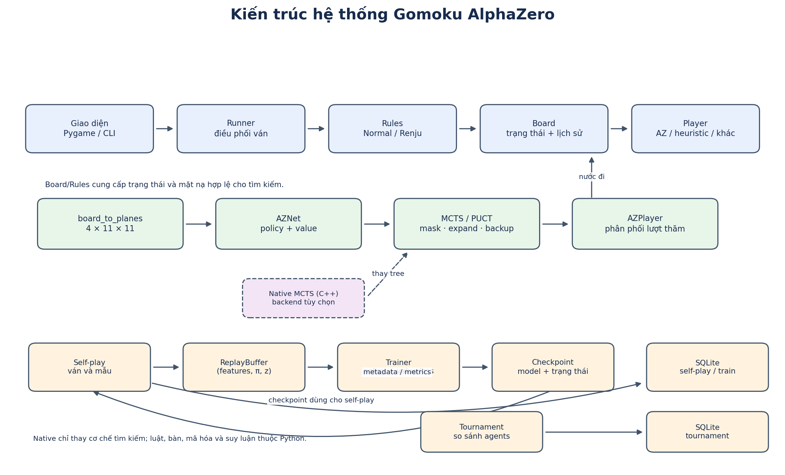
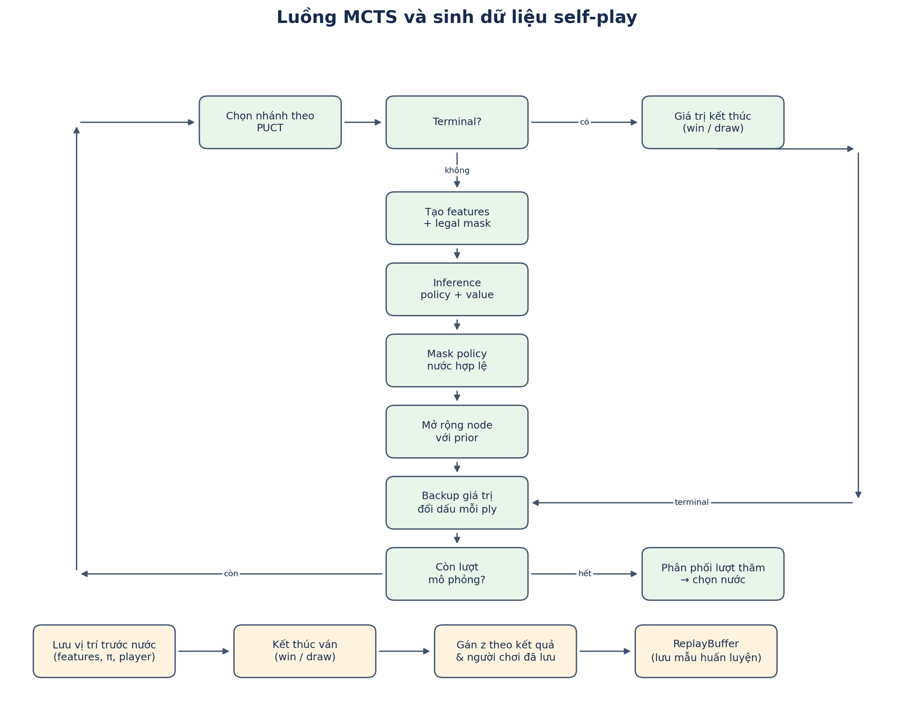
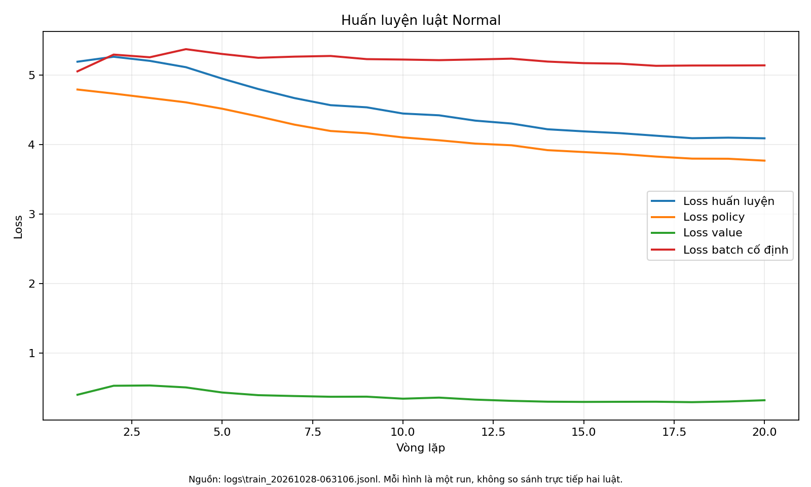
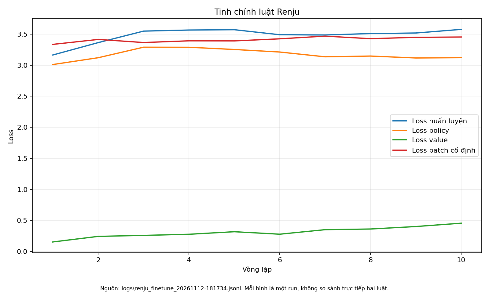

# Chương 1. Giới thiệu

## 1.1. Bối cảnh

Gomoku là trò chơi đối kháng hai người trên bàn cờ, trong đó hai bên luân phiên đặt quân vào các giao điểm còn trống. Trong biến thể Normal của đồ án, người chơi thắng khi tạo được ít nhất năm quân liên tiếp theo hàng, cột hoặc một trong hai đường chéo. Dù luật ngắn gọn, số trạng thái có thể xuất hiện tăng rất nhanh theo số nước đã đi: lựa chọn ở mỗi lượt phụ thuộc vào toàn bộ thế cờ, còn một sai lầm chiến thuật có thể quyết định kết quả ngay lập tức. Vì vậy, một chương trình chơi Gomoku cần đồng thời biểu diễn trạng thái, kiểm tra luật, ước lượng vị trí và lựa chọn hành động.

Đồ án xây dựng một hệ thống nghiên cứu agent Gomoku 11×11 theo hướng AlphaZero: mạng nơ-ron dự đoán chính sách nước đi và giá trị trạng thái; tìm kiếm Monte Carlo Tree Search (MCTS) sử dụng các dự đoán đó để phân bổ lượt mô phỏng; dữ liệu từ các ván tự chơi được đưa trở lại quá trình huấn luyện. Đây là vòng lặp kết hợp học tăng cường và lập kế hoạch tìm kiếm, thay vì chỉ dùng mạng nơ-ron suy luận một nước hoặc chỉ duyệt cây bằng luật heuristic. Đặc tả dự án xác định mục tiêu nghiên cứu là xây dựng agent, hỗ trợ Normal/Renju và so sánh sức chơi trong các điều kiện được kiểm soát; mục tiêu “AlphaZero mạnh hơn Heuristic” là câu hỏi nghiên cứu, không phải tiền đề đã được chứng minh (`SPEC.md`, mục 1–2, dòng 28–66).

## 1.2. Bài toán và biểu diễn hình thức

Xét một trò chơi có trạng thái `s`, tập hành động hợp lệ tại trạng thái đó `A(s)`, hàm chuyển trạng thái `T(s,a)` và kết quả cuối ván. Agent ở lượt của mình cần chọn `a ∈ A(s)`. Trong Gomoku, trạng thái bao gồm bố trí quân trên bàn và bên sắp đi; tập hành động chủ yếu là các ô trống, sau đó bị giới hạn thêm bởi luật của ruleset. Trò chơi là đối kháng, hai phía có mục tiêu trái dấu. Vì thế, giá trị của cùng một vị trí phải gắn với góc nhìn của một người chơi xác định, chứ không phải chỉ là điểm vô hướng không có quy ước dấu.

Trong phần cài đặt, bàn có kích thước 11×11, hai màu được mã hóa bằng BLACK/WHITE, ô trống là EMPTY và hành động được làm phẳng thành `a = 11r + c`. `Board` sở hữu lưới, người chơi hiện tại và lịch sử nước đi; việc một nước có hợp lệ theo luật hay không được hỏi qua `Rules`, không được suy ra chỉ từ thao tác sửa bàn (`SPEC.md`, mục 5.1, dòng 131–147; `gomoku/board.py`, định nghĩa `Board` và thao tác `play/undo`). Cách tách này giúp mô hình hóa trò chơi thống nhất giữa giao diện, self-play và tìm kiếm.

## 1.3. Mục tiêu, câu hỏi nghiên cứu và phạm vi

Trọng tâm kỹ thuật của báo cáo là giải thích đầy đủ cơ sở lý thuyết và kiến trúc đã được hiện thực: AlphaZero, MCTS/PUCT, ResNet, reinforcement learning, self-play và transfer learning; tiếp đó mô tả engine, luật Normal/Renju và đường đi tensor–MCTS–replay–training. Các câu hỏi nghiên cứu được SPEC nêu gồm so sánh AlphaZero với Heuristic trong cùng điều kiện, quan sát ảnh hưởng của mốc dữ liệu self-play và optimizer steps lên playing strength, đánh giá native backend về throughput lẫn tính đúng đắn, và so sánh Normal với Renju trong rating pool riêng (`SPEC.md`, mục 1.2, dòng 34–45).

Các chương đầu phân biệt cấu hình với kết quả thực nghiệm được phân tích ở các chương sau. Những giá trị như số block, batch size, số mô phỏng, số vòng và số ván trong cấu hình không tự chứng minh một lần chạy đã sử dụng các giá trị đó, cũng không phải kết quả thực nghiệm. SPEC đánh dấu mục tiêu AlphaZero thắng Heuristic với bằng chứng đủ tin cậy là chưa đạt tại thời điểm tài liệu được rà soát và yêu cầu không suy luận sức chơi từ việc loss giảm hay pipeline chạy hoàn tất (`SPEC.md`, mục 1.3 và bảng yêu cầu, dòng 41–66).

Phạm vi trò chơi được giữ ở bàn 11×11 và hai luật mà mã dự án hiện thực. Đặc biệt, Renju trong báo cáo được mô tả là hành vi của implementation; không khẳng định nó bao phủ mọi quy tắc, tiền lệ và tình huống phân xử của chuẩn Renju quốc tế (`SPEC.md`, mục 1.3 và 5.2, dòng 41–46, 137–157).

## 1.4. Ý nghĩa và bố cục

Ý nghĩa của hệ thống nằm ở sự liên kết giữa ba lớp: (i) luật và biểu diễn trạng thái cung cấp đầu vào nhất quán, (ii) mạng policy-value và MCTS tạo hành vi lựa chọn có tìm kiếm, (iii) tự chơi, replay và tối ưu tham số khép kín vòng học. Sai sót ở một lớp có thể lan sang lớp khác: ví dụ mask nước cấm sai làm cây tìm kiếm mở rộng hành động không hợp lệ; value dùng sai quy ước người chơi làm backup đảo kết quả; dữ liệu gán nhãn sai khiến loss vẫn tính được nhưng không còn mục tiêu học đúng.

Chương 2 trình bày nền tảng học thuật; Chương 3 mô tả hệ thống, engine và hai ruleset; Chương 4 tập trung vào kiến trúc mạng và pipeline AlphaZero. Các chương tiếp theo trình bày quá trình thực nghiệm, kết quả, kiểm thử và kết luận, kèm giới hạn bằng chứng.

# Chương 2. Cơ sở lý thuyết

## 2.1. Học tăng cường trong trò chơi đối kháng

Học tăng cường (Reinforcement Learning, RL) nghiên cứu cách một tác tử tương tác với môi trường, nhận trạng thái và phần thưởng rồi cải thiện chính sách lựa chọn hành động. Một quá trình quyết định Markov thường được ký hiệu bằng trạng thái `s`, hành động `a`, xác suất chuyển `P(s′|s,a)` và phần thưởng `r`. Trong trò chơi bàn cờ xác định, chuyển trạng thái được quyết định bởi nước đi và luật; phần thưởng thường tập trung ở cuối ván. Mục tiêu là tìm chính sách `π(a|s)` tối đa hóa tổng phần thưởng kỳ vọng.

Trong thiết lập hai người chơi có tổng bằng không, giá trị của vị trí có thể viết theo góc nhìn người đang đi: `v(s) = E[z | s, player-to-move]`, với kết quả cuối `z ∈ {−1, 0, +1}` tương ứng thua, hòa và thắng cho người chơi được quy ước. Sau khi một ply (một nước của một bên) được đi, góc nhìn đối kháng đổi bên, nên dấu giá trị đảo. Quy ước này là thiết yếu cho backpropagation trong MCTS và cho nhãn value trong dữ liệu tự chơi.

Trong AlphaZero, RL không dựa vào dữ liệu gắn nhãn do con người cung cấp. Agent tự sinh các ván, dùng tìm kiếm để tạo chính sách mục tiêu giàu thông tin hơn một lần dự đoán đơn lẻ, rồi cập nhật mạng dựa trên kết quả ván. Bài báo AlphaZero trình bày phương pháp học game từ self-play kết hợp policy/value network với MCTS, và báo cáo áp dụng trên cờ vây, cờ vua và shogi (Silver và cộng sự, 2018, https://www.science.org/doi/10.1126/science.aar6404). Đây là nền tảng phương pháp; bài báo không phải bằng chứng về sức chơi của implementation Gomoku trong đồ án.

## 2.2. AlphaZero: policy, value và tìm kiếm

Mạng policy-value học hai phép dự đoán trên một biểu diễn trạng thái:

- `p(a|s)`: prior xác suất cho hành động `a`, cho biết mạng ưu tiên khám phá nhánh nào.
- `v(s)`: giá trị kỳ vọng từ trạng thái, theo góc nhìn người chơi quy ước.

Policy tạo thứ tự ưu tiên khi mở rộng cây; value giúp ước lượng các lá chưa đi đến kết thúc. MCTS làm giàu dự đoán policy ban đầu thông qua nhiều lần duyệt cây. Sau tìm kiếm, số lần thăm các nước gốc được chuyển thành phân phối mục tiêu `π`; hành động thực tế có thể được lấy mẫu từ phân phối đó hoặc chọn nước có số lượt thăm cao nhất. Kết quả cuối ván tạo nhãn `z`. Mục tiêu tổng hợp thường có dạng:

`L(θ) = (z − vθ(s))² − πᵀ log pθ(s) + c||θ||²`.

Ở đây, hạng value hồi quy kết quả; hạng policy khớp phân phối thăm của tìm kiếm; regularization kiểm soát độ lớn tham số trong mô tả lý thuyết. Trong implementation của đồ án, objective được chia rõ thành policy cross-entropy và value MSE; weight decay được cấu hình ở Adam thay vì cộng thêm một lần vào loss (`az/trainer.py`, dòng 99–124). Vì vậy, công thức lý thuyết không được hiểu nhầm là mã đang cộng hạng L2 tường minh.

## 2.3. Monte Carlo Tree Search và UCT

MCTS xây dựng cây tìm kiếm từng phần bằng cách lặp bốn ý tưởng: lựa chọn một đường đi từ gốc theo thống kê hiện có; mở rộng nút mới; đánh giá lá (bằng mô phỏng hoặc hàm đánh giá); rồi backup kết quả về các nút trên đường đi. Khác với duyệt toàn bộ cây, MCTS tăng ngân sách tại các nhánh được xem là có tiềm năng, nhờ đó tập trung tính toán vào các lựa chọn hữu ích.

UCT (Upper Confidence bounds applied to Trees) cân bằng khai thác và khám phá bằng cách cộng điểm giá trị trung bình vào một hạng thưởng cho nhánh ít được thăm. Một dạng thường dùng là:

`UCT(s,a) = Q(s,a) + c √(ln N(s) / N(s,a))`.

Trong đó `Q` là kết quả trung bình ước lượng, `N(s)` là số lần thăm nút cha, `N(s,a)` là số lần thăm nhánh và `c` điều chỉnh mức khám phá. Kocsis và Szepesvári phát triển UCT như phương pháp áp dụng confidence bounds vào cây tìm kiếm (2006, https://link.springer.com/chapter/10.1007/11871842_29). UCT cung cấp nền tảng cho ý tưởng chọn nhánh theo thống kê và exploration bonus; AlphaZero thay cấu trúc thưởng bằng prior policy trong PUCT.

Trong cờ đối kháng, `Q` phải có hướng nhìn nhất quán. Nếu node con lưu giá trị từ góc nhìn người chơi tới lượt ở chính node con, thì parent đánh giá nhánh đó với dấu âm: một vị trí tốt cho đối thủ là không tốt cho người đang chọn ở parent. Không làm rõ quy ước này là nguồn lỗi phổ biến vì mọi số vẫn có thể hữu hạn và cây vẫn chạy, nhưng hành vi chọn nước bị đảo.

## 2.4. PUCT trong AlphaZero

PUCT kết hợp giá trị ước lượng với prior từ policy network. Dạng điểm chọn child được sử dụng trong dự án là:

`score(s,a) = −Q(s_a) + c_puct · P(s,a) · √(max(1,N(s))) / (1 + N(s_a))`.

Ở đây, `P(s,a)` là prior; `N(s)` là visit count của node cha; `N(s_a)` là visit count child; `Q(s_a)` là giá trị trung bình của node con theo góc nhìn người tới lượt ở con; dấu âm đưa nó về góc nhìn node cha. `c_puct` điều chỉnh độ ảnh hưởng của prior/khám phá. Ban đầu nhánh có prior cao được ưu tiên; khi nhánh được thăm nhiều, mẫu số tăng và phần thưởng giảm, cho phép nhánh khác được khảo sát. Công thức và mặc định `c_puct=1.5` được mô tả trong SPEC (`SPEC.md`, mục 7.1, dòng 180–194); các trường node và quy ước `q_value` nằm trong `az/mcts.py`, dòng 18–37.

Khi mở rộng lá, network trả về policy softmax; MCTS nhân policy đó với legal mask sau softmax, tính tổng khối lượng còn lại rồi chuẩn hóa lại trên các nước hợp lệ. Nếu tổng nhỏ hơn hoặc bằng ngưỡng `1e−8`, phần mềm dùng phân phối đều trên các hành động legal; nước cấm nhận prior bằng 0. Về mặt toán học, mask logits trước softmax tương đương khi chuẩn hóa chính xác trên cùng tập hợp hợp lệ; tuy nhiên sai số số học và ngưỡng fallback có thể tạo khác biệt trong cài đặt. Mã mask sau softmax tại `az/mcts.py`, dòng 158–174; `AZNet.predict` tạo policy probability tại `az/model.py`, dòng 86–105.

Trong huấn luyện, Dirichlet noise có thể được trộn vào prior tại root để khuyến khích khám phá: `P′ = (1−ε)P + εη`, trong đó `η` lấy từ Dirichlet chỉ trên legal moves. Đây là cơ chế self-play/training; đánh giá tournament mặc định tắt root noise theo protocol được mô tả trong SPEC (`SPEC.md`, mục 7.1 và 10.2). Do đó không nên nói root noise luôn bật trong mọi lần MCTS.

## 2.5. Mạng ResNet và mạng policy-value

Mạng tích chập phù hợp với bàn cờ vì mỗi ô nằm trong quan hệ không gian cục bộ với các ô lân cận; các bộ lọc có thể phát hiện mẫu theo vị trí mà không cần một tham số riêng cho từng tọa độ ở mọi lớp. ResNet bổ sung kết nối tắt (skip connection) để một block học phần dư thay vì phải tái tạo trực tiếp ánh xạ đầy đủ. Với đầu vào `x`, block có dạng `y = ReLU(F(x) + x)` (có chuẩn hóa batch trong các lớp tích chập). Kết nối tắt hỗ trợ truyền tín hiệu qua nhiều lớp và là nền tảng cho mạng sâu hơn. He và cộng sự giới thiệu residual learning cho recognition thị giác quy mô lớn (2015, https://arxiv.org/abs/1512.03385).

AZNet trong dự án dùng một stem convolution, tiếp đó là các residual blocks và hai head. Policy head chuyển đặc trưng không gian thành 121 logits, một cho mỗi ô của bàn 11×11. Value head tổng hợp đặc trưng thành một scalar qua `tanh`, nên dự đoán bị chặn trong `[-1,1]`. Cấu trúc có thể biểu diễn khái quát là `x → trunk ResNet → {policy logits, value}`. Theo mặc định của constructor và cấu hình, model có 6 residual blocks và 64 filters; đây là giá trị cấu hình, không phải kích thước bắt buộc của lý thuyết AlphaZero (`az/model.py`, dòng 14–40, 68–84; `config.py`, dòng 28–30; `SPEC.md`, mục 6, dòng 159–178).

Hai head phục vụ hai nhiệm vụ liên quan nhưng không đồng nhất. Policy head xếp hạng hành động; value head ước lượng kết quả kỳ vọng từ vị trí. Việc dùng chung trunk cho phép các đặc trưng hữu ích cho cả đánh giá vị trí và chọn nước được học chung, trong khi mỗi head có lớp đầu ra riêng. Không nên diễn giải policy probability là xác suất thắng; đó là phân phối trên hành động, còn value là dự đoán kết quả.

## 2.6. Self-play và dữ liệu mục tiêu

Self-play là quá trình một policy tạo ra các ván huấn luyện bằng cách điều khiển cả hai bên hoặc vận hành hai lượt agent trong cùng một game. Mỗi trạng thái trước nước đi có thể tạo mẫu `(s, π, player)`, trong đó `π` là phân phối visits sau MCTS. Khi ván kết thúc, kết quả `z` được quy đổi theo bên đã lưu ở trạng thái đó. Như vậy mỗi mẫu chứa thông tin cục bộ từ tìm kiếm và tín hiệu kết quả cuối ván.

Self-play vừa tạo dữ liệu vừa xác định phân phối trạng thái mà model gặp: thay đổi policy sẽ làm thay đổi ván, các trạng thái được thăm và target policy tiếp theo. Điều này tạo vòng phản hồi giữa dữ liệu và model. Nó cũng có rủi ro phân phối: nhiều mẫu có thể tương tự nhau hoặc thiếu các tình huống hiếm; số lượng mẫu lớn không đồng nghĩa với độ đa dạng hay playing strength cao. Để bảo toàn ngữ nghĩa, `z` phải gắn với người chơi ở trạng thái đã lưu, `π` chỉ có xác suất trên nước hợp lệ, và số mẫu nên khớp số trạng thái đã được tìm kiếm. SPEC liệt kê các bất biến tương ứng cho pipeline (`SPEC.md`, mục 8.3, dòng 255–265).

## 2.7. Transfer learning và fine-tuning

Transfer learning khai thác tri thức đã học trên một tác vụ hoặc phân phối nguồn để khởi tạo mô hình cho tác vụ đích liên quan. Trong fine-tuning, một phần hoặc toàn bộ tham số của model đã huấn luyện được tiếp tục tối ưu trên dữ liệu/tác vụ mới. Tổng quan của Pan và Yang phân loại phương pháp transfer learning theo quan hệ giữa miền nguồn, miền đích và nhiệm vụ (2010, https://ieeexplore.ieee.org/abstract/document/5288526).

Trong bối cảnh Gomoku, ý tưởng có thể là khởi tạo từ checkpoint đã học trên Normal rồi tiếp tục tối ưu khi luật đích là Renju. Có thể có đặc trưng dùng chung như hình thành chuỗi quân hoặc chiến lược chiếm trung tâm, nhưng ruleset thay đổi tập hành động hợp lệ, khái niệm kết thúc và phân phối kết quả. Do đó chuyển trọng số không đồng nghĩa với chuyển nguyên vẹn policy đúng cho luật mới. Training examples, legal mask, nhãn kết quả, buffer và checkpoint phải nhất quán với ruleset đích; dữ liệu Normal không nên bị âm thầm trộn trong buffer Renju nếu pipeline đặt ràng buộc một luật mỗi buffer.

Trong repo có cấu hình và driver fine-tuning Renju, nhưng sự hiện diện của chúng chỉ chứng minh có đường chạy được thiết kế/cài đặt; nó không chứng minh fine-tuning làm tăng strength. Cần thí nghiệm matched trước–sau với checkpoint nguồn, luật, ngân sách tìm kiếm, protocol, màu và seeds được kiểm soát để kết luận tác động nhân quả. SPEC cũng tách pool Normal/Renju và cảnh báo không thể suy diễn từ một loss hoặc số ván (`SPEC.md`, mục 1.2, 10.2; `az/renju_finetune.py`; `configs/renju.yaml`).

# Chương 3. Kiến trúc hệ thống và luật chơi

## 3.1. Tổng quan hệ thống

Hệ thống được chia thành các thành phần có trách nhiệm khác nhau. Lớp giao diện dòng lệnh hoặc Pygame khởi tạo game và player; `gomoku/` giữ board, rules, game/runner và feature encoding; `players/` cung cấp các loại tác tử; `az/` triển khai model, MCTS, self-play, replay, trainer và đánh giá; `native/` chứa các extension C++ tùy chọn. Kết quả training và tournament được ghi ở các kho dữ liệu khác nhau; checkpoint và replay được lưu riêng theo hợp đồng huấn luyện (`SPEC.md`, mục 3–4, dòng 68–128).

Trong luồng inference thông thường, player gọi MCTS; MCTS truy vấn Rules để xác định nước legal và trạng thái terminal, tạo tensor đặc trưng cho lá, rồi yêu cầu mạng policy-value đánh giá. Sau một ngân sách tìm kiếm, thống kê root được chuyển thành lựa chọn nước đi. Ở self-play, cùng luồng được thực hiện cho từng game; feature và visit policy được giữ lại, kết quả cuối được gán làm value target rồi mẫu được đưa vào replay. Trainer lấy batch từ replay, cập nhật tham số mạng, lưu checkpoint và metadata.

Cấu trúc dữ liệu và ranh giới thành phần giúp phân biệt hai hoạt động: self-play/training sinh dữ liệu, còn tournament/evaluation đánh giá checkpoint bằng giao thức riêng. Log self-play/training và database tournament không phải một kho thay thế nhau; số game đã tạo không tự là phép đo chất lượng (`SPEC.md`, mục 4.1, dòng 119–128).

## 3.2. Board, Rules và hợp đồng game

Board 11×11 được lưu dưới dạng 121 ô tuyến tính; `a=11r+c` chuyển giữa chỉ số hành động và tọa độ hàng-cột. `Board.play` bảo đảm tọa độ nằm trong bàn và ô chưa bị chiếm, ghi lịch sử rồi đổi lượt; nó không quyết định tính hợp lệ theo Normal hay Renju. Caller cần kiểm tra nước đi với `Rules` trước khi cập nhật. `undo` phục hồi nước cuối và bên đi (`SPEC.md`, mục 5.1, dòng 131–135).

Interface `Rules` tách các câu hỏi luật khỏi biểu diễn bàn: danh sách nước hợp lệ, danh sách nước cấm, trạng thái thắng và kết thúc. Cả player, MCTS và UI cần dùng chung interface để tránh tự triển khai các biến thể luật không đồng nhất. MCTS không tự hiểu “ô cấm” theo một heuristic riêng; nó nhận legal mask được tạo từ Rules (`SPEC.md`, mục 4 và 5.3, dòng 119–128, 149–157).

Normal cho phép đặt lên mọi ô trống. Năm quân trở lên liên tiếp theo một trong bốn hướng (ngang, dọc, chéo chính, chéo phụ) là thắng cho cả hai màu; bàn đầy mà chưa có thắng là hòa. Implementation kiểm tra chuỗi qua hai chiều quanh nước cuối và dùng `>=5` (`gomoku/rules/normal.py`, dòng 8–17, 19–48; `SPEC.md`, mục 5.2, dòng 137–147).

## 3.3. Luật Renju theo implementation

Renju trong đồ án áp dụng bất đối xứng theo màu. Với Black, exact-five thắng; overline, double-four và double-three là các dạng nước bị cấm theo semantics hiện tại. Với White, năm quân trở lên thắng và không có forbidden mask. Đặc biệt, code xét exact-five trước các forbidden checks khác, nên một nước Black tạo đúng năm được coi là thắng ngay cả khi đồng thời tạo mẫu khác. Các hành động bị cấm được loại khỏi danh sách legal chứ không chỉ bị phạt trong policy (`SPEC.md`, mục 5.2, dòng 137–147; `gomoku/rules/renju.py`, dòng 13–16, 22–57, 59–73).

Để tìm candidate cấm, implementation giới hạn vùng xét ở các ô trong phạm vi tối đa bốn bước theo các hướng đường thẳng từ quân Black hiện có. Với từng candidate, mã tạm đặt quân Black, kiểm tra overline, nhóm four và nhóm open-three, sau đó khôi phục ô. Kiểm tra open-three dựa vào extension tạo open-four; các extension còn được kiểm tra điều kiện hợp lệ theo quy tắc nội bộ. Đây là mô tả thuật toán mã nguồn, không phải khẳng định rằng mọi biến thể hình thế hoặc tiền lệ luật Renju quốc tế đã được bao phủ (`gomoku/rules/renju.py`, dòng 32–57, 75–90, 129–229; `SPEC.md`, mục 5.2–5.3, dòng 147–157).

Luật Renju có ảnh hưởng xuyên suốt pipeline. Legal mask tại mỗi lá MCTS phải cùng kết quả với Rules; feature input có một plane forbidden; replay phải mang nhãn ruleset; buffer chỉ chứa một ruleset; và thí nghiệm strength phải được phân tích trong pool riêng. Nếu từng lớp dùng một định nghĩa luật khác nhau thì có thể phát sinh `π` gán khối lượng lên hành động bất hợp lệ hoặc target được sinh từ trạng thái kết thúc không tương thích.

## 3.4. Python và native backend

Kiến trúc cho phép dùng Python hoặc extension C++ tùy chọn cho một số phần tìm kiếm hoặc phát hiện pattern. Ranh giới được mô tả trong SPEC là: C++ MCTS quản lý mechanics của cây; Python tiếp tục sở hữu Board, Rules, RNG, feature generation và neural inference. Native pattern detector là một thành phần riêng, không đồng nghĩa với native game engine. Do đó, “có native backend” không có nghĩa toàn bộ ván, luật, model hoặc huấn luyện đã được viết lại bằng C++ (`SPEC.md`, mục 9.1, dòng 267–284).

Hai backend cần được xem xét ở nhiều mức: hành vi luật và trạng thái, tính nhất quán ở fixture, phân phối mục tiêu qua nhiều seeds, chất lượng trận đấu, rồi mới đến throughput. Một phép đo thời gian đơn lẻ không chứng minh parity; một test fixture không chứng minh equivalence trên toàn bộ không gian trạng thái. Báo cáo này chỉ mô tả ranh giới kiến trúc, không đưa ra kết luận benchmark hay chất lượng.

# Chương 4. Kiến trúc AlphaZero: tensor, MCTS, buffer và huấn luyện

## 4.1. Mã hóa trạng thái thành tensor

Hàm `board_to_planes(board, rules, player)` mã hóa vị trí thành tensor `uint8` có shape `(4,11,11)`. Bốn plane lần lượt biểu diễn: quân của người đang đi, quân đối thủ, ô bị cấm theo Rules, và màu người đi (plane hằng 1 khi Black, 0 khi White). Đây là biểu diễn tương đối theo player-to-move, giúp dùng cùng mạng cho hai màu. Không có plane riêng cho last move hoặc toàn bộ lịch sử ván (`gomoku/features.py`, dòng 7–35; `SPEC.md`, mục 6.1, dòng 159–165).

Tính bất biến theo hình học được khai thác bằng tám phép đối xứng của hình vuông: các phép quay và phản chiếu. Biến đổi áp dụng giống nhau lên tensor bàn và policy vector đã làm phẳng; policy 121 phần tử được định hình lại thành 11×11, biến đổi không gian, rồi làm phẳng trở lại. `ReplayBuffer.sample` chọn một phép biến đổi ngẫu nhiên cho từng mẫu và áp dụng đồng bộ lên feature với policy; nhãn kết quả `z` không đổi (`gomoku/features.py`, dòng 11–20, 38–57; `az/replay_buffer.py`, dòng 80–118).

## 4.2. AZNet: trunk ResNet và hai head

`AZNet` nhận batch tensor dạng `(B,4,11,11)`. Stem sử dụng convolution 3×3, batch normalization và ReLU. Mỗi residual block gồm hai convolution 3×3 cùng batch normalization, cộng skip connection và kích hoạt. Mặc định constructor là 6 blocks × 64 filters (`az/model.py`, dòng 14–40, 68–84; `config.py`, dòng 28–30).

Policy head dùng convolution 1×1, batch normalization/ReLU, flatten và lớp fully-connected để tạo 121 logits. Value head cũng dùng convolution 1×1, batch normalization/ReLU, rồi các lớp fully-connected, ReLU và đầu ra `tanh` scalar. Forward pass trả logits và values; `predict` chuyển policy logits thành softmax probabilities và trả mảng NumPy cho phía MCTS (`az/model.py`, dòng 37–105; `SPEC.md`, mục 6.1, dòng 161–166).

Policy head không nhận legal mask bên trong mạng. Mạng dự đoán trên toàn bộ 121 ô; legal filtering thuộc bước sử dụng policy trong MCTS. Vì thế, cần phân biệt hai phép toán: softmax chuyển logits thành phân phối trước; MCTS nhân phân phối với legal mask sau đó và chuẩn hóa lại trên nước hợp lệ. Cách này giữ model output dùng chung, còn tính hợp lệ phụ thuộc vào Rules của trạng thái (`az/model.py`, dòng 86–105; `az/mcts.py`, dòng 158–174).

## 4.3. Một simulation MCTS và giao tiếp model

Mỗi node MCTS lưu parent, nước đi, prior, visit count `N`, value sum `W`, child nodes và trạng thái terminal/expanded. Giá trị trung bình là `Q=W/N`, bằng 0 khi chưa được thăm. MCTS khởi động lại root tại trạng thái mới cho mỗi quyết định nước, rồi thực hiện tối đa ngân sách simulation (`az/mcts.py`, dòng 18–37, 41–79; `SPEC.md`, mục 7.2, dòng 196–217).

Một simulation bắt đầu từ root và đi xuống các child đã mở rộng theo điểm PUCT. Mỗi nước được áp lên bàn tạm trong traversal. Khi gặp node terminal, giá trị thắng/thua/hòa được backup mà không gọi mạng. Với một lá không terminal, MCTS tạo plane tensor và legal mask từ Rules; nếu không có legal move thì lá được đánh dấu hòa. Nếu cần network inference, MCTS tạo `LeafRequest`, lưu đường đi đang chờ và hoàn tác các nước tạm trên bàn. Khi nhận policy/value, `receive` mask-normalize policy, mở rộng các nước hợp lệ rồi backup giá trị (`az/mcts.py`, dòng 88–156, 158–183; `SPEC.md`, mục 7.2, dòng 196–217).

Trong cờ đối kháng, mỗi cạnh làm đổi bên đi; vì vậy dấu của value được đổi qua từng ply khi backup. Một trạng thái terminal sau nước đi được biểu diễn từ góc nhìn người tới lượt ở trạng thái terminal, tức bên vừa đến lượt là bên thua (`−1`) trong trường hợp đối thủ vừa thắng. Hợp đồng dấu này tương ứng với điểm child PUCT có `−Q(child)` khi đánh giá từ parent. Việc hiểu đúng góc nhìn ở cả hai nơi ngăn lỗi đảo dấu (`az/mcts.py`, dòng 32–37, 115–134; `SPEC.md`, mục 7.1, dòng 184–194).

API request/receive cho phép self-play xen kẽ các game: mỗi game yêu cầu đánh giá lá, các yêu cầu đang chờ được gom thành batch inference, kết quả policy/value được trả lại từng MCTS. `run_games` ghi rõ mỗi tick tiến các game chưa kết thúc và dùng một lần `model.predict` cho các leaves đang chờ (`az/selfplay.py`, dòng 69–88). Số game chạy đồng thời phục vụ batching; nó không đồng nghĩa với số simulation cho mỗi quyết định.

## 4.4. Từ thống kê root tới nước đi và target policy

Khi MCTS hoàn thành search, visit counts của các hành động ở root tạo phân phối tìm kiếm. Có thể biểu diễn target policy bằng `π(a|s) ∝ N(s,a)^(1/τ)`, sau đó chuẩn hóa tổng xác suất bằng 1. `τ` điều khiển mức phân tán: ở nhiệt độ dương, các nhánh có lượt thăm thấp vẫn có cơ hội được lấy mẫu; khi `τ=0`, chọn hành động có visit cao nhất (xử lý tie theo RNG). Hành động chơi thực tế và nhiệt độ tạo target có thể là hai cấu hình độc lập (`SPEC.md`, mục 7.2, dòng 217).

Mặc định self-play được nêu trong SPEC: hành động dùng temperature 1 trong 15 plies đầu rồi temperature 0; target policy dùng `pi_target_temp` độc lập. Root Dirichlet noise, nếu bật, chỉ tác động vào prior tại root. Vì vậy, không nên nhập nhằng temperature của nước đi với temperature của `π`, hoặc kết luận mọi search đều dùng exploration noise (`config.py`, dòng 13–17, 43; `SPEC.md`, mục 7.1–7.2, dòng 188–217).

Ngân sách MCTS trong hợp đồng AlphaZero là cố định 200 simulations cho mỗi lần MCTS thực sự được gọi. Một override chiến thuật có thể chọn nước mà không gọi MCTS; trường hợp đó cần được hiểu là bỏ qua search ở quyết định ấy, không phải một MCTS với budget khác. Thông tin 200 là default/contract cấu hình, không phải bằng chứng về số ván chạy trong một thí nghiệm (`config.py`, dòng 8–17; `SPEC.md`, mục 7.1, dòng 192–195, 10.2).

## 4.5. Mẫu self-play và gán nhãn kết quả

Self-play duy trì trạng thái riêng cho từng game, MCTS và danh sách vị trí. Tại mỗi quyết định, mẫu lưu feature của trạng thái trước nước đi, phân phối target từ visit statistics và phía đang đi. Khi game kết thúc, outcome được đổi sang góc nhìn của từng mẫu để tạo `z`; do đó cùng một ván thắng sẽ cho target value trái dấu giữa các bên. `run_games` mô tả vị trí được gom thành mẫu sau khi kết quả đã biết (`az/selfplay.py`, dòng 24–40, 69–88; `SPEC.md`, mục 8.1, dòng 231–243).

Khai báo “một mẫu mỗi nước” không có nghĩa mọi nước mở màn ngẫu nhiên đều là sample tìm kiếm. SPEC mô tả tùy chọn random opening plies: các nước mở đầu chỉ tạo vị trí xuất phát đa dạng và không được dùng làm training targets. Khi random-opponent rate được cấu hình, nước được chơi có thể là random legal move, trong khi search và visit target vẫn được ghi theo quy ước; vì thế provenance cần phân biệt nước override và nước do search chọn (`SPEC.md`, mục 8.1, dòng 238–243).

## 4.6. Replay buffer và tăng cường dữ liệu

`ReplayBuffer` là bộ đệm vòng có capacity cố định, lưu features `uint8`, policy `float16`, value `float32`, ID ruleset và game ID. Khi đầy, ghi mẫu mới ghi đè vị trí cũ nhất. Buffer kiểm tra shape feature `(4,11,11)`, policy `(121,)`, ruleset hợp lệ và không cho trộn nhiều ruleset trong cùng một buffer (`az/replay_buffer.py`, dòng 25–78).

Sampling lấy batch với hoàn lại; do đó cùng một slot có thể được lấy nhiều lần trong batch hoặc ở các bước khác nhau. Với mỗi sample, một phép đối xứng ngẫu nhiên được áp dụng đồng bộ lên feature và `π`. `z` giữ nguyên vì phép biến đổi chỉ làm thay đổi hình học bàn chứ không đổi kết quả game. Kích thước mặc định 50.000 là cấu hình khởi đầu, không đảm bảo mọi lần chạy buffer đầy hoặc chứa 50.000 vị trí phân biệt (`az/replay_buffer.py`, dòng 80–118; `config.py`, dòng 19–21, 45).

## 4.7. Hàm mất mát và cập nhật tham số

Với batch kích thước `B`, logits `lᵢ`, policy target `πᵢ`, dự đoán value `vᵢ` và outcome target `zᵢ`, policy loss là cross-entropy mềm:

`L_policy = −(1/B) Σᵢ Σₐ πᵢₐ log softmax(lᵢ)ₐ`.

Value loss là sai số bình phương trung bình:

`L_value = (1/B) Σᵢ (vᵢ − zᵢ)²`.

Loss tối ưu:

`L = w_policy L_policy + w_value L_value`.

Trong code, policy loss sử dụng `log_softmax` trực tiếp trên logits; value loss dùng MSE sau khi làm phẳng giá trị và target. Mặc định hai hệ số loss là 1.0. Adam dùng `learning_rate=1e−3` và `weight_decay=1e−4`; lịch learning rate cosine theo global step. Weight decay thuộc optimizer, không được cộng lần thứ hai vào `_total_loss` (`az/trainer.py`, dòng 91–136; `config.py`, dòng 18–30; `SPEC.md`, mục 6.2, dòng 167–178).

Mỗi bước tối ưu lấy batch từ buffer, chuyển tensor sang device, forward model, tính loss, xóa gradient, backpropagation và cập nhật Adam. Batch sampling có hoàn lại, nên `batch_size × train_steps` không đồng nghĩa số sample duy nhất; trainer thống kê distinct slots được dùng (`az/trainer.py`, dòng 138–190). Mặc định `batch_size=128` và 200 optimizer steps/iteration trong `DEFAULT_CONFIG`; cấu hình YAML có thể ghi đè. Chẳng hạn SPEC ghi `configs/normal.yaml` dùng 1000 steps/iteration trong một cấu hình Normal, khác default 200; đây là hai tầng cấu hình, không phải kết quả chạy (`config.py`, dòng 8–27; `SPEC.md`, mục 6.2, dòng 174).

## 4.8. Fixed evaluation batch và giới hạn diễn giải

Trainer có thể cố định một batch để theo dõi loss qua thời gian và lưu các index để tránh lấy trực tiếp các slot đó vào bước train. Tuy nhiên, batch này được lấy từ replay/self-play stream, không phải tập test độc lập được thu thập ngoài quá trình huấn luyện; buffer thay đổi và có thể có quan hệ dữ liệu gần với các mẫu training. Vì vậy, fixed-batch loss chỉ mô tả loss trên batch cố định đó, không đo trực tiếp playing strength, khả năng tổng quát hóa hay superiority trước đối thủ (`az/trainer.py`, dòng 192–225; `az/replay_buffer.py`, dòng 45–47; `SPEC.md`, mục 6.2, dòng 178).

Đánh giá sức chơi cần dựa trên tournament có checkpoint identity, luật, ngân sách, màu, opening và protocol được xác định; loss giảm không thay thế phép đo đó. Các phép đo và giới hạn tương ứng được phân tích ở các chương thực nghiệm.

## 4.9. Tóm tắt luồng end-to-end

Từ một trạng thái game, Rules sinh legal mask và feature encoder tạo bốn plane. AZNet tạo policy/value; MCTS dùng PUCT để mở rộng các hành động hợp lệ, backup giá trị theo góc nhìn người chơi và tích lũy visits. Visits trở thành `π`, hành động được chọn theo nhiệt độ tương ứng, và trạng thái cùng target được lưu. Khi ván kết thúc, outcome tạo `z`; replay cung cấp các batch đã augmentation; trainer tối ưu policy-value loss và cập nhật tham số. Chu kỳ tiếp tục với model mới, nhưng chất lượng của chu kỳ chỉ có thể được kết luận qua đánh giá phù hợp, không thể suy ra từ kiến trúc hay cấu hình.

# Chương 5. Quá trình thực nghiệm và cải tiến hệ thống

Chương này tái dựng quá trình thử nghiệm theo các mốc được ghi trong báo cáo, log, SQLite và kiểm toán artifact của dự án. Trọng tâm không phải liệt kê mọi thay đổi mã, mà là chỉ ra vì sao từng phép thử được thực hiện, giả thuyết nào được đặt ra, điều kiện đo cụ thể, kết quả quan sát và quyết định tiếp theo. Các con số “ngày” dưới đây là ngày chạy hoặc ngày ghi nhận của thí nghiệm trong tài liệu; chúng **không đồng nghĩa ngày commit**. Tên checkpoint, SHA-256 của checkpoint, generation, database và Git commit là những định danh khác nhau. Git history được kiểm tra ở cấp dự án nhưng không cung cấp cơ sở để gán SHA commit cho từng thí nghiệm; vì vậy chương không biến SHA artifact thành SHA commit.

Kết quả huấn luyện, sức chơi và tốc độ được xem là ba loại bằng chứng riêng. Loss giảm không chứng minh agent thắng nhiều hơn; số ván self-play không chứng minh các ván thuộc cùng lineage; tốc độ cao không chứng minh chất lượng Python/C++ tương đương. Phạm vi kết luận ở mỗi mục được giới hạn theo luật, checkpoint, opening, backend, ngân sách tìm kiếm và workload thực sự được ghi nhận. Nền tảng kỹ thuật và nhãn trạng thái bằng chứng được trình bày trong [`SPEC.md`](../SPEC.md), đặc biệt các mục 1–2, 8–11.

## 5.1. Cách đọc timeline và phép đo

Hệ thống Normal dùng bàn 11×11, mạng policy–value ResNet 6 block × 64 filters và MCTS 200 simulations cho mỗi lần tìm kiếm. Self-play sinh policy target từ phân bố visit và value target từ kết quả cuối ván; replay buffer chỉ chứa một ruleset. Do đó, các lần fine-tuning Normal và Renju không thể cộng chung thành một chuỗi dữ liệu huấn luyện duy nhất. Cấu hình trong tệp YAML cho biết điều dự định chạy, trong khi log/DB mới cho biết phần nào thực sự đã chạy. Đây là khác biệt quan trọng giữa mục tiêu nghiên cứu và bằng chứng vận hành (`SPEC.md`, §§6–8; `docs/report.md`, §§4–8).

Một số mốc mang nhãn “25k”, “40k”, “50k”, “60k” là tên gọi của checkpoint hoặc lịch sử continuation được đối chiếu. Chúng không phải lúc nào cũng là tổng số ván có thể xác minh độc lập. Chẳng hạn, kiểm toán 60k mô tả mốc danh nghĩa gồm parent lịch sử 25k và 35k ván continuation; riêng lịch sử 25k không được đếm độc lập đầy đủ. Run 20k riêng có checkpoint khởi đầu khác hẳn checkpoint 60k, nên không thể cộng nó thành “80k liên tục” (`docs/az-80k-checkpoint-forensics.md`, §§1–2). DB `data/normal.sqlite` ghi 75.000 game records và 1.500 metric rows qua nhiều run; DB `data/az_25k_continuation_v1.sqlite` ghi 35.000 game records. Đây là hai snapshot không được cộng/gộp nếu chưa chứng minh identity và lineage; trường `git_commit` và `engine_version` trong metadata liên quan để trống (`report/bang_doi_chieu.md`, E19; `data/normal.sqlite`; `data/az_25k_continuation_v1.sqlite`; `docs/az-80k-checkpoint-forensics.md`, §§2–3).

## 5.2. Mốc khởi đầu: Normal 1.000 ván

### Bối cảnh và giả thuyết

Thử nghiệm Normal đầu tiên có mục tiêu chứng minh toàn bộ vòng lặp AlphaZero có thể chạy: tự chơi, lưu mẫu, tối ưu policy–value và ghi checkpoint/log. Giả thuyết vận hành là pipeline tạo được dữ liệu và loss train sẽ giảm khi tối ưu trên các mẫu self-play. Đây là kiểm tra khả năng chạy và tín hiệu học trong train set, không phải giả thuyết đã định lượng rằng checkpoint sẽ mạnh hơn Heuristic.

### Thiết kế

Log ngày 2026-10-28 ghi 20 iterations × 50 games = 1.000 games. Mỗi nước dùng 200 simulations; cấu hình ghi 16 ván hoạt động để gom lô inference, mạng 6×64, batch size 128 và 200 bước train/iteration. Thiết bị được ghi là NVIDIA GeForce RTX 4060 Laptop GPU. Run có 4.000 global steps ở iteration 20. Thông tin này đến từ log huấn luyện và log từng game, không phải suy ra từ YAML (`docs/report.md`, §§8.1, 8.3, lines 129–148).

### Kết quả, nhận xét và quyết định

| Metric | Iteration 1 | Iteration 20 |
|---|---:|---:|
| Replay samples | 2.005 | 30.452 |
| Global step | 200 | 4.000 |
| Train loss | 5,19370 | 4,09124 |
| Policy loss | 4,79342 | 3,76979 |
| Value loss | 0,40028 | 0,32145 |
| Fixed-batch loss | 5,05494 | 5,14099 |
| Nước trung bình mỗi ván | 40,10 | 23,10 |
| Network leaf evaluations trung bình mỗi ván | 7.877,7 | 4.408,2 |

Loss train giảm từ 5,19370 xuống 4,09124, nhưng loss trên batch cố định tăng từ 5,05494 lên 5,14099 và dao động giữa các iteration. Số nước trung bình giảm cũng không chỉ ra nguyên nhân hay sức chơi: độ dài ván còn phụ thuộc opening, màu và cách kết thúc. Vì fixed batch lấy từ stream self-play chứ không phải holdout theo game, ngay cả metric này cũng không phải ước lượng generalization độc lập (`docs/report.md`, §§6, 8.1, lines 105–115, 133–147; `SPEC.md`, §6.2).

Kết luận hợp lý của mốc 1.000 là pipeline đã tạo được checkpoint và ghi log huấn luyện, đồng thời train objective có thay đổi theo tối ưu. Kết quả **không** xác lập rằng Normal đã hội tụ hoặc tốt hơn đối thủ. Một log ngày 2026-11-01 chỉ ghi một iteration, hai ván và 95 mẫu; nó không phải continuation quy mô lớn. Cấu hình lịch sử đặt mục tiêu 5.000 ván cũng không chứng minh đã thực thi đủ ngân sách (`docs/report.md`, §8.1, lines 148–149).

## 5.3. T35: lần đánh giá đối kháng có quy mô và protocol rõ

### Bối cảnh và thiết kế

Sau các thử nghiệm chạy pipeline, nhu cầu chuyển từ “mô hình có train được không?” sang “agent chơi ra sao trước các baseline?”. T35 hoàn tất ngày 2026-11-14, tổng 2.400 ván: 1.500 Normal fixed-budget, 600 Renju fixed-budget và 300 Normal time-budget. Mỗi matchup có 100 ván, mỗi tác tử cầm Đen 50 ván; seed gốc `20261113`. Sau khi đổi baseline Alpha-Beta fixed từ depth 2 sang depth 1, tám matchup có Alpha-Beta được chạy lại đủ 800 ván; 13 matchup không có Alpha-Beta giữ nguyên 1.300 ván. Các log depth 2, smoke và run gián đoạn được giữ riêng, không cộng vào tập selection cuối (`docs/report.md`, §§10.1–10.2, lines 225–239).

Trong nhóm fixed, AZ và MCTS Pure dùng 200 simulations, còn Alpha-Beta dùng depth 1; đây không phải ngân sách tính toán tương đương. Nhóm time-budget dùng một giây mỗi nước và Alpha-Beta iterative deepening, do đó không khóa ở depth 1. Normal và Renju được phân tích trong pool riêng. Mỗi cặp cân bằng màu, nhưng các ván trong một pool không nhất thiết độc lập; Wilson interval với hòa tính nửa điểm chỉ là xấp xỉ, không phải bằng chứng hai agent tương đương (`docs/report.md`, §§9.3, 10.1–10.4, lines 203–209, 229–233; `SPEC.md`, §10.1).

### Kết quả và quyết định

Trong Normal fixed, Heuristic thắng `az_v0` 100–0; Heuristic cũng thắng `az_v1_threat` 100–0. `az_v0` đạt 149/500 = 29,8% score trong đội hình này; `az_v1_threat` đạt 369/500 = 73,8%, nhưng đây là biến thể khác có threat search và không thể gán kết quả cho trọng số mạng. Trong Renju fixed, Heuristic thắng `az_renju` 100–0; AZ Renju hòa 50–50 với Alpha-Beta depth 1, nhưng bảng phân màu cho thấy Alpha-Beta thắng toàn bộ ván khi cầm Đen. Trong Normal time, `az_v1_threat` đạt 87/100 trước Alpha-Beta; fixed và time là hai protocol khác nhau (`docs/report.md`, §§10.2–10.3, lines 241–298).

Kết quả cho thấy ở các pool đã chạy, AZ v0 yếu hơn Heuristic và biến thể threat có kết quả tốt hơn trong một số matchup Normal. Chúng không chứng minh AZ Renju ngang Alpha-Beta hoặc threat search luôn mạnh hơn: ngân sách không đồng nhất, một tập opening cụ thể được dùng, và biến thể không phải ablation mạng matched. Quyết định nghiên cứu sau T35 là cần phân tích lỗi chiến thuật và dữ liệu, thay vì dùng loss hoặc số ván huấn luyện như đại diện cho strength. T35 là điểm tham chiếu lịch sử, không được cộng với các screen sau thành một tournament duy nhất.

## 5.4. Chẩn đoán 25k: dữ liệu tự chơi, tactical và continuation

### Vì sao điều tra mốc 25k

Báo cáo phiên 25k nêu kết quả lịch sử 46/400 trước Heuristic (11,5%), đồng thời tìm thấy self-play mất cân bằng màu mạnh: trong 15.000 record được kiểm tra, 14.931 ván do Đen thắng; trong một đoạn 5.000 ván, 4.976 ván Đen thắng và 4.982 mở đầu ở tâm. Đây là mô tả phân bố quan sát; không đủ dữ liệu để tách lợi thế tiên thủ Normal khỏi thiên lệch model/search hoặc khẳng định thiên lệch màu là nguyên nhân duy nhất khiến agent yếu (`docs/analysis/25k-session-summary.md`, §§1, 5).

Một giả thuyết cụ thể hơn là MCTS bỏ lỡ nước thắng tức thì vì PUCT phân bổ visit theo prior/value, dù luật và terminal check đúng. Trên sáu canary broken-four cũ, oracle xác nhận nước 60 thắng ngay nhưng parent bỏ lỡ cả sáu; tại thế gốc, ô thắng nhận 0/199 child visits. Python và C++ chọn cùng nước trong phép đối chiếu. Phân tích chỉ giải thích các fixture này, không chứng minh lỗi sign flip hoặc lỗi chung ở MCTS (`docs/analysis/25k-session-summary.md`, §1; `docs/analysis/25k-continuation-pilot.md`, §§1–2).

### Pilot exploration ε=0,25 so với ε=0,50

Giả thuyết là tăng Dirichlet epsilon từ 0,25 lên 0,50 sẽ khuyến khích khám phá, tăng đa dạng self-play và có thể cải thiện tactical. Ba seed (111, 222, 333) chạy mỗi nhánh, cùng parent 25k, Normal, Adam reset, 200 MCTS simulations, C++ MCTS, một worker, `parallel_games=4`, batch 32; mỗi seed/nhánh chỉ 8 ván và 16 updates, tổng 24 ván/nhánh. RTX 4060 Laptop GPU được dùng. Đây là pilot nhỏ, hai nhánh không bảo đảm cùng trajectory hay cùng số inference calls (`docs/analysis/25k-continuation-pilot.md`, §§3–4, lines 15–28).

Self-play kết thúc với Đen thắng 24/24 ở cả hai nhánh. ε=0,50 tạo 282 positions so với 238 của ε=0,25, nhưng số vị trí cao hơn không đồng nghĩa dữ liệu hữu ích hay màu cân bằng hơn. Trên 24 tactical positions cố định, parent đạt 16/24; sau 16 updates, ε=0,25 lần lượt 22/24, 19/24, 15/24 theo seed, còn ε=0,50 đạt 15/24, 14/24, 15/24. Tín hiệu của ε=0,25 không tái lập trên cả ba seed và ε=0,50 không giải được các ca win-in-one trong đánh giá đó. Accuracy phòng thủ không tăng rõ. Đối kháng ghép cặp với Heuristic chỉ có 12 ván mỗi nhóm: parent 2/12, cả hai nhánh sau 16 updates 0/12. Khoảng bootstrap theo ba seed quá bất ổn để kết luận suy giảm hoặc cải thiện (`docs/analysis/25k-continuation-pilot.md`, §§4–7, lines 30–59).

Quyết định: giữ ε=0,25 làm baseline; không nâng ε=0,50 thành recipe continuation chính, không báo Elo từ pilot và không scale thêm chỉ vì loss hoặc positions. Báo cáo readiness xác nhận chưa có bằng chứng chọn epsilon, cũng chưa có bằng chứng chọn reset hay restore optimizer cho continuation dài (`docs/analysis/25k-continuation-readiness.md`, §§1–2).

### Thử wrapper thắng-ngay sau MCTS

Giả thuyết của can thiệp tactical là một lượt quét oracle độc lập sau khi MCTS hoàn tất có thể sửa lỗi không chọn nước thắng ngay mà không đổi luật, ResNet hay MCTS sản phẩm. Thiết kế matched dùng cùng checkpoint/seed/opening/backend/budget 200 simulations; wrapper chỉ thêm quét thắng ngay sau MCTS. Trên sáu canary cũ, baseline đạt 0/6 và wrapper 6/6 — tập này chính là tình huống can thiệp được thiết kế xử lý. Trên 12 thế mới, baseline và wrapper đều 11/12, cả trước và sau tám updates. Trong screen Heuristic chỉ có bốn ván mỗi arm/checkpoint; cả hai arms đều 0/4 và wrapper không kích hoạt (`docs/analysis/25k-recovery-and-tactics.md`, §§2–4, lines 53–78).

Nhận xét: có bằng chứng wrapper làm đúng hành động hẹp “chọn thắng ngay” trên canary đã biết; không có bằng chứng cải thiện holdout mới hoặc full-game strength. Không tích hợp wrapper vào sản phẩm. Phòng thủ forced-block vẫn là khoảng trống, và bốn ván không đủ để ước lượng chênh lệch sức chơi. Báo cáo cũng ghi can thiệp có thêm chi phí quét nên không khẳng định FLOPs/wall time bằng baseline (`docs/analysis/25k-recovery-and-tactics.md`, §§3–5).

### Recovery và an toàn continuation

Một lỗi pipeline được tái hiện: game đã commit vào SQLite trước khi generation checkpoint hoàn tất; resume tái tạo game cùng ID với timestamp/duration khác và bị từ chối do collision. Cách sửa ghi outbox bất biến trước khi commit game, để resume dùng đúng payload/replay targets thay vì tái tạo. Trong một thử nghiệm process exit thực trên parent 25k, seed 712, ε=0,25, 200 simulations, bốn ván đã commit, outbox có 36 positions; hai lần resume giữ nguyên payload và replay, chỉ một metrics record. Đây là bằng chứng phục hồi sau process termination, không phải mất điện (`docs/analysis/25k-recovery-and-tactics.md`, §§1, 2; `SPEC.md`, §8.3).

Kết quả integrity cho phép tiếp tục nghiên cứu với generation có provenance, nhưng không tự xác nhận chất lượng mô hình. Giới hạn Windows directory-entry/power-loss durability, dữ liệu legacy thiếu provenance, và holdout có thể tương quan vẫn cần giữ trong mọi quyết định sau đó (`SPEC.md`, §§8.2–8.3; `docs/analysis/25k-final-readiness.md`, mục 1).

## 5.5. Continuation Normal: 40k, 50k và mốc danh nghĩa 60k

### 40k/50k: so sánh hai checkpoint

Kiểm định chất lượng sau khi huấn luyện thêm không sinh thêm training hay self-play; nó dùng các checkpoint candidate tại gate 40k và 50k. Mốc 40k là parent 25k cộng 15.000 ván mới; mốc 50k là parent cộng 25.000 ván mới. Checkpoint 40k có SHA-256 `89fddabc…3f909`; checkpoint 50k có SHA-256 `28ea9001…35c5cd`. Manifest, replay và event SQLite được xác thực theo báo cáo. Hai so sánh độc lập dùng Normal, Python MCTS 200 simulations, không root noise, temperature 0, bốn nước opening ngẫu nhiên, seed 508001; mỗi so sánh 400 ván/200 opening pairs đổi màu, CI bootstrap 10.000 lần theo opening pair (`docs/analysis/50k-quality-validation.md`, §§1–2, lines 3–19).

| So sánh | W–D–L của 50k | Score | Ước lượng/CI | Kết luận |
|---|---:|---:|---:|---|
| 50k vs 40k | 278–5–117 | 70,125% | ΔElo +149,91; 95% CI [+114,88; +188,51] | 50k trội hơn 40k trong protocol này |
| 50k vs Heuristic | 213–3–184 | 53,625% | ΔElo +25,36; 95% CI [−7,86; +58,00] | Chưa chứng minh vượt Heuristic |

Kết quả phân màu cho thấy chênh lệch: trước Heuristic, 50k thắng 126/200 khi cầm Đen nhưng chỉ 87/200 khi cầm Trắng. Dù ván đã đổi màu trong opening pairs, chênh lệch này nhắc rằng score chung không diễn giải được riêng hiệu ứng màu hay khả năng tổng quát hóa. Kết luận có thể bảo vệ là checkpoint 50k tốt hơn 40k ở đúng protocol được đo; không thể kết luận mục tiêu nghiên cứu “AZ mạnh hơn Heuristic” đã đạt (`docs/analysis/50k-quality-validation.md`, §§2, 4, lines 21–41, 98–104; `SPEC.md`, §§1–2).

So sánh checkpoint không cô lập riêng số ván khỏi các khác biệt khác trong quá trình continuation; vì vậy không quy toàn bộ chênh lệch strength cho lượng dữ liệu mới.

### Kiểm tra phòng thủ và thí nghiệm value 50k thất bại

Sau kết quả 50k, một tập audit lấy mẫu 1.000 ván self-play tìm thấy 161 lượt Trắng không chặn cũng không chọn thắng ngay trong 281 cơ hội mà Đen chỉ có một ô thắng. Đây là cơ hội cụ thể sau khi lọc theo oracle, không phải tỷ lệ lỗi trên mọi nước. Tại gate 50k, bốn biến thể gần nhau của tình huống block duy nhất đều chọn action 63 thay vì action 60; prior của nước sai cao hơn nước chặn. Đây là bằng chứng chẩn đoán, không chứng minh prior/value riêng lẻ là nguyên nhân nhân quả (`docs/analysis/50k-quality-validation.md`, §§3–4, lines 43–77).

Giả thuyết tiếp theo là tăng trọng số value loss ở state sâu có thể cải thiện dự báo value/phòng thủ mà không làm giảm policy. Protocol preregistered dùng parent/replay đúng generation, seed 314159/314160/314161, 100 updates mỗi nhánh, batch 32, Adam reset, LR cố định `1e-4`, weight decay `1e-4`; tổng 600 updates. Candidate đổi trọng số value MSE theo số quân, chuẩn hóa mean weight trong minibatch; control giữ loss gốc. Ba seed được giữ riêng, và seed 314159 được chọn trước để làm candidate strength evaluation. Tập holdout cuối gồm 99 games và 25 state sâu, SHA-256 được khóa trước pilot; do review phát hiện thiếu loại trừ artifact tactical cũ, bản tạm bị loại và builder chạy lại. Tuy vậy, counts đã thấy trước khi bản cuối tạo, nên đây không phải holdout khóa trước khi xem counts (`docs/analysis/50k-final-submission.md`, §§1–2, lines 3–20).

Kết quả không qua gate value: parent deep-state MSE 0,35155; cải thiện MSE candidate−control theo quy ước “control trừ candidate” lần lượt −0,00879, −0,00158, +0,01596; trung bình +0,00186, dưới ngưỡng preregistered +0,01, và chỉ một trong ba seed cải thiện. Tactical gate inconclusive do chỉ một state pre-fork Trắng và không đủ số mẫu mỗi loại/màu; parent và candidate đều bỏ lỡ oracle answer đó. Hai tournament candidate 400 ván mỗi đối thủ cũng không đạt gate strength đã định. Quyết định cuối là **B: giữ parent 50k, không promote candidate**. Đây là thí nghiệm thất bại theo tiêu chí đã đặt trước, không phải bằng chứng mọi thay đổi value weighting đều vô ích (`docs/analysis/50k-final-submission.md`, §§2–4, lines 11–33).

### Mốc 60k và cách không cộng nhầm các nhánh

Báo cáo checkpoint forensic ngày 2026-11-21 xác nhận checkpoint continuation AZ 60k có generation, optimizer 70.000 steps và một chuỗi lịch sử được đặt tên 25k continuation; trong đó DB snapshot `az_25k_continuation_v1.sqlite` ghi 35.000 games/700 iterations. Báo cáo nói rõ 60k là mốc danh nghĩa: lịch sử parent 25k không được đếm độc lập đầy đủ. Vì vậy chương chỉ dùng “60k” như nhãn checkpoint lineage theo kiểm toán, không tuyên bố 60.000 game records đã được tái đếm hoặc độc lập xác minh (`docs/az-80k-checkpoint-forensics.md`, §§1–3; `report/bang_doi_chieu.md`, E12, E19).

Một run khác `selfplay_20k_cpp_2w` có 20.000 game records, 40 iterations × 500 ván và 40.000 optimizer steps. Tuy nhiên checkpoint khởi đầu run này khác 96/96 tensor so với checkpoint AZ 60k và checkpoint cuối 20k; optimizer ban đầu rỗng, global step 0, metadata thiếu bootstrap/parent. Forensic report kết luận không xác nhận 20k bắt đầu từ AZ 60k; bằng chứng trực tiếp bác bỏ việc bắt đầu từ checkpoint 60k đã định danh. Bởi vậy **không cộng 20k vào 60k thành AZ 80k**, cũng không suy diễn mô hình khởi tạo ngẫu nhiên nếu không biết nguồn bên ngoài (`docs/az-80k-checkpoint-forensics.md`, §§1–2, lines 5–28).

Quyết định nghiên cứu là giữ các nhánh như artifacts/lineages riêng, không dùng tổng số games trên nhiều nhánh làm “độ dài huấn luyện” của một model. Báo cáo đề xuất có thể khai thác offline dữ liệu run 20k trong thí nghiệm mới, nhưng đó sẽ là dữ liệu off-policy và chưa có importer được xác minh; không phải continuation on-policy từ AZ 60k (`docs/az-80k-checkpoint-forensics.md`, §§4–5).

## 5.6. Renju: 500 ván, 1.500 ván và fine-tuning

### Bối cảnh, thiết kế và lineage

Fine-tuning Renju nhằm chuyển trọng số Normal sang bộ luật có forbidden moves nhưng giữ replay tách luật. Báo cáo ghi log ngày 2026-11-12 về run 500 ván (10 × 50), buffer mới; loss train tăng 3,16399 → 3,57626, value loss tăng 0,15362 → 0,45555, fixed-batch loss tăng 3,33481 → 3,45334. Nguồn checkpoint trong log chỉ là đường dẫn `checkpoints/last.pt`, không có hash nguồn, vì vậy không chứng minh được bằng mật mã artifact Normal chính xác được dùng (`docs/report.md`, §8.2–8.3, lines 150–176).

Audit Renju ngày 2026-11-23 đối chiếu checkpoint 500-game SHA `42bdd1c9…55870` với checkpoint 1.500-game SHA `5e2e45d5…af9b5`. Audit ghi nguồn của checkpoint 1.500-game là Normal generation `379bac…`, SHA `17ab2889…`; checkpoint 500-game thiếu source identity. Chưa đối chiếu đầy đủ manifest chain giữa các generation, nên không kết luận SHA được ghi là parent trực tiếp hay nguồn bootstrap ban đầu. Không có checkpoint 10.000-game trong worktree đã khảo sát; 1.500-game không được gọi là model 10k (`.audit/renju_diagnostic_20261123.md`, §1).

### Kết quả data và đánh giá

DB 1.500-game ghi Black thắng cả 1.500 ván, không có hòa. Replay có 14.308 mẫu; 7.904 mẫu Black-to-move có `z=+1`, 6.404 mẫu White-to-move có `z=-1`. Điều này xác nhận outcome distribution một phía, dù từng nhãn theo góc nhìn bên đi được ghi đúng theo audit. Loss/value loss nhỏ không chứng minh value head tổng quát khi tập outcome suy biến (`.audit/renju_diagnostic_20261123.md`, §2; `SPEC.md`, §§8.3, 17).

Screen đối kháng cân bằng 100 ván dùng bốn-ply randomized openings, 50 cặp đổi màu, 200 C++ MCTS simulations, không tactical override. Checkpoint 500-game thua Heuristic 100/100; ở mười tình huống White có đúng một block hợp lệ, checkpoint 500-game bỏ lỡ cả mười. Checkpoint 1.500-game chọn block cả 10/10 tình huống fixed này, với prior/visit tăng rõ. Tuy nhiên full tournament của checkpoint 1.500-game chỉ đạt 32 thắng, 68 thua, không hòa (score 32%); Black 13–37, White 19–31. Mục tiêu 70% không đạt. Đây là một screen cho mỗi checkpoint, không phải nhiều tournament độc lập; fixed-set tactical improvement không chứng minh strength tổng quát (`.audit/renju_diagnostic_20261123.md`, §§2–3, lines 13–32).

Không có đối chứng matched trước/sau fine-tuning với cùng luật, checkpoint source, seeds/openings và protocol. T35 cũng ghi Heuristic thắng AZ Renju 100/100. Do đó chưa thể kết luận fine-tuning gây ra cải thiện sức chơi tổng thể, dù có tín hiệu giải quyết một nhóm forced-block trên tập cố định. Quyết định vận hành được ghi là dừng mở rộng run chẩn đoán; outcome guard được thiết kế để không tiếp tục đốt games khi phân phối kết quả một phía. Tách riêng cải thiện chiến thuật cụ thể khỏi mục tiêu thắng Heuristic là cần thiết (`.audit/renju_diagnostic_20261123.md`, §§3–4; `docs/report.md`, §10.2; `SPEC.md`, §8.3).

## 5.7. Hiệu năng: CPU/GPU, batching, native và số worker

### Cấu hình nền và giả thuyết

Vấn đề hiệu năng được đặt ra khi inference/model không phải chi phí duy nhất: Python MCTS request/receive và overhead mỗi tick có thể hạn chế throughput. Cần đo end-to-end cùng checkpoint, luật, simulations và workload, không suy luận từ microbenchmark một nước. Mã hiện tại cho phép Python hoặc C++ native MCTS, đồng thời gom inference từ nhiều game; GPU chạy model, CPU điều khiển board/rules/search. Native extension không phải engine chơi/huấn luyện hoàn toàn bằng C++: Python vẫn sở hữu Board, Rules, features, RNG và inference (`SPEC.md`, §§4, 9.1; `docs/report.md`, §4).

### Benchmark Python/C++: workload cụ thể của hệ số 2,54×

Báo cáo ngày 2026-11-21 dùng Windows, RTX 4060 Laptop GPU, Python 3.10.6, PyTorch 2.14.1+cu126, NumPy 2.2.6; cùng `checkpoints/latest.pt`, Normal, 200 simulations, `parallel_games=16`, temperature 0, 8 games/run, ba seeds × hai repeats. Python đạt median 0,255 games/s (31,408 s), C++ đạt 0,648 games/s (12,353 s), tỷ lệ throughput **2,54×**. Hai backend ghi cùng 39.495 inference calls và mean batch 7,63; đây là hai chỉ dấu tổng hợp giống nhau, chưa chứng minh mọi request và phân bố batch đều giống nhau. C++ giảm non-inference time từ median 14,378 xuống 2,502 giây, đồng thời inference time giảm 16,829 xuống 9,851 giây; report quy mức giảm này vào toàn bộ execution path, không riêng tree-search. GPU utilization trên workload ngắn dao động 11–45% (`docs/cpp-real-world-benchmark.md`, §§1–4, 7–10, lines 1–75, 98–129).

Một profiling khác một ván, batch=1, cho inference chiếm 92–95% wall time; đây không mâu thuẫn với 53,3% (Python) và 79,7% (C++) trong workload batched nhiều ván. Batch inference thay đổi tỷ trọng và overhead. Phép đo tree-only riêng báo 464,23 ms ở Python và 274,34 ms ở C++, tương ứng 1,69×; các đơn vị và phạm vi đo khác với profiling một ván nên không so trực tiếp tỷ phần giữa chúng. Không có căn cứ áp dụng 2,54× cho mọi workload: số này chỉ mô tả self-play Normal ngắn, một GPU/máy và cấu hình cụ thể, không đo playing strength, thời gian train toàn iteration hay soak dài (`docs/cpp-real-world-benchmark.md`, §§4–8, 10).

### Benchmark vận hành: batching và worker count

Vòng benchmark vận hành thứ hai dùng `checkpoints/last.pt` SHA `6e29a4e3…ffbc`, RTX 4060, 200 simulations, warm-up và ba lần đo mỗi cấu hình; các lần đo tuần tự, xen kẽ backend. Ở matrix active-game count, sau tối ưu C++ đạt 27,13 games/min tại `parallel_games=4` và 60,31 tại `parallel_games=16`; Python lần lượt 16,72 và 22,60. C++ p16 dùng batch inference mean 8,60, peak RSS 1,08 GB và VRAM 1.131 MiB. Đây là một benchmark khác với 2,54×, checkpoint và quy trình đo khác (`docs/performance/11-production-benchmark.md`, §§1–2, 9–10, lines 3–24).

Số process workers cũng không tuyến tính. Với workload tổng cố định 16 games, C++ 1/2/4 workers đạt lần lượt 60,34 / 73,27 / 53,02 games/min; peak RSS 1,15 / 3,25 / 5,23 GB. Hai worker là nhanh nhất trong workload này, không phải vì hai worker luôn tối ưu mà vì game count tổng được giữ nguyên. Trong workload bão hòa 16 games cho mỗi worker (16/32/64 games tổng), C++ đạt 66,03 / 100,68 / 156,73 games/min, song bốn workers dùng peak RSS 5,60 GB. Các phép đo saturation chỉ một lần/config, nên không có độ lặp của matrix chính (`docs/performance/11-production-benchmark.md`, §§3–5, lines 35–61).

Phép gần nhất với một iteration train thực tế chạy đúng 50 games, 200 simulations, ba lần/config. `run_games_parallel()` chia 25 games/process với hai workers hoặc tối đa 13 games/process với bốn workers; một process dùng `parallel_games=16`. Median C++: một worker 86,51 games/min, hai worker 129,59 games/min, bốn worker 124,66 games/min. Python cùng cấu hình đạt 22,91 / 54,08 / 80,05 games/min. Hai workers cho throughput cao nhất ở batch 50 và RSS 3,36 GB, trong khi bốn workers dùng 5,42 GB. Warm-up/startup hai worker 5,31 giây; pool được tái sử dụng qua iteration (`docs/performance/11-production-benchmark.md`, §§6–7, lines 63–78).

Đây là workload cụ thể và nguồn trực tiếp cho khuyến nghị tạm thời hai worker khi gọi batch 50 trên máy đo, không phải khuyến nghị chung cho mọi cấu hình. `games/min` phụ thuộc độ dài game; CPU/GPU utilization là snapshot/sample chứ không phải profiler đầy đủ. Báo cáo ghi rõ không chạy full tournament round 2, controlled strength arena hoặc memory soak hàng giờ; không ngoại suy 38,6 phút cho 5k games như thời gian chạy đã chứng minh (`docs/performance/11-production-benchmark.md`, §8; `SPEC.md`, §11).

### Quyết định hiệu năng và điều chưa chứng minh

Kết quả ủng hộ việc giữ native MCTS như lựa chọn tăng throughput trong workloads đã đo; đồng thời batching nhiều games giúp amortize inference overhead. Nhưng C++ không chuyển toàn bộ game/rules/NN sang native; PyTorch inference vẫn là phần lớn wall time, nhất là khi chạy C++. Không giảm budget 200 simulations để tăng tốc, vì đó là biến chất lượng cần protocol nghiên cứu riêng (`SPEC.md`, §§7.1, 9.1–9.3; `docs/cpp-real-world-benchmark.md`, §§7–10).

Các báo cáo readiness ghi một paired 4-game self-play cho samples giống nhau ở seed cụ thể và smoke GPU train/resume nhỏ; đó là evidence về đường thực thi hẹp, không phải stochastic parity dài hạn hoặc sức chơi tương đương. Chưa chứng minh C++/Python parity trên nhiều seed/trajectories, chất lượng sau training kéo dài, GPU utilization ổn định, RAM soak hàng giờ, sức chơi qua arena matched, hay hiệu năng phần cứng khác. Các mục tiêu ấy vẫn là việc cần đánh giá chứ không phải kết quả đã hoàn thành (`SPEC.md`, §§9.2–9.3; `docs/performance/12-5000-games-readiness.md`).

## 5.8. Tổng hợp quyết định và giới hạn bằng chứng

| Giai đoạn | Giả thuyết/động lực | Quan sát quan trọng | Quyết định có thể bảo vệ |
|---|---|---|---|
| Normal 1.000 | Pipeline chạy và train objective thay đổi | Train loss giảm; fixed-batch loss tăng | Xác nhận run, không tuyên bố strength |
| T35 | Định lượng agent trước baseline | Heuristic thắng AZ v0 và AZ Renju 100/100 trong pool tương ứng | Chẩn đoán khoảng cách; giữ protocol và pool riêng |
| 25k epsilon pilot | Tăng khám phá có thể cải thiện dữ liệu/tactical | tín hiệu không ổn định theo seed; đối kháng quá nhỏ | ε=0,25 làm baseline, không promote ε=0,50 |
| Tactical wrapper | Quét thắng-ngay sửa lỗi MCTS | 6/6 canary cũ; 11/12 bằng baseline trên thế mới; 0/4 game cả hai arms | Không tích hợp vì chưa có gain holdout/strength |
| 40k–50k | Continuation thêm games tăng sức chơi | 50k hơn 40k trong paired protocol; chưa chứng minh hơn Heuristic | Ghi nhận gain có phạm vi, không tuyên bố đạt mục tiêu nghiên cứu |
| Value pilot 50k | Tăng value weight cải thiện dự báo/phòng thủ | MSE gate fail; tactical inconclusive; strength gates không đạt | Giữ parent 50k, không promote candidate |
| Renju 500/1.500 | Fine-tuning luật Renju chuyển giao hữu ích | 1.500-game sửa 10/10 forced-block cố định nhưng screen chỉ 32/100; data Black-win toàn bộ | Không kết luận fine-tuning tăng strength; dừng mở rộng không kiểm soát |
| Native/performance | C++/batching/workers tăng throughput | 2,54× trong workload 8 games/run; 129,59 games/min ở 50-game batch, 2 workers | Chỉ tuyên bố hiệu năng trên workload/máy đo; không suy ra quality |

Nhìn tổng thể, tiến trình cải tiến chuyển từ hoàn thiện pipeline, sang phát hiện lỗi chiến thuật và provenance, rồi sang kiểm định candidate bằng tournament và gate định trước. Kết quả tích cực có phạm vi hẹp: 50k thắng 40k trong protocol đã chạy; tactical block trên tập Renju cố định tốt hơn ở 1.500 so với 500 games; native C++ tăng throughput trong workloads đo. Các kết quả chưa đạt cũng quan trọng: T35 ghi Heuristic vượt AZ trong các pool đã công bố; 50k không chứng minh vượt Heuristic; value candidate không qua gate; Renju 1.500-game chưa đạt target; run 20k không thuộc lineage 60k; benchmark không phải kiểm chứng soak hay sức chơi.

Do đó, kết luận học thuật không nên quy một thay đổi đơn lẻ thành nguyên nhân của tiến bộ hoặc suy giảm nếu thiếu đối chứng matched, nhiều seed/opening, holdout độc lập và identity checkpoint đầy đủ. Các database hiện có còn thiếu Git commit và engine version trong một số run; một số lineage historical không khép kín. Mục tiêu “AlphaZero thắng Heuristic với bằng chứng đủ tin cậy” vẫn chưa được xác nhận theo tiêu chí của SPEC (`SPEC.md`, §§1–2, 10, 12; `report/bang_doi_chieu.md`, E19, dòng 32 về mốc Git log; `data/normal.sqlite`; `data/az_25k_continuation_v1.sqlite`).

# Chương 6. Kết quả thực nghiệm

## 6.1. Phạm vi và quy ước đọc kết quả

Chương này tổng hợp các kết quả đã được ghi nhận trong báo cáo, log, cơ sở dữ liệu và audit của dự án. Đây là báo cáo lịch sử: trong quá trình biên soạn không chạy lại huấn luyện, self-play, giải đấu hay kiểm thử. Số ván self-play, optimizer step và training loss mô tả quá trình tạo artifact; chúng không phải phép đo độc lập về sức chơi. Các phép đối kháng chỉ được diễn giải trong đúng luật, checkpoint, backend, ngân sách tìm kiếm, opening, lịch đổi màu và cách lấy mẫu đã ghi cho từng run. Vì các protocol và mốc checkpoint khác nhau, các số liệu dưới đây không được ghép thành một chuỗi tiến bộ hoặc dùng để quy kết tác động nhân quả của huấn luyện.

Trong các bảng, W/D/L là thắng/hòa/thua từ góc nhìn tác tử A; score được tính là `(W + 0,5D)/N`. Khoảng Wilson 95% trong T35 là xấp xỉ cho score với hòa tính nửa điểm; nó không phải khoảng chính xác cho mô hình đa thức W/D/L, không hiệu chỉnh sự phụ thuộc giữa các ván đổi màu hoặc nhiều so sánh. Khoảng bootstrap ở các báo cáo mới lấy mẫu theo cặp opening, nhưng cũng chỉ biểu diễn biến thiên theo những cụm và protocol được dùng. Không diễn giải khoảng tin cậy chứa 0,5 là chứng minh tương đương. (`docs/report.md:203-209`; `SPEC.md:298`)

## 6.2. Đối kháng lịch sử T35

T35 hoàn tất ngày 14/11/2026 gồm 2.400 ván: Normal fixed 1.500, Renju fixed 600, Normal time-budget 300. Mỗi cặp gồm 100 ván, mỗi tác tử cầm Đen 50 ván; seed gốc `20261113`; không có ván hòa trong tập được chọn. Khi AlphaBeta tham gia, baseline fixed được đổi từ depth 2 sang depth 1 và tám cặp liên quan được chạy lại; các cặp không phụ thuộc AlphaBeta giữ nguyên. Ở nhóm fixed, AZ và MCTS Pure dùng 200 simulations; AlphaBeta dùng depth 1. Nhóm Normal một giây/nước dùng iterative deepening, không phải depth 1 cố định. Do đó Normal fixed, Renju fixed và Normal time là các pool tách biệt. (`docs/report.md:225-233`)

### W/D/L T35, ngân sách cố định

| Luật / tác tử A | Đối thủ B | W/D/L của A | A thắng khi Đen /50 | A thắng khi Trắng /50 | Score A | Wilson 95% |
|---|---|---:|---:|---:|---:|---:|
| Normal / Random | Heuristic | 0/0/100 | 0 | 0 | 0,00% | [0,000; 0,037] |
| Normal / Random | AlphaBeta | 4/0/96 | 2 | 2 | 4,00% | [0,016; 0,098] |
| Normal / Random | MCTS Pure | 0/0/100 | 0 | 0 | 0,00% | [0,000; 0,037] |
| Normal / Random | AZ v0 | 2/0/98 | 2 | 0 | 2,00% | [0,006; 0,070] |
| Normal / Heuristic | AlphaBeta | 100/0/0 | 50 | 50 | 100,00% | [0,963; 1,000] |
| Normal / Heuristic | MCTS Pure | 100/0/0 | 50 | 50 | 100,00% | [0,963; 1,000] |
| Normal / Heuristic | AZ v0 | 100/0/0 | 50 | 50 | 100,00% | [0,963; 1,000] |
| Normal / Heuristic | AZ v1 threat | 100/0/0 | 50 | 50 | 100,00% | [0,963; 1,000] |
| Normal / AlphaBeta | MCTS Pure | 2/0/98 | 1 | 1 | 2,00% | [0,006; 0,070] |
| Normal / AlphaBeta | AZ v0 | 50/0/50 | 50 | 0 | 50,00% | [0,404; 0,596] |
| Normal / AlphaBeta | AZ v1 threat | 0/0/100 | 0 | 0 | 0,00% | [0,000; 0,037] |
| Normal / MCTS Pure | AZ v0 | 99/0/1 | 50 | 49 | 99,00% | [0,946; 0,998] |
| Normal / MCTS Pure | AZ v1 threat | 31/0/69 | 12 | 19 | 31,00% | [0,228; 0,406] |
| Normal / AZ v0 | AZ v1 threat | 0/0/100 | 0 | 0 | 0,00% | [0,000; 0,037] |
| Renju / Random | Heuristic | 0/0/100 | 0 | 0 | 0,00% | [0,000; 0,037] |
| Renju / Random | AlphaBeta | 2/0/98 | 0 | 2 | 2,00% | [0,006; 0,070] |
| Renju / Random | AZ Renju | 0/0/100 | 0 | 0 | 0,00% | [0,000; 0,037] |
| Renju / Heuristic | AlphaBeta | 100/0/0 | 50 | 50 | 100,00% | [0,963; 1,000] |
| Renju / Heuristic | AZ Renju | 100/0/0 | 50 | 50 | 100,00% | [0,963; 1,000] |
| Renju / AlphaBeta | AZ Renju | 50/0/50 | 50 | 0 | 50,00% | [0,404; 0,596] |
Ghi chú: Các dòng Normal một giây/nước không đưa vào bảng fixed vì khác protocol: AZ v0–AlphaBeta 50/0/50, AZ v0–AZ v1 threat 0/0/100, AZ v1 threat–AlphaBeta 87/0/13. (`docs/report.md:237-279`)

Bảng cho thấy trong pool T35 được khảo sát, Heuristic thắng 100/100 trước AZ v0 ở Normal fixed và 100/100 trước AZ Renju ở Renju fixed; AZ v0 và AlphaBeta chia đều 50/50, trong đó AZ v0 thắng 50 ván khi cầm Trắng và 0 khi cầm Đen. Đây là mô tả kết quả của các cặp được đánh giá, không chứng minh thứ hạng tổng quát ngoài pool đó. Điểm số agent gộp ở các đội hình không thể so trực tiếp vì số đối thủ, luật và ngân sách khác nhau. (`docs/report.md:241-298`)

## 6.3. Đánh giá pilot ứng viên trên parent Normal 50k

### 6.3.1. Thiết kế và tiêu chí

Đợt này có hai nhóm artifact cần tách rõ. `parent` là checkpoint Normal 50k SHA-256 `28ea9001fd83c1c7b4d62117a4d7e4a1726c95eb02b8a37f39298614ea35c5cd`, model được đánh giá trong `docs/analysis/50k-quality-validation.md` và dùng làm parent của pilot. `candidate` là checkpoint khác từ pilot ba seed, trong đó seed 314159 áp dụng can thiệp value-weighting; candidate không được promote. Candidate tournaments 400 game trước 40k và Heuristic được chạy riêng; không có tournament candidate-vs-parent trực tiếp. (`docs/analysis/50k-final-submission.md:5, 11, 21-25`; `docs/analysis/50k-quality-validation.md:5-19`)
Candidate được đánh giá trong hai tournament độc lập, mỗi tournament 400 ván gồm 200 cặp đổi màu; Normal, Python backend, 200 AZ simulations/move, opening bốn nước, không root noise, temperature 0. Telemetry không ghi override hoặc nước bất hợp lệ; database có `PRAGMA quick_check=ok`. Khác biệt score candidate−parent được bootstrap 10.000 lần theo opening-pair clusters, seed 508051. Hai giải không dùng cùng một tập opening được ghép chéo, nên CI là so sánh giữa các tournament riêng chứ không phải paired candidate-vs-parent game outcomes. (`docs/analysis/50k-final-submission.md:17, 23, 29-33`)

| So sánh candidate với đối thủ | Số ván candidate | W/D/L candidate trong tournament đó | Score candidate | Khác biệt score candidate−parent 50k | CI 95% | Gate |
|---|---:|---:|---:|---:|---:|---|
| Candidate seed 314159 vs checkpoint 40k | 400 | 262/3/135 | 65,875% | −0,04250 | [−0,10125; +0,01750] | Cận dưới > −0,10; **không đạt** |
| Candidate seed 314159 vs Heuristic | 400 | 193/4/203 | 48,750% | −0,04875 | [−0,11500; +0,01875] | Cận dưới > 0; **không đạt** |

W/D/L candidate trong bảng là outcome của candidate trước từng đối thủ, không phải candidate-vs-parent. Parent 50k trước 40k (278/5/117) và trước Heuristic (213/3/184) là hai tournament độc lập đã lưu ở `docs/analysis/50k-quality-validation.md:21-41`, seed 508001; đó là các W/D/L của parent trong riêng các tournament ấy. CI candidate−parent trong bảng là khác biệt score được bootstrap theo opening-pair clusters với seed 508051 trên các kết quả tournament riêng, không phải W/D/L hay tournament ghép trực tiếp giữa candidate và parent. CI này cũng không phải ΔElo từ quality-validation với seed 508001. Theo gate preregistered, cả hai cận dưới đều không đạt; kết luận là giữ parent 50k, không promote candidate. Chênh lệch không xác định nguyên nhân của kết quả, cũng không cho phép kết luận nhân quả chung về value-weighting. (`docs/analysis/50k-final-submission.md:23-25`; `docs/analysis/50k-quality-validation.md:14-19, 21-41`)

### 6.3.2. Giới hạn độc lập và diễn giải
Tập holdout value dùng 99 game ID, 25 state sâu từ 21 opening seeds; các game có cùng opening có thể tương quan. Báo cáo ghi nhận thiết kế holdout có hạn chế về thời điểm biết counts và chưa loại được hoàn toàn near-duplicate/historical exposure. Vì vậy bootstrap theo cặp không khắc phục mọi phụ thuộc hay leakage tiềm năng. Gate value thất bại; gate tactical inconclusive do thiếu mẫu theo category/màu. Đây là giới hạn của đánh giá value/tactical, không phải một phép holdout strength tournament. (`docs/analysis/50k-final-submission.md:13-21, 25-33`)

## 6.4. Mốc 60k: screening riêng, không ghép với 50k

Báo cáo screening có 100 ván Normal (50 cặp opening bốn ply, đổi màu) giữa Heuristic và checkpoint được mô tả là 35k continuation / mốc 60k. AZ ghi nhận 55 thắng, 1 hòa, 44 thua (score 55,5%), với +38,4 Elo và 95% CI [−27,6; +106,4]. Khoảng chứa 0, do đó đây là kết quả sàng lọc không xác nhận ưu thế. Báo cáo xác định AZ v0, Python MCTS 200 simulations, seed `20261120`; device thực tế và Git/engine identity còn thiếu. (`docs/analysis/60k-vs-heuristic-100-games-20261120.md:1-15, 19-39`)

Mốc 60k là danh nghĩa lịch sử, không phải tổng cộng chắc chắn của mọi run: report migration xác nhận file checkpoint byte-identical với artifact 60k được kiểm toán, đồng thời nêu không cộng một nhánh 20k khác vào lineage. Không nên xem “60k” là protocol, cũng không dùng nó làm mắt xích để diễn giải chênh lệch với checkpoint 50k hay run 1500. (`docs/az-normal-migration-report.md:1-5`; `SPEC.md:231-244`)

## 6.5. Normal self-play và loss

`data/normal.sqlite` có 75.000 game records Normal và 1.500 hàng training metrics, phủ iteration 1–1500 / global step 100–150.000. Các khoảng run trong DB là 1–500, 501–720, 721–1200 và 1201–1500; chúng phản ánh các đoạn lịch sử ghi trong DB, không nên ghép thành một lineage/checkpoint liên tục nếu chưa đối chiếu nguồn gốc. Truy vấn WDL `SELECT rule_set,winner,COUNT(*) FROM games GROUP BY rule_set,winner` cho Normal: 60.786 thắng Đen, 14.208 thắng Trắng, 6 hòa; mất cân bằng màu là dấu hiệu cần báo cáo khi xem phân phối dữ liệu, không tự xác định nguyên nhân. Metadata training ghi Normal 11×11, backend C++, seed 314159, LR 0,0001, batch 32, MCTS 200, parallel games 2; `git_commit` và `engine_version` rỗng. (SQLite: `data/normal.sqlite`, bảng `games`, `training_steps`, `runs`; provenance: `SPEC.md:251-253`)

Loss tổng theo các run nằm trong khoảng iteration **2,27776–2,72192**, value loss **0,04916–0,25759**; đây là min/max của `training_steps`, không phải held-out metrics. Loss không giảm đơn điệu. Điểm cuối iteration 1500: total 2,49113, policy 2,39330, value 0,09783; iteration 1200: total 2,45467, policy 2,33182, value 0,12285. Không dùng loss để suy ra sức chơi hoặc chất lượng tổng quát. (SQLite: `data/normal.sqlite`, bảng `training_steps`; metrics JSON keys `loss`, `policy_loss`, `value_loss`)

Dữ liệu cho biểu đồ lấy từ log Normal `logs/train_20261028-063106.jsonl` (20 iterations, tổng 1.000 games). Đây là run lịch sử riêng, không phải đường loss của 75.000 game trong `data/normal.sqlite`, cũng không phải held-out metric hay phép đo playing strength.

## 6.6. Fine-tuning Renju: dữ liệu, loss và sàng lọc đối kháng

`data/renju_finetune_1500.sqlite` chứa 1.500 game records, cả 1.500 đều thắng Đen, không có hòa; có 30 hàng training metrics đến global step 6.000. Đây là phân phối outcome một phía rõ rệt. Training loss khoảng 2,38503–2,44821; value loss khoảng 0,000001–0,000094. Audit báo replay có 14.308 mẫu: 7.904 mẫu Black-to-move với `z=+1`, 6.404 mẫu White-to-move với `z=−1`; điều này khớp winner labels của game đã ghi nhưng không khắc phục phân phối outcome một phía. Loss nhỏ không chứng minh value head tổng quát hóa hoặc cải thiện Renju. (`.audit/renju_diagnostic_20261123.md:5-13`; `data/renju_finetune_1500.sqlite`)

Dữ liệu cho biểu đồ lấy từ log Renju `logs/renju_finetune_20261112-181734.jsonl` (10 iterations, 500 games). Đây là run lịch sử riêng, không phải đường loss của DB 1.500 game; loss không được diễn giải thành generalization.

Audit so sánh checkpoint Renju 500-game với 1.500-game; checkpoint 10.000-game được yêu cầu và match logs tương ứng không có trong worktree được khảo sát. Hai checkpoint sẵn có được screen trong 100 ván mỗi checkpoint, cùng 50 cặp opening ngẫu nhiên bốn ply, đổi màu, theo luật Renju, trước Heuristic, C++ MCTS 200 simulations, không tactical override. Cùng seeds/opening actions được dùng cho hai screens; 500-game thua 100/100, 1.500-game đạt 32 thắng, 0 hòa, 68 thua (score 32%), với 13 thắng khi cầm Đen và 19 khi cầm Trắng. Đây là một screen cho mỗi artifact, không phải các tournament độc lập lặp lại; không kết luận sức chơi tổng quát. (`.audit/renju_diagnostic_20261123.md:3-5, 17, 27-32`)

Mặc dù hai checkpoint được thử trên cùng 50 opening seeds, kết quả không phải phép thử nhân quả sạch về tác động fine-tuning: lineage nguồn checkpoint 500-game không được ghi, và một lịch opening không loại được phụ thuộc giữa ván. Audit ghi checkpoint 1.500-game được bootstrap từ Normal generation có SHA `17ab…`; manifest Renju lưu parent SHA trực tiếp `232d…`. Đây là các cấp lineage khác nhau; cần đối chiếu chuỗi generation trước khi khẳng định quan hệ giữa chúng. Vì vậy chỉ mô tả kết quả của hai artifact đã screen, không quy thay đổi từ 100% thua sang 32% score cho fine-tuning. (`.audit/renju_diagnostic_20261123.md:5`; `checkpoints/renju_finetune_1500/generations/fd545362fa8b457faca3c08536e29621/manifest.json`)

Cùng audit ghi nhận tactical diagnostic trên mười vị trí forced-block cố định: checkpoint 500-game bỏ lỡ cả 10 nước chặn đơn, còn checkpoint 1.500-game chọn đúng cả 10. Đó là kết quả trên tập vị trí cố định được rút từ trajectory, không phải chứng cứ cải thiện sức chơi toàn ván; chính audit nói các tiếp diễn sau khi ép chặn vẫn thua cả mười. Không ngoại suy tactical sample này thành tỷ lệ thắng chung hoặc quan hệ nhân quả. (`.audit/renju_diagnostic_20261123.md:17-25`)

## 6.7. Screening Normal 1500 và giới hạn trajectory

Audit checkpoint iteration 1500 ghi tournament Normal 400 ván trước Heuristic: 295 thắng, 0 hòa, 105 thua; score 73,75%, Wilson 95% CI [0,6923; 0,7782], paired Davidson ΔElo 178,92 [148,84; 211,70]. Cấu hình: Normal, C++ MCTS/Patterns, 200 simulations, ba workers, zero opening plies, đổi màu theo 200 cặp; checkpoint SHA-256 bắt đầu `17ab2889…`. Đây là thống kê pipeline trên tournament 400 game; CI không được tính lại theo số trajectory độc lập sau khi phát hiện diversity thấp. (`.audit/az-checkpoint-strength-20261123.tsv:4-7`)

Audit diversity xác định chỉ **ba trajectories đầy đủ khác nhau** trong run: một với AZ cầm Đen và hai với Heuristic cầm Đen. Do đó CI/ΔElo nêu trên phải xem là thống kê có điều kiện trên tournament và quy trình tính đã lưu, không phải CI hiệu dụng đã điều chỉnh theo ba trajectories. Không trình bày 400 ván như 400 trajectories độc lập. Đây là screening lịch sử, không phải kiểm chứng ưu thế tổng quát. So sánh iteration 1400 bị chặn do checkpoint thiếu; phép 100 game cũ có bốn opening ply không thay thế được so sánh 400 game theo opening trống. (`.audit/az-checkpoint-strength-20261123.tsv:3, 8, 10-11`)

## 6.8. Tóm tắt giới hạn so sánh

| Bằng chứng | Luật và protocol | Có thể kết luận | Không thể kết luận |
|---|---|---|---|
| T35 | Normal/Renju; fixed và time-budget tách riêng; 100 game/cặp | W/D/L trong các cặp đã chọn | Thứ hạng chung hoặc so trực tiếp giữa pool |
| 35k/60k screen | Normal, 100 game, bốn ply, Python MCTS, 50 opening pairs | Screen 55/1/44, CI Elo chứa 0 | Ưu thế chắc chắn; tác động nhân quả của 10k game |
| Candidate value-weighting seed 314159 | Normal, 400 game mỗi đối thủ, bốn ply, Python, 200 sims; CI theo opening pair | Hai gate preregistered không đạt; giữ parent 50k | Tác động nhân quả của weighting hoặc training nói chung |
| Normal checkpoint 1500 | Normal, 400 game, C++, opening trống, 200 sims; ba trajectories | Artifact ghi score 73,75% trong screen này | Generalization qua 400 trajectories độc lập; so với opening khác |
| Renju 500/1500 | Renju, 100 game mỗi checkpoint, 50 opening pairs, C++, 200 sims | 500-game thua 100/100, 1500-game đạt 32/100 ở screen này | Causal gain từ fine-tuning hoặc sức chơi tổng quát |

Không có bằng chứng matched-protocol với đủ số trajectory độc lập để đạt mục tiêu nghiên cứu “AZ thắng Heuristic với độ tin cậy phù hợp”. Đây là mục tiêu chưa đạt, không phải mục tiêu đã hoàn tất. (`SPEC.md:41-66`)

# Chương 7. Kiểm thử và đánh giá hệ thống

## 7.1. Phạm vi kiểm thử được báo cáo

Các kiểm thử dưới đây được dẫn lại từ báo cáo lịch sử; không kiểm thử nào được chạy mới khi soạn chương này. Báo cáo quy trình kiểm chứng ghi các nhóm đã hoàn thành: điều kiện tiên quyết 85 passed; evaluation/arena/tournament 28 passed; hồi quy tích hợp 1 passed; hồi quy AZ 23 passed; Alpha-Beta/MCTS Pure/CLI/UI 14 passed; hai gate `RUN_SLOW` đạt. Hai gate chậm chạy trên snapshot module fixed-simulation cũ, nên không gộp thành tuyên bố toàn bộ mã cuối đã qua mọi gate chậm. (`docs/report.md:180-195`)

Cũng theo báo cáo, smoke run thật của các biến thể AZ dùng cùng checkpoint và 200 simulations, sáu ván cân bằng đổi màu, ghi nhận override theo từng ván. Tác giả báo cáo xác định rõ sáu ván chỉ là kiểm tra đường chạy và logging, không đủ đánh giá sức mạnh hoặc lợi ích tactical/threat-space. Một lệnh CLI khác hoàn tất một ván AZ tactical–threat, và AlphaBeta–MCTS Pure hoàn tất một ván; các ván này chỉ kiểm tra khả năng thực thi, không phải tournament. (`docs/report.md:197-223`)

Audit Renju ghi 102 focused tests đã pass trên rules, Python/native MCTS, self-play, replay, trainer và integration; hai lifecycle tests bổ sung đã pass cho bounded-run/resume path. Đây là trạng thái lịch sử, không chạy lại trong báo cáo này. Audit cũng ghi một diagnostic control riêng hoàn tất 50 games, 488 moves và một training step; 1.081,395 giây là thời gian từ đầu run đến training-step record, gồm self-play, train và checkpointing, không phải throughput thuần. Kết quả control không phải tournament hay bằng chứng sức chơi. (`.audit/renju_diagnostic_20261123.md:11, 36-40`)

SPEC liệt kê kiểm thử cho board/rules, model, features, MCTS, self-play, replay, trainer, native backend, UI và tournament. Tồn tại của fixture không chứng minh correctness trên mọi trạng thái; riêng Renju còn cần đối chiếu reference fixtures/expert review ở biên luật. Kiểm thử differential C++/Python bao phủ các fixture đã chọn, không tương đương parity trên mọi trajectory hay sức chơi. (`SPEC.md:137-157, 219-229, 267-284`)

## 7.2. Đánh giá dữ liệu, tính tái lập và lưu trữ

Recovery và test lịch sử cũng không tương đương kiểm tra mất điện hoặc bảo đảm khôi phục tuyệt đối. SPEC ghi nhận process-crash tests không phải power-loss tests; durability directory entry trên Windows và hardware power loss chưa được chứng minh. Những giới hạn vận hành này không làm mất giá trị của log đã lưu, nhưng cần tránh tuyên bố độ bền chưa được kiểm chứng. (`SPEC.md:255-265`)
Các DB lịch sử cho biết rõ số records và một số cấu hình, song provenance không đồng đều: một số training run thiếu Git commit/engine version, Renju fine-tune thiếu source checkpoint hash ở log cũ. Audit nêu một Normal bootstrap SHA và một Renju manifest parent SHA thuộc cấp lineage khác nhau; cần đối chiếu chuỗi generation thay vì coi chúng là mâu thuẫn. Tournament 50k có database SHA-256 cùng checkpoint hashes trong báo cáo; tournament 1500 Normal có checkpoint SHA, nhưng các trajectories chỉ đa dạng ba ván. Số liệu DB được xác định bằng truy vấn đọc-only: `data/normal.sqlite` (bảng `games`, `training_steps`, `runs`), `data/renju_finetune_1500.sqlite` (các bảng tương ứng). (`data/normal.sqlite`; `data/renju_finetune_1500.sqlite`; `.audit/renju_diagnostic_20261123.md:5`; `docs/analysis/50k-final-submission.md:5-9, 23`; `.audit/az-checkpoint-strength-20261123.tsv:7, 10`)
## 7.3. Tiêu chí đánh giá phù hợp cho nghiên cứu tiếp theo

Kết quả tương lai cần dùng cùng bộ luật, định danh checkpoint SHA-256, backend, ngân sách search và quy tắc mở đầu; cân bằng màu; lưu từng ván, seed, opening pair, số simulations/override và trạng thái kết thúc. Phân tích uncertainty theo opening pair hoặc cụm trajectory độc lập, không coi hai ván đổi màu hay nhiều state trong cùng game là các quan sát độc lập. Cần đăng ký trước cỡ mẫu và ngưỡng thành công, báo W/D/L theo màu, score cùng CI, và giữ fixed-simulation tách khỏi fixed-time. SPEC mô tả các tiêu chí này là protocol nghiên cứu/acceptance, không phải kết quả đã đạt. (`SPEC.md:61-66, 290-298`)

# Chương 8. Kết luận và hướng nghiên cứu

## 8.1. Kết luận

Đồ án hiện thực được một pipeline AlphaZero Gomoku có self-play, policy-value network, MCTS, replay/trainer, hai ruleset Normal/Renju, các agent baseline và công cụ giải đấu. Báo cáo kiến trúc mô tả phân tách Board/Rules, MCTS Python/native và lưu trữ dữ liệu; SPEC ghi rõ phần nào verified từ source/test/report và phần nào mới implemented/unverified. Các số liệu thực nghiệm cho thấy hệ thống đã tạo lượng dữ liệu đáng kể và đã thực hiện nhiều phép screen, nhưng số lượng ván hoặc loss không đủ thay thế phép đánh giá strength có protocol và độc lập phù hợp. (`SPEC.md:28-45, 119-129, 267-289`)

Các kết quả đối kháng không đồng nhất: trong T35, Heuristic thắng AZ v0 và AZ Renju 100/100 ở các pool cố định đã chọn; một screen Normal ở snapshot được gọi 60k ghi AZ 55,5% nhưng CI Elo bao gồm 0; candidate value-weighting seed 314159 không qua hai gate so với 40k và Heuristic, trong khi parent 50k là artifact riêng được validation trước đó; checkpoint Normal iteration 1500 ghi score cao trong một tournament nhưng chỉ có ba trajectories khác nhau; checkpoint Renju 1500-game đạt 32/100 trong screen riêng với Heuristic. Các khác biệt về checkpoint, luật, backend, opening, seed, ngân sách và độ độc lập ngăn việc xếp các con số này thành một đường tiến bộ duy nhất. Chúng cũng không xác định vì sao kết quả khác nhau. (`docs/report.md:241-279`; `docs/analysis/60k-vs-heuristic-100-games-20261120.md:19-27`; `docs/analysis/50k-final-submission.md:23-25`; `docs/analysis/50k-quality-validation.md:21-41`; `.audit/az-checkpoint-strength-20261123.tsv:7, 10`; `.audit/renju_diagnostic_20261123.md:27-32`)

Dữ liệu Normal 75.000 game và Renju 1.500 game cho thấy mất cân bằng outcome theo màu, đặc biệt toàn bộ records Renju ghi Black thắng. Training loss dao động và value loss Renju nhỏ trên dữ liệu một phía; đây không phải bằng chứng generalization. Cần thận trọng với lineage của checkpoint và danh tính code/config, do một số metadata thiếu hoặc không khớp. (`data/normal.sqlite`, bảng `games`/`training_steps`/`runs`; `data/renju_finetune_1500.sqlite`, bảng tương ứng; `.audit/renju_diagnostic_20261123.md:5-13`)

Vì vậy kết luận tổng thể là mục tiêu nghiên cứu chưa đạt: hiện chưa có matched protocol với số lượng trajectory thực sự độc lập đủ để chứng minh AZ thắng Heuristic với uncertainty được kiểm soát. Theo quyết định ngày 24/11/2026, phạm vi phát triển cho đợt này được đóng băng; không chạy thêm thí nghiệm trong quá trình hoàn thiện báo cáo. Những con số đang có được giữ lại như bằng chứng lịch sử theo từng phép đo, không bị phủ nhận nhưng cũng không mở rộng quá phạm vi nguồn. (`SPEC.md:41-66, 290-298`)
## 8.2. Hướng nghiên cứu đề xuất

Các hướng sau chỉ là đề xuất nghiên cứu cho công việc tương lai; đây không phải kế hoạch đã được phép thực thi trong đợt báo cáo:

1. **Chốt protocol đối kháng trước khi chạy.** Dùng checkpoint được định danh bằng hash, cùng luật và backend, search budget cố định, cặp opening đổi màu, seed scheme được ghi; chọn trước cỡ mẫu bằng power analysis. Báo W/D/L, score, CI theo cluster độc lập và kết quả từng màu. Không thay đổi tiêu chí sau khi xem kết quả. (`SPEC.md:61-66, 290-298`)
2. **Tăng độc lập thực sự của mẫu.** Sinh nhiều opening/seed và trajectories đa dạng; kiểm tra trùng trajectory, opening family và near-duplicate. Đơn vị bootstrap phải phản ánh đơn vị độc lập thực tế; 400 game records không được xem là 400 mẫu độc lập nếu chúng chỉ tạo từ một vài trajectories. (`.audit/az-checkpoint-strength-20261123.tsv:10-11`)
3. **Đánh giá tác động training bằng thiết kế matched.** Đối chiếu parent/candidate cùng điểm khởi đầu, luật, dữ liệu, ngân sách, seeds, protocol; có nhiều seed huấn luyện độc lập và control phù hợp. Tách tác động training từ chênh lệch protocol hoặc checkpoint lineage; không suy causal từ loss hay so sánh hai screens đơn lẻ.
4. **Cân bằng và kiểm toán dữ liệu Renju.** Theo dõi outcome theo màu/side-to-move, cài tiêu chí dừng và chất lượng replay, dùng tập đánh giá độc lập theo opening family. Kiểm tra rule edge cases và lineage trước khi diễn giải loss/value. Đặc biệt không xem value loss thấp trên toàn Black-win là xác nhận calibration. (`.audit/renju_diagnostic_20261123.md:5-13`; `SPEC.md:255-265`)
5. **Củng cố provenance và tái lập.** Ghi code commit và dirty diff hash, config hiệu lực, runtime/hardware, initialization/game/worker seeds, source checkpoint/replay SHA và run IDs; lưu artifact immutable để truy vết. Gắn rõ test log với snapshot code và tách process-crash recovery khỏi power-loss claims. (`SPEC.md:245-260`)
6. **Tách correctness, throughput và strength.** C++ parity, self-play target distribution, throughput và tournament quality là các câu hỏi riêng; chỉ so workload cùng checkpoint/hardware/search budget. Mọi tối ưu cần giữ correctness/data distribution trước khi xem speedup là thành công nghiên cứu. (`SPEC.md:267-289`)

## 8.3. Tài liệu tham khảo

### Tài liệu học thuật

[1] Silver, D. et al. (2017). “Mastering the game of Go without human knowledge.” *Nature*, 550, 354–359. https://doi.org/10.1038/nature24270. Nền tảng self-play, policy/value network và tree search; trích dẫn phương pháp chung, không phải bằng chứng cho kết quả Gomoku của đồ án.

[2] He, K., Zhang, X., Ren, S., & Sun, J. (2016). “Deep Residual Learning for Image Recognition.” *Proceedings of the IEEE Conference on Computer Vision and Pattern Recognition (CVPR)*, 770–778. https://doi.org/10.1109/CVPR.2016.90. Tham chiếu kiến trúc residual; không khẳng định mạng trong đồ án tương đương bài báo gốc.

[3] Kocsis, L. & Szepesvári, C. (2006). “Bandit Based Monte-Carlo Planning.” *European Conference on Machine Learning (ECML 2006)*, 282–293. https://doi.org/10.1007/11871842_29. Tham chiếu nền tảng UCT/MCTS; triển khai dự án dùng PUCT theo mô tả tại SPEC §7.

[4] Wang, H., Emmerich, M., Preuss, M., & Plaat, A. (2019). “Policy or Value? Loss Function and Playing Strength in AlphaZero-like Self-play.” *IEEE Conference on Games*. https://liacs.leidenuniv.nl/~plaata1/papers/CoG2019.pdf. Nguồn liên quan đến việc không đồng nhất loss với playing strength.

[5] Liang, W., Yu, C., Whiteaker, B., Huh, I., Shao, H., & Liang, Y. (2023). “AlphaZero Gomoku.” arXiv:2309.01294. https://arxiv.org/abs/2309.01294. Tham khảo ứng dụng AlphaZero vào Gomoku; khác biệt cấu hình/quy tắc không cho phép dùng kết quả paper như baseline trực tiếp.

[6] Pan, S. J. & Yang, Q. (2010). “A Survey on Transfer Learning.” *IEEE Transactions on Knowledge and Data Engineering*, 22(10), 1345–1359. https://ieeexplore.ieee.org/abstract/document/5288526. Bối cảnh khái niệm transfer learning cho việc chuyển checkpoint giữa luật/miền; không phải bằng chứng rằng fine-tuning Renju trong đồ án đã cải thiện sức chơi.

[7] Sutton, R. S. & Barto, A. G. (2018). *Reinforcement Learning: An Introduction* (2nd ed.). MIT Press. https://mitpress.mit.edu/9780262039246/reinforcement-learning/. Tài liệu nền tảng về học tăng cường; không được dùng thay cho kết quả thực nghiệm của dự án.

### Nguồn dự án và điều kiện truy cập

[8] `SPEC.md`, §§1–2, 4–10, 14. Đặc tả kiến trúc, trạng thái bằng chứng, tiêu chí đánh giá và các giới hạn. Tệp trong repository; cần quyền truy cập bản checkout dự án.

[9] `docs/report.md`, §§9–10; `docs/analysis/50k-final-submission.md`; `docs/analysis/60k-vs-heuristic-100-games-20261120.md`. Báo cáo test lịch sử, T35, gate 50k và screening 60k. Các tài liệu repository có thể đọc trong checkout; link tương đối trong báo cáo dẫn tới artifact cục bộ.

[10] `.audit/az-checkpoint-strength-20261123.tsv`; `.audit/renju_diagnostic_20261123.md`; `docs/az-80k-checkpoint-forensics.md`. Audit trajectory, Renju và lineage. `.audit/` là thư mục ẩn/local trong checkout, không phải URL công khai; truy cập cần bản repository chứa các audit này.

[11] `data/normal.sqlite`; `data/renju_finetune_1500.sqlite`; `data/tournament.sqlite`; các DB tournament candidate lưu dưới `data/` và `final_50k_pilot/`. Đây là SQLite runtime artifacts local-only, bị loại khỏi Git/không có URL công khai mặc định; cần truy cập checkout hoặc bản sao dữ liệu tương ứng để truy vấn. Các đường dẫn biểu thị nguồn đã được báo cáo, không bảo đảm DB vẫn còn nguyên trạng.

[12] `az/model.py`, `az/mcts.py`, `az/selfplay.py`, `az/replay_buffer.py`, `az/trainer.py`, `gomoku/rules/`, `scripts/tournament.py`, `tests/`. Source và test trong repository; chỉ có thể truy cập qua checkout tương ứng. Chương này không khẳng định đã chạy lại chúng.

[13] Silver et al. (2018). “A general reinforcement learning algorithm that masters chess, shogi, and Go through self-play.” *Science*, 362(6419), 1140–1144. https://doi.org/10.1126/science.aar6404. Tham chiếu nền tảng thuật toán AlphaZero.

**Lưu ý về nguồn:** các kết quả thực nghiệm và trạng thái test được trích từ tài liệu/DB nội bộ nêu trên, không phải kết quả chạy mới. Nguồn học thuật giải thích phương pháp và bối cảnh; không thay thế bằng chứng thực nghiệm của repository. URL học thuật có thể truy cập công khai; dữ liệu SQLite, audit ẩn và báo cáo nội bộ phụ thuộc quyền truy cập checkout/artifact của dự án.