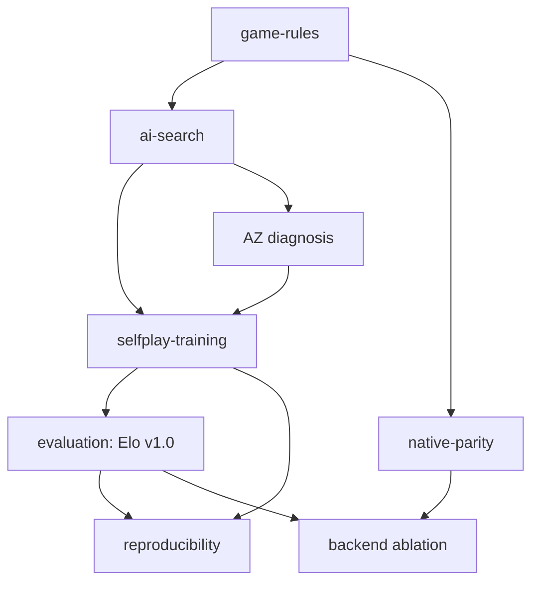

# Kế hoạch triển khai: Gomoku AlphaZero — lộ trình nghiên cứu theo SPEC

## Tổng quan

Kế hoạch này triển khai các yêu cầu nghiên cứu và cổng chất lượng trong [`../SPEC.md`](../SPEC.md), thay cho chuỗi 26 công việc tiền triển khai đã lỗi thời. Repository hiện có game engine, pipeline AlphaZero (AZ), tournament runner, classical players và một số C++ extension tùy chọn. Kết quả nghiên cứu hiện có là tiêu cực: báo cáo T35 trong repository ghi nhận Heuristic thắng AZ v0/AZ threat 100–0 ở các cặp Normal cố định và thắng AZ Renju 100–0 ở cặp Renju được báo cáo. Mục tiêu trước mắt là chẩn đoán và đo chất lượng theo protocol đăng ký trước; không mặc định rằng tăng số ván sẽ cải thiện mô hình.

**Trạng thái:** Verified = có bằng chứng từ source và test/báo cáo liên quan; Implemented / Unverified = có code nhưng chưa đủ bằng chứng đạt tiêu chí; Planned = chưa triển khai; Unknown = chưa có đủ thông tin. Báo cáo cũ không phải kết quả kiểm thử mới. Không chạy tác vụ tốn tài nguyên nếu chưa được cho phép rõ ràng.

## Hiện trạng cần bảo toàn

- `gomoku/`: Board 11×11, luật Normal/Renju, features và patterns; có tests cho luật. Việc tương đương với bộ luật Renju quốc tế vẫn Unknown.
- `az/`: AZNet, Python MCTS, self-play, replay buffer, trainer, checkpoint/resume và game logs đã có. Báo cáo lịch sử ghi nhận 1.000 ván self-play Normal và 500 ván fine-tune Renju; các con số này không chứng minh sức chơi tăng.
- `scripts/tournament.py`: round-robin có đổi màu theo cặp, seeds/openings, raw game records, checkpoint hashes, resume/shard merge và thống kê WDL/score/Wilson. Elo leaderboard v1.0 còn Planned; pairwise Davidson gate cho promotion đã Implemented / Unverified.
- `native/`: C++17 MCTS tree và pattern extension tùy chọn qua pybind11. Python là backend mặc định. Bằng chứng parity/smoke hiện còn hạn chế; không kết luận C++ tốt hơn chỉ từ tốc độ.
- Kế hoạch cũ `normal_5000.yaml`/`az_v0b` đã bị supersede. `configs/normal.yaml` hiện cấu hình một lineage `az_v0` liên tục; target iterations không phải bằng chứng về số ván đã chạy.
- Thay đổi worktree, logs và checkpoints hiện có thuộc về người dùng. Khi lập kế hoạch, không xóa, ghi đè hoặc sinh lại artifacts.

## Kiến trúc và thứ tự phụ thuộc

Giữ nguyên ranh giới module và chiều phụ thuộc đã thống nhất. `native-parity` và `selfplay-training` là hai nhánh riêng sau khi hoàn tất điều kiện tiên quyết; evaluation chỉ dùng checkpoints và game logs đáng tin cậy. Tournament/raw-log hiện tại có thể hỗ trợ chẩn đoán ban đầu trong lúc xây Elo analysis; tuyên bố chính thức phải dùng Elo v1.0.

## Các giai đoạn và mã công việc

Tiêu chí nghiệm thu, cách kiểm chứng, phụ thuộc và phạm vi file của từng task nằm trong [`todo.md`](todo.md).

### Giai đoạn 0 — Thiết lập baseline đáng tin cậy
- **P1** Chốt protocol Elo v1.0: Heuristic code/config identity, Python backends, AZ search 200 simulations cố định, bàn trống và seed scheme `paired-crc32`; rà soát T35 lịch sử và ghi metadata thiếu là Unknown.
- **P2** Kiểm chứng hợp đồng luật Normal/Renju và tính đúng của MCTS bằng tests/diagnostic fixtures tập trung.
- **P4** Xác định/kiểm chứng manifest, seed streams và lineage bất biến của checkpoint trước khi huấn luyện mới.

### Cổng A — Tính toàn vẹn baseline
- Đối chiếu dữ liệu T35 với raw games và manifests hiện có; báo cáo sai khác, không sửa đè logs gốc.
- Đóng băng protocol (phiên bản Heuristic, ruleset, cách sinh opening/seed, evaluation settings) hoặc ghi rõ Unknown.

### Giai đoạn 1 — Chẩn đoán chất lượng AZ
- **P3** Phân tích các trận thua: kiểm tra MCTS với budget cố định 200 mỗi lần search, legal masks/backup, policy/value outputs, self-play targets và điểm yếu chiến thuật; tactical override có thể bypass search nhưng không đổi budget.

### Cổng B — Bằng chứng chẩn đoán
- Mỗi nguyên nhân được khẳng định phải gắn với game/position ID có thể tái lập, checkpoint hash, đối chứng cô lập và metric.
- Giữ Unknown nếu chưa có bằng chứng cô lập; loss curve không đủ chứng minh nguyên nhân hay cải thiện.

### Giai đoạn 2 — Nền tảng backend và evaluation
- **P5** Mở rộng kiểm thử sai khác Python/C++, self-play đa seed và vòng đời worker; chưa coi C++ là backend nghiên cứu được hỗ trợ cho đến khi qua các cổng.
- **P6** Triển khai Elo Evaluation Protocol v1.0 và tests: Bradley–Terry/Davidson có mốc tham chiếu, bootstrap CI theo cặp opening, leaderboard Elo tuần tự K=16.

### Cổng C — Sẵn sàng đánh giá
- Synthetic Elo tests và tái dựng từ raw logs phải đạt; rating pool Normal/Renju tách riêng.
- **P7** Thẩm định screening 100 ván/cặp; xem xét power/cluster variance và mức phù hợp của protocol trước so sánh chính 400 ván.

### Giai đoạn 3 — Đo chất lượng và lộ trình huấn luyện
- **P8** Chạy screening 100 ván/cặp và đánh giá chính 400 ván/cặp với Heuristic/champion đã đóng băng, chỉ sau khi được cho phép; chỉ mở rộng theo từng tranche 200 ván đã đăng ký trước, tối đa 800.
- **P9** Đánh giá lại checkpoint Normal lịch sử tại mốc 1.000 ván.
- **P10** Huấn luyện/đánh giá tại mốc 2.500 ván nếu các cổng toàn vẹn và chất lượng cho phép.
- **P11/P12** Tiếp tục đến 5.000 và 10.000+ theo từng giai đoạn được cho phép riêng; đo Elo ở mỗi checkpoint bất biến.

### Cổng D — Quyết định dựa trên chất lượng
- Chỉ promote candidate khi cận dưới CI 95% ghép cặp của ΔElo so với champion lớn hơn 0.
- Chỉ xác nhận mục tiêu nghiên cứu khi ΔElo so với Heuristic > 0 và cận dưới CI 95% > 0. Mục tiêu mạnh còn yêu cầu ΔElo ≥ +100.
- Regression đã được xác nhận so với champion sẽ chặn recipe đó. Kết quả chưa kết luận tuân theo quy tắc mở rộng; nếu vẫn chưa kết luận ở 800 ván/cặp thì dừng để chẩn đoán.
- Số ván, throughput, fixed-batch loss hoặc training loss không phải điều kiện promote hay tăng quy mô.

### Giai đoạn 4 — Ablation và công bố có thể tái lập
- **P13** Chạy ablation có kiểm soát cho hyperparameters search/training (không đổi số MCTS simulations), kích thước mạng, quy mô self-play và backend. Mọi lần AZ MCTS search dùng cố định 200 simulations; mỗi contrast chỉ thay đổi yếu tố khác, tính đến compute và multiple comparisons.
- **P14** Tái dựng kết quả huấn luyện/tournament được chấp nhận từ manifests và raw logs; công bố giới hạn và learning curves không bịa hoặc nội suy kết quả.

## Các cổng nghiệm thu

1. Cổng tính đúng của luật, MCTS, self-play targets, replay và resume phải đạt trước thí nghiệm chất lượng.
2. Elo phải tái tạo được từ raw logs bất biến; mốc Heuristic = 1200; pool Normal/Renju riêng; báo cáo W/D/L, score, ΔElo, CI 95% và hiệu năng.
3. Mọi official evaluation của AZ dùng 200 MCTS simulations/move, temperature 0, tắt exploration noise; cố định SHA-256 checkpoint, seed/opening, ruleset và evaluation config đã resolve.
4. So sánh backend phải qua parity chính xác của trạng thái luật, tolerance số học được công bố và kiểm tra targets/outcomes trên nhiều seed ghép cặp trước khi tuyên bố chất lượng hoặc tốc độ.
5. Mỗi mốc huấn luyện có checkpoint lineage, số ván, optimizer steps, config, environment, Elo CI, compute và quyết định dừng/tiếp tục xác định trước.
6. Mỗi task có test tập trung hoặc cách kiểm tra thủ công an toàn. Huấn luyện dài, tournament, soak, chạy GPU và thay đổi artifacts cần được cho phép rõ ràng.

## Rủi ro và biện pháp giảm thiểu

| Rủi ro | Tác động | Giảm thiểu |
|---|---|---|
| Báo cáo cũ thiếu code/init-seed/parent-checkpoint provenance | Không thể tái lập chính xác baseline cũ | Đối chiếu phần còn có; ghi rõ thiếu hụt; lập baseline mới có content hash |
| Heuristic/config khác nhau giữa các lần chạy | Elo so sánh sai lệch | Đóng băng implementation, config, luật và model identity trước screening |
| 400 ván hoặc phần mở rộng chưa đủ power | Kết luận “đạt” sai hoặc tốn tài nguyên | Pilot paired-cluster variance/power; đăng ký trước quy tắc mở rộng và kết quả inconclusive |
| Lỗi chiến thuật hoặc targets của AZ chi phối việc học | Tăng quy mô chỉ lặp lại chất lượng yếu | Chẩn đoán theo giai đoạn trước self-play quy mô lớn |
| C++ làm đổi search/data distribution | Regression chất lượng dù tốc độ tăng | Differential và paired target/arena gates; giữ Python mặc định cho đến khi đạt |
| RAM/GPU bất ổn trong run dài | Mất artifacts hoặc nghiên cứu dở dang | Chạy theo giai đoạn nhỏ, theo dõi RSS/VRAM, giữ checkpoints/logs bất biến; không tuyên bố soak 5k/10k nếu chưa có bằng chứng |
| Python 3.10 khác môi trường Python 3.12 dùng chung | Hành vi/build khó tái lập | Chọn và ghi canonical environment trước nghiên cứu confirmatory |

## Quyết định còn mở trước Elo chính thức

- Chốt implementation/config Heuristic và identity của dữ liệu/model Heuristic nếu có.
- Pilot xem lịch 100/400/600/800 ván ghép cặp có độ chính xác phù hợp không; chỉ đổi bằng protocol version mới trước main run.
- Kiểm chứng Davidson/color model fit, opening-pair bootstrap và độ liên thông rating pool bằng synthetic data và pilot.
- Chọn backend non-inferiority margin sau pilot, trước parity/quality evaluation confirmatory.
- Chốt Python/PyTorch/C++ toolchain chuẩn và nguồn luật Renju có thẩm quyền.

## Giới hạn

Tuân thủ `SPEC.md`: không sửa source code, hyperparameters, checkpoints hay logs trong phạm vi lập kế hoạch; không huấn luyện, benchmark hoặc chạy tournament nếu chưa được cho phép rõ ràng; không trình bày cổng dự kiến như đã đạt.
